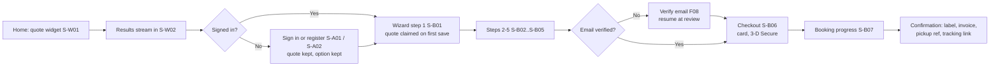
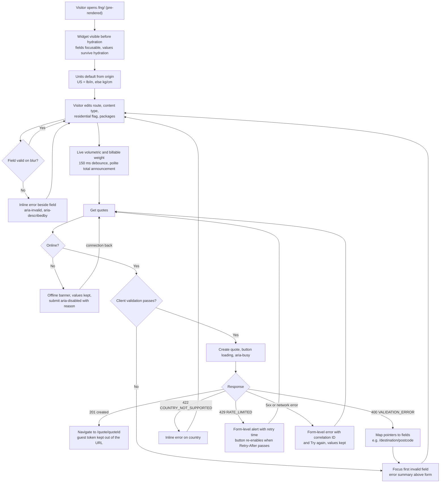
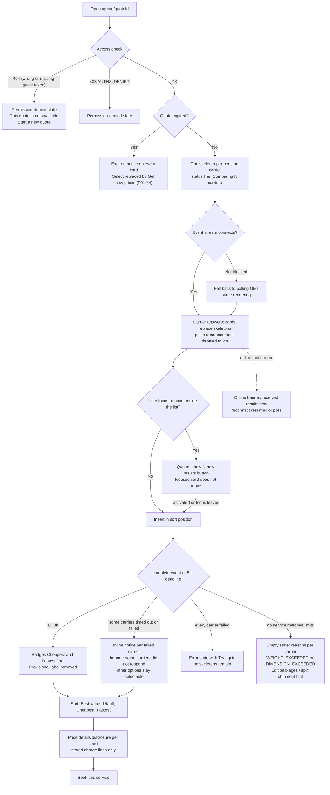
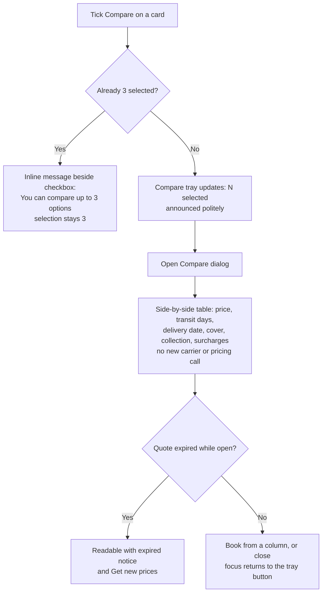
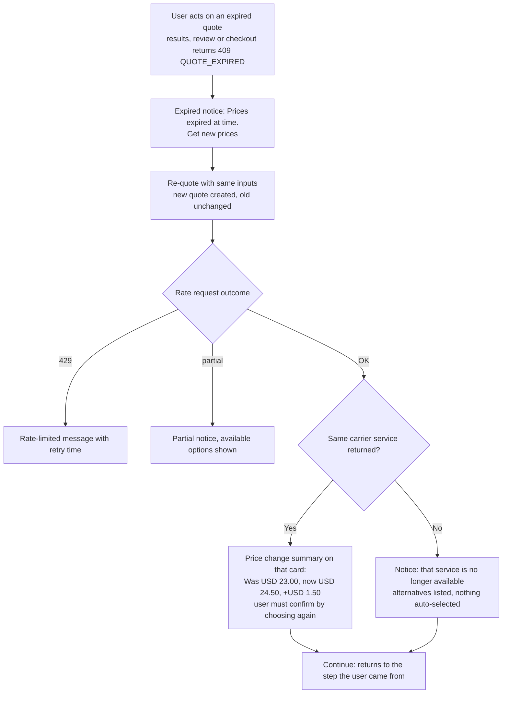
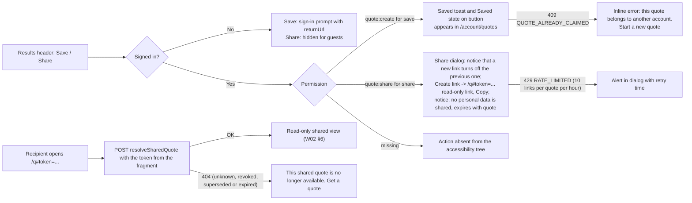

# F01 — Guest quote → results → compare → choose a service

Stories: **US-109, US-155, US-156, US-157, US-158, US-159, US-160, US-161, US-166, US-167, US-168** (Must) · US-162, US-163, US-164, US-165, US-169 (Should) · Screens S-W01, S-W02 · Exit demo PRD §6.2 (first half)

## 0. End-to-end overview of the M1 demo journey (F01 → F02 → F03)

Detailed flows: this file (quote and results), [F02](F02-auth-gate-and-wizard.md) (gate and wizard), [F03](F03-checkout-3ds-confirmation.md) (checkout, 3DS, progress, confirmation).

## 1. Get a quote (home widget)

Notes
- **No JavaScript:** a `<noscript>` message inside the widget explains that getting prices needs JavaScript. The form is still visible and readable (US-158).
- **Rate-relevant fields** are country, postcode or city, content type, residential flag, package weight and dimensions. They exist only here and in wizard step 1 (US-168).

## 2. Results stream, sort, breakdown

## 3. Compare up to three options (Should, US-163)

## 4. Expired quote and one-action re-quote (US-167) and rate-relevant change (US-168)

When a rate-relevant field changes in wizard step 1 (postcode, residential flag), see [F02 §3](F02-auth-gate-and-wizard.md#3-rate-relevant-change-inside-the-wizard-us-168).

## 5. Save and share (Should, US-164, US-165)

## 6. Error, empty, loading, offline and permission paths (summary)

| Condition | Where | Result |
|---|---|---|
| Loading | Results | Skeleton cards (one per pending carrier) after 150 ms. Status line "Comparing 4 carriers…" plus "2 of 4 responded". |
| Empty (no service fits) | Results | Empty state with per-carrier reasons and "Edit packages" |
| Filters hide everything (Should) | Results | Empty state "No options match your filters ({hidden} hidden)" with "Reset filters" |
| Error (all carriers fail, 5xx) | Results | Error state, "Try again" (new rate request on the same quote if not expired) and correlation ID |
| Partial | Results | Per-carrier inline notice plus a warning banner. Partial results remain bookable. |
| Permission-denied | Results | Wrong or missing guest token (404) or role without `quote:read` (403): no data, "Start a new quote" |
| Offline | Home, results | Offline banner. Values and received results kept. Submit and "Book" use `aria-disabled` with a reason. |
| Rate limited | Home submit, re-quote | Form-level alert with the retry time (`Retry-After`) |
