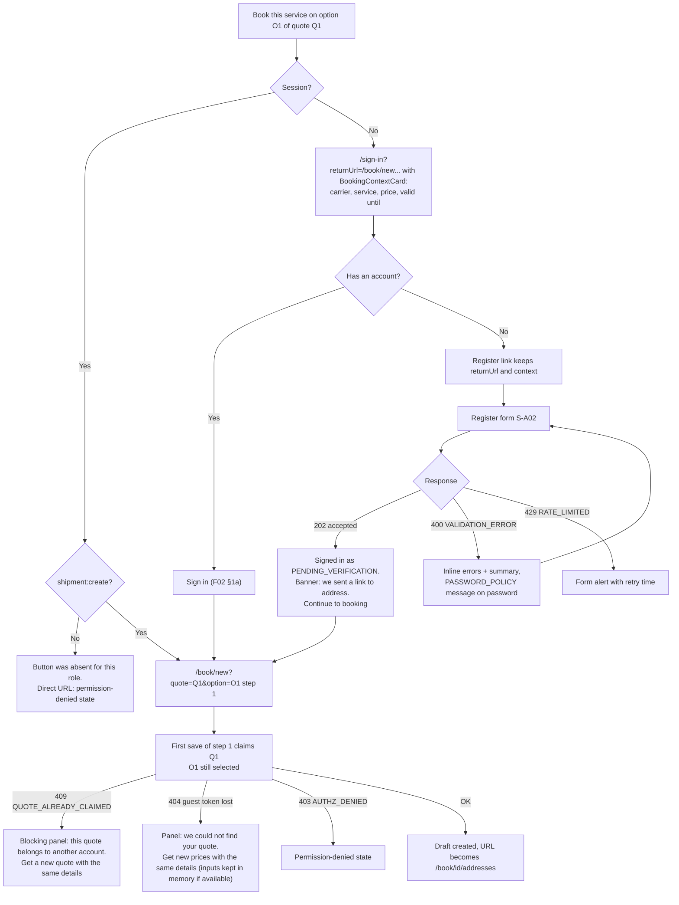
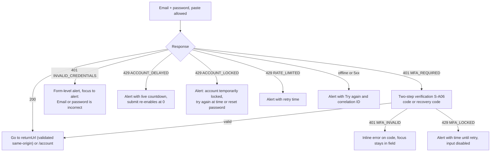
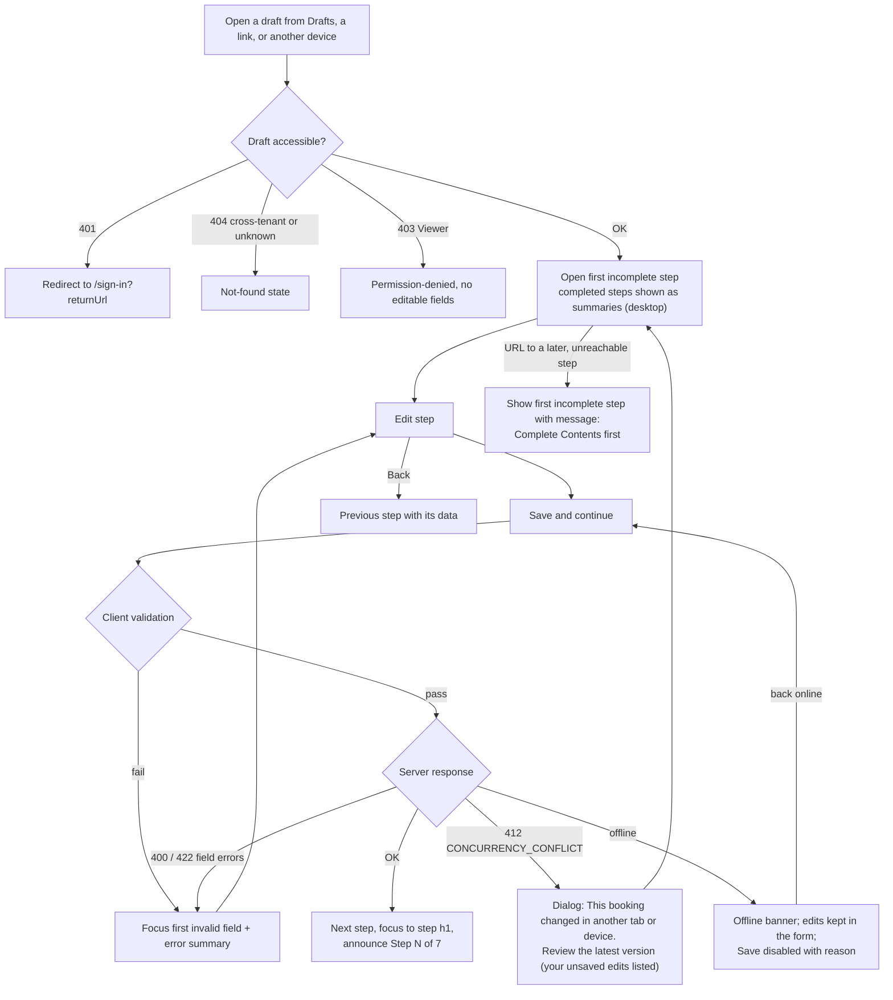
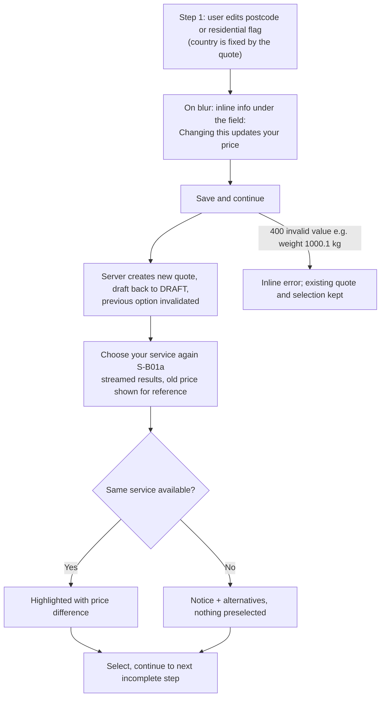
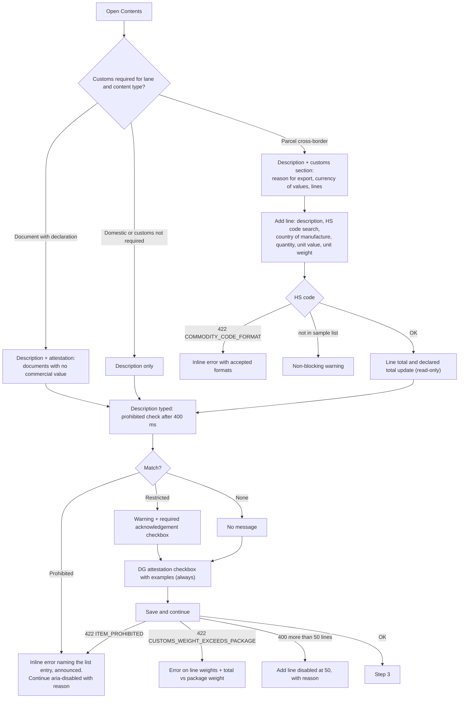
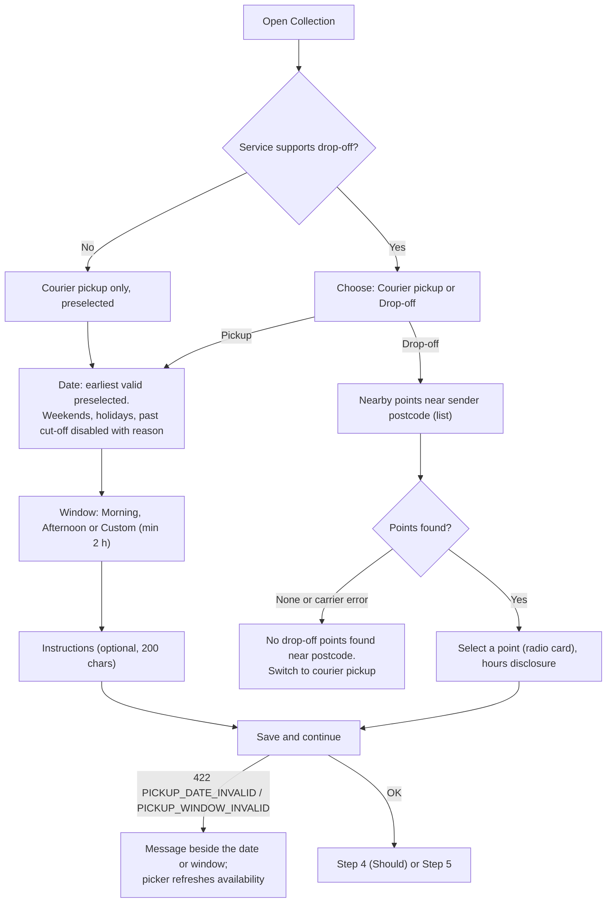
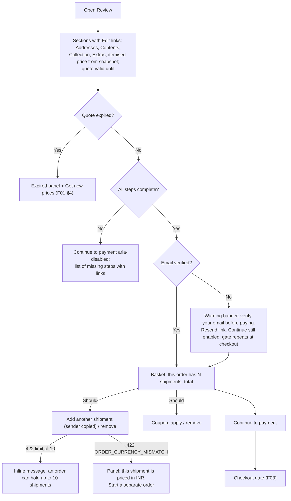

# F02 — Sign-in gate, quote claim and booking wizard (steps 1–5)

Stories: **US-015, US-017, US-020, US-166, US-171, US-172, US-174, US-175, US-176, US-177, US-180, US-181, US-182, US-183, US-184, US-189, US-191, US-192, US-232, US-233, US-234, US-168, US-167, US-119** (Must) · US-178, US-179, US-185, US-190, US-193, US-194, US-239 (Should) · Screens S-A01, S-A02, S-B01..S-B05

## 1. "Book this service" gate (D-009, US-171)

Registration for an existing email returns the same 202 response (US-015). The UI therefore always says "Check your inbox". It never says "account exists". The user can still continue to the wizard only if a session was issued. The flow assumes the API signs the user in on registration. **Open item for principal-architect:** if registration does not create a session, the screen after registration must route to sign-in with the same `returnUrl` and context, with no other UX change.

### 1a. Sign in (customer)

## 2. Wizard step navigation and resume (US-172, US-174)

Autosave (Should, US-179) adds a background save after 1 s idle with an indicator ("Saving…", "Saved at 14:02", "Not saved"). Without it, saving happens only on "Save and continue". The offline edit queue exists only if US-179 is built.

## 3. Rate-relevant change inside the wizard (US-168)

Package weight and dimensions are edited from the review step ("Edit packages"). They open the same S-B01a flow.

## 4. Step 2: contents, customs, prohibited items, DG

## 5. Step 3: collection

Switching mode clears the other mode's data (US-189). When the user has entered pickup data, the switch asks "Switch to drop-off? Your pickup date and window will be cleared" with an AlertDialog.

## 6. Step 5: review and basket

## 7. Error, empty, loading, offline and permission paths (wizard summary)

| Condition | Result |
|---|---|
| Loading a step | Step skeleton (field-shaped blocks). Summary column skeleton. Stepper rendered immediately from the cached draft when available. |
| Empty | Not applicable to steps. The address-book picker shows "No saved addresses yet" with "Enter an address". Drop-off shows the no-points state. |
| Error loading a draft | Error state with Try again and correlation ID, inside the wizard shell |
| Partial | Price summary failed while the step loaded: the summary shows its own error with Try again, and the step stays usable. Address suggestions time out after 3 s, so the step is not blocked (US-178). |
| Permission-denied | Viewer or a role without `shipment:create`: permission-denied state, no editable fields (US-174). Address-book save without `address_book:manage`: the step saves, and an inline note says "Couldn't save to your address book: you don't have permission" (US-175). |
| Not found | Cross-tenant or unknown draft: not-found state (404 indistinguishable) |
| Offline | Banner. Entered data kept. "Save and continue" uses `aria-disabled` with the reason "You're offline". |
| Session expired mid-step | Silent refresh. If refresh fails, a dialog says "Your session ended. Sign in to continue. Your saved steps are kept." The user signs in, returns to the same step and unsaved field values are restored from memory when the tab survived (US-020). |
