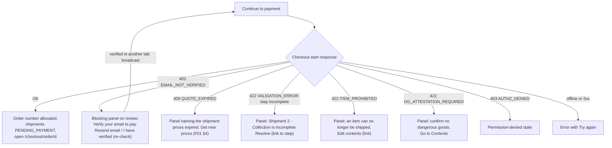
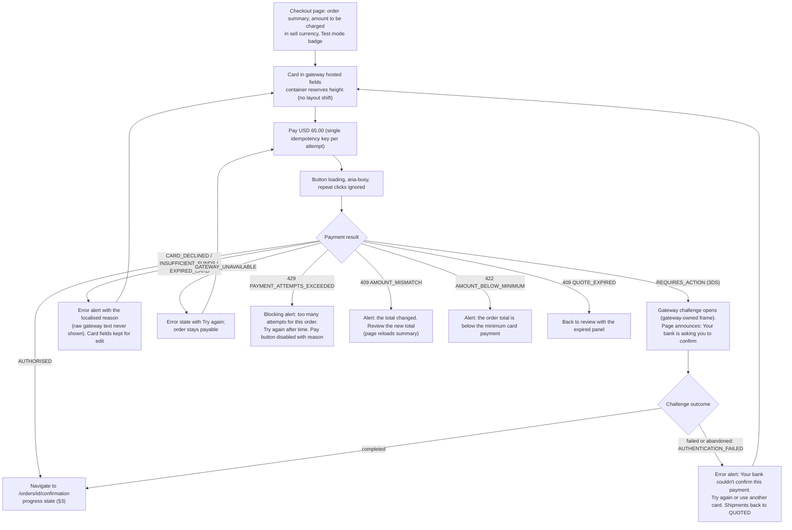
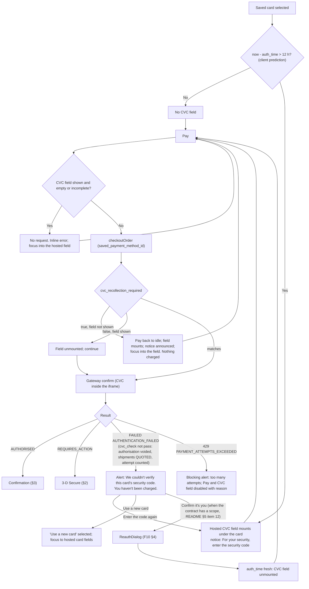
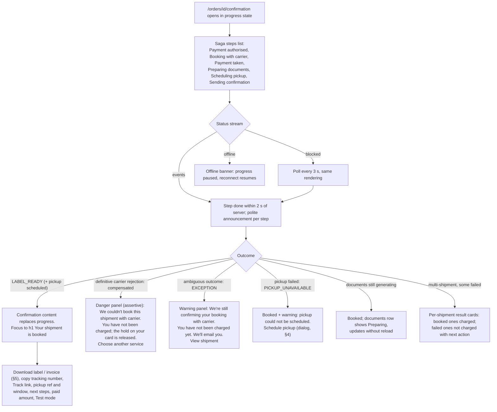
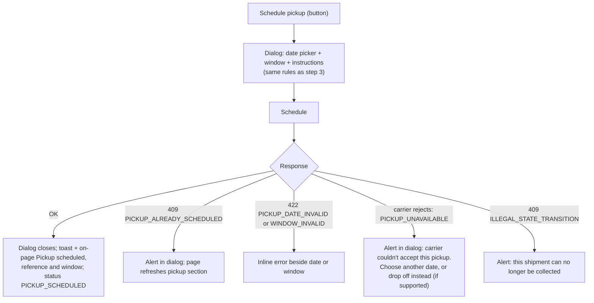
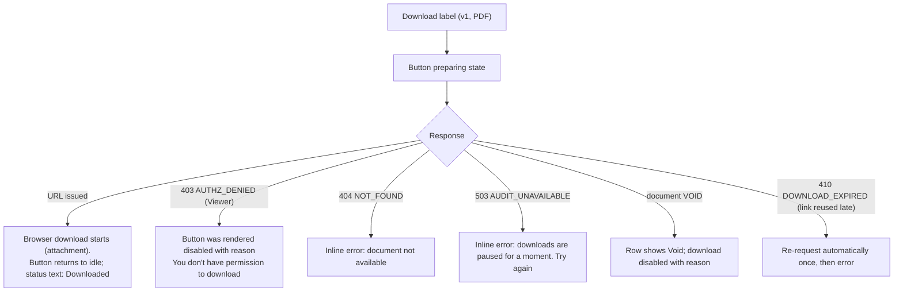

# F03 — Checkout (3-D Secure), booking progress and confirmation

Stories: **US-204, US-205, US-206, US-207, US-208, US-209, US-210, US-211, US-212, US-214, US-195, US-223, US-224, US-225, US-226, US-235, US-236** (Must) · US-217, US-218, US-228, US-188, US-239 (Should) · Screens S-B06, S-B07

## 1. Checkout gate (US-208)

Each blocking panel is an InlineAlert (danger) placed above "Continue to payment". On insertion, focus moves to the alert heading (`tabindex=-1`). It contains a single resolve action.

## 2. Pay with card, 3-D Secure and declines (US-209, US-211, US-212, US-214)

### 2a. Saved card with CVC re-collection (Should, US-217; W08 §5; SEC-P3-28)

Notes
- Only card is rendered (US-211). PayPal, wallet, credit account and payment links never appear in M1.
- Saved cards (Should, US-217) show as RadioCards above "Use a new card". A saved card that needs 3DS follows the same REQUIRES_ACTION branch. A saved card in a session verified more than 12 h ago follows §2a (CVC re-collection).
- If the session expires during checkout, the gateway challenge result is preserved by the gateway. On return after sign-in, the page re-reads the payment status before offering "Pay" again, so the user is never charged twice (idempotency key per attempt).

## 3. Booking progress (US-207) → confirmation (US-195)

## 4. Schedule pickup after booking (US-236; also from shipment detail)

## 5. Document download (US-224, US-225, US-226)

## 6. State summary

| State | Checkout (S-B06) | Progress and confirmation (S-B07) |
|---|---|---|
| Loading | Summary and payment area skeletons. The payment area reserves its height. | Saga list renders immediately with all steps "Pending". Document rows are skeletons. |
| Empty | Not applicable (no order means not found) | Documents "Documents are being prepared" (US-224) |
| Error | Gateway or 5xx: error state with Try again. Declines show an inline alert. | Stream and poll failure: error panel with Try again and correlation ID. Booking failure panel. |
| Partial | Saved methods failed to load: "Use a new card" still shown, with a notice | Multi-shipment partial booking; pickup failed; documents pending |
| Permission-denied | Viewer: permission-denied (403). Another organisation: not found. | Without `shipment:read`: permission-denied. Another organisation: not found. |
| Offline | Banner; Pay disabled with reason | Banner; progress paused; resumes and re-syncs on reconnect |
