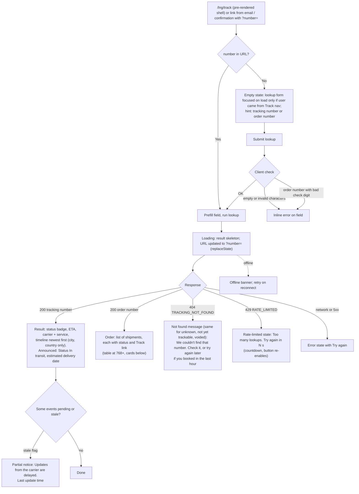

# F04 — Public tracking

Stories: **US-247, US-248, US-249, US-112** (Must) · US-250 (Should) · Screen S-W03

The Should variant (US-250, customer reference plus receiver postcode) adds a second tab of the lookup form: "Use your reference". It has two fields (reference, postcode). Its responses are identical to the not-found branch on a mismatch.

| State | Rendering |
|---|---|
| Loading | Result card skeleton (status line, 4 timeline rows) |
| Empty | No search yet: form plus a short explanation of where to find the number |
| Error | Network or 5xx: error state with Try again and correlation ID |
| Partial | Stale or pending events notice; the timeline is shown |
| Permission-denied | Rate limited (429): explicit state with countdown (US-248 maps this to permission-denied) |
| Offline | Banner; the last result stays visible |
| Not found | Neutral message; the input is kept for correction |

Privacy: no names, streets, postcodes, phone numbers, emails, references, contents, prices, carrier free text or facility names are ever displayed (DR-B31). Event location renders as "City, CC" or "CC" only (US-248).
