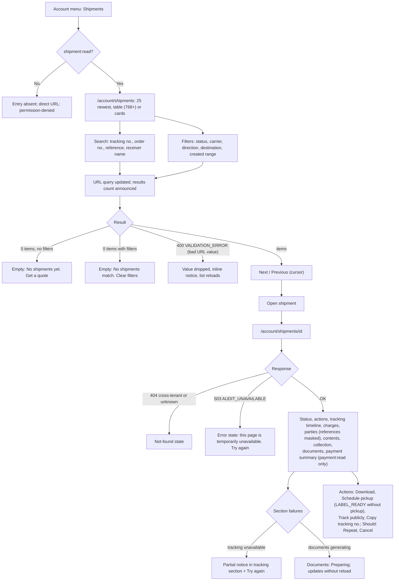
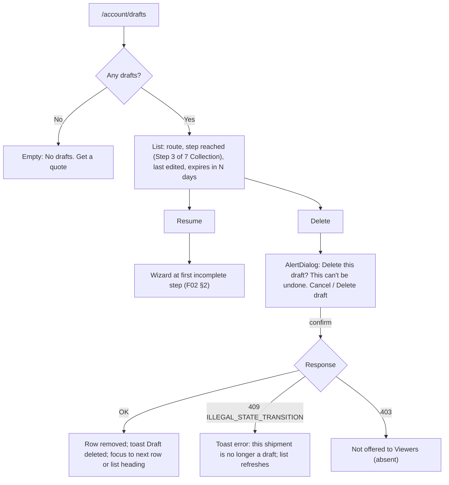
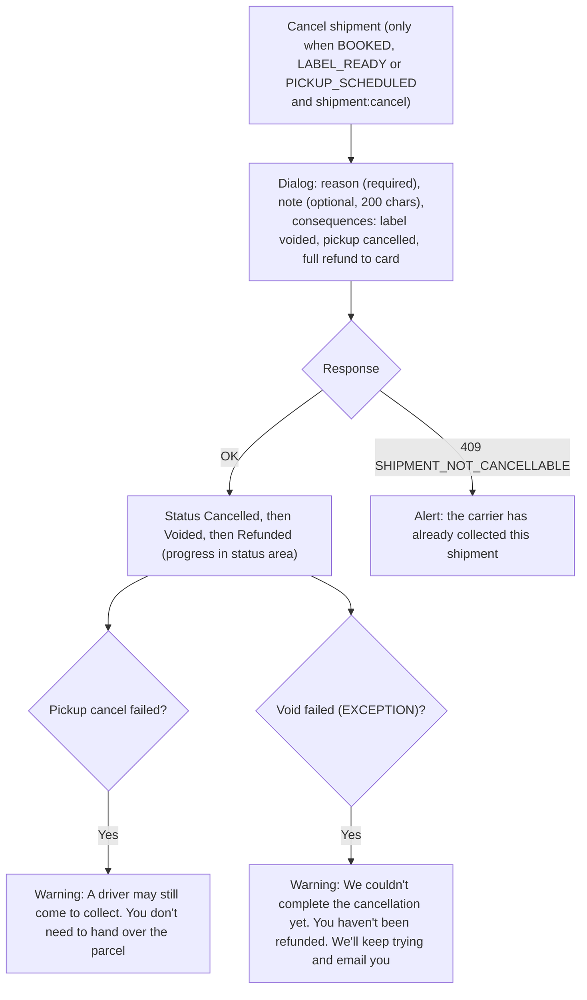
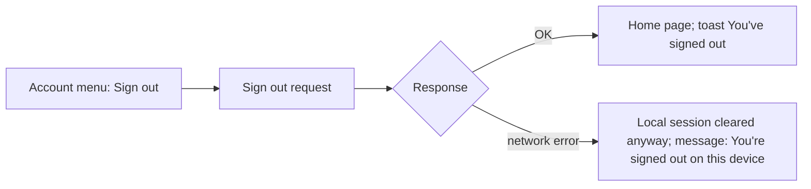
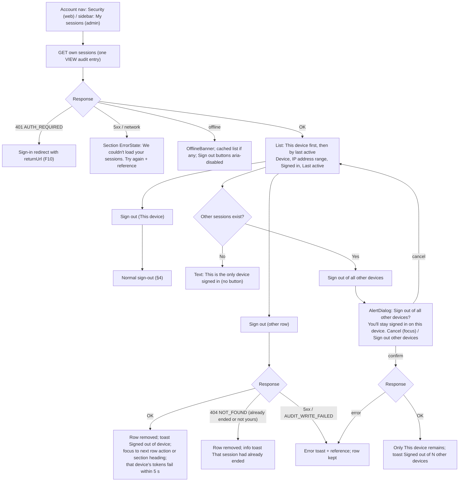

# F05 — Customer account: shipments, detail, drafts, sign-out

Stories: **US-254, US-255, US-256, US-257, US-251, US-224, US-236, US-019, US-070, US-027** (Must; US-027 since D-047) · US-258, US-261/US-196, US-260, US-267 (Should) · Screens S-C01..S-C04, S-C07 (sessions section), S-D08

## 1. Find and open a shipment

## 2. Drafts: resume and delete (US-256)

## 3. Cancel a shipment (Should, US-261/US-196; Must parts: US-237 notices)

## 4. Sign out (US-019) and session end

## 5. Where you're signed in: list and remote sign-out (US-027 Must; web S-C07 and admin S-D08; W13 §1, W16 §4)

No re-authentication is needed for listing or remote sign-out. A device that was signed out remotely sees the signed-out notice on its next request (F10 §1).
