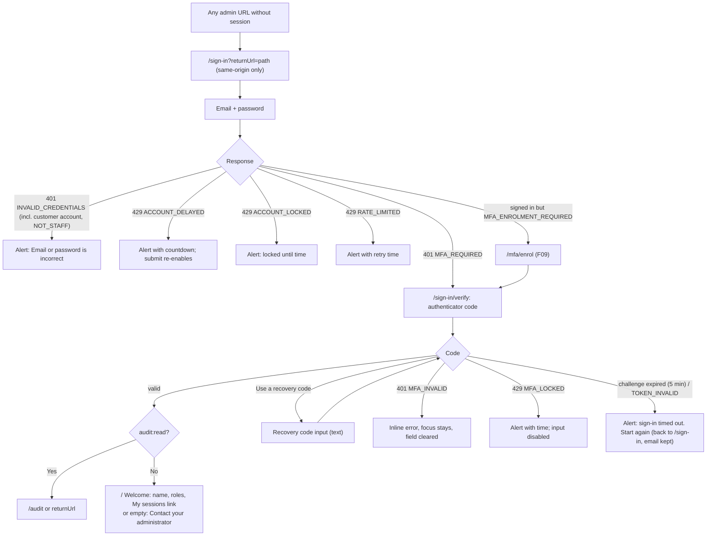
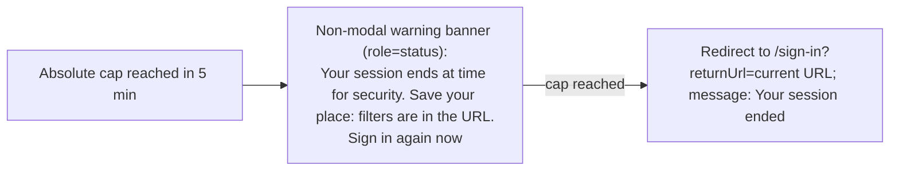
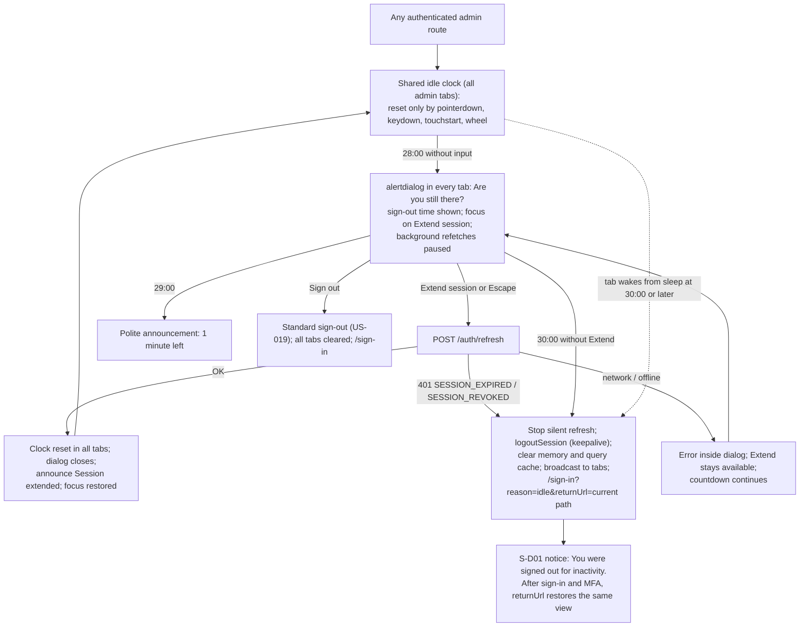

# F06 — Staff sign-in with TOTP → audit viewer

Stories: **US-017, US-022, US-023, US-024, US-025, US-030, US-031, US-032, US-097, US-098, US-093, US-110, US-070, US-027** (Must; S-D08 flow in F05 §5) · US-099, US-033 (Should) · Screens S-D01..S-D08 · Exit demo PRD §6.1

## 1. Staff sign-in



## 2. Audit viewer

```mermaid
flowchart TD
  D0["/audit"] --> E1{"audit:read?"}
  E1 -->|No| E2["Permission-denied in shell, no request made; no Audit entry in sidebar"]
  E1 -->|Yes| E3["Default: last 24 h, newest first, 50 per page<br/>chain verification chip: Verified at time / Broken at entry / Not yet verified"]
  E3 --> E4["Filter bar: date range, user, role, organisation, entity, entity ID, action, IP, outcome"]
  E4 --> E5["Apply: URL query updated, results count announced"]
  E5 --> E6{"Response"}
  E6 -->|"400 RANGE_TOO_LARGE"| E7["Inline error on date range (max 31 days)"]
  E6 -->|"400 INVALID_CURSOR"| E8["Notice: page link expired; restart from first page"]
  E6 -->|"503 AUDIT_UNAVAILABLE"| E9["Error state: audit log temporarily unavailable (fail-closed)"]
  E6 -->|"0 rows"| E10["Empty: No entries match. Clear filters (resets to 24 h)"]
  E6 -->|rows| E11["Table (768+) / cards; Next and Previous"]
  E11 --> E12["Open entry: /audit/entries/id"]
  E11 -.xl Should.-> E13["Preview in side panel; Open full entry"]
  E12 --> F0["Entry detail: all fields, diff (side by side at 1024+, stacked below),<br/>REDACTED markers, previous and entry hashes; read-only"]
  F0 --> F1["View history of this record: /audit/entities/entity/id"]
  F1 --> F2{"Entries?"}
  F2 -->|No| F3["Empty: no history for this record"]
  F2 -->|Yes| F4["Oldest to newest; links to each entry"]
  D0 -.URL with invalid filter e.g. from=not-a-date.-> G0["Value ignored with inline notice; no request uses it"]
```

## 3. Staff session limits (US-033 Should; WCAG 2.2.1)



## 4. Idle timeout (US-033 Should; REQ-ADMIN-004; ADR-0026 am. 8; W00 §2.1)



Server side, the 30-minute sliding admin refresh TTL (ADR-0006 am. 13) ends the session even if the tab is suspended or its script is blocked; the client path above is the user-facing half.
