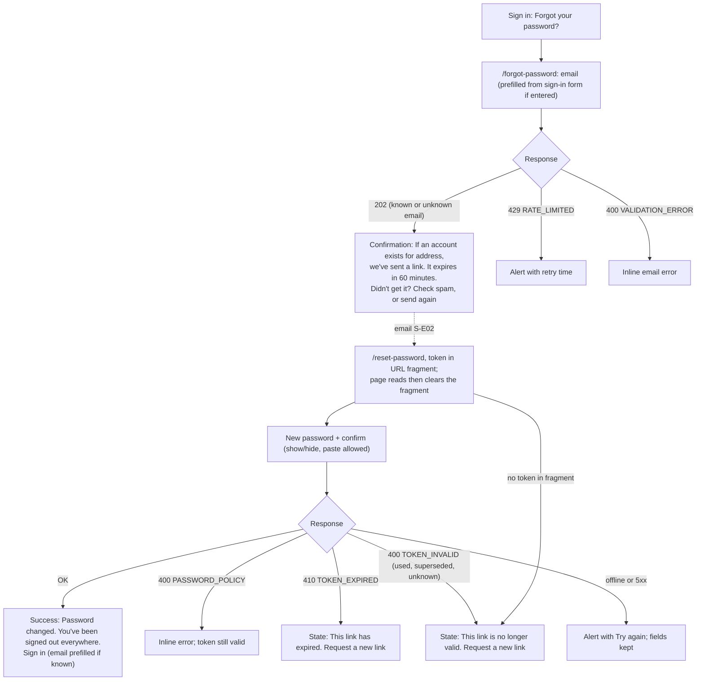

# F07 — Password reset (customer and staff)

Stories: **US-021, US-022, US-282** (Must) · Screens S-A04, S-A05, email S-E02 · The staff app uses the same pages under its own origin (a link on S-D01).

| State | Rendering |
|---|---|
| Loading | Submit button loading; no skeleton (static form) |
| Empty | Not applicable |
| Error | Form-level alert with Try again and correlation ID |
| Partial | Not applicable |
| Permission-denied | Not applicable (pre-authentication). Expired and invalid links have explicit states. |
| Offline | Banner; submit disabled with reason |
