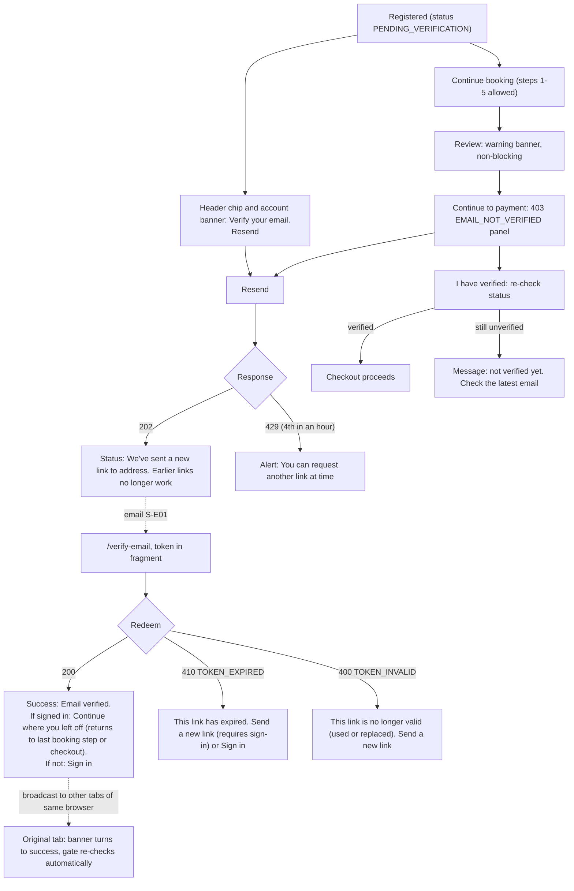

# F08 — Email verification

Stories: **US-015, US-016, US-208, US-282** (Must) · Screens S-A02, S-A03, S-B05/S-B06 gate, email S-E01 · Decision D-UX-024 (cross-tab detection)

Cross-tab detection: when verification succeeds in another tab of the same browser, a same-origin `BroadcastChannel` message (no token, only "verified") makes the waiting tab re-fetch the user's status (D-UX-024). When verification happens on another device, the "I have verified" action re-checks.

| State | Rendering |
|---|---|
| Loading | Token redemption: an "Verifying your email…" status with a skeleton line (no spinner) |
| Empty | Opening `/verify-email` without a token while signed in: "Check your inbox" panel with Resend. Signed out: Sign in. |
| Error | 5xx: error with Try again |
| Partial | Not applicable |
| Permission-denied | Resend without a session prompts sign-in |
| Offline | Banner; actions disabled with reason |
