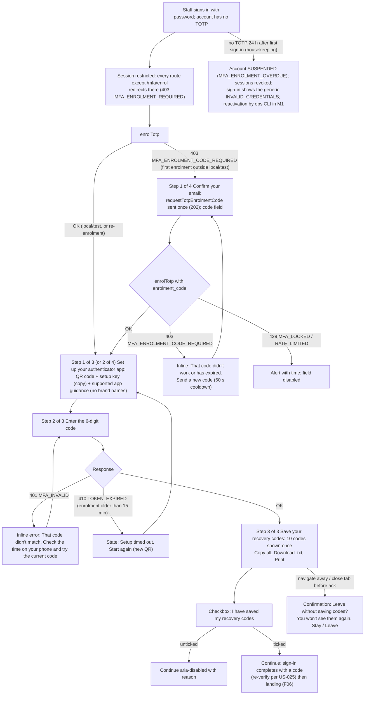
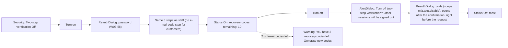

# F09 — MFA (TOTP) enrolment and recovery codes

Stories: **US-023, US-025, US-031** (Must, staff) · US-026, US-267 (Should, customer optional MFA and settings) · Screens S-D03 (admin), S-C07 (customer, Should)

## 1. Mandatory staff enrolment (first sign-in)

## 2. Customer optional MFA (Should, US-026, US-267)

| State | Rendering |
|---|---|
| Loading | QR placeholder box of fixed size (no layout shift) with text "Preparing your setup code" |
| Empty | Not applicable |
| Error | Enrolment start fails: error with Try again and correlation ID |
| Partial | QR image fails to render: the setup key is still shown, with the text "Enter this key manually" |
| Permission-denied | Not applicable (own account). A staff "turn off" attempt is not offered (US-026: staff cannot disable). |
| Offline | Banner; code submit disabled with reason. Codes already shown stay visible. |
