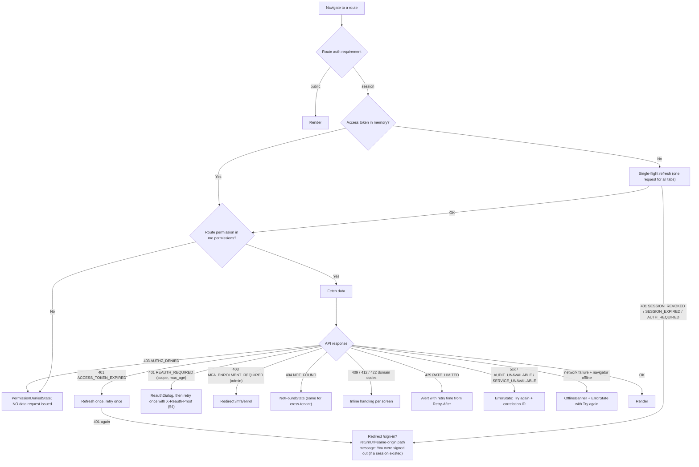
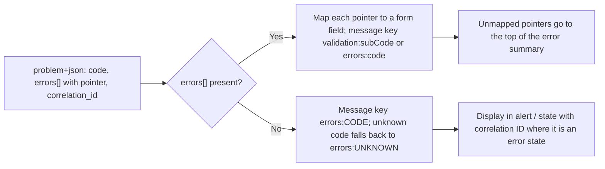
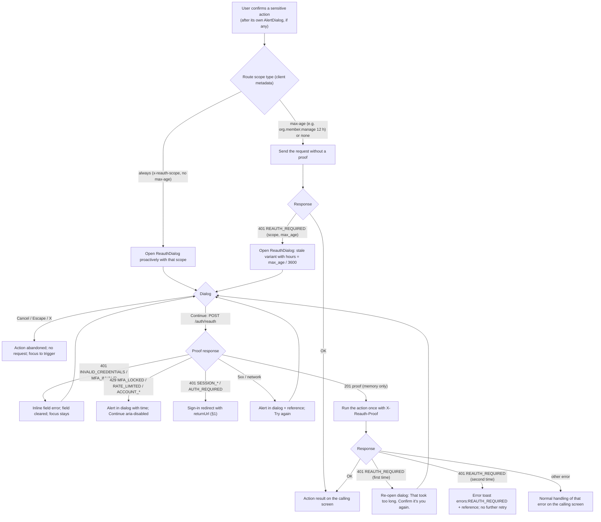

# F10 — Route guards, token refresh, permission denial and global error handling

Stories: **US-020, US-030, US-070, US-104, US-105, US-106, US-036, US-040, US-069, US-257, US-291** (Must) · Both apps

## 1. Guarded route resolution (both apps)

## 2. Unsafe action blocked in the UI but reached anyway (US-070)

When a control was hidden by permission but triggered anyway (tampered UI), the server answers 403 `AUTHZ_DENIED`. The UI shows an error toast (`role="alert"`) with "You don't have permission to do that" plus the correlation ID. No partial UI update is applied.

## 3. Error message resolution (US-036, US-115)

The raw API `detail` text (English) is never shown to users. Only localised `errors:<CODE>` and `validation:<SUB_CODE>` keys are shown (US-115).

## 4. Re-authentication for sensitive actions (US-291; ADR-0006 am. 12; W03 §8; D-UX-031)

- One dialog at a time per app; a second scoped action while the dialog is open waits.
- The proof is never stored, logged or put in a URL, and each proof is used for exactly one request (single-use).
- A successful re-authentication advances `auth_time` on the next token (ADR-0006 am. 12), so age-based scopes and saved-card checkout need no further prompt for 12 hours.
