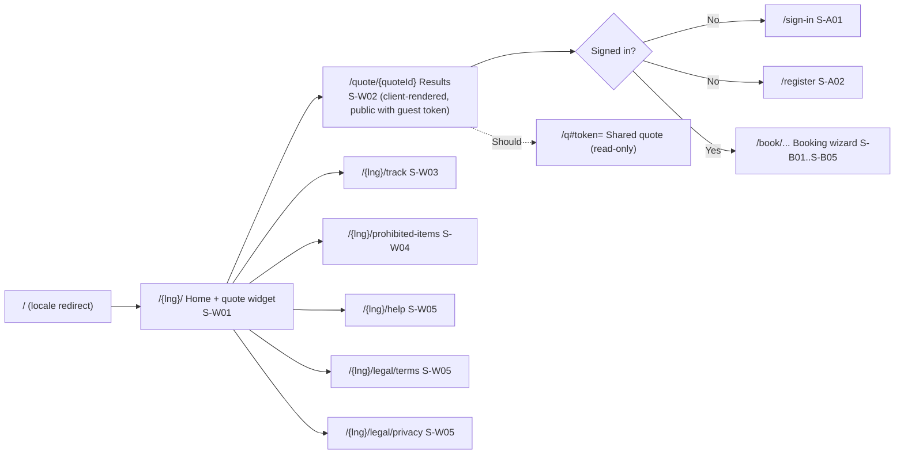
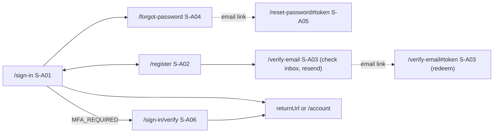
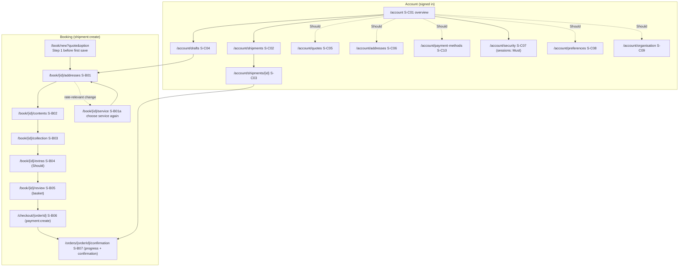
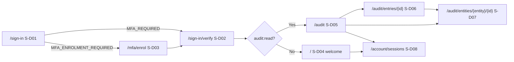

# Information architecture

Version 1.0 · 2026-11-12 · owner ux-designer · scope M0 + M1 (customer web app) + D-008 admin slice

The route **paths** are UX decisions: what the user sees in the address bar, what is bookmarkable and what is pre-rendered. Route **components, loaders and API endpoints** are for principal-architect. Permission strings below are the ones named in the stories. principal-architect owns the catalogue (`packages/authz`) and may rename them, and this table must then be updated.

## 1. URL and locale strategy (D-UX-005)

| Rule | Detail |
|---|---|
| Pre-rendered public pages are locale-prefixed | `/en/…`, `/es/…`, `/fr/…`. One static HTML file per page per locale (US-112: 6 pages × 3 locales). Each has a unique `<title>`, meta description, canonical URL and `hreflang` alternates (en, es, fr, x-default → en). |
| `/` (root) | Resolves to a locale page. It redirects (302) to `/{locale}/`, choosing the locale cookie first, then the `Accept-Language` best match, then `en` (DR-A18). The mechanism (Nginx or edge) is principal-architect's choice. With JavaScript disabled, `/en/` must still be reachable. |
| Client-rendered app routes are not prefixed | `/quote/…`, `/book/…`, `/checkout/…`, `/orders/…`, `/account/…`, `/sign-in`, `/register`. The locale comes from the profile, cookie or `Accept-Language` (DR-A18), so authenticated URLs stay stable when the user changes language. This matches the story examples (`/account/shipments`, `/sign-in?returnUrl=`). |
| Switching locale on a public page | Navigates to the same page under the new prefix and sets the cookie (US-112 "Locale precedence"). |
| Switching locale in the app | Re-renders in place, persists to the profile (signed in) or cookie (guest) and keeps the URL. |
| Return URLs | `returnUrl` holds same-origin relative paths only. It is validated on read, and anything else is dropped (US-020, US-030). |
| Secrets never in URLs | Guest quote tokens, share tokens (beyond the share link itself), access tokens, MFA challenge tokens and email-link tokens. Email links put the token in the **fragment** (`#token=…`). The page reads it, then clears it with `history.replaceState` (D-UX-009). principal-architect confirms the link format with the notification templates. |
| Query state | Filters, sort, pagination cursor and the audit filter set live in the query string, so views are bookmarkable and reload-safe (US-097, US-162, US-254). Invalid values are dropped with an inline notice (US-032). |
| Tracking result | `/{lng}/track?number={value}` keeps one pre-rendered shell per locale. Responses carrying `number` must also send `X-Robots-Tag: noindex` (US-247). That is a header rule for principal-architect. |

## 2. Sitemaps

### 2.1 Customer web app: public (pre-rendered, no sign-in)

### 2.2 Customer web app: authentication

### 2.3 Customer web app: booking and account (client-rendered, signed in)

### 2.4 Admin app (D-008 slice only; client-rendered, `noindex`)

No navigation, route or placeholder exists for orders, customers, carriers, pricing, finance, reports or settings. Their paths fall through to the not-found state (US-032, US-110). The same rule applies in the web account area for invoices, credit notes, wallet, claims and support tickets (US-273).

## 3. Navigation model

| Surface | Region | Entries (all filtered by permission and by what is implemented, US-070) |
|---|---|---|
| Web header (≥ 768 px) | Primary nav | Get a quote (→ `/{lng}/#quote`), Track, Prohibited items, Help |
| Web header | Utilities | Locale switcher, currency switcher (Should), environment chip (non-production), "Sign in" link or account menu |
| Web header (< 768 px) | Menu drawer | Same primary nav entries, then the switchers, then the account section |
| Account menu (signed in) | DropdownMenu | Overview, Shipments, Drafts, Security (Must from M1, US-027), (Should: Saved quotes, Address book, Payment methods, Preferences, Organisation), Theme, Sign out |
| Account area | AccountNav (side ≥ 1024 / dropdown < 1024) | Same as the account menu minus Theme and Sign out |
| Web footer | Footer nav | Help, Prohibited items, Terms, Privacy, Cookie settings (Should), Language, Theme |
| Admin sidebar | Nav | Audit log (`audit:read`) · My sessions |
| Admin header | Utilities | Breadcrumbs, environment chip, locale, theme, user menu (name, roles, My sessions, Sign out) |

**Global entry points to booking:** the home widget, the "Book this service" button on results, "Resume" on drafts and "Repeat" on the shipment detail (Should, US-260). "Book shipment" buttons are absent from the accessibility tree for users without `shipment:create` (US-070).

## 4. Route inventory

Legend: **Auth**: `public` = no session needed; `guest-token` = public with a quote access token or a session with `quote:read`; `session` = any signed-in user; a permission name = that permission is required. **Pre-render**: Yes = static HTML per locale; No = client-rendered. Every route is a lazily loaded chunk (NFR-WEB-004) except the app shell.

### 4.1 Customer web app

| Route | Screen | Auth / permission | Pre-render | Stories (Must in bold) | Data the screen needs |
|---|---|---|---|---|---|
| `/` | locale redirect | public | n/a (server redirect) | **US-112, US-117** | locale cookie, Accept-Language |
| `/{lng}/` | S-W01 Home + quote widget | public | Yes | **US-109, US-112, US-156, US-157, US-158**, US-173 | enabled countries with postcode rules and unit systems, content types, envelope default size, volumetric divisor defaults (reference data; can be inlined at build time) |
| `/{lng}/track` (`?number=`) | S-W03 Public tracking | public (rate-limited) | Yes (shell) | **US-112, US-247, US-248, US-249** | public tracking view (status, events with city and country, carrier and service name, ETA; order → shipment list) |
| `/{lng}/prohibited-items` | S-W04 Prohibited items lookup | public (rate-limited) | Yes (shell) | **US-055, US-112**, US-170 | enabled destination countries; per-country entries (category, localised name, status, note, source, unreviewed flag) |
| `/{lng}/legal/terms`, `/{lng}/legal/privacy` | S-W05 Legal pages | public | Yes | **US-059, US-112** | compliance-pack legal text per locale (build time), review status |
| `/{lng}/help` | S-W05 Help placeholder | public | Yes | **US-112** | static i18n content |
| `/quote/{quoteId}` | S-W02 Results | guest-token or `quote:read` | No | **US-155, US-159, US-160, US-161, US-166, US-167, US-168**, US-162, US-163, US-164, US-165, US-169 | quote (inputs, expiry, state), streamed options (carrier, service, price lines, totals, ETA, transit days, collection modes, cover, cut-off, printer hint, exclusion reasons), per-carrier stream status |
| `/q#token=…` (Should; ADR-0016 am. 6a, D-UX-034) | S-W02s Shared quote | public (token posted to `resolveSharedQuote`) | No | US-165 | shared quote view (no personal data) |
| `/sign-in` | S-A01 Sign in | public | No | **US-017, US-020, US-022, US-171** | none (plus booking context when `returnUrl` is a booking route) |
| `/sign-in/verify` | S-A06 Two-step verification | challenge (in memory) | No | **US-024** | challenge token (in memory, never in the URL) |
| `/register` | S-A02 Register | public | No | **US-015, US-171** | current terms version, locale list |
| `/verify-email` (+ `#token`) | S-A03 Verify email | public (redeem) / session (resend) | No | **US-016**, US-208 | verification status from `me` |
| `/forgot-password` | S-A04 Forgot password | public | No | **US-021** | none |
| `/reset-password#token=…` | S-A05 Reset password | public (token) | No | **US-021** | none |
| `/book/new?quote=&option=` | S-B01 Step 1 (unsaved) | `shipment:create` | No | **US-171, US-166, US-174, US-175** | claimed or claimable quote + selected option, address book (if `address_book:read`), address formats for origin and destination, tax-reference requirements for the lane |
| `/book/{shipmentId}/addresses` | S-B01 Step 1 | `shipment:create` | No | **US-172, US-174, US-175, US-176, US-177, US-119**, US-178, US-179 | draft (ETag/version), same as above |
| `/book/{shipmentId}/service` | S-B01a Choose service again | `shipment:create` | No | **US-168, US-167** | new quote options (stream) |
| `/book/{shipmentId}/contents` | S-B02 Step 2 | `shipment:create` (+ `customs:manage` for lines) | No | **US-180, US-181, US-182, US-183, US-184**, US-185 | draft, customs applicability for the lane, reasons for export, Incoterms, prohibited and restricted list matches, HS search (sample), DG wording version |
| `/book/{shipmentId}/collection` | S-B03 Step 3 | `shipment:create` / `pickup:schedule` | No | **US-189, US-232, US-233, US-234**, US-239 | service collection modes, pickup rules (cut-off, lead time, windows, holidays, horizon, sender zone), service points (Should list) |
| `/book/{shipmentId}/extras` | S-B04 Step 4 (Should) | `shipment:create` | No | US-190 | cover terms, priced delivery options, reference rules |
| `/book/{shipmentId}/review` | S-B05 Step 5 + basket | `shipment:create` | No | **US-191, US-192, US-150, US-149**, US-193, US-194 | full draft, price snapshot, quote expiry, open order (shipments, currency, total), verification status |
| `/checkout/{orderId}` | S-B06 Checkout | `payment:create` | No | **US-208, US-209, US-211, US-212, US-214, US-210** | order summary (server-computed amount, sell currency), gateway mode (test or Mock), payment client configuration, saved methods (Should) |
| `/orders/{orderId}/confirmation` | S-B07 Progress + confirmation | `shipment:read` | No | **US-195, US-207, US-204, US-205, US-206, US-223, US-224, US-235, US-236**, US-239 | order, per-shipment saga step status (stream with polling fallback), tracking numbers, documents, pickup or drop-off details, paid amount, gateway mode |
| `/account` | S-C01 Overview | session | No | **US-108** (shell), US-258 | `me`, recent shipments, action items, spend (Should) |
| `/account/shipments` | S-C02 Shipments list | `shipment:read` | No | **US-254, US-257** | shipments page (cursor), filter facets (status, carrier, direction, country) |
| `/account/shipments/{id}` | S-C03 Shipment detail | `shipment:read` (+ `tracking:read`, `document:read`/`download`, `payment:read`, `pickup:schedule`) | No | **US-255, US-251, US-224, US-225, US-226, US-236, US-237, US-243, US-257, US-072, US-150**, US-260, US-261, US-196 | shipment with history, tracking events, charge snapshot, parties (masked references), contents, collection, documents, payment summary |
| `/account/drafts` | S-C04 Drafts | `shipment:read` (list) / `shipment:create` (resume, delete) | No | **US-256, US-257** | drafts (step reached, last edit, route) |
| `/account/quotes` (Should) | S-C05 Saved quotes | `quote:read` | No | US-259, US-164 | saved quotes |
| `/account/addresses` (Should) | S-C06 Address book | `address_book:read`/`manage` | No | US-262, US-263, US-264 | address book |
| `/account/payment-methods` (Should) | S-C10 Payment methods | per catalogue | No | US-265, US-217 | saved methods (gateway tokens, brand, last 4, expiry) |
| `/account/security` | S-C07 Security | session (own) | No | **US-027**, US-267, US-026, US-028 | own sessions (Must); MFA status, recovery code count (Should sections) |
| `/account/preferences` (Should) | S-C08 Preferences | session (own) | No | US-272, US-266 | locale, display currency, units, notification preferences |
| `/account/organisation` (Should) | S-C09 Organisation & team | per catalogue | No | US-268, US-269, US-082..085 | org profile, members, invitations |
| `/invitations/accept#token=` (Should) | S-C09a Accept invitation | public then session | No | US-084 | invitation |
| any other path | S-W06 Not found | public | No (served by the SPA fallback; the pre-rendered 404 is per locale) | **US-104, US-273** | none |

### 4.2 Admin app

| Route | Screen | Auth / permission | Pre-render | Stories (Must in bold) | Data the screen needs |
|---|---|---|---|---|---|
| `/sign-in` | S-D01 Staff sign-in | public | Never | **US-030, US-031, US-017, US-022** | none |
| `/sign-in/verify` | S-D02 Staff MFA challenge | challenge (in memory) | Never | **US-024, US-031** | challenge token |
| `/mfa/enrol` | S-D03 MFA enrolment | session restricted to enrolment (`MFA_ENROLMENT_REQUIRED`) | Never | **US-023, US-025, US-031** | provisioning URI or QR, manual key (once), recovery codes (once) |
| `/` | S-D04 Welcome (redirects to `/audit` when `audit:read`) | staff session | Never | **US-032, US-110** | `me` (name, role names, permissions) |
| `/audit` | S-D05 Audit list | `audit:read` | Never | **US-097, US-093, US-032, US-110**, US-111 | audit entries page (keyset), filter option lists (users, roles, organisations, entities, actions, outcomes), latest chain-verification result |
| `/audit/entries/{entryId}` | S-D06 Entry detail | `audit:read` | Never | **US-098, US-032** | full entry incl. diff, redaction markers, hashes |
| `/audit/entities/{entity}/{entityId}` | S-D07 Entity history | `audit:read` | Never | **US-032** (route), US-099 | entity's entries (oldest first) |
| `/account/sessions` | S-D08 My sessions | staff session (own) | Never | **US-027** (Must, D-047; D-008 includes the page), US-026 | own sessions |
| `/sign-in?reason=idle` | S-D01 with the idle sign-out notice | public | Never | US-033 (Should) | none |
| any other path | S-D09 Not found | staff session | Never | **US-032, US-110** | none |

## 5. Page titles (document `<title>`)

Pattern: `{page title} · {BRAND_NAME}`. For the admin app: `{page title} · {BRAND_NAME} Admin`. Every title comes from `{namespace}:meta.title`. Examples (en): "Ship parcels and documents worldwide" (home), "Compare prices" (results), "Track a shipment", "Step 2 of 7: Contents" (wizard), "Pay for order US-000000123" (checkout), "Audit log". When a route shows a non-default state, the title is prefixed: "Not found · …", "No access · …".
