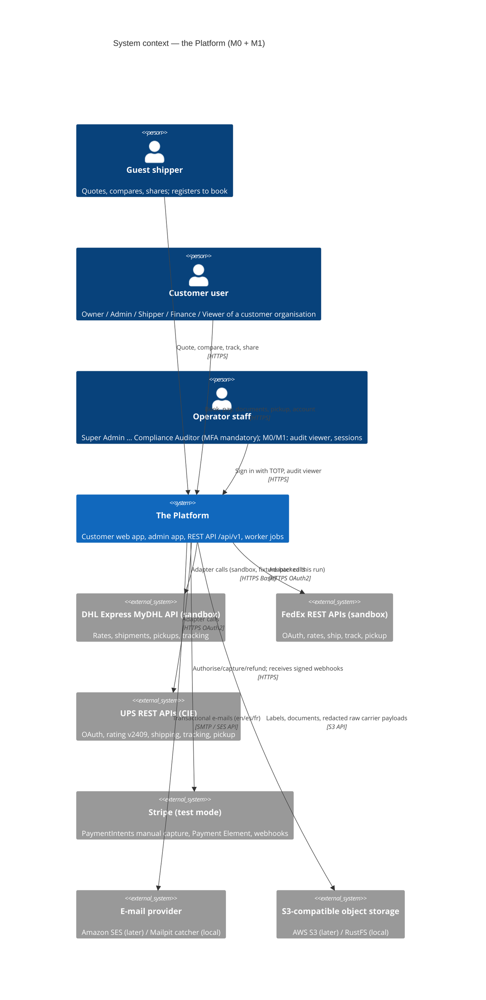
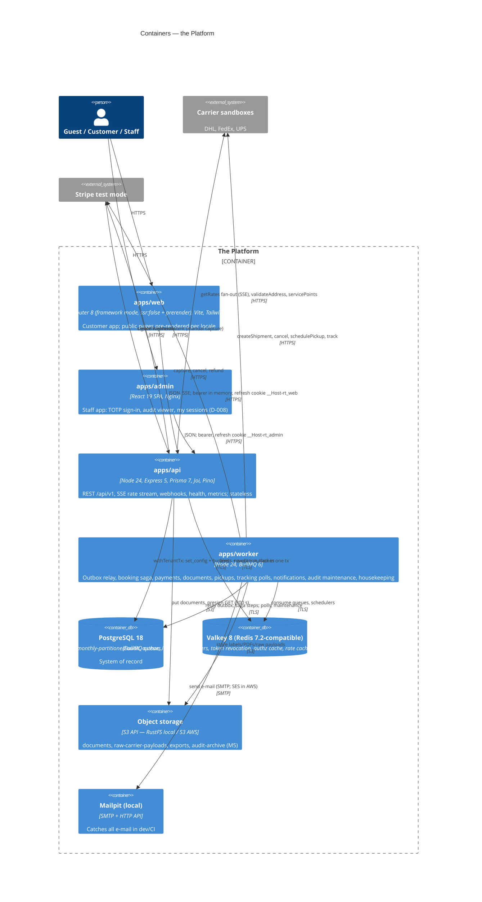
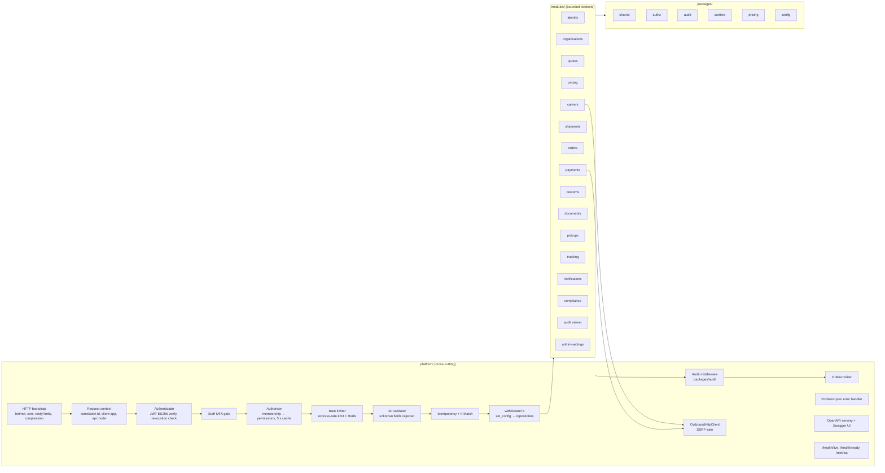
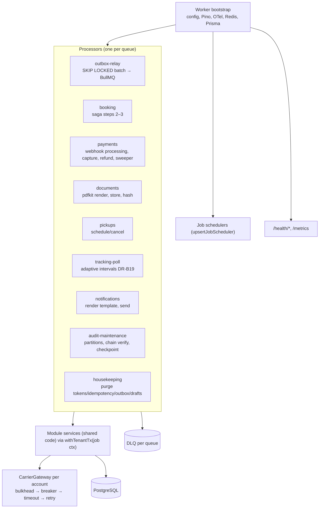
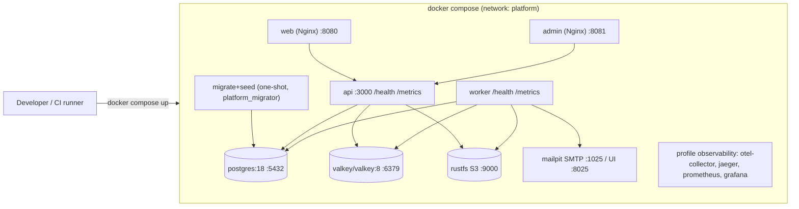

# Architecture — Multi-Carrier Shipping Platform (arc42-lite, run scope M0 + M1)

| Field | Value |
|---|---|
| Version | 1.0 — Draft for gate G2 |
| Date | 2026-11-12 |
| Owner | principal-architect |
| Inputs | `CLAUDE.md`; `docs/sdlc/BRIEF.md` (§3, §4, §9, §10, §11, App. B); `docs/01-requirements/{PRD,REQUIREMENTS,NFR,ASSUMPTIONS,BACKLOG}.md`, `stories/*`; `docs/sdlc/DECISIONS.md`; `docs/sdlc/gates/G1-attempt-1.md` |
| Companions | `adr/ADR-0001..0027`, `data-model.md`, `api/openapi.yaml`, `api/README.md`, `platform.md`, `threat-model.md`, `nfr-strategy.md`, `nfr-traceability.md`, `risks.md` |

## 1. Introduction and goals

The Platform is a carrier-aggregation marketplace (quote, compare, book, pay, documents, pickup, track across DHL Express, FedEx, UPS and a deterministic Mock carrier), an operator back office and, later, a partner developer platform. This run delivers **M0 Foundation** and **M1 Customer MVP** (D-001) under three standing obligations: compliance per country as data, an immutable audit trail of every create/update/delete/view/download, and an explicit permission on every endpoint, screen and export.

### 1.1 Architectural drivers (ranked) and quality-attribute scenarios

| # | Driver | Scenario (stimulus → response → measure) | Governing NFRs | Mechanism (ADR) |
|---|---|---|---|---|
| 1 | **Audit completeness and integrity** | Any mutating request commits → exactly one chained audit entry exists in the same transaction; DBA attempts UPDATE/DELETE → rejected; chain verifies nightly | NFR-AUDIT-001..007 | ADR-0007, ADR-0003 route metadata |
| 2 | **Tenant isolation** | Tenant A requests a resource with tenant B's exact ID → 404, zero rows read or written, in every table and route | NFR-TENANT-001/002, NFR-SEC-011 | ADR-0005 RLS, ADR-0008 RBAC |
| 3 | **Security baseline** | Credential stuffing, CSRF, token reuse, SSRF, mass assignment attempts → blocked, logged as security events, no Critical/High findings | NFR-SEC-001..013, NFR-PRIV-* | ADR-0006, ADR-0016, threat-model.md |
| 4 | **Booking correctness** | Carrier times out after label creation / capture fails / worker crashes mid-saga → no captured payment without a shipment, no second label, consistent terminal state | NFR-RES-005 | ADR-0014 saga, ADR-0004 outbox |
| 5 | **Rate-shopping responsiveness** | Guest submits a quote; one carrier hangs → first result ≤ 1.5 s, `complete` ≤ 5 s with partial results and a named unavailable carrier | NFR-PERF-002/003, NFR-RES-001..003/006 | ADR-0010 fan-out, SSE |
| 6 | **Evolvability** | A new carrier/gateway/channel is added → only an adapter, capabilities and seed change; a module is extracted → its outbox events already exist | NFR-MAINT-001..004 | ADR-0003, ADR-0010, ADR-0012, ADR-0020 |
| 7 | **Performance and scale** | 300 rps mixed load → p95 ≤ 300 ms / p99 ≤ 800 ms on non-carrier endpoints; 2 API + 2 worker replicas pass all suites with zero duplicate side effects | NFR-PERF-001/004..007, NFR-SCALE-* | stateless API, Redis-shared state, indexes per access pattern (data-model.md) |
| 8 | **Operability at $0** | `docker compose up` → healthy stack with seeds ≤ 180 s warm; CI ≤ 20 min; release = tag + GH Release + GHCR | NFR-OPS-001..005 | ADR-0002, ADR-0022, ADR-0023, platform.md |
| 9 | **Accessibility, i18n, web performance** | Every screen in en/es/fr passes axe, keyboard-only journeys, LCP ≤ 2.5 s on public pages | NFR-A11Y-*, NFR-I18N-*, NFR-WEB-*, NFR-COMPAT-* | ADR-0026, `packages/ui` |

### 1.2 Constraints

Fixed stack (ADR-0001); repository layout per brief §4.1; Node/TypeScript tooling only (Windows host, no Python); $0 cloud spend (D-002) — Terraform designed, validated, Checkov-checked, never applied; no production carrier/payment endpoints — sandbox/test only, Mock until credentials exist (D-003); legacy backup never used (brief §13 rule 9); GitHub Actions on `sukhchdit/shipcube` — hosted PR fast lane, heavy suites run locally with evidence committed under `docs/05-quality/`, dispatch-only hosted full lane at wave ends and gates, no self-hosted runner and no paid minutes (D-ORCH-001, ADR-0023 amendment); Node 24 on the Windows host via fnm with the per-command PATH prefix of CLAUDE.md §2 (D-ORCH-002, ADR-0001 amendment); release = tag + GitHub Release + GHCR (D-005); `v0.1.0-m0` pre-release after M0 waves (D-006); MAX_PARALLEL_DEVELOPERS = 4.

## 2. Options analysis and overall decision

Modular monolith (`api` + `worker` from one codebase, two static frontends) versus microservices versus an unstructured monolith — scored in ADR-0003 (chosen: **modular monolith with lint-enforced bounded contexts and a transactional outbox**). Compute: ECS on EC2 versus plain ASG — ADR-0022 (chosen: ECS on EC2). PDF: pdfkit versus headless Chromium — ADR-0019 (pdfkit). Local object store: RustFS versus MinIO/LocalStack/SeaweedFS — ADR-0021 (RustFS; MinIO is archived and LocalStack now needs an account). Audit erasure: tokenised vault versus key shredding — ADR-0007 (tokenised vault). Chain scope: per-stream with hourly ECDSA-signed anchors in an external sink — ADR-0007 (amendment 7, 2026-11-12, SEC-P3-03).

## 3. System context (C4 L1)



External actors not in this run (seams only): partners/API keys (M3), carrier push webhooks (Should, endpoint seam), inbound e-mail per tenant (M4), sanctions screening provider (M4).

## 4. Containers (C4 L2)



Trust boundaries (coordinated with threat-model.md and platform.md): Internet → Edge (Nginx / CloudFront+WAF+ALB) → App (api, worker) → Data (PostgreSQL, Redis, object storage) → External (carriers, Stripe, mail). Secrets live only in the App tier's process memory (resolved from env/Secrets Manager, ADR-0018).

## 5. Components (C4 L3)

### 5.1 `apps/api`



Each module folder: `routes.ts` (`defineRoute` declarations), `controller.ts`, `service.ts`, `repository.ts`, `schemas.ts` (Joi), `policies.ts` (module-specific authorisation beyond the permission string, e.g. ownership rules), `events.ts` (outbox event factories), `tests/`. Dependencies between modules go through `index.ts` interfaces only (ADR-0003).

### 5.2 `apps/worker`



### 5.3 `apps/web`

```mermaid
flowchart LR
  subgraph routes["Routes (React Router 8, /{lang}/…)"]
    pub["Public (pre-rendered): home + quote widget, track, prohibited items, legal, help"]
    res["Results (client): SSE stream, sort/filter/badges, compare, share"]
    auth["Auth: register, verify, sign in, reset, MFA (optional)"]
    wiz["Booking wizard 1–7 (autosave, If-Match)"]
    acct["Account: dashboard, shipments, drafts/quotes, address book, payment methods, notifications, security, org & team, privacy"]
  end
  subgraph infra["App infrastructure"]
    client["Typed API client (openapi-typescript) + Axios + TanStack Query"]
    session[Access token in memory, single-flight refresh, CSRF token]
    i18n["react-i18next en/es/fr, Intl helpers, viewer time zone"]
    gate["can() permission helper, route guards, ScreenState (6 states)"]
    forms["RHF + Zod (shared constants)"]
    sse[fetch-based SSE parser]
    stripe[Stripe Payment Element]
    flags[Feature flags client]
    analytics["Analytics seam (no-op M1)"]
  end
  routes --> infra
  infra --> ui["packages/ui: tokens, Radix wrappers, tables, skeletons, toasts"]
```



### 5.4 `apps/admin`

Shell (sidebar with implemented modules only, breadcrumb, locale switch), staff sign-in (password → TOTP/recovery; enrolment flow with one-time recovery codes), **audit viewer** (`/audit` list with URL filters, `/audit/entries/:id` detail with field diff and hashes, `/audit/entities/:entity/:id` history), **My sessions**; same app infrastructure as web with `__Host-rt_admin`, `mfa: true` required on every route; no placeholder pages for unimplemented modules (REQ-ADMIN-009).

## 6. Module catalogue — responsibilities, interfaces, events, REQ allocation

| Module / package | REQ areas allocated (all M0/M1 Must REQs of the area unless noted) | Public interface (in-process) | Outbox events emitted | Consumes |
|---|---|---|---|---|
| `identity` | REQ-AUTH-001..026 (025 `auth_time` claim and step-up, ADR-0006 am. 12; 026 pre-hijack protection and unverified-account expiry, ADR-0006 am. 15 — both added by v1.3, D-046/D-050); REQ-ADMIN-002/003/004/007/008; REQ-SEC-003/004 (auth routes); REQ-SEC-012 (auth events) | `IdentityService`, `SessionService`, `MfaService`, `ReauthService` | `auth.email_verification`, `auth.password_reset`, `auth.security_event{variant}` | — |
| `organisations` | REQ-ORG-001..014; REQ-ACCT-004/005/008 (address book); terms acceptance | `OrganisationService`, `MembershipQuery`, `AddressBookService` | `org.invitation_created` | — |
| `quotes` | REQ-QUOTE-001..023; REQ-CARR-008/009/010 (fan-out, SSE, cache); REQ-API-017/018 | `QuoteService`, `RateShopper` | `quote.created`, `quote.claimed` | `pricing`, `carriers`, `compliance` |
| `pricing` (module) + `packages/pricing` | REQ-PRICE-001..021; REQ-COMP-005; REQ-DATA-014 (FX access) | `PricingService.price()` | — | `compliance`, `admin-settings` (FX) |
| `carriers` (module) + `packages/carriers` | REQ-CARR-001..007, 011..023 (022 anonymous budget and 023 daily quota guard, ADR-0010 am. 2–3 and 10, NFR-RES-007 — added by v1.3, D-048) | `CarrierRegistry`, `CarrierGateway`, `CarrierServiceCatalogue`, `RawPayloadStore` | — (status via metrics) | `OutboundHttpClient`, `TokenCache`, `SecretResolver`, object storage |
| `shipments` | REQ-BOOK-001..012, 018..022, 029, 030 (state machine, parties, packages, cancellation); REQ-ACCT-001/002/006/007/009 (lists, detail, repeat, cancel) | `ShipmentService`, `ShipmentStateMachine` | `shipment.state_changed`, `shipment.booked`, `shipment.booking_failed`, `shipment.label_ready`, `shipment.cancelled`, `shipment.voided` | `customs`, `pricing` (snapshot copy) |
| `orders` | REQ-BOOK-013..017, 023..028 (basket, coupon, order numbers, checkout, saga) | `OrderService`, `BookingSaga`, `CancellationSaga` | `order.checkout_started`, `order.booked` | `payments`, `shipments`, `carriers`, `admin-settings` (sequences) |
| `payments` | REQ-PAY-001..019 | `PaymentService`, `PaymentGateway` (Mock, Stripe) | `payment.authorised`, `payment.authorisation_released`, `payment.captured`, `payment.capture_failed`, `payment.refunded`, `payment.refund_failed` | `OutboundHttpClient`, object storage |
| `customs` | REQ-CUST-001..015; REQ-DATA-010/011/012/013 (consumers) | `CustomsService`, `ProhibitedItemsChecker` | — | `compliance`, `admin-settings` |
| `documents` | REQ-DOC-001..015 | `DocumentService`, `DocumentRenderer` | `document.generated` | object storage, `notifications` |
| `pickups` | REQ-PICK-001..014 | `PickupService`, `PickupAvailability` | `pickup.scheduled`, `pickup.cancelled`, `pickup.failed` | `carriers`, `admin-settings` (holidays) |
| `tracking` | REQ-TRACK-001..015 | `TrackingService`, `PollPlanner`, `PublicTrackingQuery` | `tracking.event_received`, `tracking.picked_up`, `tracking.in_transit`, `tracking.out_for_delivery`, `tracking.delivered`, `tracking.exception` | `carriers`, `shipments` |
| `notifications` | REQ-NOTIF-001..017; REQ-ACCT-012 | `NotificationService`, `NotificationProvider` | — | all `*.` events per DR-B28 |
| `compliance` | REQ-COMP-001..008; REQ-UI-023 (consent record); legal pages data | `CompliancePackResolver`, `ConsentService` | `config.changed` | — |
| `audit` (module) + `packages/audit` | REQ-AUDIT-001..025 | `AuditWriter` (package), `AuditQueryService` (module) | `audit.chain_broken` | — |
| `admin-settings` | REQ-DATA-001..009, 015..017 (reference data read API, sequences, zones seam); REQ-PLAT-020/021 (feature flags) | `ReferenceDataService`, `NumberSequenceService`, `FeatureFlagService` | `featureflag.changed` | — |
| `packages/authz` | REQ-RBAC-001..014 | `PERMISSIONS`, `authorise()`, matrix generator | — | — |
| `packages/config` | REQ-PLAT-004; REQ-SEC-011 | `loadConfig()` | — | — |
| `packages/shared` | REQ-API-005 (error catalogue), REQ-API-016 (representations), REQ-SEC-008 (shared constants), REQ-DATA-006 (money) | types, enums, Money/units, queue + event names | — | — |
| `packages/ui` + `apps/web` + `apps/admin` | REQ-UI-001..023; REQ-I18N-001..014; REQ-ADMIN-001/005/006/009; REQ-ACCT-* screens; REQ-RBAC-009/010 | components, `can()` | — | API |
| platform (`apps/api/src/platform`, `apps/worker/src/platform`) | REQ-PLAT-001..019, 022; REQ-API-001..004, 006..015, 019, 020; REQ-SEC-001/002/005..007/009/010/014..016; REQ-RLS-001..013 (transaction wrapper + migrations in `prisma/`) | HTTP pipeline, `withTenantTx`, outbox writer, health, metrics | — | — |
| `prisma/` | REQ-RLS-*, REQ-AUDIT-014..017 (SQL), REQ-DATA-001..003 (seed) | migrations, seeds | — | — |
| `infra/`, `.github/` | REQ-PLAT-005..007; REQ-SEC-013; NFR-OPS-* | Compose, Dockerfiles, Terraform, workflows | — | — |

Every REQ area of REQUIREMENTS.md v1.3 (24 areas, 434 REQs) is allocated above; the per-REQ Design column in `docs/sdlc/traceability.md` references the owning module and the ADR or spec section (generated from this table and the ADR amendment index by principal-architect on 2026-11-12 for G2-C2, then reviewed row by row; regenerate with the same rules when REQs are added).

## 7. Runtime views (key sequences, including failure paths)

### 7.1 Quote fan-out with SSE (REQ-CARR-008/009, REQ-API-017/018, DR-B15/B16)

```mermaid
sequenceDiagram
  autonumber
  participant B as Browser (guest)
  participant API as api (quotes)
  participant R as Redis (rate cache)
  participant GW as CarrierGateway ×N (bulkhead→breaker→timeout)
  participant P as PricingService
  participant DB as PostgreSQL
  B->>API: POST /quotes {lane, packages, contentType…} (X-Correlation-Id?)
  API->>DB: withTenantTx(guest): insert quote (org_id NULL, guest_token_hash), packages, audit CREATE (ANONYMOUS), outbox quote.created
  API-->>B: 201 {quote_id, guest_token (once), expires_at}
  B->>API: GET /quotes/{id}/stream (X-Quote-Token) → text/event-stream
  API->>R: GET cache[hash(request, account set, scenario)]
  alt cache hit
    R-->>API: carrier cost responses (cached:true)
  else miss
    par per eligible carrier account, deadline 4 s each, 5 s overall
      API->>GW: getRates(req, ctx)
      GW-->>API: RateQuote[] | NO_SERVICE | TIMEOUT | ERROR
    end
    API->>R: SETEX 300 s (only complete, successful responses)
  end
  loop as each carrier answers
    API->>P: price(carrierQuote, config, fx, tax)
    P-->>API: PricingResult (lines, totals, explanation)
    API->>DB: insert quote_options (price_snapshot, config_version)
    API-->>B: event: carrier_result {carrier, options[]} (id n)
  end
  API-->>B: event: carrier_error {carrier, state: timeout, code} (hung carrier at 4 s)
  API-->>B: event: complete {per-carrier status, elapsed_ms, cached} (≤ 5 s), close ≤ 1 s
  Note over API,GW: Client disconnect → AbortSignal cancels outstanding calls within 1 s; late responses are discarded and never cached.
```

*Amended 2026-11-13 (D-ARCH-106, ADR-0010 amendment 5, ADR-0003 amendment of the same date).* The fan-out is started by `createQuote` after its transaction committed and the 201 was sent, which in the route-descriptor model is the `afterCommit` phase (best-effort, in process); the stream drawn above only replays persisted `quote_options` and subscribes (ADR-0016 amendment 3), it never calls a carrier. Each result is persisted in its own short tenant transaction as it arrives, and no tenant transaction is open while a carrier is called. A fan-out lost to a crash must end as per-carrier timeouts at the 5 s deadline, never as a stream that does not complete.

### 7.2 Checkout and booking saga with compensation (ADR-0014, DR-B03/B04)

```mermaid
sequenceDiagram
  autonumber
  participant B as Browser
  participant API as api (orders/payments)
  participant S as Stripe (test) / Mock gateway
  participant DB as PostgreSQL (outbox)
  participant W as worker (booking/payments/documents/pickups/notifications)
  participant C as Carrier (via CarrierGateway)
  B->>API: POST /orders/{id}/checkout (Idempotency-Key, If-Match)
  API->>DB: allocate order number (UPDATE number_sequences … RETURNING); payment CREATED; audit; outbox order.checkout_started
  API->>S: create PaymentIntent (amount = Σ snapshots, capture_method=manual, Idempotency-Key)
  S-->>API: client_secret (REQUIRES_ACTION for 3DS)
  API-->>B: 202 {payment_id, client_secret, livemode:false}
  B->>S: confirmPayment (Payment Element, 3DS)
  S-->>API: webhook payment_intent.amount_capturable_updated (Stripe-Signature)
  API->>DB: store gateway_webhook_events (event_id UNIQUE) → enqueue payments
  W->>S: retrieve PaymentIntent (state from object, not event order)
  W->>DB: payment AUTHORISED; shipments PENDING_PAYMENT→PAID; saga_executions RUNNING (deadline +30 min); audit STATE_TRANSITION; outbox payment.authorised
  W->>C: step 2 createShipment(client ref = shipment_id) [no auto-retry]
  alt carrier confirms
    C-->>W: ShipmentConfirmation (AWB, label bytes)
    W->>DB: PAID→BOOKING→BOOKED; raw payload → object storage; outbox shipment.booked
    W->>S: step 3 capture Σ booked (Idempotency-Key capture:<order>)
    S-->>W: CAPTURED
    W->>DB: payment CAPTURED; outbox payment.captured, order.booked
    W->>W: step 4 documents: store label, render commercial invoice (pdfkit), SHA-256 → BOOKED→LABEL_READY; outbox shipment.label_ready
    W->>C: step 5 schedulePickup (if requested)
    C-->>W: PickupConfirmation → LABEL_READY→PICKUP_SCHEDULED; outbox pickup.scheduled
    W->>W: step 6 notify: BOOKING_CONFIRMATION + PAYMENT_RECEIPT (recipient locale)
  else definitive carrier rejection
    C-->>W: INVALID_ADDRESS / WEIGHT_EXCEEDED …
    W->>DB: shipment → DRAFT (customer fixes); if no shipment booked: void authorisation; outbox shipment.booking_failed
  else ambiguous (timeout / 5xx after send)
    W->>DB: shipment → EXCEPTION, needs_review; release authorisation; schedule void retry every 4 h × 24 h (no second label)
  else capture fails
    S-->>W: mock_capture_fail / decline
    W->>C: cancelShipment (void label)
    W->>S: cancel authorisation
    W->>DB: BOOKED→CANCELLED→VOIDED; outbox payment.capture_failed
  end
  Note over W: Sweeper every 5 min: authorisations > 30 min without BOOKED → cancel; CAPTURED without BOOKED > 10 min → repair or refund (REQ-PAY-018).
```

*Amended 2026-11-13 (D-ARCH-106, ADR-0005 amendment 11, ADR-0003 amendment of the same date).* On the API side the first steps (payment record, then PaymentIntent) are the `load` -> `call` -> `handler` phases: the order, its price snapshots and the attempt count are read in a short read-only transaction, the gateway is called with the key `auth:<order_id>:<attempt>` while no transaction is open, and the payment row (with the gateway reference), the audit entry, the number allocation and `order.checkout_started` are written in one transaction afterwards. A crash or an admission rejection between the two leaves at most an unconfirmed PaymentIntent, which a retry with the same key returns. The worker steps keep the same discipline (ADR-0014): persist the client reference, call, record the outcome, each database part in its own `withTenantTx`.

### 7.3 Audit write inside a mutation (ADR-0007)

```mermaid
sequenceDiagram
  autonumber
  participant API as api pipeline
  participant SVC as module service
  participant DB as PostgreSQL
  participant AUD as packages/audit writer
  API->>DB: BEGIN; SELECT set_config('app.org_id',…,true), set_config('app.actor_id',…,true), set_config('app.actor_scope',…,true), set_config('app.guest_token_hash',…,true)
  API->>SVC: execute (version-conditional UPDATE … WHERE version = $expected)
  SVC->>DB: UPDATE shipments … RETURNING (0 rows → 412/409, ROLLBACK)
  SVC->>AUD: record({action, entity, id, old, new, reason, outcome})
  AUD->>AUD: diff → redact SECRET → tokenise PERSONAL fields (vault rows) → JCS canonical
  AUD->>DB: SELECT pg_advisory_xact_lock(hashtext('audit:'||stream_id)); SELECT head FROM audit_stream_heads
  AUD->>DB: INSERT audit_pii_vault …; INSERT audit_entries (prev_hash, entry_hash = sha256(JCS(entry)||prev)); UPDATE audit_stream_heads
  SVC->>DB: INSERT outbox_events (shipment.state_changed)
  API->>DB: COMMIT
  Note over AUD,DB: Audit insert fails (e.g. no partition) → exception → ROLLBACK → 500 AUDIT_WRITE_FAILED; business row unchanged. Sensitive VIEW: entry written before the response is released, else 503 AUDIT_UNAVAILABLE.
```

*Amended 2026-11-13 (D-ARCH-106).* No external call lies between `BEGIN` and `COMMIT` in this sequence or in any other (ADR-0005 amendment 11): the transaction holds database work only, and a route that needs an external result reads, calls with no transaction open, and then writes and audits here (ADR-0003 amendment of the same date).

### 7.4 Login, refresh rotation and reuse detection (ADR-0006)

```mermaid
sequenceDiagram
  autonumber
  participant B as Browser (web)
  participant API as api (identity)
  participant R as Redis
  participant DB as PostgreSQL
  B->>API: POST /auth/login {email, password, client_app: web}
  API->>DB: user + credentials (constant-time dummy compare for unknown e-mail); lockout counters in Redis
  alt MFA active
    API-->>B: 401 MFA_REQUIRED {challenge_token (5 min)}
    B->>API: POST /auth/mfa/challenge {challenge_token, code}
  end
  API->>DB: session + refresh_tokens(family, ACTIVE, hash); audit LOGIN; outbox auth.security_event(NEW_DEVICE_SIGN_IN) if new device
  API-->>B: 200 {access_token (15 min, in memory)} + Set-Cookie __Host-rt_web (HttpOnly; Secure; SameSite=Strict)
  B->>API: GET /auth/csrf → {csrf_token}
  Note over B: 60 s before expiry, single-flight across tabs
  B->>API: POST /auth/refresh (cookie, Origin, X-CSRF-Token)
  API->>DB: token ACTIVE? → mark ROTATED, insert successor ACTIVE (same family)
  API-->>B: 200 {access_token} + rotated cookie
  B->>API: POST /auth/refresh with the OLD (rotated) token (stolen/replayed)
  API->>DB: status ROTATED → family + session REVOKED; audit TOKEN_REUSE_DETECTED
  API->>R: SADD auth:revoked:<sid> (TTL 15 min)
  API-->>B: 401 SESSION_REVOKED (security event refresh_token_reuse; e-mail SESSION_REVOKED)
  Note over API,R: Every authenticated request checks the revocation set → revoked sessions fail within 5 s (REQ-AUTH-009).
```

*Amended 2026-11-13 (D-ARCH-109, ADR-0006 amendment 17, ADR-0008 amendment 5).* The refresh cookie is `Path=/` (the `__Host-` prefix requires it), so the browser attaches it to every request to the API host, including the login that starts the next session and every public read. The authn slot makes that harmless: a route reads only the credential kinds it declares, so the cookie is read by `refresh`, `logout` and `csrf` and is ignored everywhere else (a stale cookie on `POST /auth/login` is a normal login, never a 401, and rotated tokens sent elsewhere cause no reuse alarm); in the other direction, an expired bearer attached by the client does not fail `refresh`, `logout` or `csrf`. Failure path of the diagram: reuse detection can fire only on the routes that read the cookie, so a rotated cookie that travels to any other route is not an alarm.

### 7.5 Tracking poll with adaptive intervals (REQ-TRACK-003/004, DR-B18/B19)

```mermaid
sequenceDiagram
  autonumber
  participant SCH as worker scheduler (every minute)
  participant Q as BullMQ tracking-poll
  participant W as worker processor
  participant GW as CarrierGateway
  participant DB as PostgreSQL
  participant N as notifications
  SCH->>DB: SELECT shipments due (next_poll_at ≤ now, status not terminal) per org
  SCH->>Q: add job tracking:<shipment_id> (jobId dedupe)
  Q->>W: process
  W->>GW: track([tracking_number], ctx) [timeout 10 s, retry ≤ 2]
  alt new canonical events
    GW-->>W: TrackingResult (raw events kept)
    W->>DB: insert tracking_events (canonical + raw ref); apply DR-B18 mapping only if DR-B01 permits; STATE_TRANSITION audit; outbox tracking.<status>
    W->>DB: next_poll_at = now + interval(status, last event age) ± 10 % jitter
    N-->>N: TRACKING_* e-mail if preference allows
  else no change
    W->>DB: next_poll_at per DR-B19 (sparser when idle > 24 h)
  else carrier error / timeout
    W->>DB: failure backoff doubling up to 4 h; breaker state exported
  end
  Note over W,DB: Stop at DELIVERED, RETURNED_TO_SENDER, VOIDED, REFUNDED, CANCELLED; stale flag after 60 days.
```

## 8. Deployment views

### 8.1 Local / CI (Compose) — the staging target for this run (D-002)



Sequencing: `postgres`/`redis`/`rustfs` healthy → `migrate` (Prisma migrate deploy + reference seed + demo seed when not production) → `api`/`worker` → `web`/`admin`. Second `up` is idempotent; `down -v` resets. Scale test: `--scale api=2 --scale worker=2` behind the Nginx reverse proxy (NFR-SCALE-002). Details in `platform.md` §2.

### 8.2 AWS target (designed, not applied — ADR-0022, platform.md §4–§6)

3-AZ VPC; CloudFront + WAF in front of S3-hosted web/admin assets; ALB + WAF → ECS on EC2 (capacity provider ASG, private subnets) running `api` (ALB target group, CodeDeploy canary 5/25/50/100 with alarm rollback) and `worker` (rolling, queue-depth autoscaling); RDS PostgreSQL 18 Multi-AZ with PITR; ElastiCache Valkey 8 (Redis 7.2-compatible engine, D-ARCH-005) Multi-AZ; S3 buckets (documents, raw-carrier-payloads, exports, audit-archive Object Lock, inbound-mail, tf-state); SES; Lambda seams (inbound mail, upload scan); Secrets Manager + KMS; CloudWatch logs/metrics/alarms; AWS Backup with cross-region copy. Images from GHCR (mirror to ECR at M5).

### 8.3 Multi-region notes (brief §10 — LATER)

Kept now: stateless API/worker; `REGION` in configuration; no region-specific identifiers (UUIDv7, country-scoped sequences); audit streams per org (region-agnostic); S3 keys without region; idempotency and rate-limit state in Redis (per region). **Active-passive** needs: Route 53 health-checked failover, RDS cross-region read replica promoted on failover, S3 cross-region replication (incl. Object Lock buckets), ElastiCache Global Datastore (or accept cache loss), secrets replicated, CodeDeploy per region. **Active-active** additionally needs: tenant pinning (home region per organisation, routed at the edge) or a write-partitioned schema; per-region `number_sequences` ranges or region-prefixed numbers (format change — reserve now by keeping the format in config); audit chain streams already partition by org, so per-region writers do not conflict if orgs are pinned; outbox relay per region; conflict-free reference data (global, read-only).

## 9. Cross-cutting concepts (summary; details in ADRs)

| Concern | Mechanism | ADR |
|---|---|---|
| Authentication / sessions / MFA / CSRF | ES256 JWT in memory, rotating `__Host-` refresh cookie with reuse detection, Redis revocation ≤ 5 s, TOTP + recovery codes, staff gate, re-auth proof, Origin + `X-CSRF-Token` | ADR-0006 |
| Authorisation | Typed permission catalogue, roles as data, per-request resolution (5 s cache), route metadata, generated matrix tests | ADR-0008 |
| Multi-tenancy | `org_id` + forced RLS, `set_config` per transaction, operator scope per route, guest-token branch, `WITH CHECK` | ADR-0005 |
| Audit | Partitioned, triggered, INSERT/SELECT-only store owned by `platform_audit_owner` (not the migrator); identity-based DDL event trigger; per-stream chain + hourly ECDSA-signed anchors in a mandatory external sink; same-tx writes; fail-closed sensitive reads; redaction; tokenised PII vault | ADR-0007 (am. 7, SEC-P3-03) |
| Consistency model | Strong within a request (one transaction); eventual across modules via the outbox (at-least-once, idempotent consumers); saga for cross-system steps | ADR-0004, ADR-0014 |
| Messaging / jobs | BullMQ queues with deterministic job IDs, retries, DLQs, singleton schedulers | ADR-0013 |
| Idempotency | `Idempotency-Key` store (24 h), saga step keys, gateway idempotency keys, carrier client references | ADR-0014 |
| Caching and invalidation | Redis: rate cache 300 s (costs only), authz 5 s (invalidated on membership change), flags 30 s, OAuth tokens until expiry−60 s, revocation TTL 15 min; HTTP: `ETag`/304 for resources, `Cache-Control: public, max-age=3600` + ETag for reference data, immutable hashed assets | ADR-0010, ADR-0008, ADR-0027, ADR-0016 |
| Resilience | Per-account bulkhead → breaker → timeout → retry (idempotent ops only); partial results; graceful shutdown; Redis-loss fallbacks | ADR-0010, ADR-0013, ADR-0016 |
| Observability | Pino JSON with correlation/org/actor, RED metrics, OTel traces API→queue→worker→carrier, health endpoints, security events | ADR-0017 |
| Configuration / secrets | `packages/config` Joi schema, fail-fast, secret references, `.env.example` parity | ADR-0018 |
| Feature flags | DB-backed, Redis-cached, audited, tracked task IDs | ADR-0027 |
| i18n / a11y | en/es/fr keys only, Intl helpers, logical CSS, WCAG 2.2 AA components, six screen states | ADR-0026 |
| Data privacy | Classification registry (PUBLIC/INTERNAL/PERSONAL/SENSITIVE_PERSONAL/SECRET) drives log redaction, audit tokenisation and public-field allow-lists; retention periods recorded in packs (enforcement M4/M5); consent records; erasure design via vault deletion | ADR-0007, ADR-0017, ADR-0020 |
| Error handling | One handler, RFC 9457, stable codes, no internals in bodies | ADR-0016 |

## 10. Seams for backlog items (BACKLOG.md)

| Backlog epic | Seam present in M0/M1 |
|---|---|
| B-201/202 Orders admin, booking on behalf | `shipments.on_behalf_of_org_id` + `created_by_user_id` columns (NULL in this run), audit `ON_BEHALF_ACTION`, `shipment:create:on_behalf` permission (reserved), re-auth primitive, entity history view |
| B-204 Carriers admin, B-302 BYO accounts | `carrier_accounts.owner_type/owner_org_id/connection_mode`, `CarrierContext.account`, envelope-encryption table design, OAuth state table design (ADR-0011) |
| B-205 Pricing admin, rate cards | `pricing_config_versions` + rule tables; `carrierQuote.source = RATE_CARD` discriminator; empty `zones`, `zone_countries` (REQ-DATA-017) |
| B-206/B-402 Invoices, ledger, wallet | `number_sequences` scopes INVOICE/CREDIT_NOTE defined; `payments.ledger_posting_ref NULL`; payment method enum values reserved |
| B-207 Roles editor, B-209 e-signature | Roles as data; `audit.reasonRequired`; `REASON_REQUIRED`; re-auth proof |
| B-208 Audit exports, regulator report | `EXPORT` action; `audit:export` permission; chain status API; viewer filters |
| B-303/304/305/306 API keys, portal, webhooks, metering | `API_KEY` actor type; `ApiMode test|live` on the request context; outbox events as the webhook source; `carrier_usage` counters; OpenAPI contract-first pipeline + Swagger UI |
| B-404/405 Exceptions, claims | `EXCEPTION` state with `needs_review`; `CLAIM_OPEN` state (unreachable in M1); canonical tracking taxonomy |
| B-406/409 Support, inbound mail, template editor, SMS/WhatsApp | `NotificationProvider.channel` values; versioned templates table; `inbound_mailboxes` table (no rows) |
| B-407 Bulk upload | `POST /shipments` is batch-friendly (array accepted at the service layer; API exposes single create in M1); `UploadScanner` port |
| B-408 CMS | Pre-rendered public routes read legal/help content from the compliance pack / static placeholders; content tables are M4 |
| B-411 Flags UI | Flag API + audit exist |
| B-412/413 Screening, KYC, privacy workflows | `screening_status = NOT_SCREENED` recorded; classification registry; vault-based erasure; consent records; retention periods in packs |
| B-414 System health | Queue/DLQ/breaker/relay metrics already exported |
| B-501..507 AWS, canary, DR, archive, migration | Terraform modules + overlays; CD stages no-op; `AuditArchiver` + `archived_at`; `MIGRATED` audit action in the enum; UUIDv7 crosswalk-friendly keys; region in config |
| LATER: white-label, multi-region, analytics, channels, pallets, COD, social login | `BRAND_*` config + themable tokens; §8.3 notes; `track()` analytics seam with named events; `ChannelIntegration` interface placeholder (documented, no code); `package_type` enum (`DOCUMENT`, `PARCEL`; `PALLET`, `FREIGHT` reserved); payment method `COD` reserved; `user_credentials.kind` |

## 11. Codebase blueprint (for P4/P5; the skeleton is scaffolded in P5 Wave 0)

- Layout per brief §4.1 and ADR-0002; module folders per ADR-0003; naming: files kebab-case, types PascalCase, DB snake_case; one module = one `index.ts` public surface.
- Patterns: `defineRoute` metadata; controller = parse → service → map; services receive a `RequestContext` (`{ correlationId, actor, orgId, actorScope, clientApp, apiMode, locale, now }`) and a `TenantDb`; repositories = Prisma + raw SQL with parameters only; domain errors extend `AppError(code)`; outbox events via typed factories; state machines as explicit transition tables (DR-B01, DR-B27, DR-A03/A04/A05).
- Error handling: fail fast at boundaries (Joi), typed `AppError` with catalogue codes, no silent catch-alls (lint `no-empty` + custom rule), 5xx logged with stack, body generic.
- Logging: `logger.child({ module })`; never log bodies/PII; security events via `securityEvent(name, attrs)` helper.
- Testing pyramid targets: unit ≈ 65 % of tests (pure logic, components), integration/API ≈ 30 % (Testcontainers, generated suites), e2e ≈ 5 % (critical journeys ×3 engines ×2 viewports); coverage gates per ADR-0024.
- Definition of Done hooks: route metadata + OpenAPI + matrix fixture + audit descriptor + i18n keys (3 locales) + six states + Compose runs it (CLAUDE.md §8).

## 12. Risks

See `risks.md` (R-ARCH-01..12) with mitigations and Wave-0 spikes.

## 13. Glossary

Active organisation · Audit stream · Guest token · Operator scope · Price snapshot · Saga · Outbox · Canonical code · Compliance pack · Tenant class (TENANT / GUEST_CAPABLE / USER_OWNED / GLOBAL / SYSTEM) — definitions in the ADRs referenced above and in `data-model.md`.
