# Data Model: Multi-Carrier Shipping Platform (M0 + M1)

| Field | Value |
|---|---|
| Version | 1.0 |
| Date | 2026-11-12 |
| Owner | data-architect (spawned by principal-architect, P3 Architecture) |
| Status | **Draft for G2** |
| Scope | Every persistent entity required by the M0 and M1 requirements, plus the seams the brief demands (`on_behalf_of_org_id`, `package_type`, `zones`/`zone_countries`, `api_mode`, audit partition archive marker) |
| Inputs | `docs/sdlc/BRIEF.md` §4.2, §4.4–§4.7, §4.9, §4.10, §4.12, §4.13, Appendix A (shape only; the legacy backup was not touched); `docs/01-requirements/REQUIREMENTS.md` v1.1 (all areas, DR-A01..A28, DR-B01..B34, EC-A/EC-B); `docs/01-requirements/NFR.md` (NFR-DATA, NFR-PERF-006, NFR-AUDIT, NFR-TENANT, NFR-REC, NFR-AVAIL-003, NFR-PRIV); `docs/01-requirements/ASSUMPTIONS.md` (A-041..A-082); `docs/sdlc/DECISIONS.md` (D-001..D-037); P3 design brief of 2026-11-12 (fixed decisions ADR-0004/0005/0006/0007/0009/0013/0014/0016); `CLAUDE.md` §5 database guardrail |
| Fixed stack (not re-opened) | PostgreSQL 18, Prisma 7.10.x with `@prisma/adapter-pg` + `pg`, `prisma.config.ts`, Node.js 24 LTS, UUIDv7 keys, Redis 7, S3 API object storage (RustFS locally) |
| External facts checked | Prisma 7 docs and changelog (prisma.io/docs, checked 2026-11-12): driver adapters mandatory, `prisma-client` generator with required `output`, `prisma.config.ts` holds datasource URL, migrations path and seed, `$use` middleware removed (client extensions instead), `partialIndexes` preview feature since 7.4 (`@@index(..., where: raw("..."))`), `tables.external` (preview, `experimental.externalTables`), down migrations via `migrate diff --from-schema … --to-config-datasource --script` + `db execute` + `migrate resolve --rolled-back`. PostgreSQL 18 native `uuidv7()` (release notes, 2025-09-25). |

Conventions in this document: requirement IDs (`REQ-*`), domain rules (`DR-*`), edge cases (`EC-*`), NFR IDs and assumptions (`A-*`) are cited next to the design element they justify. "Brief" means the P3 design brief of principal-architect unless "product brief" is written. Nothing here is code; Prisma schema, migrations and seed scripts are P4/P5 deliverables built from this document.

## Contents

1. Principles, bounded contexts, store selection and table classes
2. ERD (Mermaid) per module
3. Table-by-table specification (columns, constraints, classification, access patterns, indexes)
4. Row-level security: policy templates, settings, roles and grants, catalog tests
5. Audit store SQL: partitioning, immutability triggers, partition pre-creation, hash chaining, verification, PII vault
6. Outbox, idempotency, saga, number sequences; transactions and consistency
7. Prisma 7 mapping notes
8. Migration strategy, backup/restore rehearsal and zero-downtime probe
9. Seed plan
10. Volume and sizing, partitioning outlook, caching, data protection, retention, open issues
11. Handoff Report

---

## 1. Principles, bounded contexts, store selection and table classes

### 1.1 Data-model principles

| # | Principle | Rule | Source |
|---|---|---|---|
| P1 | Identifiers | Every primary key is `id uuid` generated as UUIDv7 by the application (`uuid` v14 `v7()`), with `DEFAULT uuidv7()` (PostgreSQL 18 native) as a safety net. No serial or identity keys. UUIDv7 gives B-tree locality (append-mostly inserts, fewer page splits) without a central sequence, is safe to generate in API and worker before the insert (needed for saga client references and outbox aggregate IDs) and does not leak row counts the way serials do. Its embedded timestamp reveals creation time to anyone who sees the ID; that is acceptable because no ID is a secret (secrets are separate 256-bit tokens stored hashed). | §4.10, ADR-0009, REQ-RLS-009, NFR-DATA-002 |
| P2 | Standard columns (`STD`) | `id uuid PK`, `created_at timestamptz NOT NULL DEFAULT now()`, `updated_at timestamptz NOT NULL DEFAULT now()`, `created_by uuid NOT NULL`, `updated_by uuid NOT NULL`, `version integer NOT NULL DEFAULT 1 CHECK (version >= 1)`. Set by the server (Prisma extension, §7.6), never from client input (REQ-SEC-007). `created_by`/`updated_by` are logical references to `users.id` (not foreign keys: avoids lock traffic on `users` and FK cycles at registration); reserved system actors (§1.6) exist as `users` rows so joins resolve. Append-only tables keep `version = 1` and `updated_* = created_*`. The only exemption is `audit_entries` (§3.4, open issue OI-08). | §4.10, REQ-RLS-009, REQ-RLS-011, DR-A16, NFR-DATA-003 |
| P3 | Soft delete (`SD`) | Soft-deletable tables add `deleted_at timestamptz NULL`, `deleted_by uuid NULL`, `CHECK ((deleted_at IS NULL) = (deleted_by IS NULL))`. Every unique constraint and every list index on such a table is partial `WHERE deleted_at IS NULL`. The runtime role has no `DELETE` on them. Deletion is audited as `DELETE`. Restoring is not offered in this run. | REQ-RLS-010, DR-A17, NFR-DATA-003 |
| P4 | Time | Instants are `timestamptz` (stored UTC, microsecond precision); no `timestamp without time zone` column exists (schema test). Dates that are local by nature (pickup date, holiday) are `date` plus an IANA zone `text` column. Local times of day (cut-off, pickup window) are `time` interpreted in the stated zone. | REQ-RLS-012, DR-A19, NFR-DATA-002 |
| P5 | Money | Every amount is a pair `<name>_minor bigint` + `<name>_currency char(3)` (or one shared `currency char(3)` column per row when all amounts on the row share it), with `CHECK (currency ~ '^[A-Z]{3}$')` and a FK to `currencies(code)` on configuration tables. No `numeric`, `real` or `money` type for amounts. FX rates are `numeric(18,6)` (rates are not money) and travel as strings in the API. | §4.4, ADR-0009, REQ-PRICE-002, REQ-API-016, NFR-DATA-001 |
| P6 | Units | Weights are integer grams (`*_g integer`), lengths integer millimetres (`*_mm integer`), percentages integer basis points (`*_bp integer`, 1 % = 100 bp). | DR-B06, REQ-PRICE-004 |
| P7 | Enumerations | Status, state, type and code columns are `text` with a named `CHECK (col IN (...))` constraint, not PostgreSQL enum types: CHECKs can be widened in an expand migration (`ADD CONSTRAINT … NOT VALID` then `VALIDATE`, drop the old one later) without `ALTER TYPE` locking, and Prisma maps them to `String` typed by the TypeScript unions in `packages/shared`. A catalog test asserts each CHECK list equals its `packages/shared` enum (§4.6). | §4.10, REQ-BOOK-018, REQ-BOOK-028 |
| P8 | JSONB | Only for (a) immutable snapshots (price snapshots, explanations, service-point snapshot, public share snapshot, compliance-pack section content), (b) raw/redacted payload metadata and audit diffs, (c) outcome blobs of saga steps. Never for data that is filtered, joined or constrained; never for serialised addresses or parties (product brief App. A weakness). | §4.10, App. A |
| P9 | Naming | `snake_case`, plural table names, singular column names, FK columns `<entity>_id`. Constraint names: `pk_<table>`, `fk_<table>__<column>`, `ux_<table>__<cols>` (unique index), `ix_<table>__<cols>` (index), `ck_<table>__<rule>`, `ex_<table>__<rule>` (exclusion). Prisma models are PascalCase singular mapped with `@@map`/`@map` (§7.4). | Brief |
| P10 | Tenancy | Tenant-owned rows carry `org_id uuid NOT NULL` (nullable only on guest-capable tables) with RLS `ENABLE` + `FORCE` and a composite index leading with `org_id`. Every table belongs to exactly one class (§1.5). | ADR-0005, REQ-RLS-001/002/013, NFR-TENANT-001 |
| P11 | Optimistic locking | Updates are `UPDATE … SET …, version = version + 1 WHERE id = $id AND version = $expected`; zero rows ⇒ 412 `CONCURRENCY_CONFLICT` (If-Match) or 409 `CONFLICT` (internal). A no-op update issues no statement, no version bump and no audit entry. | REQ-RLS-011, REQ-API-013, DR-A16, EC-A25/A26 |
| P12 | Integrity in the database | Business invariants that are cheap to state declaratively are enforced in the database too (CHECK, partial UNIQUE, composite FK, exclusion constraints, immutability triggers); state machines and cross-row rules stay in the service layer, with the database holding the last line of defence where noted. | §4.10, NFR-DATA-001..004 |
| P13 | Files out of row | Documents, raw carrier payloads and gateway webhook payloads live in object storage; rows hold bucket, key (UUIDs only, no personal data), size, media type and SHA-256. | §4.10, REQ-DOC-006, REQ-CARR-018, REQ-PAY-003 |

### 1.2 Column classification vocabulary (classification registry)

Every column has exactly one classification, used by the field classification registry in `packages/audit` (build-time test, REQ-AUDIT-009, NFR-PRIV-003), Pino redaction (REQ-PLAT-012, NFR-PRIV-001) and the audit PII tokeniser (ADR-0007).

| Tag | Meaning | Audit value handling | Log handling |
|---|---|---|---|
| `PUB` (PUBLIC) | Non-sensitive, may be shown publicly (country codes, canonical status) | Stored as is | Allowed |
| `INT` (INTERNAL) | Business data without personal content (IDs, amounts, states, timestamps, carrier refs) | Stored as is | Allowed (IDs, codes) |
| `PER` (PERSONAL) | Identifies or relates to a natural person (names, emails, phones, addresses, postcodes, IP, user agent, free text typed by users) | Replaced by `{"$pii":"<token>"}`, value in `audit_pii_vault` | Redacted / masked |
| `SPER` (SENSITIVE_PERSONAL) | Government or tax identifiers, identity-document data | As `PER`, vault classification `SENSITIVE_PERSONAL`; never in notifications or public responses | Redacted |
| `SEC` (SECRET) | Password hashes, token hashes, TOTP secrets, recovery codes, gateway tokens, secret references | `[REDACTED]` before hashing (REQ-AUDIT-008) | Redacted |

`STD` and `SD` columns are `INT`. Note: NFR-PRIV-003 cites an example vocabulary (`PII_DIRECT`, `PII_INDIRECT`, `SENSITIVE`, `NONE`); this model uses the REQ-AUDIT-009 five-level vocabulary as the single source (OI-11).

### 1.3 Conceptual model: bounded contexts and aggregates

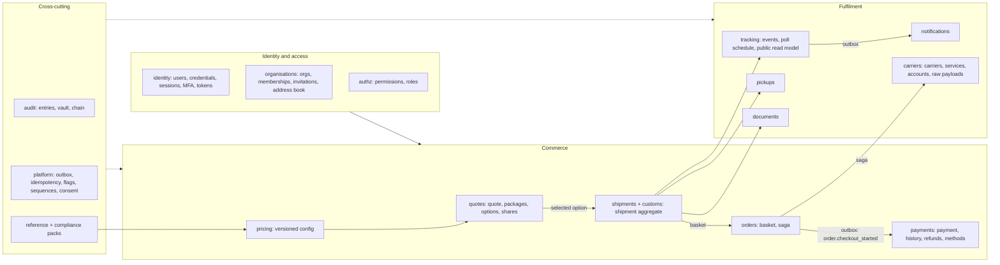

Aggregates and their consistency boundary (one transaction may change one aggregate plus its outbox event and audit entry; other aggregates react to the event, DR-B04 G4):

| Aggregate (root) | Members | Invariants held in one transaction |
|---|---|---|
| User (`users`) | `user_credentials`, `mfa_totp`, `mfa_recovery_codes`, `sessions`, `notification_preferences` | Status machine DR-A04; at most one pending/active TOTP; recovery batch replaced atomically |
| Organisation (`organisations`) | `memberships`, `membership_roles`, `invitations`, `address_book_entries`, `organisation_tax_references` | Type immutable; one OPERATOR org; at least one ACTIVE Owner (DR-A05); one default sender |
| Quote (`quotes`) | `quote_packages`, `quote_options`, `quote_shares` | Immutable after rating completes except claim/save/delete; claim once (DR-B14) |
| Shipment (`shipments`) | `shipment_parties`, `shipment_party_identifiers`, `shipment_packages`, `customs_declarations`, `customs_items`, `prohibited_acknowledgements`, `shipment_attestations`, `shipment_price_snapshots`, `shipment_state_transitions` | State machine DR-B01 with history row + audit in the same tx (REQ-BOOK-019); single customs currency; snapshot immutability |
| Order (`orders`) | `order_shipments`, `saga_executions`, `saga_steps`, `coupon_redemptions` | 1–10 shipments, one currency (DR-B33); one open order per user and org |
| Payment (`payments`) | `payment_status_history`, `payment_attempts`, `refunds` | DR-B27 transitions; captured ≤ authorised; refunded ≤ captured |
| Document version (`documents`) | — | One CURRENT version per logical document (DR-B26) |
| Pickup (`pickups`) | — | One SCHEDULED pickup per shipment |
| Tracking stream (`tracking_events` per shipment) | `tracking_index`, `tracking_poll_schedule` (global index tables) | Dedupe per shipment (REQ-TRACK-005) |
| Audit stream (`audit_stream_heads` per stream) | `audit_entries`, `audit_pii_vault` | Hash chain continuity under the stream lock (ADR-0007) |

### 1.4 Store selection per context

All system-of-record data lives in one PostgreSQL 18 database (one schema `public` for tables, schema `platform` for functions). A single relational store is chosen because every M0/M1 write path needs atomicity across the business row, the outbox row and the audit entry (REQ-PLAT-016, REQ-AUDIT-004), tenant isolation is enforced by RLS in that same store (ADR-0005), and the projected volume (§10) is far inside one Multi-AZ instance. Redis and object storage hold only derived, ephemeral or binary data.

| Context | Store | Dominant access patterns (frequency at design load, latency target) | Why this store |
|---|---|---|---|
| identity, organisations, authz | PostgreSQL | Login lookup by email (≈ 2/s peak, p95 ≤ 300 ms incl. bcrypt); session validation per request is **not** a DB read (JWT + Redis revocation set, ADR-0006); refresh by token hash (≈ 1/s, ≤ 50 ms); `GET /me` memberships + permissions (per page load, ≤ 50 ms, cached ≤ 5 s REQ-RBAC-008) | Transactions with audit; RLS on users/sessions/memberships (DR-A14) |
| quotes, pricing config | PostgreSQL (+ Redis rate cache 300 s, DR-B15) | Insert quote + options per rate request (≈ 20/s peak, part of the 5 s rate-shopping budget, DB share ≤ 30 ms); read quote by id (SSE fallback, ≤ 50 ms); pricing config loaded once per version into process memory | Quotes must be claimable atomically under RLS (REQ-RLS-013) |
| shipments, customs, orders, payments, saga | PostgreSQL | Wizard saves by id with version check (≈ 10/s, ≤ 100 ms); shipment list per org with keyset pagination (≈ 5/s, p95 ≤ 300 ms at 100k rows, NFR-PERF-006); saga step persistence (≈ 5 bookings/s × 6 steps) | ACID across state + transition + outbox + audit (DR-B04) |
| documents | Object storage (bytes) + PostgreSQL (metadata) | Generate ≈ 4 documents per booking; download URL issue (≤ 300 ms incl. SHA-256 re-check of ≤ 5 MB, REQ-DOC-009) | Binary blobs out of the DB; S3 versioning + SSE (REQ-DOC-006) |
| carriers raw payloads, gateway webhook payloads | Object storage + PostgreSQL metadata | Write-once per carrier call; read only by staff/support (M2) | Keeps rows small (product brief App. A weakness) |
| tracking | PostgreSQL | Poll scheduler scan of due rows (every 30 s, ≤ 50 ms); event insert with dedupe (≈ 20/s at design load); public lookup by hash (50 req/s, p95 ≤ 200 ms, A-031) | Event-driven state transitions must commit with the event |
| notifications | PostgreSQL (templates, preferences, log) + BullMQ (jobs) | Log insert per send; user's own log list | Idempotency keys in the same DB as the outbox |
| audit | PostgreSQL (monthly partitions) → S3 Object Lock archive (M5 seam) | 1 insert per mutating request (in-tx, ≤ 15 ms p95 overhead, NFR-AUDIT-005); viewer queries with mandatory ≤ 31-day range (p95 ≤ 500 ms on 1M rows, NFR-PERF-006) | Same-transaction write (REQ-AUDIT-004); partition pruning |
| platform: outbox, idempotency, flags, sequences | PostgreSQL (+ Redis flag cache 30 s) | Outbox relay poll every 500 ms; idempotency claim per unsafe request; sequence allocation per checkout | Must commit atomically with the business change |
| reference data, compliance packs | PostgreSQL + in-process cache with ETag (`Cache-Control: public, max-age=3600`, REQ-DATA-016) | Read-mostly, ≈ 100 % cache hits | Seeded by migration/seed only (DR-A27) |
| Ephemeral: rate limits, revocation set `revoked:sid`, carrier OAuth tokens, rate cache, permission cache, service-point lookups, SSE fan-out, BullMQ | Redis 7 | Sub-millisecond counters and TTL keys | Loss is tolerable (A-053); nothing in Redis is a system of record |

### 1.5 Table classes (tenant class, ADR-0005)

| Class | `org_id` | RLS | Who can read | Examples |
|---|---|---|---|---|
| `TENANT` | `NOT NULL`, FK `organisations` | ENABLE + FORCE; tenant branch + read-only operator branch (`app_is_operator()`) | Rows of `app.org_id`; verified operator staff (read) | shipments, orders, payments, documents, address_book_entries, saga tables |
| `GUEST_CAPABLE` | nullable; `guest_token_hash` when null | as TENANT + guest branch | As TENANT, or the holder of the guest token | quotes, quote_packages, quote_options, quote_shares |
| `USER_OWNED` | none, or `org_id` for user-private data within an org | ENABLE + FORCE; `user_id = app_actor_id()` (and `org_id = app_org_id()` where present) + operator read + org-member read on `users` | The user; verified operator staff (read) | users, user_credentials, sessions, refresh_tokens, one-time token tables, mfa_*, reauth_proofs, notification_preferences, notification_log, saved_payment_methods, payment_gateway_customers, terms_acceptances, consent_records |
| `GLOBAL` | none | none | Everyone (SELECT); writes only where listed in §4.4 | reference data, compliance packs, carriers, pricing config, roles, permissions, feature flags, number_sequences, notification_templates |
| `SYSTEM` | none (or informational `org_id` on global index tables) | none | Only the owning module's repositories; no personal data except hashes and the encrypted vault | outbox_events, processed_events, idempotency_keys, login_attempt_counters, gateway_webhook_events, global index tables (`tracking_index`, `gateway_refs`, `tracking_poll_schedule`), `audit_*` (entries, stream heads, partitions, verifications, checkpoint heads, PII vault, data subjects) |

The documented list of non-RLS tables (GLOBAL + SYSTEM) is the allow-list of the REQ-RLS-001 build-time test; any table with a column named `org_id` that is not on it must have RLS forced and an `org_id`-leading index (§4.6). Pre-authentication and cross-tenant lookups use only the allow-listed definer functions of §4.5 or the global index tables (ADR-0005 amendment 1).

### 1.6 Reserved identifiers

| Name | Value | Use |
|---|---|---|
| SYSTEM actor | `00000000-0000-7000-8000-000000000001` | `created_by`/`updated_by` and audit `user_id` for seed and system jobs (REQ-RLS-009); seeded `users` row with `is_system = true`, no credentials |
| ANONYMOUS actor | `00000000-0000-7000-8000-000000000002` | `created_by` of guest quotes and anonymous consent records (REQ-AUDIT-011) |
| SYSTEM audit stream shards | `00000000-0000-0000-0000-0000000000NN`, `NN` = `00`…`0f` | `stream_id` of entries without an organisation, shard = `hash(correlation_id) mod 16` (ADR-0007 amendment 1); shard `00` (the nil UUID) also carries the nightly checkpoint |

Both actor IDs are syntactically valid UUIDv7 (version nibble 7, variant 10, timestamp 0) so the NFR-DATA-002 key test passes.

### 1.7 Enumeration catalogue (CHECK lists; single source `packages/shared`)

| Enum | Values | Source |
|---|---|---|
| `org_type` | `OPERATOR`, `BUSINESS_CUSTOMER`, `PARTNER`, `INDIVIDUAL` | REQ-ORG-001 |
| `user_status` | `PENDING_VERIFICATION`, `ACTIVE`, `SUSPENDED`, `DEACTIVATED` | DR-A04 |
| `membership_status` | `INVITED`, `ACTIVE`, `SUSPENDED`, `REMOVED` | DR-A05 |
| `role_scope` | `OPERATOR`, `CUSTOMER`, `PARTNER` | REQ-ORG-004 |
| `refresh_token_status` | `ACTIVE`, `ROTATED`, `REVOKED` | DR-A03 |
| `session_status` | `ACTIVE`, `REVOKED`, `EXPIRED` | REQ-AUTH-009 |
| `client_app` | `web`, `admin` | ADR-0006 |
| `audit_action` | `CREATE`, `UPDATE`, `DELETE`, `VIEW`, `DOWNLOAD`, `LOGIN`, `LOGOUT`, `LOGIN_FAILED`, `ACCOUNT_LOCKED`, `TOKEN_REUSE_DETECTED`, `MFA_ENROLLED`, `MFA_FAILED`, `PERMISSION_DENIED`, `EXPORT`, `ON_BEHALF_ACTION`, `CONFIG_CHANGE`, `API_KEY_USE`, `STATE_TRANSITION` | REQ-AUDIT-002 (OI-07) |
| `audit_outcome` / `actor_type` / `source_app` | `SUCCESS`, `DENIED`, `FAILED` / `USER`, `API_KEY`, `SYSTEM_JOB`, `ANONYMOUS` / `web`, `admin`, `api`, `worker` | REQ-AUDIT-003/011, DR-A10/A11 |
| `shipment_state` | `DRAFT`, `QUOTED`, `PENDING_PAYMENT`, `PAID`, `BOOKING`, `BOOKED`, `LABEL_READY`, `PICKUP_SCHEDULED`, `DROPPED_OFF`, `IN_TRANSIT`, `CUSTOMS_HOLD`, `OUT_FOR_DELIVERY`, `DELIVERED`, `EXCEPTION`, `RETURNED_TO_SENDER`, `CANCELLED`, `VOIDED`, `REFUNDED`, `CLAIM_OPEN` | REQ-BOOK-018, DR-B01 |
| `transition_trigger` | `USER_ACTION`, `SAGA_STEP`, `CARRIER_EVENT`, `PAYMENT_EVENT`, `SYSTEM_TIMEOUT` | REQ-BOOK-019 |
| `direction` / `content_type` / `package_type` | `EXPORT`, `IMPORT`, `DOMESTIC` / `DOCUMENT`, `PARCEL` / `PARCEL_BOX`, `ENVELOPE` (seam: `PALLET`, `FREIGHT` later) | REQ-BOOK-027/028 |
| `screening_status` | `NOT_SCREENED`, `CLEARED`, `REVIEW`, `BLOCKED` | REQ-CUST-011 |
| `order_status` | `OPEN`, `PENDING_PAYMENT`, `PAID`, `BOOKING`, `BOOKED`, `PARTIALLY_BOOKED`, `FAILED`, `CANCELLED` | Reconciled to the API contract (ADR-0016 amendment 5e; §12 OI-13); no REQ enumerates order states |
| `payment_status` | `CREATED`, `REQUIRES_ACTION`, `AUTHORISED`, `CAPTURED`, `PARTIALLY_CAPTURED`, `VOIDED`, `FAILED`, `REFUND_PENDING`, `REFUNDED`, `REFUND_FAILED` | REQ-PAY-003, DR-B27 |
| `document_type` / `document_status` / `document_format` | `SHIPPING_LABEL`, `COMMERCIAL_INVOICE`, `PRO_FORMA_INVOICE`, `CARRIER_CUSTOMS_DECLARATION`, `PICKUP_CONFIRMATION` / `CURRENT`, `SUPERSEDED`, `VOIDED` / `PDF_4X6`, `PDF_A4`, `PDF_LETTER`, `ZPL` | REQ-DOC-001/002/015 |
| `tracking_status` | `INFO_RECEIVED`, `PICKED_UP`, `DROPPED_OFF`, `IN_TRANSIT`, `CUSTOMS_HOLD`, `CUSTOMS_CLEARED`, `OUT_FOR_DELIVERY`, `DELIVERY_ATTEMPTED`, `DELIVERED`, `EXCEPTION`, `RETURN_INITIATED`, `RETURNED_TO_SENDER`, `CANCELLED` | REQ-TRACK-001, DR-B18 |
| `notification_status` / `channel` | `QUEUED`, `SENT`, `FAILED`, `DEAD_LETTERED`, `SUPPRESSED_BY_PREFERENCE` / `EMAIL`, `SMS`, `WHATSAPP` | REQ-NOTIF-001/012 |
| `api_mode` | `TEST`, `LIVE` | REQ-API-020 (seam) |
| `reference_source` | `ISO`, `SEED`, `SAMPLE`, `OPERATOR` | REQ-DATA-001, DR-A27 |


---

## 2. ERD (Mermaid) per module

Mermaid `erDiagram` has no grouping construct, so there is one diagram per module. Attributes are limited to keys and the columns that define relationships or tenancy; full column lists are in §3. Entities from other modules appear with their `id` only. Standard and soft-delete columns are omitted from the diagrams.

### 2.1 Identity

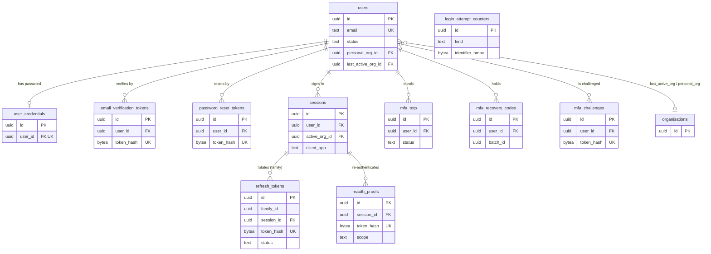

### 2.2 Organisations and authz

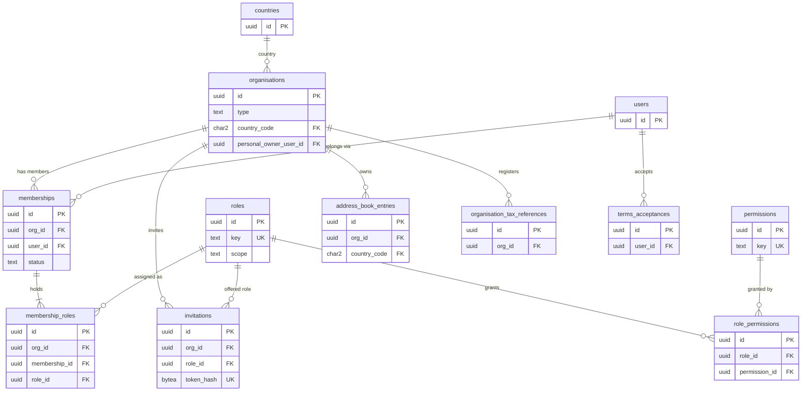

### 2.3 Audit

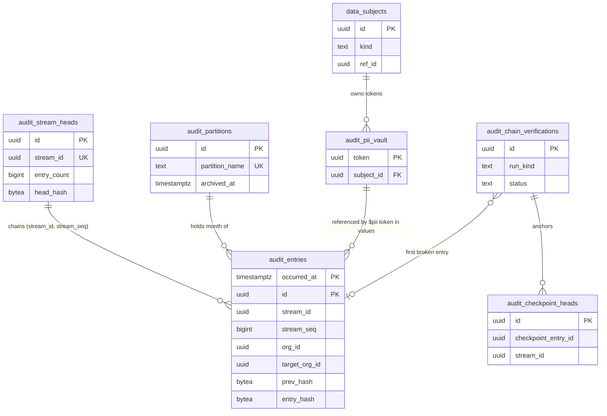

### 2.4 Platform

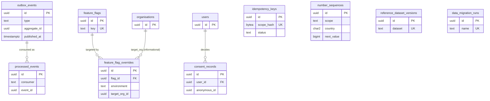

### 2.5 Reference data and compliance

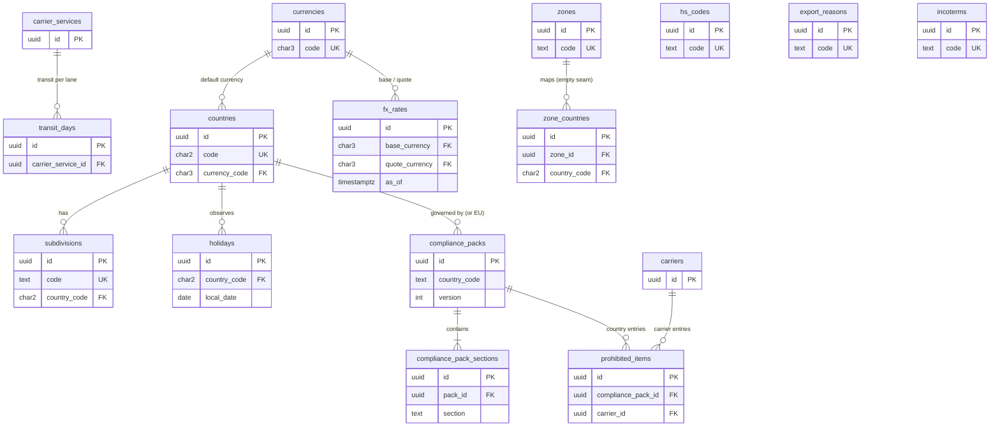

### 2.6 Carriers and pricing

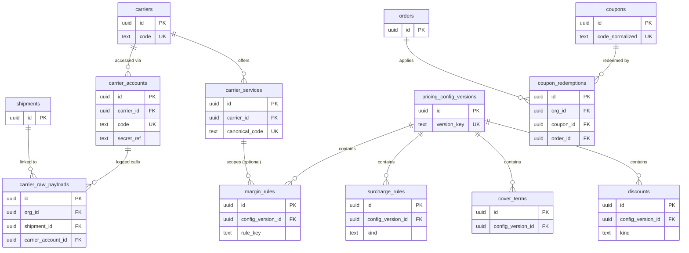

### 2.7 Quotes

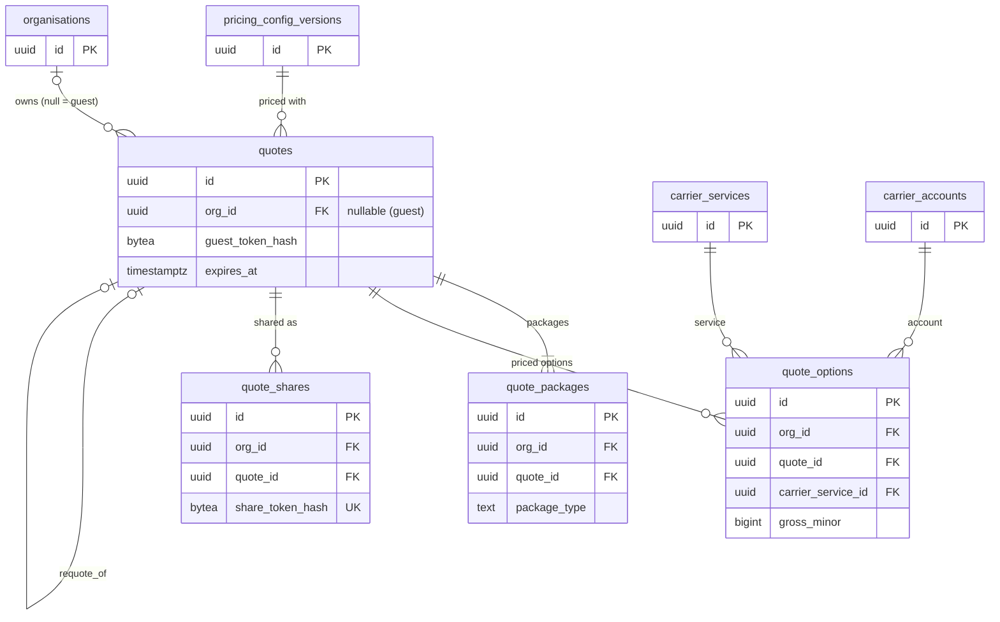

### 2.8 Shipments and customs

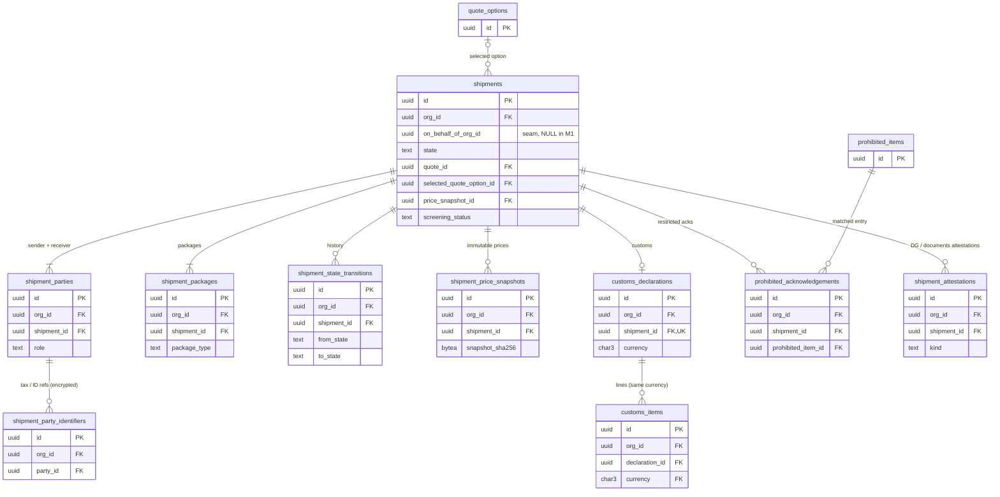

### 2.9 Orders, saga and payments

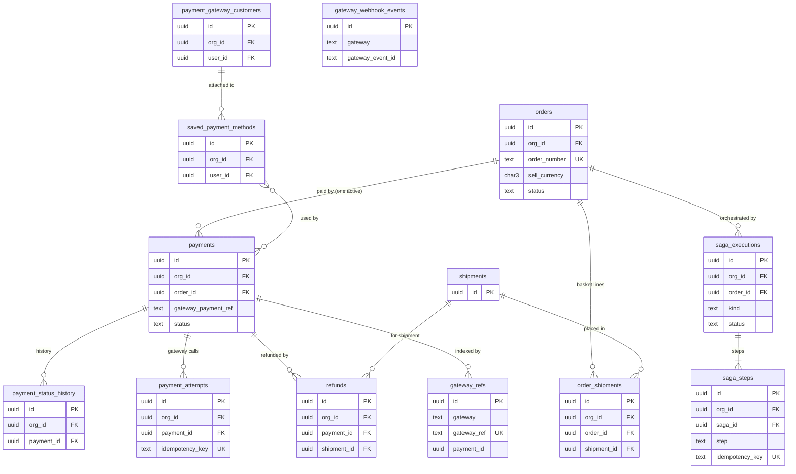

### 2.10 Documents, pickups, tracking, notifications

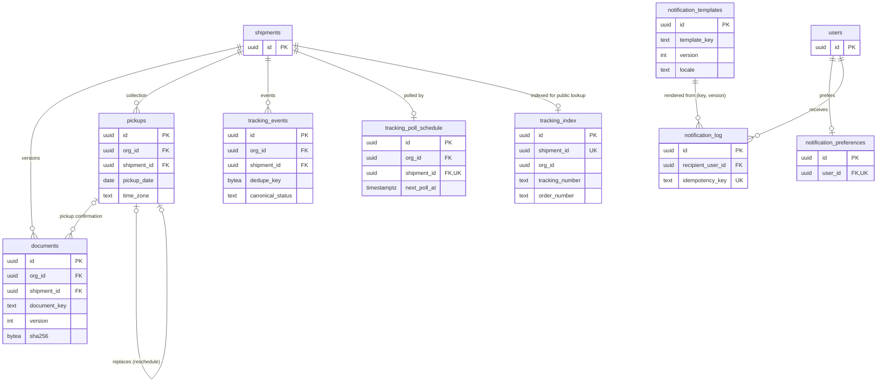


---

## 3. Table-by-table specification

How to read the tables:

- **Header line:** table name · class (§1.5) · soft delete (yes/no) · write mode (`mutable`, `append-only`, `insert-only config`, `hard-delete allow-listed`).
- **`STD`** row = the six standard columns of P2; **`SD`** row = `deleted_at`, `deleted_by` (P3). Both are classification `INT`.
- **Null:** `N` = `NOT NULL`, `Y` = nullable.
- **Class:** `PUB`, `INT`, `PER`, `SPER`, `SEC` (§1.2). This column is the content of the classification registry.
- **Access patterns** are named `AP-<MODULE>-nn`; each name is an entry in the NFR-PERF-006 query-plan registry and maps to exactly one supporting index (or the primary key). Keyset pagination keys are stated as `(sort cols, id)`. All tenant indexes lead with `org_id` (REQ-RLS-001); partial `WHERE deleted_at IS NULL` on soft-deletable tables (REQ-RLS-010).
- Currency columns always carry `CHECK (<col> ~ '^[A-Z]{3}$')`; country columns `CHECK (<col> ~ '^[A-Z]{2}$')`. They are not repeated per row.

### 3.1 Identity module

#### `users` · USER_OWNED (+ org-member read branch, DR-A14) · SD: yes · mutable

REQ-AUTH-001/004/024, REQ-ORG-002/005, REQ-ACCT-017/018, REQ-I18N-007, REQ-UI-002/016/017, DR-A04.

| Column | Type | Null | Default / constraint | Class |
|---|---|---|---|---|
| STD, SD | | | | INT |
| `email` | `text` | N | `ck_users__email_normalised CHECK (email = lower(email) AND char_length(email) BETWEEN 3 AND 254)`; NFC normalisation and trimming done in the service (REQ-AUTH-001, EC-A02) | PER |
| `email_verified_at` | `timestamptz` | Y | | INT |
| `display_name` | `text` | N | `CHECK (char_length(display_name) BETWEEN 1 AND 100)` | PER |
| `status` | `text` | N | `DEFAULT 'PENDING_VERIFICATION'`, CHECK `user_status` | INT |
| `status_changed_at` | `timestamptz` | N | `DEFAULT now()` | INT |
| `locale` | `text` | N | `DEFAULT 'en'`, `CHECK (locale IN ('en','es','fr'))` | INT |
| `time_zone` | `text` | Y | IANA name, validated in service (A-077) | PER |
| `display_currency` | `char(3)` | Y | FK `currencies(code)` | INT |
| `unit_system` | `text` | Y | `CHECK (unit_system IN ('METRIC','IMPERIAL'))` | INT |
| `theme` | `text` | Y | `CHECK (theme IN ('LIGHT','DARK','SYSTEM'))` (REQ-UI-002) | INT |
| `admin_sidebar_collapsed` | `boolean` | N | `DEFAULT false` (REQ-UI-016) | INT |
| `table_density` | `text` | N | `DEFAULT 'COMFORTABLE'`, `CHECK (… IN ('COMFORTABLE','COMPACT'))` (REQ-UI-017) | INT |
| `personal_org_id` | `uuid` | Y | FK `organisations(id)`, set in the registration transaction (REQ-ORG-002); `DEFERRABLE INITIALLY DEFERRED` because user and org are inserted in the same transaction | INT |
| `last_active_org_id` | `uuid` | Y | FK `organisations(id)` (REQ-ORG-005) | INT |
| `is_system` | `boolean` | N | `DEFAULT false` (reserved actors, §1.6) | INT |
| `deletion_requested_at` | `timestamptz` | Y | 30-day grace (REQ-ACCT-017, Could) | INT |

| AP | Query | Index |
|---|---|---|
| AP-ID-01 | Resolve user by normalised email at login/registration/reset (through `auth_lookup_user_by_email`, §4.5) | `ux_users__email ON (email) WHERE deleted_at IS NULL` (also enforces case-insensitive uniqueness, EC-A02) |
| AP-ID-02 | Own row by id (`GET /me`) | PK |
| AP-ID-03 | Users of an org for member list (join from memberships) | PK (driven from `memberships`) |

#### `user_credentials` · USER_OWNED · SD: no · mutable

REQ-AUTH-002/003/012/023. One row per user; separated from `users` so that the profile can be read and audited without ever touching the hash.

| Column | Type | Null | Default / constraint | Class |
|---|---|---|---|---|
| STD | | | | INT |
| `user_id` | `uuid` | N | FK `users(id)`, `UNIQUE` | INT |
| `password_hash` | `text` | N | bcrypt string; `CHECK (password_hash ~ '^\$2[aby]\$')` | SEC |
| `bcrypt_cost` | `smallint` | N | `CHECK (bcrypt_cost >= 12)` (rehash on login when lower, REQ-AUTH-003) | INT |
| `password_changed_at` | `timestamptz` | N | `DEFAULT now()` | INT |

AP-ID-04 credential by user id → `ux_user_credentials__user_id`.

#### `email_verification_tokens`, `password_reset_tokens` · USER_OWNED · SD: no · purged by `purge_expired_tokens` (§4.5)

REQ-AUTH-004/011/012, DR-A01 (24 h / 60 min, 256-bit, hashed, single-use, superseded by newer token). Redeemed through `auth_lookup_one_time_token` (§4.5), after which the transaction runs as the user. Identical shape:

| Column | Type | Null | Default / constraint | Class |
|---|---|---|---|---|
| STD | | | | INT |
| `user_id` | `uuid` | N | FK `users(id)` | INT |
| `token_hash` | `bytea` | N | SHA-256 of the 256-bit token; `CHECK (octet_length(token_hash) = 32)`; `UNIQUE` | SEC |
| `expires_at` | `timestamptz` | N | | INT |
| `consumed_at` | `timestamptz` | Y | | INT |
| `superseded_at` | `timestamptz` | Y | set on all open tokens of the user when a new one is issued | INT |

| AP | Query | Index |
|---|---|---|
| AP-ID-05 | Redeem by token hash | `ux_<table>__token_hash` |
| AP-ID-06 | Supersede open tokens of a user | `ix_<table>__user_id_open ON (user_id) WHERE consumed_at IS NULL AND superseded_at IS NULL` |
| AP-ID-07 | Housekeeping purge (`expires_at < now() - 7 days`) through `purge_expired_tokens`, batches of 1,000 | `ix_<table>__expires_at` |

#### `sessions` · USER_OWNED · SD: no · mutable

REQ-AUTH-007/009/021/022, REQ-ADMIN-004/007, A-041. `id` is the `sid` claim.

| Column | Type | Null | Default / constraint | Class |
|---|---|---|---|---|
| STD | | | | INT |
| `user_id` | `uuid` | N | FK `users(id)` | INT |
| `client_app` | `text` | N | `CHECK (client_app IN ('web','admin'))` | INT |
| `status` | `text` | N | `DEFAULT 'ACTIVE'`, CHECK `session_status` | INT |
| `active_org_id` | `uuid` | N | FK `organisations(id)` (REQ-ORG-005/006) | INT |
| `mfa_satisfied` | `boolean` | N | `DEFAULT false` (JWT `mfa` claim source) | INT |
| `ip_prefix_created` | `inet` | Y | network prefix only, IPv4 /24 or IPv6 /48 (`CHECK (masklen(ip_prefix_created) IN (24, 48))`, REQ-AUTH-021) | PER |
| `ip_prefix_last` | `inet` | Y | as above | PER |
| `user_agent_raw` | `text` | Y | `CHECK (char_length(user_agent_raw) <= 512)` | PER |
| `ua_browser`, `ua_os` | `text` | Y | parsed by bowser | PER |
| `last_used_at` | `timestamptz` | N | `DEFAULT now()`; updated at most once per 5 min per session (write throttling) | INT |
| `absolute_expires_at` | `timestamptz` | N | login + 90 d (web) / 12 h (admin) (A-041, REQ-ADMIN-004) | INT |
| `revoked_at` | `timestamptz` | Y | | INT |
| `revoked_reason` | `text` | Y | `CHECK (… IN ('LOGOUT','REMOTE_SIGN_OUT','PASSWORD_RESET','PASSWORD_CHANGED','TOKEN_REUSE','MEMBERSHIP_REMOVED','USER_STATUS_CHANGED','MFA_DISABLED','ABSOLUTE_EXPIRY'))` | INT |

| AP | Query | Index |
|---|---|---|
| AP-ID-08 | List own sessions (newest use first) | `ix_sessions__user_status_last_used ON (user_id, status, last_used_at DESC, id DESC)` |
| AP-ID-09 | Revoke sessions whose active org is X for a removed member (REQ-ORG-012, EC-A17) | `ix_sessions__active_org_user ON (active_org_id, user_id) WHERE status = 'ACTIVE'` |
| AP-ID-10 | Expire sessions past `absolute_expires_at` (housekeeping; access tokens already stop at the absolute cap, so this is cleanup) | `ix_sessions__absolute_expires ON (absolute_expires_at) WHERE status = 'ACTIVE'` |

Cross-user revocations (membership removal, user status change, REQ-ORG-012, DR-A04) are performed by a worker job reacting to the outbox event with `app.actor_id` set to the affected user, because `sessions` is USER_OWNED; the Redis revocation set makes them effective within 5 s (REQ-AUTH-009, OI-25).

#### `refresh_tokens` · USER_OWNED · SD: no · purged by `purge_expired_tokens` (expired families)

ADR-0006, REQ-AUTH-006/007/008, DR-A03. Looked up by hash through `auth_lookup_refresh_token` (§4.5) before any access token exists; rotation and revocation then run under the user's own-row policy.

| Column | Type | Null | Default / constraint | Class |
|---|---|---|---|---|
| STD | | | | INT |
| `family_id` | `uuid` | N | one family per session | INT |
| `session_id` | `uuid` | N | FK `sessions(id)` | INT |
| `user_id` | `uuid` | N | FK `users(id)` | INT |
| `token_hash` | `bytea` | N | SHA-256, 32 bytes, `UNIQUE` | SEC |
| `status` | `text` | N | `DEFAULT 'ACTIVE'`, CHECK `refresh_token_status` | INT |
| `expires_at` | `timestamptz` | N | issue + 30 d, never beyond session absolute expiry | INT |
| `rotated_at`, `revoked_at` | `timestamptz` | Y | | INT |
| `replaced_by_id` | `uuid` | Y | FK `refresh_tokens(id)` | INT |

Constraint `ux_refresh_tokens__one_active_per_family ON (family_id) WHERE status = 'ACTIVE'` makes a second concurrent rotation fail (DR-A03, EC-A04). AP-ID-11 lookup by hash (`ux_refresh_tokens__token_hash`); AP-ID-12 revoke family (`ix_refresh_tokens__family_id`); AP-ID-13 purge `expires_at < now() - 7 d` (`ix_refresh_tokens__expires_at`).

#### `mfa_totp` · USER_OWNED · SD: no · mutable

REQ-AUTH-015/017/018/019, EC-A06.

| Column | Type | Null | Default / constraint | Class |
|---|---|---|---|---|
| STD | | | | INT |
| `user_id` | `uuid` | N | FK `users(id)` | INT |
| `status` | `text` | N | `CHECK (status IN ('PENDING','ACTIVE','DISABLED'))` | INT |
| `secret_ciphertext` | `bytea` | N | AES-256-GCM (nonce ‖ ciphertext ‖ tag) of the base32 secret | SEC |
| `key_id` | `text` | N | envelope key identifier/version (env key locally, KMS key ARN + version in AWS); never the key itself | INT |
| `pending_expires_at` | `timestamptz` | Y | created + 15 min while PENDING | INT |
| `activated_at`, `disabled_at` | `timestamptz` | Y | | INT |
| `last_accepted_step` | `bigint` | Y | last accepted RFC 6238 time step; a code for a step ≤ this is rejected (EC-A06) | INT |

`ux_mfa_totp__user_live ON (user_id) WHERE status IN ('PENDING','ACTIVE')` (AP-ID-14).

#### `mfa_recovery_codes` · USER_OWNED · SD: no · mutable

REQ-AUTH-016, REQ-ADMIN-008. Columns: STD; `user_id uuid N FK`; `batch_id uuid N` (regeneration voids the whole previous batch); `code_hash text N` bcrypt (SEC); `used_at timestamptz Y`; `voided_at timestamptz Y`. AP-ID-15 unused codes of a user: `ix_mfa_recovery_codes__user_open ON (user_id) WHERE used_at IS NULL AND voided_at IS NULL` (≤ 10 rows, each compared with bcrypt).

#### `mfa_challenges` · USER_OWNED · SD: no · purged by `purge_expired_tokens`

REQ-AUTH-017 (5 min, single use, bound to user and IP class). Columns: STD; `user_id uuid N FK`; `client_app text N`; `token_hash bytea N UNIQUE` (SEC); `ip_prefix_hmac bytea N` (HMAC-SHA256 of the client's /24 or /48 prefix, so the challenge can be bound to the IP class without storing the address; INT); `expires_at timestamptz N`; `consumed_at timestamptz Y`; `failed_attempts smallint N DEFAULT 0 CHECK (failed_attempts BETWEEN 0 AND 5)`. AP-ID-16 by hash (through `auth_lookup_one_time_token` with purpose `MFA_CHALLENGE`); AP-ID-17 purge by `expires_at`.

#### `reauth_proofs` · USER_OWNED · SD: no · purged by `purge_expired_tokens`

REQ-AUTH-020 (5 min, single use, bound to session + action scope). Columns: STD; `user_id uuid N`; `session_id uuid N FK sessions`; `scope text N CHECK (scope ~ '^[a-z_]+(:[a-z_]+)*$')`; `token_hash bytea N UNIQUE` (SEC); `expires_at timestamptz N`; `consumed_at timestamptz Y`. Consumption is `UPDATE … SET consumed_at = now() WHERE token_hash = $1 AND session_id = $2 AND scope = $3 AND consumed_at IS NULL AND expires_at > now() RETURNING id` (single use under concurrency). Seam: the M2 signature record references `reauth_proofs.id` from the audit entry (`audit_entries.reauth_proof_id`).

#### `login_attempt_counters` · SYSTEM · SD: no · hard-delete allow-listed (stale > 30 d)

REQ-AUTH-013/014/017, DR-A02, EC-A09. Counters exist for unknown identifiers too, so the key is a keyed hash, never the email.

| Column | Type | Null | Default / constraint | Class |
|---|---|---|---|---|
| STD | | | | INT |
| `kind` | `text` | N | `CHECK (kind IN ('LOGIN','MFA'))` | INT |
| `identifier_hmac` | `bytea` | N | HMAC-SHA256(normalised email or user id, per-environment key from secret manager) | SEC |
| `consecutive_failures` | `integer` | N | `DEFAULT 0 CHECK (consecutive_failures >= 0)` | INT |
| `last_failure_at` | `timestamptz` | Y | | INT |
| `delayed_until`, `locked_until` | `timestamptz` | Y | DR-A02 schedule | INT |

`ux_login_attempt_counters__kind_identifier ON (kind, identifier_hmac)` (AP-ID-18). Increment is an atomic upsert: `INSERT … ON CONFLICT (kind, identifier_hmac) DO UPDATE SET consecutive_failures = CASE WHEN login_attempt_counters.locked_until > now() THEN login_attempt_counters.consecutive_failures ELSE login_attempt_counters.consecutive_failures + 1 END, …` (counter not incremented while locked, DR-A02).

### 3.2 Organisations module

#### `organisations` · TENANT (special policy, §4.3) · SD: yes · mutable

REQ-ORG-001/002/008/009/014, DR-A06, REQ-I18N, REQ-PRICE-015.

| Column | Type | Null | Default / constraint | Class |
|---|---|---|---|---|
| STD, SD | | | | INT |
| `type` | `text` | N | CHECK `org_type`; immutable (trigger `trg_organisations__type_immutable` raises on change) | INT |
| `display_name` | `text` | N | `CHECK (char_length(display_name) BETWEEN 1 AND 120)` | PER (a personal org is named after the user) |
| `legal_name` | `text` | Y | ≤ 200 | PER |
| `country_code` | `char(2)` | Y | FK `countries(code)` | PUB |
| `address_line1`, `address_line2`, `address_line3`, `city`, `postcode` | `text` | Y | lengths per DR-B (≤ 100/100/100/60/20) | PER |
| `region_code` | `text` | Y | FK `subdivisions(code)` | INT |
| `contact_email` | `text` | Y | lower-case | PER |
| `contact_phone_e164` | `text` | Y | `CHECK (contact_phone_e164 ~ '^\+[1-9][0-9]{6,14}$')` | PER |
| `default_locale` | `text` | N | `DEFAULT 'en'` CHECK en/es/fr | INT |
| `default_currency` | `char(3)` | Y | FK `currencies(code)` | INT |
| `personal_owner_user_id` | `uuid` | Y | FK `users(id)`; `CHECK ((type = 'INDIVIDUAL') = (personal_owner_user_id IS NOT NULL))` | INT |

| AP | Query | Index |
|---|---|---|
| AP-ORG-01 | Org by id (profile, `GET /organisations/{id}`) | PK |
| AP-ORG-02 | Exactly one OPERATOR org (DR-A06) | `ux_organisations__single_operator ON (type) WHERE type = 'OPERATOR'` |
| AP-ORG-03 | Personal org of a user (one per user) | `ux_organisations__personal_owner ON (personal_owner_user_id) WHERE personal_owner_user_id IS NOT NULL AND deleted_at IS NULL` |
| AP-ORG-04 | Count of orgs owned by a user (A-047 cap 10) | driven from `membership_roles` (AP-ORG-09) |

The REQ-RLS-001 "index leading with `org_id`" rule is satisfied by the PK `id`, which is the tenant key of this table (catalog test special-cases `organisations.id`).

#### `organisation_tax_references` · TENANT · SD: yes · mutable

REQ-ORG-008 (tax references as type/value pairs). Columns: STD, SD; `org_id uuid N FK`; `reference_type text N CHECK (reference_type ~ '^[A-Z]{2}_[A-Z0-9_]+$')` (pack-defined codes such as `IN_GSTIN`, `GB_VAT`); `value text N` ≤ 64 (PER); `country_code char(2) N`. AP-ORG-05 list per org: `ix_organisation_tax_references__org ON (org_id, reference_type) WHERE deleted_at IS NULL`; unique `(org_id, reference_type, value) WHERE deleted_at IS NULL`.

#### `memberships` · TENANT (+ user-owned read branch, DR-A14) · SD: no (status `REMOVED` keeps history) · mutable

REQ-ORG-003/005/011/012/013, DR-A05, EC-A15/A17.

| Column | Type | Null | Default / constraint | Class |
|---|---|---|---|---|
| STD | | | | INT |
| `org_id` | `uuid` | N | FK `organisations(id)` | INT |
| `user_id` | `uuid` | N | FK `users(id)` | INT |
| `status` | `text` | N | CHECK `membership_status` | INT |
| `invitation_id` | `uuid` | Y | FK `invitations(id)` | INT |
| `activated_at`, `suspended_at`, `removed_at` | `timestamptz` | Y | | INT |
| `removed_by` | `uuid` | Y | | INT |
| `last_owner_guard` | — | — | not a column: the LAST_OWNER rule (REQ-ORG-013) is enforced by the service under `SELECT … FOR UPDATE` of the org's ACTIVE Owner membership rows inside the changing transaction | — |

| AP | Query | Index |
|---|---|---|
| AP-ORG-06 | Unique non-removed membership per (user, org) | `ux_memberships__org_user_live ON (org_id, user_id) WHERE status <> 'REMOVED'` |
| AP-ORG-07 | Member list of an org (status filter, keyset by `created_at, id`) | `ix_memberships__org_status_created ON (org_id, status, created_at, id)` |
| AP-ORG-08 | A user's memberships across orgs (`GET /me/organisations`, permission resolution per request, REQ-RBAC-008) | `ix_memberships__user_status ON (user_id, status) INCLUDE (org_id)` |

#### `membership_roles` · TENANT · SD: no (revocation via `revoked_at`) · mutable

REQ-ORG-003/004/012, REQ-ACCT-015. Columns: STD; `org_id uuid N FK`; `membership_id uuid N FK memberships`; `role_id uuid N FK roles`; `granted_by uuid N`; `revoked_at timestamptz Y`; `revoked_by uuid Y`. Trigger `trg_membership_roles__scope_matches_org` (BEFORE INSERT) raises `ROLE_NOT_ALLOWED_FOR_ORG_TYPE` when `roles.scope` does not match the org type mapping (`OPERATOR→OPERATOR`, `BUSINESS_CUSTOMER|INDIVIDUAL→CUSTOMER`, `PARTNER→PARTNER`) as the database backstop of REQ-ORG-004.

| AP | Query | Index |
|---|---|---|
| AP-ORG-09 | Active roles of a membership (permission resolution) | `ux_membership_roles__membership_role_live ON (membership_id, role_id) WHERE revoked_at IS NULL` |
| AP-ORG-10 | ACTIVE Owners of an org (LAST_OWNER check) | `ix_membership_roles__org_role_live ON (org_id, role_id) WHERE revoked_at IS NULL` |

#### `invitations` · TENANT · SD: no (status) · mutable

REQ-ORG-010/011, REQ-ACCT-014, A-082, DR-A01, EC-A16.

| Column | Type | Null | Default / constraint | Class |
|---|---|---|---|---|
| STD | | | | INT |
| `org_id` | `uuid` | N | FK | INT |
| `email` | `text` | N | lower-case | PER |
| `role_id` | `uuid` | N | FK `roles(id)` (customer roles only; trigger as on `membership_roles`) | INT |
| `locale` | `text` | N | CHECK en/es/fr (inviter's selection, REQ-NOTIF-006) | INT |
| `token_hash` | `bytea` | N | 32 bytes, `UNIQUE` | SEC |
| `status` | `text` | N | `CHECK (status IN ('PENDING','ACCEPTED','REVOKED','EXPIRED'))` | INT |
| `expires_at` | `timestamptz` | N | created + 7 d | INT |
| `send_count` | `smallint` | N | `DEFAULT 1 CHECK (send_count BETWEEN 1 AND 4)` (initial + 3 resends) | INT |
| `last_sent_at` | `timestamptz` | N | | INT |
| `accepted_at`, `revoked_at` | `timestamptz` | Y | | INT |
| `accepted_by_user_id`, `revoked_by` | `uuid` | Y | | INT |

AP-ORG-11 pending invitation per (org, email): `ux_invitations__org_email_pending ON (org_id, email) WHERE status = 'PENDING'`; AP-ORG-12 list per org: `ix_invitations__org_status_created ON (org_id, status, created_at DESC, id DESC)`; AP-ORG-13 redeem by token: `ux_invitations__token_hash` (via `invitation_lookup`, §4.5).

#### `address_book_entries` · TENANT · SD: yes · mutable

REQ-ACCT-008/009/010, REQ-BOOK-005, A-068 (≤ 500 per org; app-checked with a count inside the insert transaction under `SELECT … FOR UPDATE` of the org row).

| Column | Type | Null | Default / constraint | Class |
|---|---|---|---|---|
| STD, SD | | | | INT |
| `org_id` | `uuid` | N | FK | INT |
| `label` | `text` | N | `CHECK (char_length(label) BETWEEN 1 AND 50)` | PER |
| `contact_name` | `text` | N | ≤ 100 | PER |
| `company` | `text` | Y | ≤ 100 | PER |
| `address_line1` | `text` | N | ≤ 100 | PER |
| `address_line2`, `address_line3` | `text` | Y | ≤ 100 | PER |
| `city` | `text` | N | ≤ 60 | PER |
| `region_code` | `text` | Y | FK `subdivisions(code)` | INT |
| `postcode` | `text` | Y | ≤ 20 | PER |
| `country_code` | `char(2)` | N | FK `countries(code)` | PUB |
| `phone_e164` | `text` | N | E.164 CHECK | PER |
| `email` | `text` | Y | | PER |
| `residential` | `boolean` | N | `DEFAULT false` | INT |
| `is_default_sender` | `boolean` | N | `DEFAULT false` | INT |
| `search_text` | `text` | N | `GENERATED ALWAYS AS (lower(label \|\| ' ' \|\| contact_name \|\| ' ' \|\| coalesce(company,'') \|\| ' ' \|\| city)) STORED` | PER |

| AP | Query | Index |
|---|---|---|
| AP-ORG-14 | List entries by label (keyset `(lower(label), id)`) | `ix_address_book__org_label ON (org_id, lower(label), id) WHERE deleted_at IS NULL` |
| AP-ORG-15 | Search by name/company/city/label (partial, case-insensitive) | `ix_address_book__org_search_trgm USING gin (org_id, search_text gin_trgm_ops) WHERE deleted_at IS NULL` (extensions `pg_trgm`, `btree_gin`) |
| AP-ORG-16 | One default sender per org (REQ-ACCT-009) | `ux_address_book__org_default_sender ON (org_id) WHERE is_default_sender AND deleted_at IS NULL` |
| AP-ORG-17 | CSV import duplicate check by label + postcode (REQ-ACCT-010) | `ix_address_book__org_label_postcode ON (org_id, lower(label), postcode) WHERE deleted_at IS NULL` |

#### `terms_acceptances` · USER_OWNED · SD: no · append-only

REQ-AUTH-001. Columns: STD; `user_id uuid N FK`; `document text N CHECK (document IN ('TERMS','PRIVACY'))`; `document_version text N`; `country_code text N` (pack country or `EU`); `locale text N`; `accepted_at timestamptz N DEFAULT now()`. AP-ORG-18 own acceptances: `ix_terms_acceptances__user ON (user_id, document, accepted_at DESC)`.

### 3.3 Authz module (GLOBAL, read-only at runtime)

REQ-RBAC-001/002/003/004/013/014, DR-A07. Loaded and reconciled by the reference seed from the `packages/authz` catalogue (§9.3); no runtime write grants (REQ-RBAC-013).

| Table | Columns (besides STD) | Constraints / indexes |
|---|---|---|
| `permissions` | `key text N` (INT), `description text N`, `category text N`, `operator_only boolean N DEFAULT false` | `ux_permissions__key`; `ck_permissions__key_format CHECK (key ~ '^[a-z_]+:[a-z_]+(:[a-z_]+)?$' OR key IN ('public','authenticated'))` |
| `roles` | `key text N` (e.g. `OPERATOR_SUPER_ADMIN`, `CUSTOMER_OWNER`, `PARTNER_DEVELOPER`), `name_key text N` (i18n key), `scope text N` CHECK `role_scope`, `is_system boolean N DEFAULT true`, `description text N` | `ux_roles__key`; AP-AUTHZ-01 roles by scope `ix_roles__scope` |
| `role_permissions` | `role_id uuid N FK`, `permission_id uuid N FK` | `ux_role_permissions__role_permission`; AP-AUTHZ-02 permissions of roles `ix_role_permissions__role_id INCLUDE (permission_id)` |

The effective-permission query (REQ-RBAC-008) is one statement: memberships (AP-ORG-08) → membership_roles (AP-ORG-09) → role_permissions (AP-AUTHZ-02) → permissions; its result is cached in Redis for at most 5 s and invalidated on membership change.

### 3.4 Audit module

#### `audit_entries` · SYSTEM (no RLS, ADR-0005) · SD: no · append-only, immutable (DB-enforced) · partitioned by RANGE (`occurred_at`) monthly

ADR-0007, REQ-AUDIT-002/003/004/007/008/009/010/011/012/014/016/017/018, DR-A09..A13, NFR-AUDIT-001..006. Full DDL in §5.1. Access only through `packages/audit`; the viewer repository applies the scope that RLS would otherwise apply (`scope_org_id = active org` unless the request carries verified operator scope, REQ-AUDIT-023) and the route requires `audit:read`. **Exempt from P2 standard columns** (immutable rows have no `updated_*`/`version`; `occurred_at` plays `created_at`, `user_id` plays `created_by`) — OI-08.

| Column | Type | Null | Default / constraint | Class |
|---|---|---|---|---|
| `id` | `uuid` | N | UUIDv7 (app) | INT |
| `occurred_at` | `timestamptz` | N | database clock `clock_timestamp()` read **after** the stream lock is held (§5.4); partition key | INT |
| `stream_id` | `uuid` | N | `org_id`, or one of the 16 SYSTEM shard UUIDs (§1.6, ADR-0007 amendment 1) | INT |
| `stream_seq` | `bigint` | N | `audit_stream_heads.entry_count + 1`, allocated under the stream lock; explicit chain order and gap detector (OI-05) | INT |
| `org_id` | `uuid` | Y | actor's active organisation | INT |
| `target_org_id` | `uuid` | Y | organisation whose data was touched by an operator cross-tenant action (REQ-RLS-006, DR-A15) | INT |
| `scope_org_id` | `uuid` | Y | `GENERATED ALWAYS AS (COALESCE(target_org_id, org_id)) STORED`; the viewer's "organisation" filter | INT |
| `on_behalf_of_org_id` | `uuid` | Y | NULL in M1 (DR-A06) | INT |
| `actor_type` | `text` | N | CHECK `actor_type` | INT |
| `user_id` | `uuid` | Y | NULL for ANONYMOUS; SYSTEM actor id for jobs | INT |
| `api_key_id` | `uuid` | Y | seam (M3) | INT |
| `job_name` | `text` | Y | required when `actor_type = 'SYSTEM_JOB'` (`CHECK`) | INT |
| `actor_roles` | `text[]` | N | `DEFAULT '{}'`; role keys at the time | INT |
| `session_id` | `uuid` | Y | | INT |
| `ip_token` | `uuid` | Y | PII-vault token of the client IP (ADR-0007 amendment 2) | PER (token) |
| `ip_hash` | `bytea` | Y | HMAC-SHA256(`AUDIT_INDEX_KEY`, IP) for the viewer's IP equality filter | INT |
| `ip_coarse` | `inet` | Y | /24 (IPv4) or /48 (IPv6) network, in clear (not personal data at that granularity, ADR-0007 amendment 2) | INT |
| `user_agent_token` | `uuid` | Y | PII-vault token of the raw UA string (ADR-0007 amendment 2) | PER (token) |
| `ua_parsed` | `text` | Y | browser family + major version / OS family only (e.g. `Firefox 146 / Windows`) | INT |
| `source_app` | `text` | N | CHECK `source_app` | INT |
| `correlation_id` | `text` | N | `CHECK (correlation_id ~ '^[A-Za-z0-9-]{8,64}$')` | INT |
| `action` | `text` | N | CHECK `audit_action` | INT |
| `entity_name` | `text` | N | `CHECK (entity_name ~ '^[a-z][a-z0-9_]*$')` | INT |
| `entity_id` | `text` | Y | NULL for list views | INT |
| `outcome` | `text` | N | CHECK `audit_outcome` | INT |
| `reason_token` | `uuid` | Y | PII-vault token of the typed reason (REQ-AUDIT-025, ≤ 500 chars; ADR-0007 amendment 2) | PER (token) |
| `reauth_proof_id` | `uuid` | Y | seam for the M2 signature record (§4.9 Part 11) | INT |
| `signature_meaning` | `text` | Y | seam (M2) | INT |
| `http_method` | `text` | Y | | INT |
| `route` | `text` | Y | route template, never the concrete URL | INT |
| `old_value`, `new_value` | `jsonb` | Y | field-level diff, keys sorted (REQ-AUDIT-007); `PER`/`SPER` values replaced by `{"$pii":"<token>"}`, `SEC` by `"[REDACTED]"` | INT (tokenised) |
| `details` | `jsonb` | Y | context snapshot: filter summary (filter values tokenised, ADR-0007 amendment 2) + result count (DR-A13), required permission (REQ-RBAC-007), document id/version/sha256 (REQ-DOC-008), carrier operation (`carrier_call`), from/to state | INT |
| `pii_token_count` | `integer` | N | `DEFAULT 0 CHECK (pii_token_count >= 0)` | INT |
| `hash_version` | `smallint` | N | `DEFAULT 1` (canonicalisation version) | INT |
| `prev_hash` | `bytea` | N | `CHECK (octet_length(prev_hash) = 32)`; 32 zero bytes for `stream_seq = 1` | INT |
| `entry_hash` | `bytea` | N | `CHECK (octet_length(entry_hash) = 32)` | INT |

Keys and constraints: `PRIMARY KEY (occurred_at, id)`; `UNIQUE (entry_hash, occurred_at)` — PostgreSQL requires the partition key in every unique constraint of a partitioned table, so ADR-0007's "`entry_hash` UNIQUE" is enforced per partition and global uniqueness of `entry_hash` and `(stream_id, stream_seq)` is asserted by the verifier (OI-05).

| AP | Query (all carry a mandatory `occurred_at` range ≤ 31 days, REQ-AUDIT-019) | Index (created on the parent, propagated to every partition) |
|---|---|---|
| AP-AUD-01 | Time range, newest first, keyset `(occurred_at DESC, id DESC)` | PK `(occurred_at, id)` scanned backwards |
| AP-AUD-02 | Organisation + time | `ix_audit__scope_org_time ON (scope_org_id, occurred_at DESC, id DESC)` |
| AP-AUD-03 | User + time | `ix_audit__user_time ON (user_id, occurred_at DESC, id DESC) WHERE user_id IS NOT NULL` |
| AP-AUD-04 | Entity name + entity id + time (also entity history, REQ-AUDIT-021, chronological) | `ix_audit__entity_time ON (entity_name, entity_id, occurred_at DESC, id DESC)` |
| AP-AUD-05 | Action + time | `ix_audit__action_time ON (action, occurred_at DESC, id DESC)` |
| AP-AUD-06 | Outcome (DENIED/FAILED) + time | `ix_audit__outcome_time ON (outcome, occurred_at DESC, id DESC) WHERE outcome <> 'SUCCESS'` |
| AP-AUD-07 | IP + time (exact IP via `ip_hash`, network via `ip_coarse`) | `ix_audit__ip_hash_time ON (ip_hash, occurred_at DESC, id DESC) WHERE ip_hash IS NOT NULL`; `ix_audit__ip_coarse_time ON (ip_coarse, occurred_at DESC, id DESC) WHERE ip_coarse IS NOT NULL` |
| AP-AUD-08 | Role filter (combined with the time range) | `ix_audit__roles USING gin (actor_roles)` |
| AP-AUD-09 | Chain verification and head recovery by stream (ADR-0007's `(stream_id, occurred_at)` order equals `stream_seq` order because `occurred_at` is taken after the lock and kept monotonic) | `ix_audit__stream_seq ON (stream_id, stream_seq)` |
| AP-AUD-15 | Correlation id (support: all entries of one request/job) | `ix_audit__correlation ON (correlation_id)` |
| AP-AUD-10 | Entry detail by id (`GET /audit/entries/{id}`) | The API cursor/ID carries the timestamp (`id` is UUIDv7, so `uuid_extract_timestamp(id)` bounds `occurred_at` to ±1 s), letting the query add `occurred_at BETWEEN t - 1 s AND t + 1 s` and prune to one partition; PK lookup |

Write amplification: 12 index entries per audit insert (PK, unique hash, 10 secondary). At the design load of ≈ 40 audit writes/s peak (§10) this is ≈ 500 index tuples/s, well inside one instance; AP-AUD-06/07 are partial to stay small, and AP-AUD-08 (GIN) uses `fastupdate` (default on) so pending-list inserts are batched. Index count is reviewed at M5 with real filter usage; dropping one is a contract step.

**Partition pruning proof (REQ-AUDIT-016).** Every viewer query has the form `WHERE occurred_at >= $from AND occurred_at < $to [AND <filter>] ORDER BY occurred_at DESC, id DESC LIMIT $n`. With literal or custom-plan parameters the planner prunes at plan time; with a generic plan (prepared statement reused > 5 times by `pg`) pruning happens at executor start-up and `EXPLAIN` shows `Subplans Removed: N`. The integration test (Testcontainers, 1M seeded rows across ≥ 4 monthly partitions, NFR-PERF-006) runs `EXPLAIN (FORMAT JSON)` for a one-day range (a) with literals and (b) after `SET plan_cache_mode = force_generic_plan` via `PREPARE`/`EXPLAIN EXECUTE`, and asserts that the Append node has exactly one non-pruned child (`audit_entries_YYYY_MM` of that day) and that no node is a `Seq Scan` on a partition with > 10,000 rows. A cross-month range of ≤ 31 days touches at most two partitions (asserted as well).

#### `audit_stream_heads` · SYSTEM · SD: no · mutable (under the stream lock only)

ADR-0007 (per-stream chain), REQ-AUDIT-012, EC-A22. O(1) predecessor lookup that does not depend on RLS visibility of the previous entry (an anonymous request may append to an org stream without being able to read that stream).

| Column | Type | Null | Default / constraint | Class |
|---|---|---|---|---|
| STD | | | | INT |
| `stream_id` | `uuid` | N | `UNIQUE` | INT |
| `entry_count` | `bigint` | N | `DEFAULT 0` (= `stream_seq` of the head entry) | INT |
| `head_entry_id` | `uuid` | Y | | INT |
| `head_occurred_at` | `timestamptz` | Y | | INT |
| `head_hash` | `bytea` | N | 32 zero bytes by default | INT |
| `last_verified_seq` | `bigint` | N | `DEFAULT 0` | INT |
| `last_verified_hash` | `bytea` | N | 32 zero bytes | INT |
| `last_verified_occurred_at` | `timestamptz` | Y | | INT |

The head is a cache, not evidence: if it were tampered with, the next entry would chain to a wrong predecessor and the verifier (which walks entries, §5.6) reports the break.

#### `audit_partitions` · SYSTEM · SD: no · mutable (metadata only)

REQ-AUDIT-017/018 (archive marker seam), NFR-AUDIT-007. Columns: STD; `partition_name text N UNIQUE` (`audit_entries_YYYY_MM`); `range_start timestamptz N`; `range_end timestamptz N` (`CHECK (range_end > range_start)`); `closed_at timestamptz Y` (month ended and verified); `row_count_at_close bigint Y`; `archived_at timestamptz Y` (seam; no job writes it in this run); `archive_object_key text Y`; `archive_manifest_sha256 bytea Y`. AP-AUD-11 future partitions count for readiness (`ix_audit_partitions__range_start`).

#### `audit_chain_verifications` · SYSTEM · SD: no · mutable (run row updated as it progresses)

REQ-AUDIT-013, NFR-AUDIT-003. Columns: STD; `run_kind text N CHECK (run_kind IN ('INCREMENTAL','FULL'))`; `status text N CHECK (status IN ('RUNNING','PASSED','FAILED','ERROR'))`; `started_at timestamptz N`; `finished_at timestamptz Y`; `streams_checked integer N DEFAULT 0`; `entries_checked bigint N DEFAULT 0`; `first_broken_stream_id uuid Y`; `first_broken_entry_id uuid Y`; `first_broken_occurred_at timestamptz Y`; `failure_kind text Y CHECK (… IN ('HASH_MISMATCH','PREV_HASH_MISMATCH','SEQ_GAP','SEQ_DUPLICATE','DUPLICATE_ENTRY_HASH','HEAD_MISMATCH'))`; `checkpoint_entry_id uuid Y`. AP-AUD-12 latest result for `/health/ready` and `GET /audit/chain/status`: `ix_audit_chain_verifications__started ON (started_at DESC)`.

#### `audit_checkpoint_heads` · SYSTEM · SD: no · append-only

ADR-0007 nightly `CHAIN_CHECKPOINT` (OI-07). One row per stream head captured by a checkpoint (§5.5): STD; `checkpoint_entry_id uuid N` (the SYSTEM-shard-0 entry whose `new_value.heads_digest` = SHA-256 over the sorted `(stream_id ‖ entry_count ‖ head_hash)` list); `stream_id uuid N`; `entry_count bigint N`; `head_hash bytea N`. `ux_audit_checkpoint_heads__checkpoint_stream ON (checkpoint_entry_id, stream_id)`. The digest inside the chain anchors these rows; altering any row changes the recomputed digest.

#### `audit_pii_vault` · SYSTEM (encrypted vault) · SD: no · insert-only; hard delete only by the erasure role (M4/M5)

ADR-0007, A-045, REQ-AUDIT-009, NFR-PRIV-002. DDL in §5.7.

| Column | Type | Null | Default / constraint | Class |
|---|---|---|---|---|
| `token` | `uuid` | N | PK (UUIDv7) | INT |
| STD (without `id`; `token` is the key) | | | | INT |
| `subject_id` | `uuid` | N | FK `data_subjects(id)` | INT |
| `classification` | `text` | N | `CHECK (classification IN ('PERSONAL','SENSITIVE_PERSONAL'))` | INT |
| `entity_name` | `text` | N | audited entity (e.g. `shipment_party`, `audit_entry`) | INT |
| `field` | `text` | N | field name (e.g. `name`, `ip`, `reason`) | INT |
| `value_hmac` | `bytea` | N | HMAC-SHA256(value, per-env key); dedupe key so a repeated value for the same subject and field reuses its token | SEC |
| `ciphertext` | `bytea` | N | AES-256-GCM(nonce ‖ ct ‖ tag) of the UTF-8 value | SEC (holds PER/SPER) |
| `key_id` | `text` | N | envelope key id/version | INT |

`ux_audit_pii_vault__subject_field_value ON (subject_id, entity_name, field, value_hmac)` (AP-AUD-13 token reuse); AP-AUD-14 erasure by subject: `ix_audit_pii_vault__subject`. No RLS (SYSTEM, ADR-0005); access only through `packages/audit`; vault reads are themselves `SENSITIVE` views allowed to `audit:read` holders (ADR-0007). It is exempt from the SYSTEM-no-PII test because its PII is encrypted.

#### `data_subjects` · SYSTEM · SD: no · insert-only (+ `erased_at`)

Columns: STD; `kind text N CHECK (kind IN ('USER','CONTACT'))`; `ref_id uuid N` (user id, or `shipment_parties.id` / `address_book_entries.id` / `invitations.id` for contacts); `erased_at timestamptz Y` (M4/M5). `ux_data_subjects__kind_ref ON (kind, ref_id)`.

### 3.5 Platform module

#### `outbox_events` · SYSTEM · SD: no · mutable (`published_at`, `attempts`) · hard-delete allow-listed (published > 7 d)

ADR-0004, REQ-PLAT-016/017, DR-A25, EC-A39. DDL in §6.1.

| Column | Type | Null | Default / constraint | Class |
|---|---|---|---|---|
| STD | | | | INT |
| `type` | `text` | N | dotted lower-case catalogue name; `CHECK (type ~ '^[a-z_]+\.[a-z_]+$')` | INT |
| `aggregate_type` | `text` | N | | INT |
| `aggregate_id` | `uuid` | N | | INT |
| `org_id` | `uuid` | Y | informational (job tenant context, REQ-RLS-008); this table is on the non-RLS allow-list | INT |
| `actor_id` | `uuid` | N | | INT |
| `payload` | `jsonb` | N | IDs, codes, recipient locale (REQ-I18N-008); never PER values (schema-validated per type) | INT |
| `correlation_id` | `text` | N | | INT |
| `trace_context` | `text` | Y | W3C `traceparent` | INT |
| `published_at` | `timestamptz` | Y | | INT |
| `attempts` | `integer` | N | `DEFAULT 0` | INT |
| `last_error` | `text` | Y | ≤ 500, no payload echo | INT |

AP-PLAT-01 relay batch: `ix_outbox_events__unpublished ON (created_at, id) WHERE published_at IS NULL`; AP-PLAT-02 purge: `ix_outbox_events__published_at ON (published_at) WHERE published_at IS NOT NULL`. Per-aggregate order (REQ-PLAT-017) holds because the relay publishes in `(created_at, id)` order and a single relay instance holds the batch lock (`FOR UPDATE SKIP LOCKED` lets a second instance take the next batch; BullMQ `jobId = event id` dedupes a crash replay).

#### `processed_events` · SYSTEM · SD: no · insert-only · hard-delete allow-listed (> 30 d)

Columns: STD; `consumer text N`; `event_id uuid N`; `processed_at timestamptz N DEFAULT now()`. `ux_processed_events__consumer_event ON (consumer, event_id)` (AP-PLAT-03, consumer dedupe inside the consumer's business transaction); `ix_processed_events__processed_at` for purge.

#### `idempotency_keys` · SYSTEM · SD: no · mutable · hard-delete allow-listed (expired, and 5xx/429 outcomes)

REQ-API-009/010/011, DR-A20, EC-A27..A30. Protocol in §6.2.

| Column | Type | Null | Default / constraint | Class |
|---|---|---|---|---|
| STD | | | | INT |
| `scope_hash` | `bytea` | N | SHA-256 of `org_id or guest token hash ‖ actor_id ‖ method ‖ path ‖ key`; `UNIQUE` | INT |
| `scope_org_id` | `uuid` | Y | informational | INT |
| `actor_id` | `uuid` | Y | | INT |
| `method` | `text` | N | | INT |
| `path` | `text` | N | concrete path (IDs only) | INT |
| `idem_key` | `text` | N | `CHECK (idem_key ~ '^[\x21-\x7E]{1,255}$')` | INT |
| `fingerprint` | `bytea` | N | SHA-256 of method, path, canonical query and body (32 bytes) | INT |
| `status` | `text` | N | `CHECK (status IN ('IN_PROGRESS','COMPLETED'))` | INT |
| `lease_until` | `timestamptz` | N | in-progress lease (30 s) for crash recovery | INT |
| `response_status` | `smallint` | Y | 2xx/4xx only | INT |
| `response_headers` | `jsonb` | Y | allow-listed headers (ETag, Location) | INT |
| `response_body` | `jsonb` | Y | may contain personal data of the caller's own resource; kept 24 h only | PER |
| `expires_at` | `timestamptz` | N | created + 24 h | INT |

AP-PLAT-04 claim/lookup: `ux_idempotency_keys__scope_hash`; AP-PLAT-05 purge: `ix_idempotency_keys__expires_at`. This is the one SYSTEM table allowed a `PER` column (explicit allow-list entry), justified by the 24 h hard-delete and by `response_body` only ever echoing the caller's own data.

#### `feature_flags` · GLOBAL (runtime write under `featureflag:manage`) · SD: yes · mutable

REQ-PLAT-020/021, DR-A28, A-056. Columns: STD, SD; `key text N` (`CHECK (key ~ '^[a-z][a-z0-9_.-]{2,63}$')`); `description text N`; `default_value boolean N DEFAULT false`; `owner_task_id text Y` (tracked task ID, product brief §13 rule 5). `ux_feature_flags__key ON (key) WHERE deleted_at IS NULL` (AP-PLAT-06).

#### `feature_flag_overrides` · GLOBAL (runtime write) · SD: yes · mutable

Columns: STD, SD; `flag_id uuid N FK`; `environment text Y CHECK (environment IN ('local','test','staging','production'))`; `target_org_id uuid Y` (named `target_` because it targets, it does not own: global table); `value boolean N`; `percentage smallint Y CHECK (percentage BETWEEN 0 AND 100)` (Could). `CHECK (environment IS NOT NULL OR target_org_id IS NOT NULL)`; `ux_feature_flag_overrides__flag_env_org ON (flag_id, environment, target_org_id) NULLS NOT DISTINCT WHERE deleted_at IS NULL` (AP-PLAT-07, whole table cached ≤ 30 s).

#### `number_sequences` · GLOBAL (UPDATE of counters only) · SD: no · mutable

DR-A24, DR-B22, REQ-DATA-015, REQ-BOOK-026. Allocation SQL in §6.4.

| Column | Type | Null | Default / constraint | Class |
|---|---|---|---|---|
| STD | | | | INT |
| `scope` | `text` | N | `CHECK (scope IN ('ORDER','INVOICE','CREDIT_NOTE'))` | INT |
| `country` | `char(2)` | N | FK `countries(code)` | PUB |
| `next_value` | `bigint` | N | `DEFAULT 1`, `CHECK (next_value BETWEEN 1 AND 100000000)` (8-digit space; the update fails loudly before overflow) | INT |
| `allocation_enabled` | `boolean` | N | `DEFAULT true`; `false` for `INVOICE`/`CREDIT_NOTE` until M2 (seam, DR-A24) | INT |

`ux_number_sequences__scope_country` (AP-PLAT-08).

#### `consent_records` · USER_OWNED (insert open for anonymous decisions) · SD: no · append-only

REQ-UI-023, REQ-ACCT-012, REQ-COMP-007, NFR-PRIV-005, EC-A47.

| Column | Type | Null | Default / constraint | Class |
|---|---|---|---|---|
| STD | | | | INT |
| `subject_kind` | `text` | N | `CHECK (subject_kind IN ('USER','ANONYMOUS'))` | INT |
| `user_id` | `uuid` | Y | FK `users(id)` | INT |
| `anonymous_id` | `uuid` | Y | first-party cookie identifier; `CHECK (num_nonnulls(user_id, anonymous_id) >= 1)` | PER |
| `purpose` | `text` | N | `CHECK (purpose IN ('COOKIES','EMAIL_TRACKING_UPDATES','EMAIL_MARKETING'))` | INT |
| `decision` | `text` | N | `CHECK (decision IN ('GRANTED','DENIED','CUSTOM'))` | INT |
| `categories` | `text[]` | N | `DEFAULT '{necessary}'`, subset of `necessary, preferences, analytics, marketing`; `CHECK ('necessary' = ANY(categories))` for cookies | INT |
| `policy_country` | `text` | N | pack country or `EU` | INT |
| `policy_version` | `text` | N | consent-rule / pack version | INT |
| `locale` | `text` | N | | INT |
| `source` | `text` | N | `CHECK (source IN ('BANNER','PREFERENCES','REGISTRATION'))` | INT |
| `decided_at` | `timestamptz` | N | `DEFAULT now()` | INT |

AP-PLAT-09 latest decision of a visitor/user per purpose: `ix_consent_records__anon_purpose ON (anonymous_id, purpose, decided_at DESC) WHERE anonymous_id IS NOT NULL` and `ix_consent_records__user_purpose ON (user_id, purpose, decided_at DESC) WHERE user_id IS NOT NULL`.

#### `reference_dataset_versions` · SYSTEM · SD: no · mutable

Seed idempotency and audit (REQ-DATA-001, REQ-RBAC-013, REQ-COMP-008). Columns: STD; `dataset text N UNIQUE` (e.g. `countries`, `authz_matrix`, `compliance_pack:IN`); `version text N`; `content_sha256 bytea N`; `applied_at timestamptz N`; `row_count integer N`. A seed run compares the dataset hash and is a no-op (no audit entry) when unchanged (REQ-COMP-008 "none on a no-op re-run").

#### `data_migration_runs` · SYSTEM · SD: no · mutable

Throttled resumable backfills (§8.5). Columns: STD; `name text N UNIQUE`; `status text N CHECK (status IN ('PENDING','RUNNING','PAUSED','COMPLETED','FAILED'))`; `last_key jsonb Y` (keyset position); `rows_done bigint N DEFAULT 0`; `rows_estimate bigint Y`; `batch_size integer N DEFAULT 1000`; `pause_ms integer N DEFAULT 200`; `started_at`, `finished_at timestamptz Y`; `last_error text Y`.


### 3.6 Reference module (GLOBAL, read-only at runtime, seeded)

All reference tables carry STD plus `source text N CHECK reference_source` and, where content may be legally or commercially relevant, `reviewed_at timestamptz Y` and `reviewed_by text Y` (PER: reviewer name) (DR-A27). The API exposes `unreviewed: true` when `reviewed_at IS NULL` (REQ-COMP-004). Runtime access is `SELECT` only; the reference seed (as `platform_migrator`) is the only writer. Names in three locales are explicit columns (`name_en`, `name_es`, `name_fr`), not JSONB, because they are selected by locale in every query (REQ-DATA-016). All columns of reference tables are `PUB` unless stated.

| Table | Columns (besides STD, `source`) | Constraints and access-pattern indexes | REQs |
|---|---|---|---|
| `countries` | `code char(2) N`, `alpha3 char(3) N`, `numeric_code char(3) N`, `name_en/_es/_fr text N`, `currency_code char(3) N FK currencies(code)`, `unit_system text N CHECK (METRIC, IMPERIAL)`, `postcode_regex text Y`, `postcode_example text Y`, `location_type text N CHECK (POSTCODE_REQUIRED, POSTCODE_OPTIONAL, CITY_ONLY)`, `region_required boolean N DEFAULT false`, `address_format text N` (field-order template, e.g. `%N%n%O%n%A%n%C %S %Z`), `postcode_label_key text N`, `region_label_key text Y`, `phone_country_code text N`, `default_time_zone text N` (IANA), `shipping_enabled boolean N DEFAULT false`, `is_eu_member boolean N DEFAULT false`, `translation_reviewed boolean N DEFAULT false` | `ux_countries__code`, `ux_countries__alpha3`; AP-REF-01 enabled countries `ix_countries__shipping_enabled ON (shipping_enabled) WHERE shipping_enabled`; `CHECK (location_type <> 'POSTCODE_REQUIRED' OR postcode_regex IS NOT NULL)` | REQ-DATA-004/005, REQ-I18N-005, A-049 |
| `subdivisions` | `code text N` (ISO 3166-2, e.g. `US-CA`), `country_code char(2) N FK`, `name_en/_es/_fr text N`, `type text N CHECK (STATE, PROVINCE, TERRITORY, UNION_TERRITORY, DISTRICT, OTHER)`, `time_zone text N` (primary IANA zone; OI-14), `translation_reviewed boolean N DEFAULT false` | `ux_subdivisions__code`; AP-REF-02 by country `ix_subdivisions__country ON (country_code, code)`; `CHECK (code LIKE country_code \|\| '-%')` | REQ-DATA-007 |
| `currencies` | `code char(3) N`, `numeric_code char(3) N`, `minor_unit smallint N CHECK (minor_unit BETWEEN 0 AND 4)`, `name_en/_es/_fr text N`, `symbol text N` | `ux_currencies__code` | REQ-DATA-006 |
| `holidays` | `country_code char(2) N FK`, `region_code text Y FK subdivisions(code)`, `local_date date N`, `time_zone text N`, `name_en/_es/_fr text N`, `pickup_unavailable boolean N DEFAULT true`, `reviewed_at`, `reviewed_by` | `ux_holidays__natural ON (country_code, region_code, local_date, name_en) NULLS NOT DISTINCT`; AP-REF-03 by country + year range `ix_holidays__country_date ON (country_code, local_date)` | REQ-DATA-008, REQ-PICK-003, DR-B25 |
| `hs_codes` | `code text N CHECK (code ~ '^[0-9]{6}$')`, `chapter char(2) GENERATED ALWAYS AS (left(code,2)) STORED`, `description_en/_es/_fr text N` | `ux_hs_codes__code`; AP-REF-04 prefix search `ix_hs_codes__code_pattern ON (code text_pattern_ops)`; AP-REF-05 keyword search per locale `ix_hs_codes__desc_en_trgm USING gin (lower(description_en) gin_trgm_ops)` (and `_es`, `_fr`); `LIMIT 20` (REQ-DATA-010, REQ-CUST-006) | REQ-DATA-010, REQ-CUST-006/007 |
| `prohibited_items` | `item_key text N` (natural key), `scope text N CHECK (COUNTRY, CARRIER)`, `compliance_pack_id uuid Y FK compliance_packs`, `carrier_id uuid Y FK carriers`, `category text N`, `name_en/_es/_fr text N`, `status text N CHECK (PROHIBITED, RESTRICTED)`, `note_en/_es/_fr text Y`, `keywords_en/_es/_fr text[] N DEFAULT '{}'` (lower-cased, unaccented at seed), `synonyms text[] N DEFAULT '{}'`, `hs_prefixes text[] N DEFAULT '{}'` (`CHECK` each 2–6 digits), `reviewed_at`, `reviewed_by` | `CHECK ((scope = 'COUNTRY' AND compliance_pack_id IS NOT NULL AND carrier_id IS NULL) OR (scope = 'CARRIER' AND carrier_id IS NOT NULL AND compliance_pack_id IS NULL))`; `ux_prohibited_items__pack_key ON (compliance_pack_id, item_key) WHERE scope='COUNTRY'`, `ux_prohibited_items__carrier_key ON (carrier_id, item_key) WHERE scope='CARRIER'`; AP-REF-06 lookup by resolved pack + carrier (`ix_prohibited_items__pack`, `ix_prohibited_items__carrier`); keyword matching runs in the service on the cached per-(pack, carrier) list (≤ 2,000 rows) using the same normaliser for text and keywords | REQ-DATA-011, REQ-CUST-009, DR-B24, REQ-QUOTE-020 |
| `export_reasons` | `code text N CHECK (code IN ('SALE','GIFT','SAMPLE','REPAIR_RETURN','PERSONAL_EFFECTS','RETURNED_GOODS','TEMPORARY_EXPORT','DOCUMENTS'))`, `label_en/_es/_fr text N`, `documents_only boolean N DEFAULT false`, `customs_selectable boolean N DEFAULT true`, `sort_order smallint N` | `ux_export_reasons__code` | REQ-DATA-012, REQ-CUST-004 (customs-selectable subset excludes `TEMPORARY_EXPORT` and `DOCUMENTS`) |
| `incoterms` | `code text N CHECK (code ~ '^[A-Z]{3}$')`, `label_en/_es/_fr text N`, `courier_usable boolean N`, `is_default boolean N DEFAULT false` | `ux_incoterms__code`; `ux_incoterms__single_default ON (is_default) WHERE is_default` | REQ-DATA-013, REQ-CUST-005 |
| `fx_rates` | `base_currency char(3) N FK`, `quote_currency char(3) N FK`, `rate numeric(18,6) N CHECK (rate > 0)`, `as_of timestamptz N`, `source` | Insert-only (no runtime UPDATE grant; new snapshot = new row, REQ-DATA-014); `ux_fx_rates__pair_as_of ON (base_currency, quote_currency, as_of)`; AP-REF-07 latest at or before T `ix_fx_rates__pair_as_of_desc ON (base_currency, quote_currency, as_of DESC)`; `CHECK (base_currency <> quote_currency)` | REQ-DATA-014, REQ-PRICE-015, DR-B13, D-019 |
| `transit_days` | `carrier_service_id uuid N FK`, `origin_country char(2) N`, `destination_country char(2) N`, `min_days smallint N`, `max_days smallint N`, `CHECK (min_days >= 0 AND max_days >= min_days)` | `ux_transit_days__service_lane ON (carrier_service_id, origin_country, destination_country)` (AP-REF-08) | REQ-DATA-009, REQ-QUOTE-007 |
| `zones` (empty seam) | `code text N`, `name text N`, `carrier_id uuid Y FK`, `description text Y` | `ux_zones__code`; no seed rows, no endpoints | REQ-DATA-017, D-010 |
| `zone_countries` (empty seam) | `zone_id uuid N FK zones`, `country_code char(2) N FK`, `postcode_from text Y`, `postcode_to text Y` | `ix_zone_countries__zone ON (zone_id)`; `ix_zone_countries__country ON (country_code)` | REQ-DATA-017 |

Brief §4.10 also lists postcode ranges and remote areas; they belong to M2 rate cards and remote-area surcharges (REQ-PRICE-021 seam) and are not created now, so no table exists without a consumer (product brief §13 rule 5).

### 3.7 Compliance module (GLOBAL, insert-only versions)

REQ-COMP-001..008, DR-A23, D-020, EC-A43.

#### `compliance_packs`

| Column | Type | Null | Default / constraint | Class |
|---|---|---|---|---|
| STD | | | | INT |
| `country_code` | `text` | N | `CHECK (country_code ~ '^[A-Z]{2}$')` (ISO alpha-2 or `EU`) | PUB |
| `version` | `integer` | N | `CHECK (version >= 1)` | PUB |
| `effective_from` | `timestamptz` | N | | PUB |
| `published_at` | `timestamptz` | N | `DEFAULT now()` (seeded packs are published on load) | INT |
| `reviewed_by` | `text` | Y | | PER |
| `reviewed_at` | `timestamptz` | Y | `NULL` ⇒ `unreviewed: true` | PUB |
| `content_sha256` | `bytea` | N | hash over all sections (seed idempotency, tamper evidence) | INT |
| `source` | `text` | N | `SEED` | INT |

`ux_compliance_packs__country_version ON (country_code, version)`; AP-COMP-01 resolve pack in force at T (DR-A23): `ix_compliance_packs__country_effective ON (country_code, effective_from DESC)` with `WHERE country_code = $c AND effective_from <= $t ORDER BY effective_from DESC LIMIT 1`, falling back to `EU` for EU members, else `PACK_UNAVAILABLE`. Trigger `trg_compliance_packs__immutable` (BEFORE UPDATE OR DELETE) raises for every role (REQ-COMP-002 "edits of a published version are rejected at the database"); a review is recorded by publishing a new version.

#### `compliance_pack_sections`

| Column | Type | Null | Default / constraint | Class |
|---|---|---|---|---|
| STD | | | | INT |
| `pack_id` | `uuid` | N | FK `compliance_packs(id)` | INT |
| `section` | `text` | N | `CHECK (section IN ('TAX_RULES','CUSTOMS_THRESHOLDS','CUSTOMS_LANES','IDENTITY_REFERENCES','PROHIBITED_ITEMS','PRIVACY_NOTICE','LEGAL_DOCUMENTS','CONSENT_RULE','RETENTION'))` | INT |
| `schema_version` | `integer` | N | JSON Schema version validated by the seed loader (invalid pack fails the seed, REQ-COMP-001) | INT |
| `content` | `jsonb` | N | immutable section snapshot: tax rules per line type (rate as decimal string, taxable flag, tax code, label, display mode `INCLUSIVE`/`EXCLUSIVE`) (REQ-COMP-005, DR-B12); de-minimis `{amount_minor, currency}` and document exemption (REQ-COMP-006); customs-required lane rules (REQ-CUST-001, DR-B23); identity/tax reference types with regex per party role and lane (REQ-BOOK-008); privacy notice per locale (REQ-COMP-007); consent rule `NOTICE_ONLY`/`OPT_IN`/`OPT_OUT` + version; retention periods per data category (recorded, not enforced, NFR-PRIV-005); `PROHIBITED_ITEMS` holds only a reference list of `prohibited_items.item_key` (rows are relational, §3.6) | PUB |
| `content_sha256` | `bytea` | N | | INT |

`ux_compliance_pack_sections__pack_section`; same immutability trigger. Packs are small (≤ 50 kB) and cached per version in process; JSONB is acceptable because sections are never filtered in SQL (P8). Consumers store the pack country and version they used (`quotes.tax_pack_*`, `customs_declarations.pack_*`, REQ-COMP-002).

### 3.8 Carriers module

#### `carriers` · GLOBAL

REQ-CARR-002/004/006/021. Columns: STD, `source`; `code text N` (`DHL_EXPRESS`, `FEDEX`, `UPS`, `MOCK`; `CHECK (code ~ '^[A-Z][A-Z0-9_]{1,31}$')`); `name text N`; `logo_asset_key text N`; `enabled boolean N DEFAULT true`; `non_production_only boolean N DEFAULT false` (`true` for MOCK, REQ-CARR-006); `push_tracking_supported boolean N`; `max_tracking_numbers_per_call smallint N DEFAULT 30`; `idempotent_create boolean N` (REQ-BOOK-021/023). `ux_carriers__code`.

#### `carrier_services` · GLOBAL

REQ-CARR-002/021, DR-B05, DR-B30, DR-B34, D-014. Single source for `capabilities()` (REQ-CARR-021 note).

| Column | Type | Null | Default / constraint |
|---|---|---|---|
| STD, `source`, `reviewed_at`, `reviewed_by` | | | |
| `carrier_id` | `uuid` | N | FK `carriers(id)` |
| `carrier_service_code` | `text` | N | carrier's own code |
| `canonical_code` | `text` | N | `<CARRIER>_<SERVICE>`; `UNIQUE` |
| `name_key` | `text` | N | i18n key |
| `tier` | `text` | N | `CHECK (tier IN ('EXPRESS','STANDARD','ECONOMY'))` |
| `directions` | `text[]` | N | `CHECK (directions <@ ARRAY['EXPORT','IMPORT','DOMESTIC'] AND cardinality(directions) > 0)` |
| `content_types` | `text[]` | N | subset of `DOCUMENT`, `PARCEL` |
| `max_package_weight_g`, `max_shipment_weight_g` | `integer` | N | `> 0` |
| `max_length_mm`, `max_width_mm`, `max_height_mm` | `integer` | N | `> 0` |
| `document_max_weight_g` | `integer` | Y | document services' own limit (REQ-QUOTE-004, REQ-CUST-002) |
| `volumetric_divisor_metric` | `integer` | N | cm³/kg, default 5000 |
| `volumetric_divisor_imperial` | `integer` | N | in³/lb, default 139 (product brief App. A) |
| `weight_increment_metric_g` | `integer` | N | `DEFAULT 500` (A-059) |
| `weight_increment_imperial_centi_lb` | `integer` | N | `DEFAULT 100` (1 lb; the engine converts with 1 lb = 453.59237 g exactly, DR-B06) |
| `booking_cutoff_local` | `time` | N | interpreted in the sender's IANA zone (DR-B25) |
| `pickup_supported`, `dropoff_supported`, `ddp_supported`, `paperless_supported`, `printer_free_dropoff` | `boolean` | N | |
| `label_formats` | `text[]` | N | subset of `document_format` |
| `pickup_days` | `smallint[]` | N | ISO weekdays 1–7 |
| `pickup_earliest_ready`, `pickup_latest_close` | `time` | N | defaults 08:00 / 18:00 (A-071) |
| `pickup_min_window_minutes` | `smallint` | N | `DEFAULT 120` |
| `liability_term_type` | `text` | N | `CHECK (… IN ('PERCENT','PER_KG','FIXED'))` |
| `liability_percent_bp` | `integer` | Y | |
| `liability_amount_minor` | `bigint` | Y | per kg or fixed, with `liability_currency char(3) Y` |
| `enabled` | `boolean` | N | `DEFAULT true` |

`CHECK` consistency of liability columns per type. AP-CARR-01 services of enabled carriers (loaded once per process, ≤ 200 rows): `ix_carrier_services__carrier ON (carrier_id) WHERE enabled`.

#### `carrier_accounts` · GLOBAL (config-backed) · SD: no

D-012, REQ-CARR-001/015, product brief §4.3 (environment per account). Platform-owned accounts only in M1; partner accounts (M3) add encrypted credentials and RLS in an expand migration.

| Column | Type | Null | Default / constraint | Class |
|---|---|---|---|---|
| STD, `source` | | | | INT |
| `code` | `text` | N | `UNIQUE` (e.g. `MOCK_DEFAULT`, `DHL_PLATFORM_SANDBOX`) | INT |
| `carrier_id` | `uuid` | N | FK | INT |
| `owner_type` | `text` | N | `DEFAULT 'PLATFORM'`, `CHECK (owner_type IN ('PLATFORM','PARTNER'))` | INT |
| `owner_org_id` | `uuid` | Y | `ck_carrier_accounts__platform_only_m1 CHECK (owner_type = 'PLATFORM' AND owner_org_id IS NULL)` (seam; replaced in M3) | INT |
| `environment` | `text` | N | `ck_carrier_accounts__sandbox_only_m1 CHECK (environment = 'SANDBOX')`; the column domain is `SANDBOX`/`PRODUCTION` and the M1 check mirrors the CLAUDE.md §5 guardrail until a G4-approved migration relaxes it (OI-24) | INT |
| `secret_ref` | `text` | N | reference only, never a value: `CHECK (secret_ref ~ '^(env\|aws-sm):[A-Za-z0-9_/:.+=@-]{1,200}$')` (e.g. `env:CARRIER_DHL_SANDBOX`) | SEC (redacted in audit and logs) |
| `account_number_ref` | `text` | Y | same pattern | SEC |
| `enabled` | `boolean` | N | runtime status `NOT_CONFIGURED` is computed when the referenced secret is absent (REQ-CARR-015) | INT |

AP-CARR-02 enabled accounts per carrier (process cache).

#### `carrier_raw_payloads` · TENANT · SD: no · append-only

REQ-CARR-018, product brief App. A weakness ("raw responses stored inline"). Bytes in the raw-carrier bucket; rows are metadata.

| Column | Type | Null | Default / constraint | Class |
|---|---|---|---|---|
| STD | | | | INT |
| `org_id` | `uuid` | N | FK | INT |
| `shipment_id` | `uuid` | Y | FK `shipments(id)` | INT |
| `pickup_id` | `uuid` | Y | FK `pickups(id)` | INT |
| `carrier_account_id` | `uuid` | N | FK | INT |
| `operation` | `text` | N | `CHECK (operation IN ('CREATE_SHIPMENT','CANCEL_SHIPMENT','SCHEDULE_PICKUP','CANCEL_PICKUP','TRACK','UPLOAD_CUSTOMS_DOCUMENTS','RATES_FAILED'))` | INT |
| `request_object_key`, `response_object_key` | `text` | Y | `CHECK (… ~ '^raw/[0-9a-f-]{36}/[0-9a-f-]{36}/[a-z_]+\.json$')` (UUIDs only) | INT |
| `request_sha256`, `response_sha256` | `bytea` | Y | | INT |
| `redaction_version` | `smallint` | N | redactor version applied before upload | INT |
| `http_status` | `smallint` | Y | | INT |
| `duration_ms` | `integer` | Y | | INT |
| `outcome` | `text` | N | `CHECK (outcome IN ('SUCCESS','REJECTED','TIMEOUT','ERROR'))` | INT |
| `canonical_error_code` | `text` | Y | DR-B30 | INT |
| `correlation_id` | `text` | N | | INT |
| `truncation_applied` | `boolean` | N | `DEFAULT false` (REQ-CUST-015 "marking the truncation in the raw record") | INT |

AP-CARR-03 payloads of a shipment (staff, M2): `ix_carrier_raw_payloads__org_shipment ON (org_id, shipment_id, created_at)`.

### 3.9 Pricing module (GLOBAL configuration, versioned)

D-010, REQ-PRICE-003..021, DR-B07..B13. A configuration version is a published, immutable set of rules; quotes and booked shipments record the version they used (REQ-PRICE-020). Child rows are immutable once their version is published (trigger `trg_pricing_children__immutable_when_published` on each child table raises on UPDATE/DELETE when the parent `published_at IS NOT NULL`). Tax rules come from compliance packs (§3.7); FX from `fx_rates`.

| Table | Columns (besides STD) | Constraints and indexes |
|---|---|---|
| `pricing_config_versions` | `version_key text N` (`pricing-2026.11.0`), `effective_from timestamptz N`, `published_at timestamptz Y`, `content_sha256 bytea N`, `source text N`, `notes text Y` | `ux_pricing_config_versions__version_key`; AP-PRICE-01 active version at T `ix_pricing_config_versions__effective ON (effective_from DESC) WHERE published_at IS NOT NULL`; immutable when published (trigger) |
| `margin_rules` | `config_version_id uuid N FK`, `rule_key text N`, `priority integer N DEFAULT 0`, nullable dimensions `carrier_id`, `carrier_service_id`, `carrier_account_id uuid`, `content_type text`, `weight_min_g integer`, `weight_max_g integer`, `origin_country char(2)`, `destination_country char(2)`, `customer_segment text`, `valid_during tstzrange`; `margin_type text N CHECK (PERCENT, FIXED)`, `margin_bp integer Y`, `margin_fixed_minor bigint Y`, `margin_currency char(3) Y`, `apply_to_surcharges boolean N DEFAULT false`, `allow_below_cost boolean N DEFAULT false`, `is_default boolean N DEFAULT false` | `ux_margin_rules__version_key ON (config_version_id, rule_key)`; `ux_margin_rules__one_default ON (config_version_id) WHERE is_default`; `CHECK (NOT is_default OR (priority = -1000 AND carrier_id IS NULL AND carrier_service_id IS NULL AND … all dimensions NULL))` (DR-B08); `CHECK (margin_bp IS NULL OR margin_bp >= 0)`; `CHECK (weight_max_g IS NULL OR weight_min_g IS NULL OR weight_max_g > weight_min_g)`; whole version loaded into memory (AP-PRICE-02 `ix_margin_rules__version`) |
| `surcharge_rules` | `config_version_id uuid N FK`, `rule_key text N`, `kind text N`, `carrier_id uuid Y`, `percent_bp integer N CHECK (percent_bp >= 0)`, `valid_during tstzrange N` | `ck_surcharge_rules__kind_m1 CHECK (kind = 'FUEL')` (REMOTE_AREA/PEAK/RESIDENTIAL/OVERSIZE are M2 seams, REQ-PRICE-021); `ex_surcharge_rules__no_overlap EXCLUDE USING gist (config_version_id WITH =, kind WITH =, (COALESCE(carrier_id, '00000000-0000-0000-0000-000000000000'::uuid)) WITH =, valid_during WITH &&)` (overlapping fuel ranges for the same carrier are impossible, REQ-PRICE-006/020; requires `btree_gist`) |
| `cover_terms` | `config_version_id uuid N FK`, `rule_key text N`, `carrier_service_id uuid Y`, `optional_percent_bp integer N`, `min_charge_minor bigint N`, `min_charge_currency char(3) Y` (NULL = sell currency, A-066), `max_insurable_minor bigint N`, `max_insurable_currency char(3) N` | `ux_cover_terms__version_key`; seed: 200 bp, 500 minor, 500000 USD minor (REQ-PRICE-009) |
| `discounts` | `config_version_id uuid N FK`, `rule_key text N`, `kind text N CHECK (EMAIL_DOMAIN, ORGANISATION, VOLUME_TIER)`, `email_domain text Y` (lower-case), `target_org_id uuid Y`, `min_shipments_30d integer Y`, `carrier_id uuid Y`, `content_type text Y`, `value_type text N CHECK (PERCENT, FIXED)`, `percent_bp integer Y`, `fixed_minor bigint Y`, `fixed_currency char(3) Y`, `stackable boolean N`, `valid_during tstzrange N` (start inclusive, end exclusive, REQ-PRICE-010) | `ux_discounts__version_key`; kind-specific `CHECK`s (`EMAIL_DOMAIN ⇒ email_domain NOT NULL`, `ORGANISATION ⇒ target_org_id NOT NULL`, `VOLUME_TIER ⇒ min_shipments_30d NOT NULL`); `target_org_id` is a reference to a customer, not ownership (global table, operator-managed, PER-free) |
| `coupons` | **not versioned** (runtime redemption counter): `code_normalized text N` (upper-case, trimmed), `value_type`, `percent_bp`, `fixed_minor`, `fixed_currency`, `stackable boolean N`, `valid_during tstzrange N`, `max_redemptions integer Y`, `redeemed_count integer N DEFAULT 0`, eligibility `carrier_id uuid Y`, `content_type text Y`, `origin_country char(2) Y`, `min_order_minor bigint Y`; SD | `ux_coupons__code ON (code_normalized) WHERE deleted_at IS NULL` (AP-PRICE-03); `CHECK (max_redemptions IS NULL OR redeemed_count <= max_redemptions)`; runtime grant `UPDATE (redeemed_count, updated_at, updated_by, version)` only; redemption at PAID: `UPDATE coupons SET redeemed_count = redeemed_count + 1, … WHERE id = $1 AND (max_redemptions IS NULL OR redeemed_count < max_redemptions) RETURNING id` — 0 rows ⇒ `COUPON_EXHAUSTED` (REQ-PRICE-011, EC-B24) |

#### `coupon_redemptions` · TENANT · SD: no · append-only

Columns: STD; `org_id uuid N FK`; `coupon_id uuid N FK`; `order_id uuid N FK orders`; `discount_minor bigint N`; `currency char(3) N`; `redeemed_at timestamptz N`. `ux_coupon_redemptions__coupon_order ON (coupon_id, order_id)`; AP-PRICE-04 per org `ix_coupon_redemptions__org ON (org_id, redeemed_at DESC)`.

Volume-tier discounts (REQ-PRICE-012, Could) count the org's shipments in BOOKED or later over 30 days with AP-SHP-03 (`(org_id, state, created_at)`), excluding CANCELLED/VOIDED/REFUNDED.


### 3.10 Quotes module (GUEST_CAPABLE)

ADR-0005 guest branch, REQ-QUOTE-001..019, REQ-RLS-013, DR-B14, DR-B15, D-009, D-021, EC-A44, EC-B04/B05/B29. All four tables carry `org_id uuid NULL` and `guest_token_hash bytea NULL` with `ck_<t>__owner CHECK (num_nonnulls(org_id, guest_token_hash) = 1)` so a row is either guest-owned or org-owned, never both or neither. Children denormalise `org_id` and `guest_token_hash` from the parent so every RLS predicate is a column comparison (no join in the policy); the claim updates all four in one transaction (§4.3). `quote_packages` is guest-capable as well (listed by ADR-0005).

#### `quotes` · GUEST_CAPABLE · SD: yes (saved quote deleted by `quote:delete`) · immutable after rating except claim/save/delete

| Column | Type | Null | Default / constraint | Class |
|---|---|---|---|---|
| STD, SD | | | | INT |
| `org_id` | `uuid` | Y | FK `organisations(id)` | INT |
| `guest_token_hash` | `bytea` | Y | SHA-256 of the ≥ 128-bit (256-bit issued) guest token; 32 bytes | SEC |
| `claimed_by_user_id` | `uuid` | Y | | INT |
| `claimed_at` | `timestamptz` | Y | | INT |
| `claimed_from_token_hash` | `bytea` | Y | the guest token hash retained after the claim (not used by any policy) so a later claim attempt with the same token can be answered 409 instead of 404 (OI-19) | SEC |
| `saved_at`, `saved_by` | `timestamptz`, `uuid` | Y | REQ-QUOTE-014 | INT |
| `on_behalf_of_org_id` | `uuid` | Y | `ck_quotes__on_behalf_null_m1 CHECK (on_behalf_of_org_id IS NULL)` (seam, DR-A06; dropped by an M2 expand migration) | INT |
| `api_mode` | `text` | N | `DEFAULT 'TEST'`, CHECK `api_mode` (seam REQ-API-020) | INT |
| `origin_country`, `destination_country` | `char(2)` | N | FK `countries(code)` | PUB |
| `origin_postcode`, `destination_postcode` | `text` | Y | per country `location_type` | PER |
| `origin_city`, `destination_city` | `text` | Y | | PER (city alone is low risk but typed by users) |
| `origin_region_code`, `destination_region_code` | `text` | Y | | INT |
| `residential` | `boolean` | N | | INT |
| `content_type` | `text` | N | CHECK `content_type` | INT |
| `direction` | `text` | N | CHECK `direction` (REQ-BOOK-027) | INT |
| `ship_date` | `date` | Y | origin-local date | INT |
| `entry_unit_system` | `text` | N | `METRIC`/`IMPERIAL` (display only; canonical values are g/mm) | INT |
| `package_count` | `smallint` | N | `CHECK (package_count BETWEEN 1 AND 20)` (DR-B34) | INT |
| `total_actual_weight_g` | `integer` | N | | INT |
| `sell_currency` | `char(3)` | N | origin country currency (REQ-PRICE-015) | INT |
| `pricing_config_version_id` | `uuid` | N | FK | INT |
| `engine_version` | `text` | N | | INT |
| `fx_snapshot` | `jsonb` | N | `[{base, quote, rate:"83.120000", as_of, source}]` used for all options (REQ-PRICE-015, DR-B13) | INT |
| `tax_pack_country`, `tax_pack_version` | `text`, `integer` | Y | resolved pack (REQ-COMP-002) | INT |
| `request_fingerprint` | `bytea` | N | SHA-256 of the normalised inputs (DR-B15 rate-cache key without account set; re-quote, REQ-QUOTE-017/018) | INT |
| `mock_scenario` | `text` | Y | non-production only (DR-B29) | INT |
| `rating_status` | `text` | N | `DEFAULT 'IN_PROGRESS'`, `CHECK (rating_status IN ('IN_PROGRESS','COMPLETE'))` | INT |
| `carrier_statuses` | `jsonb` | Y | final per-carrier `OK/NO_SERVICE/TIMEOUT/ERROR` + canonical codes and exclusion reasons (`WEIGHT_EXCEEDED`, `DIMENSION_EXCEEDED`, REQ-QUOTE-004) — snapshot | INT |
| `rating_completed_at` | `timestamptz` | Y | | INT |
| `requote_of_quote_id` | `uuid` | Y | FK `quotes(id)` (price difference, REQ-QUOTE-017) | INT |
| `expires_at` | `timestamptz` | N | `created_at + QUOTE_TTL_HOURS` (24 h); `CHECK (expires_at > created_at)` | INT |

| AP | Query | Index |
|---|---|---|
| AP-QUO-01 | Quote by id (owner, guest with token, SSE fallback GET) | PK (+ RLS predicate) |
| AP-QUO-02 | Saved quotes of the org, newest first, keyset `(saved_at DESC, id DESC)` (REQ-ACCT-005) | `ix_quotes__org_saved ON (org_id, saved_at DESC, id DESC) WHERE saved_at IS NOT NULL AND deleted_at IS NULL` |
| AP-QUO-03 | Retention scan of unclaimed expired guest quotes (M4/M5 job; recorded only) | `ix_quotes__guest_expires ON (expires_at) WHERE org_id IS NULL` |
| AP-QUO-04 | Tenant composite index required by REQ-RLS-001 (also "recent quotes of org") | `ix_quotes__org_created ON (org_id, created_at DESC, id DESC) WHERE org_id IS NOT NULL` |

Expiry is derived (`now() > expires_at`), never stored as a state (DR-B14). Quote and option rows are not updated after `rating_status = 'COMPLETE'` except the claim columns, `saved_*` and `deleted_*`; the runtime grant on `quotes` is column-scoped accordingly (§4.4).

#### `quote_packages` · GUEST_CAPABLE · SD: no · insert-only (+ claim columns)

| Column | Type | Null | Default / constraint | Class |
|---|---|---|---|---|
| STD | | | | INT |
| `org_id`, `guest_token_hash` | as parent | Y | owner CHECK | INT / SEC |
| `quote_id` | `uuid` | N | FK `quotes(id)` | INT |
| `seq` | `smallint` | N | `CHECK (seq BETWEEN 1 AND 20)` | INT |
| `package_type` | `text` | N | CHECK `package_type` (`PARCEL_BOX`, `ENVELOPE`; seam REQ-BOOK-028) | INT |
| `weight_g` | `integer` | N | `CHECK (weight_g BETWEEN 100 AND 1000000)` (DR-B34) | INT |
| `length_mm`, `width_mm`, `height_mm` | `integer` | N | `CHECK (… BETWEEN 10 AND 3000)` | INT |

`ux_quote_packages__quote_seq ON (quote_id, seq)` (AP-QUO-05); `ix_quote_packages__org_quote ON (org_id, quote_id) WHERE org_id IS NOT NULL`.

#### `quote_options` · GUEST_CAPABLE · SD: no · insert-only (+ claim columns)

REQ-QUOTE-007/009/012, REQ-PRICE-016, DR-B11, DR-B17.

| Column | Type | Null | Default / constraint | Class |
|---|---|---|---|---|
| STD | | | | INT |
| `org_id`, `guest_token_hash` | as parent | Y | owner CHECK | INT / SEC |
| `quote_id` | `uuid` | N | FK | INT |
| `carrier_id`, `carrier_service_id`, `carrier_account_id` | `uuid` | N | FKs | INT |
| `canonical_service_code`, `tier` | `text` | N | | INT |
| `transit_min_days`, `transit_max_days` | `smallint` | Y | NULL ⇒ "estimated delivery unavailable" (REQ-DATA-009) | INT |
| `estimated_delivery_date` | `date` | Y | destination-local | INT |
| `collection_modes` | `text[]` | N | subset of `PICKUP`, `DROP_OFF` | INT |
| `billable_weight_g` | `integer` | N | | INT |
| `carrier_cost_minor` | `bigint` | N | `CHECK (carrier_cost_minor >= 0)` | INT |
| `carrier_cost_currency` | `char(3)` | N | | INT |
| `net_minor`, `tax_minor`, `gross_minor` | `bigint` | N | `CHECK (net_minor + tax_minor = gross_minor AND gross_minor >= 0)` (REQ-PRICE-016/019) | INT |
| `sell_currency` | `char(3)` | N | = parent (checked in service) | INT |
| `price_snapshot` | `jsonb` | N | ordered charge lines `{code, label_key, amount, currency, tax_amount, tax_code, source}`, totals, FX used, config + engine version, `unreviewed` flags | INT |
| `explanation` | `jsonb` | N | rules fired/rejected (REQ-PRICE-016) | INT |
| `snapshot_sha256` | `bytea` | N | SHA-256 over JCS of `price_snapshot` | INT |
| `carrier_quote_ref` | `text` | Y | carrier rate reference needed at booking, if any | INT |
| `cached` | `boolean` | N | `DEFAULT false` (REQ-CARR-010) | INT |

AP-QUO-06 options of a quote: `ix_quote_options__quote ON (quote_id, gross_minor, id)`; tenant index `ix_quote_options__org_quote ON (org_id, quote_id) WHERE org_id IS NOT NULL`.

#### `quote_shares` · GUEST_CAPABLE (anonymous reads only through `quote_share_resolve`, §4.5) · SD: no (revocation via `revoked_at`) · mutable

REQ-QUOTE-015, NFR-PRIV-004, EC-B29. The share row carries an allow-listed `public_snapshot` built at share time from the (immutable) quote, so the anonymous reader never touches `quotes`.

| Column | Type | Null | Default / constraint | Class |
|---|---|---|---|---|
| STD | | | | INT |
| `org_id`, `guest_token_hash` | | Y | owner CHECK | INT / SEC |
| `quote_id` | `uuid` | N | FK | INT |
| `share_token_hash` | `bytea` | N | SHA-256 of the ≥ 128-bit share token; `UNIQUE` | SEC |
| `public_snapshot` | `jsonb` | N | origin/destination country + city, packages (g/mm), content type, options with prices and transit; **no postcode, name, address, email, reference** (schema test against an allow-list, NFR-PRIV-004) | INT |
| `expires_at` | `timestamptz` | N | = quote expiry | INT |
| `revoked_at`, `revoked_by` | | Y | | INT |

AP-QUO-07 anonymous read by token (inside `quote_share_resolve`): `ux_quote_shares__share_token_hash`; AP-QUO-08 shares of a quote: `ix_quote_shares__org_quote ON (org_id, quote_id) WHERE org_id IS NOT NULL`.

### 3.11 Shipments and customs module (TENANT)

REQ-BOOK-001..030, REQ-CUST-001..015, REQ-ACCT-002..007, DR-B01/B02/B20/B23/B24, DR-A06.

#### `shipments` · TENANT · SD: no (draft deletion is the transition to CANCELLED, REQ-ACCT-004) · mutable (aggregate root, optimistic locking)

| Column | Type | Null | Default / constraint | Class |
|---|---|---|---|---|
| STD | | | | INT |
| `org_id` | `uuid` | N | FK | INT |
| `on_behalf_of_org_id` | `uuid` | Y | `ck_shipments__on_behalf_null_m1 CHECK (on_behalf_of_org_id IS NULL)` (seam, REQ-ORG-007) | INT |
| `api_mode` | `text` | N | `DEFAULT 'TEST'` (seam) | INT |
| `state` | `text` | N | `DEFAULT 'DRAFT'`, CHECK `shipment_state` | INT |
| `state_changed_at` | `timestamptz` | N | | INT |
| `quote_id` | `uuid` | Y | FK `quotes(id)` (NULL for a repeat draft awaiting a fresh quote, REQ-ACCT-006) | INT |
| `selected_quote_option_id` | `uuid` | Y | FK `quote_options(id)`; cleared on rate-relevant change (REQ-QUOTE-018) | INT |
| `completed_steps` | `smallint[]` | N | `DEFAULT '{}'`, values 1–7 (REQ-BOOK-002) | INT |
| `last_edited_at` | `timestamptz` | N | draft expiry after 30 d (REQ-ACCT-004) | INT |
| `direction`, `content_type` | `text` | N | CHECKs | INT |
| `origin_country`, `destination_country` | `char(2)` | N | must equal the quote's (`ADDRESS_COUNTRY_MISMATCH`, REQ-BOOK-006) | PUB |
| `residential_delivery` | `boolean` | N | | INT |
| `description_of_contents` | `text` | Y | 3–100 chars when step 2 complete | PER |
| `package_count`, `total_actual_weight_g` | `smallint`, `integer` | N | | INT |
| `collection_mode` | `text` | Y | `CHECK (collection_mode IN ('PICKUP','DROP_OFF'))` (REQ-BOOK-010) | INT |
| `service_point_snapshot` | `jsonb` | Y | chosen drop-off point (REQ-PICK-010) | INT |
| `additional_cover` | `boolean` | N | `DEFAULT false` | INT |
| `insured_value_minor` | `bigint` | Y | with `insured_value_currency char(3) Y` | INT |
| `customer_reference`, `order_reference`, `note` | `text` | Y | `CHECK (… ~ '^[A-Za-z0-9 ._/-]{1,30}$')` (REQ-BOOK-011) | PER |
| `delivery_options` | `text[]` | N | `DEFAULT '{}'` | INT |
| `address_suggestion_accepted` | `boolean` | N | `DEFAULT false` (REQ-BOOK-007) | INT |
| `carrier_id`, `carrier_service_id`, `carrier_account_id` | `uuid` | Y | FKs; set from the selected option | INT |
| `canonical_service_code` | `text` | Y | | INT |
| `client_reference` | `text` | N | `DEFAULT id::text` semantics set by app = shipment id (REQ-BOOK-021, ADR-0014) | INT |
| `carrier_shipment_ref` | `text` | Y | AWB / carrier id | INT |
| `tracking_number` | `text` | Y | master tracking number | INT |
| `price_snapshot_id` | `uuid` | Y | FK `shipment_price_snapshots(id)` (current) | INT |
| `sell_currency` | `char(3)` | Y | | INT |
| `net_minor`, `tax_minor`, `gross_minor` | `bigint` | Y | denormalised from the current snapshot for lists and order totals; same CHECK as quote options | INT |
| `pricing_config_version_id` | `uuid` | Y | FK | INT |
| `coupon_id` | `uuid` | Y | FK `coupons(id)` | INT |
| `estimated_delivery_date` | `date` | Y | | INT |
| `screening_status` | `text` | N | `DEFAULT 'NOT_SCREENED'`, CHECK `screening_status` (REQ-CUST-011) | INT |
| `paperless_upload_status` | `text` | Y | `CHECK (… IN ('PENDING','UPLOADED','FAILED'))` (REQ-CUST-014) | INT |
| `booking_error_codes` | `text[]` | Y | canonical codes of the last definitive rejection (REQ-BOOK-023) | INT |
| `needs_review` | `boolean` | N | `DEFAULT false` (REQ-BOOK-023/030) | INT |
| `needs_review_reason` | `text` | Y | code | INT |
| `tracking_stale` | `boolean` | N | `DEFAULT false` (REQ-TRACK-003) | INT |
| `first_scan_at` | `timestamptz` | Y | first PICKED_UP/DROPPED_OFF/later event; cancellation window (DR-B20) | INT |
| `booked_at`, `delivered_at` | `timestamptz` | Y | | INT |
| `cancellation_id` | `uuid` | Y | attempt-independent cancellation id (refund idempotency, REQ-PAY-013) | INT |
| `cancel_reason_code` | `text` | Y | `CHECK (… IN ('CHANGED_MIND','WRONG_ADDRESS','WRONG_SERVICE','OTHER'))` | INT |
| `cancel_reason_text` | `text` | Y | ≤ 200 | PER |
| `cancelled_at`, `cancelled_by` | | Y | | INT |

Uniqueness: `ux_shipments__carrier_tracking ON (carrier_id, tracking_number) WHERE tracking_number IS NOT NULL`; `ux_shipments__client_reference ON (client_reference)`.

| AP | Query | Index |
|---|---|---|
| AP-SHP-01 | Shipment by id (detail, wizard save `WHERE id AND version`) | PK |
| AP-SHP-02 | Org shipment list, default sort `created_at DESC`, keyset `(created_at, id)`, optional filters carrier/direction (low cardinality, applied as filter) and creation range (REQ-ACCT-002) | `ix_shipments__org_created ON (org_id, created_at DESC, id DESC)` |
| AP-SHP-03 | List filtered by status (and dashboard "needs action" counts, volume tiers) | `ix_shipments__org_state_created ON (org_id, state, created_at DESC, id DESC)` |
| AP-SHP-04 | List filtered by destination country | `ix_shipments__org_dest_created ON (org_id, destination_country, created_at DESC, id DESC)` |
| AP-SHP-05 | Search by tracking number within tenant | `ix_shipments__org_tracking ON (org_id, tracking_number) WHERE tracking_number IS NOT NULL` |
| AP-SHP-06 | Search by customer reference within tenant | `ix_shipments__org_customer_ref ON (org_id, customer_reference) WHERE customer_reference IS NOT NULL` |
| AP-SHP-07 | User's drafts with step and last edit (REQ-ACCT-004) | `ix_shipments__org_creator_drafts ON (org_id, created_by, last_edited_at DESC, id DESC) WHERE state = 'DRAFT'` |
| AP-SHP-08 | Draft expiry scan (inside `draft_expiry_candidates`, §4.5) | `ix_shipments__draft_last_edited ON (last_edited_at) WHERE state = 'DRAFT'` |
| AP-SHP-09 | Needs-review / EXCEPTION metric and void-retry scan (every 4 h for 24 h, REQ-BOOK-030; inside `void_retry_candidates`) | `ix_shipments__needs_review ON (state_changed_at) WHERE needs_review` |
| AP-SHP-10 | Search by receiver name (partial, case-insensitive) | via `shipment_parties` AP-SHP-12, joined on `shipment_id` |
| AP-SHP-11 | Search by order number | via `orders` AP-ORD-02 → `order_shipments` AP-ORD-04 |

Write amplification: 9 secondary indexes, but a shipment row is updated ≈ 10–15 times in its life (wizard saves, transitions); `last_edited_at` and `state` are in indexes, so those updates are not HOT. Accepted at ≈ 5 bookings/s; `fillfactor = 90` on `shipments` leaves room for HOT updates of non-indexed columns (references, notes, snapshot pointer).

#### `shipment_parties` · TENANT · SD: no · mutable (child of shipment, structured snapshot, never a reference, REQ-BOOK-005)

| Column | Type | Null | Default / constraint | Class |
|---|---|---|---|---|
| STD | | | | INT |
| `org_id` | `uuid` | N | FK | INT |
| `shipment_id` | `uuid` | N | FK `shipments(id)` | INT |
| `role` | `text` | N | `CHECK (role IN ('SENDER','RECEIVER'))` | INT |
| `name` | `text` | N | ≤ 100 (strictest carrier limit validated in service, REQ-BOOK-006) | PER |
| `company` | `text` | Y | | PER |
| `address_line1` | `text` | N | | PER |
| `address_line2`, `address_line3` | `text` | Y | | PER |
| `city` | `text` | N | | PER |
| `region_code` | `text` | Y | FK `subdivisions(code)` | INT |
| `postcode` | `text` | Y | | PER |
| `country_code` | `char(2)` | N | | PUB |
| `phone_e164` | `text` | N | | PER |
| `email` | `text` | N | | PER |
| `residential` | `boolean` | N | | INT |
| `time_zone` | `text` | N | IANA zone of the address (pickup computations, DR-B25; OI-14) | INT |
| `source_address_book_entry_id` | `uuid` | Y | informational, no FK cascade | INT |
| `name_search` | `text` | N | `GENERATED ALWAYS AS (lower(name \|\| ' ' \|\| coalesce(company,''))) STORED` | PER |

`ux_shipment_parties__shipment_role ON (shipment_id, role)`; AP-SHP-12 receiver name search: `ix_shipment_parties__org_receiver_name_trgm USING gin (org_id, name_search gin_trgm_ops) WHERE role = 'RECEIVER'`; tenant index `ix_shipment_parties__org_shipment ON (org_id, shipment_id)`.

#### `shipment_party_identifiers` · TENANT · SD: yes · mutable · field-level encrypted

REQ-BOOK-008 (tax/identity references required by the pack; masked after entry; never in logs, audit values, notifications or public tracking), product brief §4.12 (KYC data stored encrypted).

| Column | Type | Null | Default / constraint | Class |
|---|---|---|---|---|
| STD | | | | INT |
| `org_id`, `shipment_id`, `party_id` | `uuid` | N | FKs | INT |
| `reference_type` | `text` | N | pack code, e.g. `IN_PAN`, `IN_GSTIN`, `IN_IEC` | INT |
| `value_ciphertext` | `bytea` | N | AES-256-GCM, envelope key per environment (KMS in AWS) | SPER |
| `value_last4` | `text` | N | masking display (`••••1234`) | SPER (displayed masked) |
| `key_id` | `text` | N | | INT |
| `pack_country`, `pack_version` | `text`, `integer` | N | pack that required it (REQ-COMP-002) | INT |

`ux_shipment_party_identifiers__party_type ON (party_id, reference_type) WHERE deleted_at IS NULL`; tenant index `(org_id, shipment_id)`. Values are validated against the pack regex before encryption; decryption happens only in the carrier adapter call path and in the customs document job.

#### `shipment_packages` · TENANT · SD: yes · mutable

REQ-BOOK-028, DR-B05/B06. Columns: STD, SD (a removed package is soft-deleted; uniqueness partial); `org_id`, `shipment_id uuid N FK`; `seq smallint N CHECK 1..20`; `package_type text N` CHECK `package_type`; `weight_g`, `length_mm`, `width_mm`, `height_mm integer N` (same CHECKs as `quote_packages`); `tracking_number text Y` (piece-level); `carrier_package_ref text Y`. `ux_shipment_packages__shipment_seq ON (shipment_id, seq) WHERE deleted_at IS NULL`; tenant index `(org_id, shipment_id) WHERE deleted_at IS NULL`.

#### `shipment_state_transitions` · TENANT · SD: no · append-only (INSERT/SELECT only)

REQ-BOOK-019, REQ-ACCT-003 timeline. Written in the same transaction as the state change and its audit entry.

| Column | Type | Null | Default / constraint | Class |
|---|---|---|---|---|
| STD | | | | INT |
| `org_id`, `shipment_id` | `uuid` | N | FKs | INT |
| `from_state` | `text` | Y | NULL for the creation row | INT |
| `to_state` | `text` | N | CHECK `shipment_state` | INT |
| `trigger` | `text` | N | CHECK `transition_trigger` | INT |
| `actor_type` | `text` | N | CHECK `actor_type` | INT |
| `actor_id` | `uuid` | N | | INT |
| `correlation_id` | `text` | N | | INT |
| `reason_code` | `text` | Y | | INT |
| `tracking_event_id`, `saga_step_id`, `payment_id` | `uuid` | Y | provenance | INT |
| `occurred_at` | `timestamptz` | N | `DEFAULT now()` | INT |

AP-SHP-13 timeline: `ix_shipment_state_transitions__org_shipment_time ON (org_id, shipment_id, occurred_at, id)`.

Database backstop of DR-B01: trigger `trg_shipments__legal_transition` (BEFORE UPDATE OF `state`) checks `(OLD.state, NEW.state)` against the static table `shipment_state_rules(from_state, to_state)` (GLOBAL, seeded from `packages/shared`, catalog test asserts equality with the TS transition map) and raises `ILLEGAL_STATE_TRANSITION` (SQLSTATE `P0001`, message prefix mapped to 409). The service layer remains the primary enforcement (REQ-BOOK-018).

#### `shipment_price_snapshots` · TENANT · SD: no · insert-only, immutable (DB-enforced)

REQ-PRICE-017, EC-B14, product brief §4.4 ("the booked shipment stores this snapshot; later rule changes never alter a booked price").

| Column | Type | Null | Default / constraint | Class |
|---|---|---|---|---|
| STD | | | | INT |
| `org_id`, `shipment_id` | `uuid` | N | FKs | INT |
| `kind` | `text` | N | `CHECK (kind IN ('OPTION_SELECTED','REPRICED_COVER','REPRICED_COUPON','BOOKED'))` | INT |
| `quote_option_id` | `uuid` | Y | FK | INT |
| `pricing_config_version_id` | `uuid` | N | FK | INT |
| `engine_version` | `text` | N | | INT |
| `fx_snapshot` | `jsonb` | N | | INT |
| `carrier_cost_minor`, `carrier_cost_currency` | `bigint`, `char(3)` | N | | INT |
| `net_minor`, `tax_minor`, `gross_minor`, `currency` | | N | sum CHECK as above | INT |
| `snapshot` | `jsonb` | N | full engine output | INT |
| `explanation` | `jsonb` | N | | INT |
| `snapshot_sha256` | `bytea` | N | SHA-256 over JCS of `snapshot` | INT |

`ux_shipment_price_snapshots__one_booked ON (shipment_id) WHERE kind = 'BOOKED'`; AP-SHP-14 `(org_id, shipment_id, created_at DESC)`. Trigger `trg_shipment_price_snapshots__immutable` (BEFORE UPDATE OR DELETE) raises `PRICE_SNAPSHOT_IMMUTABLE` for every role; the runtime role has INSERT/SELECT only. The repository maps the trigger error to a `DENIED` audited `UPDATE` (REQ-PRICE-017). Re-pricing inserts a new row and repoints `shipments.price_snapshot_id`; at booking the saga inserts the `BOOKED` row.

#### `customs_declarations` · TENANT · SD: no · mutable

REQ-CUST-001..008/012, DR-B23.

| Column | Type | Null | Default / constraint | Class |
|---|---|---|---|---|
| STD | | | | INT |
| `org_id`, `shipment_id` | `uuid` | N | FK; `UNIQUE (shipment_id)` | INT |
| `required` | `boolean` | N | result of DR-B23 for the lane | INT |
| `reason_for_export_code` | `text` | Y | FK `export_reasons(code)` | INT |
| `incoterm_code` | `text` | N | `DEFAULT 'DAP'`, FK `incoterms(code)` | INT |
| `currency` | `char(3)` | Y | single currency of all lines | INT |
| `declared_value_minor` | `bigint` | Y | Σ quantity × unit value, computed (REQ-CUST-003) | INT |
| `total_net_weight_g` | `integer` | Y | must be ≤ total actual package weight (`CUSTOMS_WEIGHT_EXCEEDS_PACKAGE`, service-checked) | INT |
| `invoice_type` | `text` | Y | `CHECK (… IN ('COMMERCIAL','PRO_FORMA'))` (SALE ⇒ COMMERCIAL, REQ-CUST-012) | INT |
| `de_minimis_hint` | `text` | Y | `CHECK (… IN ('MAY_BE_EXEMPT','DUTIES_LIKELY','NONE'))` (REQ-CUST-008) | INT |
| `pack_country`, `pack_version` | | Y | | INT |

`UNIQUE (id, currency)` supports the composite FK below. AP-SHP-15 by shipment: `ux_customs_declarations__shipment`; tenant index `(org_id, shipment_id)`.

#### `customs_items` · TENANT · SD: yes (replacing lines in `PUT /shipments/{id}/customs` soft-deletes the old ones) · mutable

| Column | Type | Null | Default / constraint | Class |
|---|---|---|---|---|
| STD | | | | INT |
| `org_id`, `shipment_id`, `declaration_id` | `uuid` | N | FKs | INT |
| `seq` | `smallint` | N | `CHECK (seq BETWEEN 1 AND 50)` | INT |
| `description` | `text` | N | `CHECK (char_length(description) BETWEEN 3 AND 100)` (full text kept; adapter truncates, REQ-CUST-015) | PER |
| `quantity` | `integer` | N | `CHECK (quantity BETWEEN 1 AND 99999)` | INT |
| `unit_value_minor` | `bigint` | N | `CHECK (unit_value_minor > 0)` | INT |
| `currency` | `char(3)` | N | `fk_customs_items__declaration_currency FOREIGN KEY (declaration_id, currency) REFERENCES customs_declarations (id, currency) ON UPDATE CASCADE` — a line can only carry the declaration's currency (`CUSTOMS_CURRENCY_MIXED`, REQ-CUST-003, EC-B37) | INT |
| `unit_net_weight_g` | `integer` | N | `> 0` | INT |
| `commodity_code` | `text` | N | `CHECK (commodity_code ~ '^[0-9]{6}([0-9]{2}){0,2}$')` (REQ-CUST-007) | INT |
| `commodity_code_in_sample` | `boolean` | N | warning flag (REQ-CUST-007) | INT |
| `country_of_manufacture` | `char(2)` | N | FK `countries(code)` | PUB |

STD and SD columns as usual. `ux_customs_items__declaration_seq ON (declaration_id, seq) WHERE deleted_at IS NULL`; tenant index `(org_id, shipment_id) WHERE deleted_at IS NULL`. `ON UPDATE CASCADE` keeps soft-deleted lines consistent when the declaration currency changes.

#### `prohibited_acknowledgements` · TENANT · SD: no · append-only

REQ-CUST-009, DR-B24. Columns: STD; `org_id`, `shipment_id uuid N FK`; `prohibited_item_id uuid N FK`; `field_ref text N` (`contents` or `customs_items[<seq>].description`; never the user's wording, REQ-CUST-009 note); `pack_country text N`, `pack_version integer N`; `acknowledged_by uuid N`; `acknowledged_at timestamptz N`. `ux_prohibited_ack__shipment_item_field ON (shipment_id, prohibited_item_id, field_ref)`; tenant index.

#### `shipment_attestations` · TENANT · SD: no · append-only

REQ-CUST-002 (documents of no commercial value), REQ-CUST-010 (no dangerous goods; audited as `CREATE` on `dg_attestation`). Columns: STD; `org_id`, `shipment_id uuid N`; `kind text N CHECK (kind IN ('NO_DANGEROUS_GOODS','DOCUMENTS_NO_COMMERCIAL_VALUE'))`; `wording_version text N`; `locale text N`; `attested_by uuid N`; `attested_at timestamptz N`. `ux_shipment_attestations__shipment_kind_version ON (shipment_id, kind, wording_version)`; tenant index. Booking checks the presence of the current wording version (`DG_ATTESTATION_REQUIRED`, EC-B38).

### 3.12 Orders module (TENANT)

REQ-BOOK-013..017/020..026, DR-B03/B04/B22/B33, ADR-0013/0014.

#### `orders` · TENANT · SD: no (status) · mutable

| Column | Type | Null | Default / constraint | Class |
|---|---|---|---|---|
| STD | | | | INT |
| `org_id` | `uuid` | N | FK | INT |
| `on_behalf_of_org_id` | `uuid` | Y | `CHECK (on_behalf_of_org_id IS NULL)` (seam) | INT |
| `api_mode` | `text` | N | `DEFAULT 'TEST'` | INT |
| `status` | `text` | N | `DEFAULT 'OPEN'`, CHECK `order_status` (OI-13) | INT |
| `order_number` | `text` | Y | `CHECK (order_number ~ '^[A-Z]{2}-[0-9]{9}$')`; allocated at checkout (REQ-BOOK-026) | INT |
| `order_number_country` | `char(2)` | Y | origin country of the sequence | PUB |
| `sell_currency` | `char(3)` | Y | set by the first shipment; `ORDER_CURRENCY_MISMATCH` otherwise (REQ-BOOK-013) | INT |
| `shipment_count` | `smallint` | N | `DEFAULT 0 CHECK (shipment_count BETWEEN 0 AND 10)` (DR-B33) | INT |
| `total_net_minor`, `total_tax_minor`, `total_gross_minor` | `bigint` | N | `DEFAULT 0`; recomputed on each basket change | INT |
| `coupon_id` | `uuid` | Y | FK | INT |
| `checkout_started_at`, `completed_at` | `timestamptz` | Y | | INT |

`ux_orders__order_number ON (order_number) WHERE order_number IS NOT NULL`.

| AP | Query | Index |
|---|---|---|
| AP-ORD-01 | One open basket per (org, user) (REQ-BOOK-014) | `ux_orders__org_creator_open ON (org_id, created_by) WHERE status = 'OPEN'` |
| AP-ORD-02 | Lookup by order number (account search; public tracking uses the projection) | `ux_orders__order_number` |
| AP-ORD-03 | Org order list newest first, keyset `(created_at, id)` | `ix_orders__org_created ON (org_id, created_at DESC, id DESC)` |

#### `order_shipments` · TENANT · SD: no (removal via `removed_at`) · mutable

| Column | Type | Null | Default / constraint | Class |
|---|---|---|---|---|
| STD | | | | INT |
| `org_id`, `order_id`, `shipment_id` | `uuid` | N | FKs | INT |
| `position` | `smallint` | N | 1–10 | INT |
| `gross_minor` | `bigint` | Y | amount authorised for this shipment, frozen at checkout | INT |
| `captured_minor`, `refunded_minor` | `bigint` | N | `DEFAULT 0`; `CHECK (refunded_minor <= captured_minor AND (gross_minor IS NULL OR captured_minor <= gross_minor))` (per-shipment capture and refund, REQ-BOOK-024, EC-B15/B19) | INT |
| `removed_at`, `removed_by` | | Y | | INT |

`ux_order_shipments__shipment_live ON (shipment_id) WHERE removed_at IS NULL` (a shipment is in at most one live basket); AP-ORD-04 lines of an order `ix_order_shipments__org_order ON (org_id, order_id, position) WHERE removed_at IS NULL`.

#### `saga_executions`, `saga_steps` · TENANT (due work discovered through `saga_due_candidates`, §4.5) · SD: no · mutable

DDL in §6.3. `saga_executions`: `kind BOOKING|CANCELLATION`, one BOOKING saga per order (`ux_saga_executions__order_booking ON (order_id) WHERE kind = 'BOOKING'`), one CANCELLATION saga per `cancellation_id`; `status`, `current_step`, `deadline_at` (30 min, REQ-BOOK-023), `next_run_at`. AP-ORD-05 sweeper/deadline scan: `ix_saga_executions__active_deadline ON (deadline_at) WHERE status IN ('PENDING','RUNNING','COMPENSATING')`; AP-ORD-06 progress of an order (REQ-BOOK-025): `ix_saga_executions__org_order ON (org_id, order_id)`; AP-ORD-07 steps of a saga: `ux_saga_steps__saga_step_shipment ON (saga_id, step, shipment_id) NULLS NOT DISTINCT`; AP-ORD-08 retry scan: `ix_saga_steps__next_attempt ON (next_attempt_at) WHERE status = 'FAILED_RETRYABLE'`.


### 3.13 Payments module (TENANT, except webhook inbox)

REQ-PAY-001..019, DR-B27, DR-B21, DR-B33, D-011, EC-B11/B12/B15/B16/B19/B30/B31/B32.

#### `payments` · TENANT · SD: no · mutable

One row per gateway authorisation lifecycle (a Stripe PaymentIntent or Mock equivalent). An order has at most one non-final payment at a time; a retry after `FAILED` creates a new row, and the per-order attempt limit (5 per hour, REQ-PAY-010, A-080) counts these rows.

| Column | Type | Null | Default / constraint | Class |
|---|---|---|---|---|
| STD | | | | INT |
| `org_id`, `order_id` | `uuid` | N | FKs | INT |
| `api_mode` | `text` | N | `DEFAULT 'TEST'` (seam) | INT |
| `gateway` | `text` | N | `CHECK (gateway IN ('MOCK','STRIPE'))` | INT |
| `gateway_payment_ref` | `text` | Y | PaymentIntent id; set after the create call | INT |
| `status` | `text` | N | `DEFAULT 'CREATED'`, CHECK `payment_status` | INT |
| `currency` | `char(3)` | N | = order sell currency | INT |
| `amount_authorised_minor` | `bigint` | N | server-computed Σ gross (REQ-PAY-006) | INT |
| `amount_captured_minor`, `amount_refunded_minor` | `bigint` | N | `DEFAULT 0`; `CHECK (amount_captured_minor <= amount_authorised_minor AND amount_refunded_minor <= amount_captured_minor)` | INT |
| `livemode` | `boolean` | N | `DEFAULT false`, `ck_payments__test_mode_only_m1 CHECK (livemode = false)` (REQ-PAY-004/016, CLAUDE.md §5; relaxed only by a G4-approved migration, OI-24) | INT |
| `saved_payment_method_id` | `uuid` | Y | FK | INT |
| `method_type` | `text` | N | `DEFAULT 'CARD'`, `CHECK (method_type = 'CARD')` in M1 (REQ-PAY-019; widened in M4) | INT |
| `card_brand` | `text` | Y | | INT |
| `card_last4` | `text` | Y | `CHECK (card_last4 ~ '^[0-9]{4}$')` | PER |
| `failure_code` | `text` | Y | canonical decline code (REQ-PAY-010) | INT |
| `authorised_at`, `captured_at`, `voided_at`, `failed_at` | `timestamptz` | Y | | INT |

| AP | Query | Index |
|---|---|---|
| AP-PAY-01 | One non-final payment per order | `ux_payments__order_active ON (order_id) WHERE status NOT IN ('FAILED','VOIDED','REFUNDED')` |
| AP-PAY-02 | Payment of an order / attempts in the last hour | `ix_payments__org_order_created ON (org_id, order_id, created_at DESC)` |
| AP-PAY-03 | Webhook / confirm resolution by gateway ref | `ux_payments__gateway_ref ON (gateway, gateway_payment_ref) WHERE gateway_payment_ref IS NOT NULL` |
| AP-PAY-04 | Sweeper: AUTHORISED older than 30 min without booked shipment (REQ-PAY-018), inside `payment_sweeper_candidates` (§4.5) | `ix_payments__authorised_at ON (authorised_at) WHERE status = 'AUTHORISED'` |
| AP-PAY-05 | Sweeper: CAPTURED whose shipment is not BOOKED+ after 10 min, inside `payment_sweeper_candidates` | `ix_payments__captured_at ON (captured_at) WHERE status IN ('CAPTURED','PARTIALLY_CAPTURED')` |
| AP-PAY-06 | Dashboard spend of the month by currency (REQ-ACCT-001) | `ix_payments__org_captured ON (org_id, captured_at) INCLUDE (currency, amount_captured_minor, amount_refunded_minor) WHERE captured_at IS NOT NULL` |

#### `payment_status_history` · TENANT · SD: no · append-only

Columns: STD; `org_id`, `payment_id uuid N`; `from_status text Y`; `to_status text N` CHECK `payment_status`; `source text N CHECK (source IN ('API','WEBHOOK','SAGA','SWEEPER'))`; `gateway_event_id text Y`; `correlation_id text N`; `occurred_at timestamptz N DEFAULT now()`. AP-PAY-07 `ix_payment_status_history__org_payment_time ON (org_id, payment_id, occurred_at, id)`. A trigger `trg_payments__legal_transition` (BEFORE UPDATE OF `status`) checks DR-B27 against `payment_status_rules` (GLOBAL, seeded from `packages/shared`) as a backstop.

#### `payment_attempts` · TENANT · SD: no · mutable (journal of gateway calls)

DR-B04 G3 (every gateway call carries an idempotency key). Columns: STD; `org_id`, `payment_id uuid N`; `operation text N CHECK (operation IN ('CREATE','CONFIRM','CAPTURE','VOID','REFUND','RETRIEVE'))`; `idempotency_key text N UNIQUE` (deterministic: `<payment_id>:<operation>:<shipment_id or '-'>:<n>`); `amount_minor bigint Y`; `currency char(3) Y`; `status text N CHECK (status IN ('PENDING','SUCCEEDED','FAILED','AMBIGUOUS'))`; `gateway_ref text Y` (capture/refund id); `decline_code text Y`; `raw_object_key text Y` (redacted copy in object storage, REQ-PAY-003); `requested_at`, `completed_at timestamptz`. AP-PAY-08 by payment `ix_payment_attempts__org_payment (org_id, payment_id, requested_at)`.

#### `refunds` · TENANT · SD: no · mutable

REQ-PAY-013, DR-B21, EC-B19/B32. Columns: STD; `org_id`, `payment_id`, `order_id`, `shipment_id uuid N`; `cancellation_id uuid N`; `amount_minor bigint N CHECK (> 0)`; `currency char(3) N`; `status text N CHECK (status IN ('PENDING','SUCCEEDED','FAILED'))`; `attempts smallint N DEFAULT 0 CHECK (attempts <= 6)`; `gateway_refund_ref text Y`; `last_error_code text Y`; `idempotency_key text N UNIQUE` (from shipment + cancellation id); `requested_at`, `completed_at timestamptz`. `ux_refunds__shipment_cancellation ON (shipment_id, cancellation_id)` (one refund per cancellation); AP-PAY-09 retry scan `ix_refunds__pending ON (requested_at) WHERE status = 'PENDING'`; tenant index `(org_id, payment_id)`.

#### `payment_gateway_customers` · USER_OWNED within the org (ADR-0005 amendment 4) · SD: no · mutable

Columns: STD; `org_id`, `user_id uuid N`; `gateway text N`; `gateway_customer_ref text N` (SEC: treated as a gateway token in audit). `ux_payment_gateway_customers__org_user_gateway ON (org_id, user_id, gateway)`; `ux_payment_gateway_customers__ref ON (gateway, gateway_customer_ref)`.

#### `saved_payment_methods` · USER_OWNED within the org (ADR-0005 amendment 4) · SD: yes · mutable

REQ-PAY-014, REQ-ACCT-011. Only token, brand, last four and expiry are stored.

| Column | Type | Null | Default / constraint | Class |
|---|---|---|---|---|
| STD, SD | | | | INT |
| `org_id`, `user_id` | `uuid` | N | FKs | INT |
| `gateway` | `text` | N | | INT |
| `gateway_method_ref` | `text` | N | `pm_…` token | SEC |
| `brand` | `text` | N | | INT |
| `last4` | `text` | N | `^[0-9]{4}$` | PER |
| `exp_month` | `smallint` | N | 1–12 | PER |
| `exp_year` | `smallint` | N | ≥ 2025 | PER |
| `is_default` | `boolean` | N | `DEFAULT false` | INT |

`ux_saved_payment_methods__default ON (org_id, user_id) WHERE is_default AND deleted_at IS NULL`; `ux_saved_payment_methods__ref ON (gateway, gateway_method_ref) WHERE deleted_at IS NULL`; AP-PAY-10 list own methods `ix_saved_payment_methods__org_user ON (org_id, user_id, created_at) WHERE deleted_at IS NULL` (limit 10 per user checked in the insert transaction, `LIMIT_EXCEEDED`, A-073).

#### `gateway_webhook_events` · SYSTEM · SD: no · mutable (processing status)

REQ-PAY-011/012, EC-B11. Arrives without tenant context; the verified payload bytes are stored in object storage for replay (gateway events carry no card numbers; the row holds metadata only).

| Column | Type | Null | Default / constraint | Class |
|---|---|---|---|---|
| STD | | | | INT |
| `gateway` | `text` | N | | INT |
| `gateway_event_id` | `text` | N | `UNIQUE (gateway, gateway_event_id)` (store-before-process, at most once) | INT |
| `event_type` | `text` | N | unknown types stored and acknowledged | INT |
| `object_type`, `object_ref` | `text` | Y | e.g. `payment_intent`, `pi_…` | INT |
| `resolved_org_id`, `resolved_payment_id` | `uuid` | Y | from verified event metadata (`org_id`, `payment_id` set at PaymentIntent creation) | INT |
| `payload_object_key`, `payload_sha256` | `text`, `bytea` | N | | INT |
| `processing_status` | `text` | N | `CHECK (… IN ('RECEIVED','PROCESSED','IGNORED','FAILED'))` | INT |
| `attempts` | `smallint` | N | `DEFAULT 0` | INT |
| `received_at`, `processed_at` | `timestamptz` | | | INT |
| `last_error` | `text` | Y | | INT |

AP-PAY-11 processing queue / replay by event id: `ix_gateway_webhook_events__status_received ON (processing_status, received_at)`. Processing runs in a worker job that resolves the organisation from the verified event metadata or, failing that, through `payment_lookup_by_gateway_ref` (§4.5, backed by `gateway_refs`), sets `app.org_id` (tenant scope) and derives state from the retrieved gateway object (REQ-PAY-012); signature failures are not stored (400, audited as DENIED in a SYSTEM shard).

#### `gateway_refs` · SYSTEM (global index table, ADR-0005 amendment 1) · SD: no · insert-only

Maps a gateway object reference (PaymentIntent, refund or customer id) to its payment and organisation so webhook processing can establish tenant context (REQ-PAY-012, EC-B11). Columns: STD; `gateway text N`; `gateway_ref text N`; `payment_id uuid N`; `org_id uuid N` (informational). `ux_gateway_refs__gateway_ref ON (gateway, gateway_ref)` (AP-PAY-12). Written in the same transaction that stores the gateway reference on `payments`/`refunds`; read through `payment_lookup_by_gateway_ref` (§4.5) when the verified event's metadata does not carry `org_id`.

### 3.14 Documents module (TENANT)

#### `documents` · TENANT · SD: no (versions kept; labels VOIDED, never deleted) · mutable (status only)

REQ-DOC-001..015, DR-B26, REQ-CUST-012/013, REQ-RBAC-012. One row per stored version; the API's `docId` is this row's `id`.

| Column | Type | Null | Default / constraint | Class |
|---|---|---|---|---|
| STD | | | | INT |
| `org_id`, `shipment_id` | `uuid` | N | FKs | INT |
| `pickup_id` | `uuid` | Y | FK (pickup confirmation, REQ-DOC-003) | INT |
| `type` | `text` | N | CHECK `document_type` | INT |
| `format` | `text` | N | CHECK `document_format` | INT |
| `document_key` | `text` | N | logical document: `<TYPE>:<FORMAT>` or `PICKUP_CONFIRMATION:<pickup_id>:<FORMAT>` | INT |
| `version` | `integer` | N | `CHECK (version >= 1)` | INT |
| `status` | `text` | N | `DEFAULT 'CURRENT'`, CHECK `document_status` | INT |
| `media_type` | `text` | N | `CHECK (media_type IN ('application/pdf','application/zpl'))` | INT |
| `size_bytes` | `integer` | N | `CHECK (size_bytes BETWEEN 1 AND 5242880)` (REQ-DOC-009 limit) | INT |
| `sha256` | `bytea` | N | of the exact stored bytes (REQ-DOC-005), 32 bytes | INT |
| `storage_bucket` | `text` | N | | INT |
| `storage_key` | `text` | N | `CHECK (storage_key ~ '^docs/[0-9a-f-]{36}/[0-9a-f-]{36}/[0-9a-f-]{36}\.(pdf\|zpl)$')` (`org/shipment/document` UUIDs only, REQ-DOC-006) | INT |
| `storage_version_id` | `text` | Y | S3 object version | INT |
| `origin` | `text` | N | `CHECK (origin IN ('GENERATED','CARRIER'))` | INT |
| `generator_version` | `text` | Y | | INT |
| `input_hash` | `bytea` | Y | deterministic job input hash (REQ-DOC-012) | INT |
| `superseded_at`, `voided_at` | `timestamptz` | Y | | INT |

| AP | Query | Index |
|---|---|---|
| AP-DOC-01 | Versions of a logical document; next version number | `ux_documents__shipment_key_version ON (shipment_id, document_key, version)` |
| AP-DOC-02 | One CURRENT version per logical document (DR-B26) | `ux_documents__shipment_key_current ON (shipment_id, document_key) WHERE status = 'CURRENT'` |
| AP-DOC-03 | Documents of a shipment (list, REQ-DOC-011) | `ix_documents__org_shipment ON (org_id, shipment_id, type, version DESC)` |
| AP-DOC-04 | Download by id → hash re-check → audit → pre-signed URL | PK |

Identical bytes create no version (DR-B26): the job compares `sha256` with the CURRENT row before inserting.

### 3.15 Pickups module (TENANT)

#### `pickups` · TENANT · SD: no (status) · mutable

REQ-PICK-001..014, DR-B25, A-071, EC-B17/B18/B25. Service-point lookups are **not** persisted: they are cached in Redis for 1 h keyed by `(carrier account, postcode, radius)`; the chosen point is a snapshot on `shipments.service_point_snapshot` (REQ-PICK-010). A table would hold third-party opening-hours data that goes stale and that no requirement queries later.

| Column | Type | Null | Default / constraint | Class |
|---|---|---|---|---|
| STD | | | | INT |
| `org_id`, `shipment_id`, `carrier_account_id` | `uuid` | N | FKs | INT |
| `sender_party_id` | `uuid` | N | FK `shipment_parties(id)` (pickup address is the sender address in M1) | INT |
| `status` | `text` | N | `CHECK (status IN ('REQUESTED','SCHEDULED','FAILED','CANCELLED','CANCEL_FAILED','SUPERSEDED'))` | INT |
| `pickup_date` | `date` | N | sender-local date | INT |
| `time_zone` | `text` | N | IANA zone of the sender address | INT |
| `window_start`, `window_end` | `time` | N | `CHECK (window_end - window_start >= interval '120 minutes')` | INT |
| `instructions` | `text` | Y | ≤ 200, control characters and markup stripped (REQ-PICK-012) | PER |
| `carrier_pickup_ref` | `text` | Y | | INT |
| `replaces_pickup_id` | `uuid` | Y | FK `pickups(id)` (reschedule, REQ-PICK-009) | INT |
| `shared_pickup_group_id` | `uuid` | Y | REQ-PICK-014 (Could): shipments sharing one carrier pickup | INT |
| `failure_code` | `text` | Y | canonical (DR-B30) | INT |
| `scheduled_at`, `cancelled_at` | `timestamptz` | Y | | INT |

AP-PICK-01 one SCHEDULED pickup per shipment: `ux_pickups__shipment_scheduled ON (shipment_id) WHERE status = 'SCHEDULED'` (reschedule inserts the new row as `REQUESTED`, then in one transaction flips old → `SUPERSEDED` and new → `SCHEDULED`); AP-PICK-02 pickups of a shipment `ix_pickups__org_shipment ON (org_id, shipment_id, created_at DESC)`; AP-PICK-03 shared pickup grouping `ix_pickups__group ON (shared_pickup_group_id) WHERE shared_pickup_group_id IS NOT NULL`.

### 3.16 Tracking module

#### `tracking_events` · TENANT · SD: no · append-only

REQ-TRACK-001/002/005/007/013, DR-B18, EC-B22/B23.

| Column | Type | Null | Default / constraint | Class |
|---|---|---|---|---|
| STD | | | | INT |
| `org_id`, `shipment_id` | `uuid` | N | FKs | INT |
| `carrier_id` | `uuid` | N | | INT |
| `tracking_number` | `text` | N | | INT |
| `package_id` | `uuid` | Y | FK `shipment_packages(id)` | INT |
| `dedupe_key` | `bytea` | N | carrier event id, else SHA-256(tracking number ‖ event code ‖ timestamp ‖ location) (REQ-TRACK-005) | INT |
| `canonical_status` | `text` | N | CHECK `tracking_status` | PUB |
| `unmapped` | `boolean` | N | `DEFAULT false` (REQ-TRACK-001) | INT |
| `carrier_event_code` | `text` | N | | INT |
| `carrier_description` | `text` | Y | may contain names ("signed by …"), so never public (DR-B31) | PER |
| `occurred_at` | `timestamptz` | N | event time | INT |
| `location_city` | `text` | Y | | PUB |
| `location_region` | `text` | Y | | PUB |
| `location_country` | `char(2)` | Y | | PUB |
| `location_postcode` | `text` | Y | | PER |
| `facility_name` | `text` | Y | | INT (not public) |
| `source` | `text` | N | `CHECK (source IN ('POLL','PUSH','MOCK'))` | INT |
| `raw_object_key` | `text` | Y | raw event payload in object storage (REQ-CARR-018) | INT |
| `applied_to_state` | `text` | Y | state applied by this event, NULL if stored but not applied (REQ-TRACK-002) | INT |
| `received_at` | `timestamptz` | N | `DEFAULT now()` | INT |

AP-TRK-01 dedupe on insert (`INSERT … ON CONFLICT DO NOTHING`): `ux_tracking_events__shipment_dedupe ON (shipment_id, dedupe_key)`; AP-TRK-02 timeline ordered by event time: `ix_tracking_events__org_shipment_time ON (org_id, shipment_id, occurred_at, id)`.

#### `tracking_poll_schedule` · SYSTEM (global index table, ADR-0005 amendment 1) · SD: no · mutable

REQ-TRACK-003/004/015, DR-B19, A-081.

| Column | Type | Null | Default / constraint | Class |
|---|---|---|---|---|
| STD | | | | INT |
| `org_id` | `uuid` | N | | INT |
| `shipment_id` | `uuid` | N | `UNIQUE` | INT |
| `carrier_account_id` | `uuid` | N | | INT |
| `tracking_number` | `text` | N | | INT |
| `interval_class` | `text` | N | `CHECK (… IN ('PRE_COLLECTION','MOVING','OUT_FOR_DELIVERY','IDLE'))` | INT |
| `next_poll_at` | `timestamptz` | N | ± 10 % jitter applied when computed | INT |
| `last_polled_at`, `last_event_at` | `timestamptz` | Y | | INT |
| `consecutive_failures` | `integer` | N | `DEFAULT 0` | INT |
| `not_found_since` | `timestamptz` | Y | 48 h grace (EC-B23) | INT |
| `manual_refresh_at` | `timestamptz` | Y | ≤ once per 5 min (REQ-TRACK-015) | INT |
| `stopped_at` | `timestamptz` | Y | | INT |
| `stop_reason` | `text` | Y | `CHECK (… IN ('FINAL_STATE','STALE_60D','VOIDED'))` | INT |

AP-TRK-03 due polls grouped per carrier account (batches ≤ 30, REQ-TRACK-004): `ix_tracking_poll_schedule__account_due ON (carrier_account_id, next_poll_at) WHERE stopped_at IS NULL`; AP-TRK-04 per-org cleanup `ix_tracking_poll_schedule__org ON (org_id)`. The planner reads due rows directly (no RLS, no personal data), calls the carrier in batches across organisations, then fans out per-org jobs that write events in tenant scope (REQ-RLS-008).

#### `tracking_index` · SYSTEM (global index table, ADR-0005 amendment 1) · SD: no · mutable (maintained in the source transaction)

REQ-TRACK-006/008/009/012, DR-B31, EC-B08/B39, A-050. Public tracking lookups and carrier push matching arrive with no tenant context. The index resolves a lookup key to `(shipment_id, org_id)` without personal data; the service then opens a tenant-scoped transaction for that organisation (`app.actor_id` = ANONYMOUS actor for public lookups) and projects only the DR-B31 allow-list (canonical status, event timestamps, localised canonical descriptions, city and country, carrier and service names, estimated delivery date). A response-schema contract test rejects any other field (NFR-PRIV-004).

| Column | Type | Null | Default / constraint | Class |
|---|---|---|---|---|
| STD | | | | INT |
| `shipment_id` | `uuid` | N | `UNIQUE` | INT |
| `org_id` | `uuid` | N | informational; this table is on the non-RLS allow-list | INT |
| `carrier_code` | `text` | N | | INT |
| `tracking_number` | `text` | Y | master tracking number (set at booking) | INT |
| `order_number` | `text` | Y | set at checkout | INT |
| `customer_ref_postcode_hmac` | `bytea` | Y | HMAC-SHA256(normalised customer reference ‖ `\|` ‖ normalised receiver postcode, per-env key) (REQ-TRACK-009) | INT |

AP-TRK-05 by tracking number (also carrier push matching): `ix_tracking_index__tracking_number ON (tracking_number) WHERE tracking_number IS NOT NULL`; AP-TRK-06 by order number (lists every shipment of the order): `ix_tracking_index__order_number ON (order_number) WHERE order_number IS NOT NULL`; AP-TRK-07 by reference + postcode (a result only when exactly one row matches, EC-B39): `ix_tracking_index__ref_postcode ON (customer_ref_postcode_hmac) WHERE customer_ref_postcode_hmac IS NOT NULL`. Writers: the booking saga (tracking number), checkout (order number), wizard step 1/4 saves (reference/postcode hash), all inside the transaction that changes the source row. The check-digit test on order numbers runs before any query (EC-A42), and unknown keys return the identical 404 `TRACKING_NOT_FOUND` (REQ-TRACK-012).

### 3.17 Notifications module

#### `notification_templates` · GLOBAL · SD: no · insert-only (versioned)

REQ-NOTIF-004/005/006/017, DR-B28, D-018. Columns: STD, `source`; `template_key text N` (e.g. `EMAIL_VERIFICATION`, `SECURITY_NOTICE`, `BOOKING_CONFIRMATION`, `TRACKING_DELIVERED`); `variant text Y` (security-notice variants); `version integer N`; `channel text N CHECK (channel = 'EMAIL')` (M1); `locale text N CHECK en/es/fr`; `subject text N`; `body_html text N`; `body_text text N`; `variables text[] N` (declared variables; CI parity check, REQ-NOTIF-017); `content_sha256 bytea N`. `ux_notification_templates__key_variant_version_locale ON (template_key, variant, version, locale, channel) NULLS NOT DISTINCT`; AP-NOT-01 latest version for (key, variant, locale) `ix_notification_templates__lookup ON (template_key, variant, locale, version DESC)`. Immutable trigger (a new version never changes logged messages, REQ-NOTIF-005).

#### `notification_preferences` · USER_OWNED · SD: no · mutable

REQ-ACCT-012, REQ-NOTIF-011. Columns: STD; `user_id uuid N UNIQUE FK`; `tracking_updates boolean N DEFAULT true`; `marketing boolean N DEFAULT false`. Each change also inserts a `consent_records` row (purposes `EMAIL_TRACKING_UPDATES`, `EMAIL_MARKETING`).

#### `notification_log` · USER_OWNED · SD: no · mutable (status)

REQ-NOTIF-012/013/014, NFR-PRIV-004 (minimal: no rendered body, no full address), OI-10.

| Column | Type | Null | Default / constraint | Class |
|---|---|---|---|---|
| STD | | | | INT |
| `org_id` | `uuid` | Y | booking org for shipment events; NULL for auth events | INT |
| `recipient_user_id` | `uuid` | Y | FK `users(id)`; NULL only for invitations to unknown addresses | INT |
| `recipient_kind` | `text` | N | `CHECK (recipient_kind IN ('USER','INVITEE'))` | INT |
| `recipient_address_masked` | `text` | N | `a***@domain` as at send time (masking rule of REQ-PLAT-012) | PER |
| `event_id` | `uuid` | N | outbox event id | INT |
| `template_key`, `template_variant` | `text` | N / Y | | INT |
| `template_version` | `integer` | N | | INT |
| `locale`, `channel` | `text` | N | | INT |
| `status` | `text` | N | CHECK `notification_status` | INT |
| `attempt_count` | `smallint` | N | `DEFAULT 0` | INT |
| `idempotency_key` | `text` | N | `<event_id>:<template_key>:<recipient>`; `UNIQUE` (REQ-NOTIF-014) | INT |
| `variables_redacted` | `jsonb` | N | identifiers only (order number, tracking number, carrier, canonical status, city); names, addresses, phones, references dropped | INT |
| `provider_message_id` | `text` | Y | | INT |
| `queued_at`, `sent_at`, `failed_at` | `timestamptz` | | | INT |
| `last_error_code` | `text` | Y | | INT |

AP-NOT-02 own log newest first: `ix_notification_log__recipient_created ON (recipient_user_id, created_at DESC, id DESC)`; tenant-rule index `ix_notification_log__org_created ON (org_id, created_at DESC) WHERE org_id IS NOT NULL` (REQ-RLS-001 catalog rule; also the M2 staff view per org); AP-NOT-03 per-shipment email rate limit (5/h, REQ-DOC-010) is enforced in Redis, not by a query.

### 3.18 Static rule tables (GLOBAL)

`shipment_state_rules(from_state, to_state)` and `payment_status_rules(from_status, to_status)`: STD + the pair, `UNIQUE (from, to)`, seeded from the `packages/shared` transition maps (DR-B01, DR-B27) and asserted equal by a catalog test; used only by the backstop triggers (§3.11, §3.13).


---

## 4. Row-level security

ADR-0005 (Accepted, including its threat-model amendments 1–5), REQ-RLS-001..013, DR-A14, DR-A15, NFR-TENANT-001. All SQL below is written as raw SQL inside Prisma migrations (§7.3); the per-table policy blocks are rendered from these templates by `tools/db/render-rls.ts`, never typed by hand.

### 4.1 Request context settings

At the top of every request or job transaction (`withTenantTx`, §7.7) the server executes exactly one statement. Transaction-local values (`is_local = true`, equivalent to `SET LOCAL`) cannot leak across pooled connections (REQ-RLS-003). The first four settings are ADR-0005's; the last two are additions that carry no authority:

```sql
SELECT set_config('app.org_id',           $1, true),   -- active org uuid from the access token, or '' (guest/public)
       set_config('app.actor_id',         $2, true),   -- user id | SYSTEM actor id | '' (anonymous)
       set_config('app.actor_scope',      $3, true),   -- 'TENANT' | 'OPERATOR'
       set_config('app.guest_token_hash', $4, true),   -- 64 hex chars (SHA-256 of X-Quote-Token), or ''
       set_config('app.correlation_id',   $5, true),   -- for triggers' error messages and pg_stat_activity
       set_config('statement_timeout',    $6, true);   -- e.g. '5000' (ms)
```

| Setting | Set by | Rule |
|---|---|---|
| `app.org_id` | API: the access token's active organisation only; a path `{orgId}` that differs yields 404 before any query (ADR-0005 amendment 3). Worker: the job payload (REQ-RLS-008). | UUID or empty |
| `app.actor_id` | API from `sub`; worker from the payload; reserved IDs (§1.6) for system and anonymous actors | UUID or empty |
| `app.actor_scope` | `TENANT` by default; `OPERATOR` only for admin-app tokens (`app = admin`) of actors with an ACTIVE OPERATOR membership on routes declaring `tenancy: 'operator-cross-tenant'` (M1: the audit viewer only) (DR-A15, ADR-0005 amendments 2 and 5). There is no cross-tenant scope for workers: cross-tenant work is discovered through the §4.5 functions and the global index tables, then executed per organisation in tenant scope. | |
| `app.guest_token_hash` | Quote routes with `X-Quote-Token` (`tenancy: 'guest'`) | SHA-256 hex |

### 4.2 Helper functions (schema `platform`, owner `platform_migrator`)

Unset, empty or malformed settings evaluate to `NULL`, so every comparison is false and the query returns zero rows instead of raising (fail closed without errors, REQ-RLS-004). ADR-0005 sketches `app_org_id()` as `NULLIF(…,'')::uuid`; the regex guard below keeps its semantics and additionally turns a malformed value into "no rows" rather than a cast error. The SQL helpers are `STABLE`, have no `FROM` clause and are inlined by the planner, so `org_id = platform.app_org_id()` is an index condition.

```sql
CREATE SCHEMA IF NOT EXISTS platform AUTHORIZATION platform_migrator;

CREATE FUNCTION platform.app_org_id() RETURNS uuid LANGUAGE sql STABLE PARALLEL SAFE AS $$
  SELECT CASE WHEN current_setting('app.org_id', true) ~* '^[0-9a-f]{8}-[0-9a-f]{4}-[0-9a-f]{4}-[0-9a-f]{4}-[0-9a-f]{12}$'
              THEN current_setting('app.org_id', true)::uuid END
$$;
CREATE FUNCTION platform.app_actor_id() RETURNS uuid LANGUAGE sql STABLE PARALLEL SAFE AS $$
  SELECT CASE WHEN current_setting('app.actor_id', true) ~* '^[0-9a-f]{8}-[0-9a-f]{4}-[0-9a-f]{4}-[0-9a-f]{4}-[0-9a-f]{12}$'
              THEN current_setting('app.actor_id', true)::uuid END
$$;
CREATE FUNCTION platform.app_guest_token_hash() RETURNS bytea LANGUAGE sql STABLE PARALLEL SAFE AS $$
  SELECT CASE WHEN current_setting('app.guest_token_hash', true) ~ '^[0-9a-f]{64}$'
              THEN decode(current_setting('app.guest_token_hash', true), 'hex') END
$$;

-- ADR-0005 amendment 2: the operator branch also verifies the membership in the database
CREATE FUNCTION platform.app_is_operator() RETURNS boolean
LANGUAGE sql STABLE SECURITY DEFINER SET search_path = pg_catalog, public AS $$
  SELECT current_setting('app.actor_scope', true) = 'OPERATOR'
     AND EXISTS (SELECT 1
                   FROM public.memberships m
                   JOIN public.organisations o ON o.id = m.org_id
                  WHERE o.type = 'OPERATOR'
                    AND m.user_id = platform.app_actor_id()
                    AND m.status = 'ACTIVE')
$$;
```

`platform.app_is_operator()` takes no column arguments, so in a policy it becomes a one-time filter evaluated once per query, not per row.

### 4.3 Policy templates per table class

Policies for the runtime are `TO platform_app` (ADR-0005). Cross-tenant access is the operator branch only, **read-only** in M0/M1 (ADR-0005 amendment 2); M2 on-behalf writes add write-capable operator policies through superseding migrations. Because `FORCE` makes the owner `platform_migrator` subject to RLS and no runtime policy targets it, the owner sees nothing by default; the narrow `TO platform_migrator` policies at the end of this section exist only so the §4.5 definer functions (which execute as their owner) can read the rows they are allowed to resolve.

**TENANT** (every TENANT table `<t>`):

```sql
ALTER TABLE public.<t> ENABLE ROW LEVEL SECURITY;
ALTER TABLE public.<t> FORCE ROW LEVEL SECURITY;

CREATE POLICY p_<t>__tenant ON public.<t>
  FOR ALL TO platform_app
  USING      (org_id = platform.app_org_id())
  WITH CHECK (org_id = platform.app_org_id());

CREATE POLICY p_<t>__operator ON public.<t>
  FOR SELECT TO platform_app
  USING (current_setting('app.actor_scope', true) = 'OPERATOR' AND platform.app_is_operator());
```

**GUEST_CAPABLE** (`quotes`, `quote_packages`, `quote_options`, `quote_shares`) = TENANT template plus:

```sql
CREATE POLICY p_<t>__guest ON public.<t>
  FOR ALL TO platform_app
  USING      (org_id IS NULL AND guest_token_hash = platform.app_guest_token_hash())
  WITH CHECK (org_id IS NULL AND guest_token_hash = platform.app_guest_token_hash());
```

Anonymous shared-quote reads do not use a policy branch: they go through `quote_share_resolve(share_token_hash)` (§4.5), which returns only the allow-listed `public_snapshot` (REQ-QUOTE-015, NFR-PRIV-004).

**Guest claim** (REQ-QUOTE-016, REQ-RLS-013, EC-A44, ADR-0005), executed with both `app.org_id` and `app.guest_token_hash` set. The guest branch makes the old row visible (`USING`), the tenant branch accepts the new row (`WITH CHECK`), and `org_id IS NULL` makes the claim once-only:

```sql
UPDATE public.quotes
   SET org_id = $org, claimed_by_user_id = $user, claimed_at = now(),
       claimed_from_token_hash = guest_token_hash, guest_token_hash = NULL,
       updated_at = now(), updated_by = $user, version = version + 1
 WHERE id = $quote AND org_id IS NULL;
-- same transaction, the children (ADR-0005 amendment 4):
UPDATE public.quote_packages SET org_id = $org, guest_token_hash = NULL, updated_at = now(), updated_by = $user, version = version + 1 WHERE quote_id = $quote AND org_id IS NULL;
UPDATE public.quote_options  SET org_id = $org, guest_token_hash = NULL, updated_at = now(), updated_by = $user, version = version + 1 WHERE quote_id = $quote AND org_id IS NULL;
UPDATE public.quote_shares   SET org_id = $org, guest_token_hash = NULL, updated_at = now(), updated_by = $user, version = version + 1 WHERE quote_id = $quote AND org_id IS NULL;
```

Zero rows on `quotes` ⇒ the service re-reads by id under its own org scope: visible ⇒ already claimed by this org, idempotent 200; not visible ⇒ `quote_claim_state(id, token_hash)` (§4.5) returns `CLAIMED_ELSEWHERE` ⇒ 409 `QUOTE_ALREADY_CLAIMED`, or `UNKNOWN` ⇒ 404. After the claim the guest token stops working (REQ-QUOTE-016).

**USER_OWNED** (`user_credentials`, `sessions`, `refresh_tokens`, `email_verification_tokens`, `password_reset_tokens`, `mfa_totp`, `mfa_recovery_codes`, `mfa_challenges`, `reauth_proofs`, `notification_preferences`, `terms_acceptances`):

```sql
ALTER TABLE public.<t> ENABLE ROW LEVEL SECURITY;
ALTER TABLE public.<t> FORCE ROW LEVEL SECURITY;
CREATE POLICY p_<t>__own ON public.<t>
  FOR ALL TO platform_app
  USING      (user_id = platform.app_actor_id())
  WITH CHECK (user_id = platform.app_actor_id());
CREATE POLICY p_<t>__operator ON public.<t>
  FOR SELECT TO platform_app
  USING (current_setting('app.actor_scope', true) = 'OPERATOR' AND platform.app_is_operator());
```

USER_OWNED **within the organisation** (ADR-0005 amendment 4: members cannot read each other's private data) for `saved_payment_methods` and `payment_gateway_customers`: `USING (org_id = platform.app_org_id() AND user_id = platform.app_actor_id())` with the same `WITH CHECK`. `notification_log` uses `recipient_user_id = platform.app_actor_id()`. `consent_records` adds an anonymous insert branch: `CREATE POLICY p_consent_records__anonymous_insert ON public.consent_records FOR INSERT TO platform_app WITH CHECK (user_id IS NULL AND subject_kind = 'ANONYMOUS');`.

**Special policies of DR-A14:**

```sql
-- users: own row; rows of members of the active org (member lists); operator read
CREATE POLICY p_users__own ON public.users FOR ALL TO platform_app
  USING (id = platform.app_actor_id()) WITH CHECK (id = platform.app_actor_id());
CREATE POLICY p_users__org_member_read ON public.users FOR SELECT TO platform_app
  USING (EXISTS (SELECT 1 FROM public.memberships m
                  WHERE m.user_id = users.id
                    AND m.org_id = platform.app_org_id()
                    AND m.status <> 'REMOVED'));
CREATE POLICY p_users__operator ON public.users FOR SELECT TO platform_app
  USING (current_setting('app.actor_scope', true) = 'OPERATOR' AND platform.app_is_operator());

-- memberships: org rows (tenant template) + the actor's own memberships in any org
CREATE POLICY p_memberships__tenant ON public.memberships FOR ALL TO platform_app
  USING (org_id = platform.app_org_id()) WITH CHECK (org_id = platform.app_org_id());
CREATE POLICY p_memberships__own_read ON public.memberships FOR SELECT TO platform_app
  USING (user_id = platform.app_actor_id());
CREATE POLICY p_memberships__operator ON public.memberships FOR SELECT TO platform_app
  USING (current_setting('app.actor_scope', true) = 'OPERATOR' AND platform.app_is_operator());

-- organisations: the active org; orgs the actor belongs to (switcher, GET /me/organisations); operator read
CREATE POLICY p_organisations__active ON public.organisations FOR ALL TO platform_app
  USING (id = platform.app_org_id()) WITH CHECK (id = platform.app_org_id());
CREATE POLICY p_organisations__member_read ON public.organisations FOR SELECT TO platform_app
  USING (EXISTS (SELECT 1 FROM public.memberships m
                  WHERE m.org_id = organisations.id
                    AND m.user_id = platform.app_actor_id()
                    AND m.status IN ('ACTIVE','SUSPENDED')));
CREATE POLICY p_organisations__operator ON public.organisations FOR SELECT TO platform_app
  USING (current_setting('app.actor_scope', true) = 'OPERATOR' AND platform.app_is_operator());
```

The `memberships` policies reference no other RLS table, so policy evaluation cannot recurse. Registration (REQ-AUTH-001) generates the user and personal-org IDs in the service, sets `app.actor_id = user id` and `app.org_id = org id`, then inserts user, credentials, organisation, membership, role link and terms acceptance in one transaction; each insert passes its own `WITH CHECK`. Creating a business organisation (REQ-ORG-009) and accepting an invitation (REQ-ORG-011, after `invitation_lookup`) set `app.org_id` to the target organisation the same way; the service is the only party that chooses it.

**Definer-read policies** (only on the tables the §4.5 functions read; SELECT only, plus DELETE with an expiry predicate on purge tables):

```sql
CREATE POLICY p_<t>__definer_read  ON public.<t> FOR SELECT TO platform_migrator USING (true);
CREATE POLICY p_<t>__definer_purge ON public.<t> FOR DELETE TO platform_migrator
  USING (expires_at < now() - interval '7 days');                    -- token tables only
```

`platform_migrator` is a login role used only by the migration job; the definer policies make it able to read these tables (it could alter them as owner anyway), while `platform_app` keeps no path around its own policies (OI-02).

**RETURNING caveat.** `INSERT … RETURNING` requires the new row to satisfy a `SELECT` policy. The only writer that inserts rows it cannot read back is the anonymous consent banner, which uses `createMany` (no `RETURNING`, §7.6). Audit tables are SYSTEM class (ADR-0005) and unaffected.

### 4.4 Roles, ownership and grants

Bootstrap SQL (run once by the cluster administrator: the Compose init script `infra/compose/postgres/initdb/00-roles.sql` locally, a pipeline-run bootstrap job against RDS at M5). Passwords come from the secret manager / Compose secret files and are referenced as psql variables; the script never contains values (CLAUDE.md §5).

```sql
CREATE ROLE platform_migrator LOGIN NOSUPERUSER NOCREATEDB NOCREATEROLE NOREPLICATION NOBYPASSRLS PASSWORD :'migrator_password';
CREATE ROLE platform_app      LOGIN NOSUPERUSER NOCREATEDB NOCREATEROLE NOREPLICATION NOBYPASSRLS NOINHERIT
                               CONNECTION LIMIT 200 PASSWORD :'app_password';
CREATE ROLE platform_erasure  NOLOGIN NOSUPERUSER NOBYPASSRLS;   -- unused until the M4/M5 erasure job

ALTER DATABASE platform OWNER TO platform_migrator;               -- trusted extensions: pg_trgm, btree_gin, btree_gist
REVOKE ALL ON DATABASE platform FROM PUBLIC;
GRANT CONNECT ON DATABASE platform TO platform_app;
ALTER SCHEMA public OWNER TO platform_migrator;
REVOKE ALL ON SCHEMA public FROM PUBLIC;
GRANT USAGE ON SCHEMA public TO platform_app;

ALTER ROLE platform_app SET search_path = pg_catalog, public;
ALTER ROLE platform_app SET idle_in_transaction_session_timeout = '15s';
ALTER ROLE platform_app SET lock_timeout = '2s';
ALTER ROLE platform_migrator SET lock_timeout = '3s';
ALTER DEFAULT PRIVILEGES FOR ROLE platform_migrator IN SCHEMA public   REVOKE ALL ON TABLES FROM PUBLIC;
ALTER DEFAULT PRIVILEGES FOR ROLE platform_migrator IN SCHEMA platform REVOKE EXECUTE ON FUNCTIONS FROM PUBLIC;
```

`platform_migrator` owns every table, partition, function and both schemas; `platform_app` owns nothing (REQ-RLS-005). Neither has `BYPASSRLS`. Note that `lock_timeout` also bounds the audit stream advisory-lock wait (§5.4): a wait above 2 s fails the request closed (`AUDIT_WRITE_FAILED`), which is the intended behaviour.

Grant matrix (rendered from `prisma/sql/grants.manifest.json` into each migration that adds a table; catalog test C5 compares the live privileges with the manifest):

| Class / table group | `platform_app` privileges |
|---|---|
| TENANT and USER_OWNED mutable tables (soft-deletable or not) | `SELECT, INSERT, UPDATE` — never `DELETE` (REQ-RLS-010; expired one-time and refresh tokens are purged through `purge_expired_tokens`, §4.5) |
| Append-only tables: `shipment_state_transitions`, `shipment_price_snapshots`, `payment_status_history`, `tracking_events`, `terms_acceptances`, `consent_records`, `carrier_raw_payloads`, `prohibited_acknowledgements`, `shipment_attestations`, `coupon_redemptions`, `audit_checkpoint_heads` | `SELECT, INSERT` |
| `quotes` | `SELECT, INSERT`, `UPDATE (org_id, guest_token_hash, claimed_from_token_hash, claimed_by_user_id, claimed_at, saved_at, saved_by, rating_status, carrier_statuses, rating_completed_at, deleted_at, deleted_by, updated_at, updated_by, version)` |
| `quote_packages`, `quote_options` | `SELECT, INSERT`, `UPDATE (org_id, guest_token_hash, updated_at, updated_by, version)` |
| `quote_shares` | `SELECT, INSERT`, `UPDATE (org_id, guest_token_hash, revoked_at, revoked_by, updated_at, updated_by, version)` |
| GLOBAL reference, compliance, carriers, pricing, authz, templates, rule tables | `SELECT` |
| `feature_flags`, `feature_flag_overrides` | `SELECT, INSERT, UPDATE` |
| `number_sequences` | `SELECT`, `UPDATE (next_value, updated_at, updated_by, version)` |
| `coupons` | `SELECT`, `UPDATE (redeemed_count, updated_at, updated_by, version)` |
| SYSTEM hard-delete allow-list: `idempotency_keys`, `outbox_events`, `processed_events`, `login_attempt_counters` | `SELECT, INSERT, UPDATE, DELETE` (DELETE used only by housekeeping with the retention predicates of §10.5) |
| SYSTEM global index tables: `tracking_index`, `gateway_refs`, `tracking_poll_schedule` | `SELECT, INSERT, UPDATE` |
| Other SYSTEM: `audit_stream_heads`, `audit_partitions`, `audit_chain_verifications`, `gateway_webhook_events`, `reference_dataset_versions`, `data_migration_runs` | `SELECT, INSERT, UPDATE` |
| `audit_entries` (parent only; never partitions) | `SELECT, INSERT` |
| `audit_pii_vault`, `data_subjects` | `SELECT, INSERT` (`platform_erasure`: `SELECT, DELETE` on the vault, `UPDATE (erased_at, updated_at, updated_by, version)` on subjects) |
| Functions | `EXECUTE` on `platform.app_org_id`, `app_actor_id`, `app_guest_token_hash`, `app_is_operator`, `ensure_audit_partitions` and exactly the §4.5 list |
| Never granted to anyone at runtime | `TRUNCATE`, `REFERENCES`, `TRIGGER`, `DELETE` outside the allow-list, any privilege on partitions |

Compared with the P3 brief's hard-delete allow-list (expired tokens, idempotency keys, MFA challenges, re-auth proofs, outbox events older than N days, PII vault via erasure job): token-table purges run through one definer function because those tables are USER_OWNED under ADR-0005; vault deletion is assigned to the dedicated `platform_erasure` role instead of `platform_app` (OI-15).

### 4.5 Allow-listed SECURITY DEFINER functions (ADR-0005 amendment 1)

Every path that must read rows before a tenant/actor context exists, or must discover work across tenants, uses one of these functions or a global index table (`tracking_index`, `gateway_refs`, `tracking_poll_schedule`, §3.13/§3.16). Each function is owned by `platform_migrator`, is `SECURITY DEFINER` with `SET search_path = pg_catalog, public`, takes a hashed or opaque key, returns a fixed minimal column set (IDs, statuses, timestamps; never personal data beyond what the caller supplied), has `EXECUTE` revoked from `PUBLIC` and granted to `platform_app`, and has a dedicated integration test (ADR-0005). After the lookup the service sets `app.actor_id`/`app.org_id` in the same transaction and continues under the normal policies.

| Function | Returns | Reads (definer-read policy) | Used by |
|---|---|---|---|
| `auth_lookup_user_by_email(p_email text)` | `(user_id uuid, status text, email_verified boolean)` | `users` | login, registration duplicate check, password reset request (REQ-AUTH-001/005/011) |
| `auth_lookup_credential(p_user_id uuid)` | `(password_hash text, bcrypt_cost smallint)` | `user_credentials` | login password check before the actor is established (the hash never leaves the identity service) |
| `auth_lookup_refresh_token(p_token_hash bytea)` | `(token_id, family_id, session_id, user_id, status, expires_at)` | `refresh_tokens` | refresh, logout, reuse detection (REQ-AUTH-007/008) |
| `auth_lookup_one_time_token(p_purpose text, p_token_hash bytea)` | `(token_id, user_id, expires_at, consumed_at, superseded_at)`; `p_purpose ∈ ('EMAIL_VERIFICATION','PASSWORD_RESET','MFA_CHALLENGE')` dispatches to the matching table | `email_verification_tokens`, `password_reset_tokens`, `mfa_challenges` | verify email, reset password, MFA challenge (REQ-AUTH-004/012/017) |
| `invitation_lookup(p_token_hash bytea)` | `(invitation_id, org_id, email, role_id, status, expires_at)` | `invitations` | accept invitation (REQ-ORG-011) |
| `payment_lookup_by_gateway_ref(p_gateway text, p_ref text)` | `(payment_id uuid, org_id uuid)` | `gateway_refs` (no RLS) | gateway webhooks when event metadata lacks the org (REQ-PAY-012) |
| `quote_share_resolve(p_share_token_hash bytea)` | `(quote_id, public_snapshot jsonb, expires_at, revoked boolean)` | `quote_shares` | `GET /public/shared-quotes/{shareToken}` (REQ-QUOTE-015) |
| `quote_claim_state(p_quote_id uuid, p_token_hash bytea)` | `text` (`CLAIMED_ELSEWHERE` \| `UNKNOWN`) | `quotes` (`claimed_from_token_hash`) | claim conflict answer (EC-A44). ADR-0005 sketches `quote_claim_state(id)`; the token-hash argument is a tightening so that a caller learns about claim state only for a quote whose guest token it holds (OI-19) |
| `payment_sweeper_candidates(p_authorised_before timestamptz, p_captured_before timestamptz, p_limit int)` | `(payment_id, org_id, status)` | `payments` | REQ-PAY-018 sweeper |
| `saga_due_candidates(p_now timestamptz, p_limit int)` | `(saga_id, org_id)` | `saga_executions` | deadline enforcement and retry pickup (REQ-BOOK-023) |
| `draft_expiry_candidates(p_idle_before timestamptz, p_limit int)` | `(shipment_id, org_id)` | `shipments` | 30-day draft expiry (REQ-ACCT-004) |
| `void_retry_candidates(p_now timestamptz, p_limit int)` | `(shipment_id, org_id)` | `shipments` | void retry every 4 h for 24 h (REQ-BOOK-030) |
| `org_ids_page(p_after uuid, p_limit int)` | `setof uuid` | `organisations` | resumable backfills that iterate organisations (§8.5) |
| `purge_expired_tokens(p_before timestamptz, p_limit int)` | `integer` (rows deleted) | `email_verification_tokens`, `password_reset_tokens`, `refresh_tokens`, `mfa_challenges`, `reauth_proofs` (definer-purge policy) | housekeeping (§10.5) |

Example (the others follow the same shape):

```sql
CREATE FUNCTION platform.auth_lookup_user_by_email(p_email text)
RETURNS TABLE (user_id uuid, status text, email_verified boolean)
LANGUAGE sql STABLE SECURITY DEFINER
SET search_path = pg_catalog, public AS $$
  SELECT u.id, u.status, u.email_verified_at IS NOT NULL
    FROM public.users u
   WHERE u.email = p_email AND u.deleted_at IS NULL
$$;
ALTER FUNCTION platform.auth_lookup_user_by_email(text) OWNER TO platform_migrator;
REVOKE ALL ON FUNCTION platform.auth_lookup_user_by_email(text) FROM PUBLIC;
GRANT EXECUTE ON FUNCTION platform.auth_lookup_user_by_email(text) TO platform_app;
```

Candidate functions page by their partial indexes (AP-PAY-04/05, AP-ORD-05, AP-SHP-08/09) and return at most `p_limit` (≤ 1,000) rows; the worker groups them by `org_id` and processes each organisation in its own tenant-scoped transaction (REQ-RLS-008). Adding a function requires a reviewed migration, a test and an entry in this table (catalog test C11 compares the live list with it).

### 4.6 Catalog tests (integration suite, Testcontainers, run against the migrated schema)

| # | Assertion | Query sketch |
|---|---|---|
| C1 | Every non-partition table in `public` not on the GLOBAL/SYSTEM allow-list has RLS enabled **and** forced | `SELECT relname FROM pg_class c JOIN pg_namespace n ON n.oid = c.relnamespace WHERE n.nspname = 'public' AND c.relkind IN ('r','p') AND NOT c.relispartition AND relname <> ALL($allow) AND NOT (relrowsecurity AND relforcerowsecurity)` → 0 rows (REQ-RLS-002) |
| C2 | Every table with an `org_id` column is either allow-listed or has RLS, ≥ 1 `TO platform_app` policy and an index whose first key column is `org_id` (`organisations` special-cased on `id`) | join `pg_attribute` / `pg_policy` / `pg_index` (`indkey[0] = attnum`) (REQ-RLS-001, NFR-TENANT-001) |
| C3 | Policy definitions equal the committed snapshot; no `TO platform_app` policy has `USING (true)`; `TO platform_migrator` policies exist only on the tables in §4.5 | `SELECT tablename, policyname, cmd, roles, qual, with_check FROM pg_policies ORDER BY 1,2` vs `tests/catalog/policies.snapshot.json` |
| C4 | `platform_app` is not superuser, has no `BYPASSRLS`/`CREATEROLE`/`CREATEDB`, owns no relation or function | `pg_roles`, `pg_class.relowner`, `pg_proc.proowner` (REQ-RLS-005) |
| C5 | Table and column privileges of `platform_app` equal the grant manifest; `DELETE` only on the SYSTEM allow-list; audit tables exactly `INSERT, SELECT`; no privilege on any partition | `information_schema.role_table_grants`, `role_column_grants`, `has_table_privilege` (REQ-AUDIT-014, REQ-RLS-010) |
| C6 | `audit_entries` has the UPDATE/DELETE row trigger and the TRUNCATE trigger; every partition has the cloned row trigger (`tgparentid`) and its own TRUNCATE trigger | `pg_trigger` (ADR-0007) |
| C7 | Immutability triggers exist on `compliance_packs`, `compliance_pack_sections`, `shipment_price_snapshots`, `notification_templates`, pricing child tables, `audit_checkpoint_heads`, `audit_pii_vault` | `pg_trigger` |
| C8 | No `timestamp without time zone`; every `id` is `uuid` with default `uuidv7()`; every `*_minor` column is `bigint` with a sibling currency column carrying the `^[A-Z]{3}$` CHECK | `information_schema.columns`, `pg_constraint` (NFR-DATA-001/002) |
| C9 | Each named enum CHECK equals its `packages/shared` enum | parse `pg_get_constraintdef` of `ck_*` constraints |
| C10 | Every column has a classification registry entry; SYSTEM tables have no `PER`/`SPER` columns except the documented exceptions (`idempotency_keys.response_body`, the encrypted vault) | `information_schema.columns` vs registry (NFR-PRIV-003) |
| C11 | `SECURITY DEFINER` functions are exactly the §4.5 list plus `app_is_operator` and `ensure_audit_partitions`, each with a fixed `search_path`, owner `platform_migrator` and `EXECUTE` only for `platform_app` | `pg_proc.prosecdef`, `proconfig`, `proowner`, `has_function_privilege` |
| C12 | With no settings, every RLS table returns 0 rows to `platform_app`; with org A set, crafted IDs of org B select/update/delete 0 rows and inserts with B's `org_id` fail; a customer member with `app.actor_scope = 'OPERATOR'` forced still sees nothing of B (`app_is_operator()` false) | generated per table (REQ-RLS-004/006/007, NFR-TENANT-001) |

---

## 5. Audit store SQL

ADR-0007, REQ-AUDIT-012..018, DR-A09, NFR-AUDIT-002/003. Written as raw SQL in the initial audit migration.

### 5.1 Partitioned table

```sql
CREATE TABLE public.audit_entries (
  id                  uuid        NOT NULL,
  occurred_at         timestamptz NOT NULL,
  stream_id           uuid        NOT NULL,
  stream_seq          bigint      NOT NULL CONSTRAINT ck_audit_entries__seq CHECK (stream_seq >= 1),
  org_id              uuid,
  target_org_id       uuid,
  scope_org_id        uuid GENERATED ALWAYS AS (COALESCE(target_org_id, org_id)) STORED,
  on_behalf_of_org_id uuid,
  actor_type          text        NOT NULL CONSTRAINT ck_audit_entries__actor_type
                        CHECK (actor_type IN ('USER','API_KEY','SYSTEM_JOB','ANONYMOUS')),
  user_id             uuid,
  api_key_id          uuid,
  job_name            text,
  actor_roles         text[]      NOT NULL DEFAULT '{}',
  session_id          uuid,
  ip_token            uuid,
  ip_hash             bytea       CONSTRAINT ck_audit_entries__ip_hash CHECK (ip_hash IS NULL OR octet_length(ip_hash) = 32),
  ip_coarse           inet        CONSTRAINT ck_audit_entries__ip_coarse CHECK (ip_coarse IS NULL OR masklen(ip_coarse) IN (24, 48)),
  user_agent_token    uuid,
  ua_parsed           text        CONSTRAINT ck_audit_entries__ua_parsed CHECK (char_length(ua_parsed) <= 120),
  source_app          text        NOT NULL CONSTRAINT ck_audit_entries__source_app CHECK (source_app IN ('web','admin','api','worker')),
  correlation_id      text        NOT NULL CONSTRAINT ck_audit_entries__correlation CHECK (correlation_id ~ '^[A-Za-z0-9-]{8,64}$'),
  action              text        NOT NULL CONSTRAINT ck_audit_entries__action CHECK (action IN (
                        'CREATE','UPDATE','DELETE','VIEW','DOWNLOAD','LOGIN','LOGOUT','LOGIN_FAILED','ACCOUNT_LOCKED',
                        'TOKEN_REUSE_DETECTED','MFA_ENROLLED','MFA_FAILED','PERMISSION_DENIED','EXPORT',
                        'ON_BEHALF_ACTION','CONFIG_CHANGE','API_KEY_USE','STATE_TRANSITION')),
  entity_name         text        NOT NULL CONSTRAINT ck_audit_entries__entity_name CHECK (entity_name ~ '^[a-z][a-z0-9_]*$'),
  entity_id           text,
  outcome             text        NOT NULL CONSTRAINT ck_audit_entries__outcome CHECK (outcome IN ('SUCCESS','DENIED','FAILED')),
  reason_token        uuid,
  reauth_proof_id     uuid,
  signature_meaning   text,
  http_method         text,
  route               text,
  old_value           jsonb,
  new_value           jsonb,
  details             jsonb,
  pii_token_count     integer     NOT NULL DEFAULT 0 CONSTRAINT ck_audit_entries__pii_token_count CHECK (pii_token_count >= 0),
  hash_version        smallint    NOT NULL DEFAULT 1,
  prev_hash           bytea       NOT NULL CONSTRAINT ck_audit_entries__prev_hash  CHECK (octet_length(prev_hash) = 32),
  entry_hash          bytea       NOT NULL CONSTRAINT ck_audit_entries__entry_hash CHECK (octet_length(entry_hash) = 32),
  CONSTRAINT ck_audit_entries__job_name CHECK (actor_type <> 'SYSTEM_JOB' OR job_name IS NOT NULL),
  CONSTRAINT pk_audit_entries PRIMARY KEY (occurred_at, id),
  CONSTRAINT ux_audit_entries__entry_hash UNIQUE (entry_hash, occurred_at)
) PARTITION BY RANGE (occurred_at);
-- no DEFAULT partition: an insert outside every partition fails closed (REQ-AUDIT-017, EC-A21)

CREATE INDEX ix_audit__scope_org_time ON public.audit_entries (scope_org_id, occurred_at DESC, id DESC);
CREATE INDEX ix_audit__user_time      ON public.audit_entries (user_id, occurred_at DESC, id DESC) WHERE user_id IS NOT NULL;
CREATE INDEX ix_audit__entity_time    ON public.audit_entries (entity_name, entity_id, occurred_at DESC, id DESC);
CREATE INDEX ix_audit__action_time    ON public.audit_entries (action, occurred_at DESC, id DESC);
CREATE INDEX ix_audit__outcome_time   ON public.audit_entries (outcome, occurred_at DESC, id DESC) WHERE outcome <> 'SUCCESS';
CREATE INDEX ix_audit__ip_hash_time   ON public.audit_entries (ip_hash, occurred_at DESC, id DESC) WHERE ip_hash IS NOT NULL;
CREATE INDEX ix_audit__ip_coarse_time ON public.audit_entries (ip_coarse, occurred_at DESC, id DESC) WHERE ip_coarse IS NOT NULL;
CREATE INDEX ix_audit__correlation    ON public.audit_entries (correlation_id);
CREATE INDEX ix_audit__roles          ON public.audit_entries USING gin (actor_roles);
CREATE INDEX ix_audit__stream_seq     ON public.audit_entries (stream_id, stream_seq);
```

### 5.2 Immutability triggers

```sql
CREATE FUNCTION platform.audit_forbid_mutation() RETURNS trigger
LANGUAGE plpgsql AS $$
BEGIN
  RAISE EXCEPTION USING
    ERRCODE = '42501',                                   -- insufficient_privilege
    MESSAGE = format('AUDIT_IMMUTABLE: %s on %s is not permitted', TG_OP, TG_TABLE_NAME);
END $$;

CREATE TRIGGER trg_audit_entries__no_update_delete
  BEFORE UPDATE OR DELETE ON public.audit_entries
  FOR EACH ROW EXECUTE FUNCTION platform.audit_forbid_mutation();     -- cloned to every partition

CREATE TRIGGER trg_audit_entries__no_truncate
  BEFORE TRUNCATE ON public.audit_entries
  FOR EACH STATEMENT EXECUTE FUNCTION platform.audit_forbid_mutation();
-- statement triggers are not cloned to partitions: ensure_audit_partitions adds one per partition (§5.3)

CREATE TRIGGER trg_audit_checkpoint_heads__immutable
  BEFORE UPDATE OR DELETE ON public.audit_checkpoint_heads
  FOR EACH ROW EXECUTE FUNCTION platform.audit_forbid_mutation();
```

The triggers fire for every role including the owner (REQ-AUDIT-014). Disabling a trigger requires table ownership (`platform_migrator`), which the application never holds; the migration linter rejects `DISABLE TRIGGER`, `DETACH PARTITION`, `DROP TABLE … audit_*`, `NO FORCE ROW LEVEL SECURITY` and any `UPDATE`/`DELETE`/`TRUNCATE` of audit tables (§8.3). `session_replication_role = replica` (which skips triggers) needs superuser. As defence in depth the bootstrap (superuser) script installs an event trigger `platform_audit_ddl_guard` on `ddl_command_start` and `sql_drop` that raises when the statement text targets `audit_entries`/`audit_pii_vault` with `DETACH`, `DISABLE TRIGGER`, `NO FORCE`, `DISABLE ROW LEVEL SECURITY` or `DROP`. It guards against accidents, not a malicious superuser; tamper evidence against the latter is the hash chain plus the M5 Object Lock archive. The REQ-AUDIT-015 tests attempt UPDATE, DELETE and TRUNCATE as `platform_app`, `platform_migrator` and the bootstrap owner, through SQL and through the Prisma client, and expect SQLSTATE `42501`.

### 5.3 Partition pre-creation

```sql
CREATE FUNCTION platform.ensure_audit_partitions(p_months_ahead integer DEFAULT 3)
RETURNS integer
LANGUAGE plpgsql SECURITY DEFINER
SET search_path = pg_catalog, public
SET "TimeZone" = 'UTC'
SET lock_timeout = '5s'
AS $$
DECLARE
  v_month   date;
  v_from    timestamptz;
  v_to      timestamptz;
  v_name    text;
  v_created integer := 0;
BEGIN
  IF p_months_ahead NOT BETWEEN 0 AND 12 THEN
    RAISE EXCEPTION 'months_ahead must be between 0 and 12';
  END IF;
  PERFORM pg_advisory_xact_lock(hashtext('audit:partitions'));        -- one creator at a time
  FOR i IN 0..p_months_ahead LOOP
    v_month := (date_trunc('month', now()) + make_interval(months => i))::date;
    v_from  := v_month::timestamp AT TIME ZONE 'UTC';
    v_to    := (v_month + interval '1 month')::timestamp AT TIME ZONE 'UTC';
    v_name  := 'audit_entries_' || to_char(v_month, 'YYYY_MM');
    IF to_regclass('public.' || v_name) IS NULL THEN
      -- create detached, then ATTACH (SHARE UPDATE EXCLUSIVE on the parent instead of ACCESS EXCLUSIVE)
      EXECUTE format('CREATE TABLE public.%I (LIKE public.audit_entries INCLUDING DEFAULTS INCLUDING CONSTRAINTS INCLUDING GENERATED)', v_name);
      EXECUTE format('ALTER TABLE public.%I ADD CONSTRAINT %I CHECK (occurred_at >= %L AND occurred_at < %L)',
                     v_name, 'ck_' || v_name || '__range', v_from, v_to);
      EXECUTE format('ALTER TABLE public.audit_entries ATTACH PARTITION public.%I FOR VALUES FROM (%L) TO (%L)',
                     v_name, v_from, v_to);                            -- parent indexes and row trigger are created/attached
      EXECUTE format('CREATE TRIGGER %I BEFORE TRUNCATE ON public.%I FOR EACH STATEMENT EXECUTE FUNCTION platform.audit_forbid_mutation()',
                     'trg_' || v_name || '__no_truncate', v_name);
      EXECUTE format('REVOKE ALL ON public.%I FROM PUBLIC', v_name);
      INSERT INTO public.audit_partitions (id, partition_name, range_start, range_end, created_by, updated_by)
      VALUES (uuidv7(), v_name, v_from, v_to,
              '00000000-0000-7000-8000-000000000001', '00000000-0000-7000-8000-000000000001')
      ON CONFLICT (partition_name) DO NOTHING;
      v_created := v_created + 1;
    END IF;
  END LOOP;
  RETURN v_created;
END $$;
ALTER FUNCTION platform.ensure_audit_partitions(integer) OWNER TO platform_migrator;
REVOKE ALL ON FUNCTION platform.ensure_audit_partitions(integer) FROM PUBLIC;
GRANT EXECUTE ON FUNCTION platform.ensure_audit_partitions(integer) TO platform_app;
```

The initial migration calls `SELECT platform.ensure_audit_partitions(3);` (current month + 3, REQ-AUDIT-017). The daily `audit-maintenance` job calls it idempotently; readiness reports the audit component degraded when fewer than 2 future partitions exist (`SELECT count(*) FROM audit_partitions WHERE range_start > now()`), and the job alerts on any failure. The ATTACH of an empty table with a matching CHECK skips the validation scan.

### 5.4 Chaining procedure (what the application does inside the business transaction)

Executed by `packages/audit` as the **last** database work before `COMMIT`, after the business statements and the outbox insert, so the per-stream lock is held for 1–3 ms. The transaction isolation level is `READ COMMITTED` (mandatory: each statement must see the latest committed stream head after the lock is granted; under `REPEATABLE READ` the snapshot would predate the lock and chain to a stale head).

```sql
-- 1. Tokenise PER/SPER values (one statement per value; vault dedupes per subject/field/value)
INSERT INTO public.audit_pii_vault (token, subject_id, classification, entity_name, field, value_hmac, ciphertext, key_id,
                                    created_at, updated_at, created_by, updated_by, version)
VALUES ($token, $subject_id, $classification, $entity_name, $field, $value_hmac, $ciphertext, $key_id, now(), now(), $actor, $actor, 1)
ON CONFLICT (subject_id, entity_name, field, value_hmac) DO NOTHING;
SELECT token FROM public.audit_pii_vault
 WHERE subject_id = $subject_id AND entity_name = $entity_name AND field = $field AND value_hmac = $value_hmac;

-- 2. Serialise writers of this stream (ADR-0007); SYSTEM entries use shard hash(correlation_id) mod 16
SELECT pg_advisory_xact_lock(hashtext('audit:' || $stream_id::text));

-- 3. Read (or create) the head and the database clock
INSERT INTO public.audit_stream_heads (id, stream_id, entry_count, head_hash, last_verified_seq, last_verified_hash,
                                       created_at, updated_at, created_by, updated_by, version)
VALUES (uuidv7(), $stream_id, 0, '\x' || repeat('00', 32), 0, '\x' || repeat('00', 32), now(), now(), $actor, $actor, 1)
ON CONFLICT (stream_id) DO NOTHING;
SELECT entry_count, head_hash, head_occurred_at, clock_timestamp() AS db_now
  FROM public.audit_stream_heads WHERE stream_id = $stream_id;
```

4. In the application: `stream_seq = entry_count + 1`; `occurred_at = max(db_now, head_occurred_at + 1 µs)` truncated to microseconds (monotonic per stream even if the clock steps back); build the canonical object of every column except `prev_hash`, `entry_hash` and the generated `scope_org_id` (timestamps as `YYYY-MM-DDTHH:MM:SS.ffffffZ`, bytea as lower-case hex, absent values as JSON `null`, `hash_version` included); `entry_hash = SHA-256( UTF-8(JCS(canonical)) ‖ head_hash )` (RFC 8785 via `canonicalize`; first `prev_hash` is 32 zero bytes, DR-A09). `[REDACTED]` markers and `$pii` tokens are part of the hashed content.

```sql
-- 5. Append and advance the head (raw parameterised INSERT from packages/audit)
INSERT INTO public.audit_entries (id, occurred_at, stream_id, stream_seq, org_id, target_org_id, on_behalf_of_org_id,
       actor_type, user_id, api_key_id, job_name, actor_roles, session_id, ip_token, ip_hash, ip_coarse, user_agent_token,
       ua_parsed, source_app, correlation_id, action, entity_name, entity_id, outcome, reason_token, reauth_proof_id,
       signature_meaning, http_method, route, old_value, new_value, details, pii_token_count, hash_version, prev_hash, entry_hash)
VALUES ($1, $2, … , $36);

UPDATE public.audit_stream_heads
   SET entry_count = $seq, head_entry_id = $id, head_occurred_at = $occurred_at, head_hash = $entry_hash,
       updated_at = now(), updated_by = $actor, version = version + 1
 WHERE stream_id = $stream_id AND entry_count = $seq - 1;      -- exactly 1 row, else abort (cannot happen under the lock)
-- 6. COMMIT releases the advisory lock
```

`FAILED` outcome entries (REQ-AUDIT-010) and best-effort `VIEW` entries run the same procedure in their own short transaction; fail-closed reads (DR-A12) write the `VIEW`/`DOWNLOAD` entry and commit before the response (or pre-signed URL) is released. `hashtext` returns 32 bits, so two streams can share a lock slot; that only adds occasional serialisation, never a chain error (OI-21).

### 5.5 Nightly checkpoint entry (ADR-0007, amendment 3)

```sql
BEGIN;                                                       -- worker job, SYSTEM actor, no tenant context
SELECT pg_advisory_xact_lock(hashtext('audit:00000000-0000-0000-0000-000000000000'));   -- SYSTEM shard 0
SELECT stream_id, entry_count, head_hash FROM public.audit_stream_heads ORDER BY stream_id;   -- committed heads now
-- app: append a SYSTEM-shard-0 entry (procedure §5.4): action 'CREATE', entity_name 'chain_checkpoint',
--      entity_id = <checkpoint id>, new_value = {"heads":[{"stream_id","head_hash","entry_count"}…],
--      "stream_count":n, "heads_digest":"<sha256 hex over the sorted heads>", "as_of":"<ts>"}
INSERT INTO public.audit_checkpoint_heads (id, checkpoint_entry_id, stream_id, entry_count, head_hash,
                                           created_at, updated_at, created_by, updated_by, version)
SELECT uuidv7(), $checkpoint_entry_id, stream_id, entry_count, head_hash, now(), now(), $system, $system, 1
  FROM public.audit_stream_heads;
COMMIT;
-- after commit: HMAC-SHA256(AUDIT_CHECKPOINT_KEY, entry_hash ‖ heads_digest) is written to the external
-- append-only anchor (local file in Compose; CloudWatch Logs with retention lock / Object Lock bucket at M5)
```

As ADR-0007 decides, the checkpoint value lists every stream's `(stream_id, head_hash, entry_count)`; `audit_checkpoint_heads` stores the same list relationally for verification queries. When the number of streams makes the value large (more than 10,000 organisations, ≈ 1 MB of JSONB), the value keeps only `heads_digest` and `stream_count` and the list lives in `audit_checkpoint_heads` alone, which the digest inside the chain anchors (OI-07). Heads advancing during the snapshot are harmless: each captured head was a committed head at read time. The external HMAC anchor means a database superuser cannot rebuild a stream and recompute matching checkpoints undetected (designed now, enforced at M5).

### 5.6 Verification (hourly incremental, nightly full)

Per stream, keyset batches of 5,000 in `stream_seq` order; the time predicate prunes partitions on incremental runs:

```sql
SELECT id, occurred_at, stream_seq, org_id, target_org_id, on_behalf_of_org_id, actor_type, user_id, api_key_id, job_name,
       actor_roles, session_id, ip_token, ip_hash, ip_coarse, user_agent_token, ua_parsed, source_app, correlation_id,
       action, entity_name, entity_id, outcome, reason_token, reauth_proof_id, signature_meaning, http_method, route,
       old_value, new_value, details, pii_token_count, hash_version, prev_hash, entry_hash
  FROM public.audit_entries
 WHERE stream_id = $stream_id
   AND stream_seq > $after_seq
   AND occurred_at >= $last_verified_occurred_at - interval '5 minutes'   -- omitted on the nightly full run
 ORDER BY stream_seq
 LIMIT 5000;
```

For each row the verifier asserts `stream_seq = expected`, `prev_hash = running_hash`, and recomputes `entry_hash`; it then sets `running_hash = entry_hash`. When caught up, `running_hash` must equal `audit_stream_heads.head_hash` (`HEAD_MISMATCH` otherwise) and the head's `last_verified_*` columns advance. The nightly run covers all 16 SYSTEM shards, checks the latest checkpoint (recomputing `heads_digest` from `audit_checkpoint_heads` and from the entries at those sequence numbers, and comparing the HMAC with the external anchor when configured) and global duplicates, partition by partition:

```sql
SELECT entry_hash FROM public.audit_entries_2026_11 GROUP BY entry_hash HAVING count(*) > 1;           -- DUPLICATE_ENTRY_HASH
SELECT stream_id, stream_seq FROM public.audit_entries GROUP BY 1, 2 HAVING count(*) > 1;              -- SEQ_DUPLICATE
```

A cheap SQL pre-check of linkage (no hash recomputation) finds the first break quickly:

```sql
SELECT id, stream_seq FROM (
  SELECT id, stream_seq, prev_hash,
         lag(entry_hash) OVER (ORDER BY stream_seq) AS expected_prev,
         lag(stream_seq) OVER (ORDER BY stream_seq) AS prev_seq
    FROM public.audit_entries WHERE stream_id = $stream_id AND stream_seq > $after_seq) s
 WHERE prev_seq IS NOT NULL AND (prev_hash <> expected_prev OR stream_seq <> prev_seq + 1)
 ORDER BY stream_seq LIMIT 1;
```

Results go to `audit_chain_verifications`; a break emits outbox event `audit.chain_broken`, security log event `audit_chain_broken`, an alert metric and degrades `/health/ready` (REQ-AUDIT-013). Budget: 1M entries in ≤ 5 min (NFR-AUDIT-003) — reading 1M rows in 200 batches plus 1M SHA-256 computations of ≈ 1 kB is well under a minute on the reference host.

### 5.7 PII vault DDL

```sql
CREATE TABLE public.data_subjects (
  id         uuid PRIMARY KEY DEFAULT uuidv7(),
  created_at timestamptz NOT NULL DEFAULT now(), updated_at timestamptz NOT NULL DEFAULT now(),
  created_by uuid NOT NULL, updated_by uuid NOT NULL, version integer NOT NULL DEFAULT 1 CHECK (version >= 1),
  kind       text NOT NULL CONSTRAINT ck_data_subjects__kind CHECK (kind IN ('USER','CONTACT')),
  ref_id     uuid NOT NULL,
  erased_at  timestamptz,
  CONSTRAINT ux_data_subjects__kind_ref UNIQUE (kind, ref_id)
);

CREATE TABLE public.audit_pii_vault (
  token          uuid PRIMARY KEY DEFAULT uuidv7(),
  created_at     timestamptz NOT NULL DEFAULT now(), updated_at timestamptz NOT NULL DEFAULT now(),
  created_by     uuid NOT NULL, updated_by uuid NOT NULL,
  version        integer NOT NULL DEFAULT 1 CONSTRAINT ck_audit_pii_vault__version CHECK (version = 1),
  subject_id     uuid NOT NULL CONSTRAINT fk_audit_pii_vault__subject REFERENCES public.data_subjects (id),
  classification text NOT NULL CONSTRAINT ck_audit_pii_vault__classification CHECK (classification IN ('PERSONAL','SENSITIVE_PERSONAL')),
  entity_name    text NOT NULL CONSTRAINT ck_audit_pii_vault__entity CHECK (entity_name ~ '^[a-z][a-z0-9_]*$'),
  field          text NOT NULL CONSTRAINT ck_audit_pii_vault__field CHECK (field ~ '^[a-z][a-z0-9_]*$'),
  value_hmac     bytea NOT NULL CONSTRAINT ck_audit_pii_vault__hmac CHECK (octet_length(value_hmac) = 32),
  ciphertext     bytea NOT NULL CONSTRAINT ck_audit_pii_vault__ct CHECK (octet_length(ciphertext) BETWEEN 29 AND 65536),  -- 12 B nonce + ≥1 B + 16 B tag
  key_id         text NOT NULL,
  CONSTRAINT ux_audit_pii_vault__subject_field_value UNIQUE (subject_id, entity_name, field, value_hmac)
);

CREATE FUNCTION platform.audit_vault_guard() RETURNS trigger LANGUAGE plpgsql AS $$
BEGIN
  IF TG_OP = 'DELETE' AND current_user = 'platform_erasure'
     AND current_setting('app.erasure_request_id', true) ~* '^[0-9a-f-]{36}$' THEN
    RETURN OLD;                                               -- M4/M5 erasure job only
  END IF;
  RAISE EXCEPTION USING ERRCODE = '42501', MESSAGE = format('AUDIT_VAULT_IMMUTABLE: %s', TG_OP);
END $$;
CREATE TRIGGER trg_audit_pii_vault__guard BEFORE UPDATE OR DELETE ON public.audit_pii_vault
  FOR EACH ROW EXECUTE FUNCTION platform.audit_vault_guard();
CREATE TRIGGER trg_audit_pii_vault__no_truncate BEFORE TRUNCATE ON public.audit_pii_vault
  FOR EACH STATEMENT EXECUTE FUNCTION platform.audit_forbid_mutation();
```

Erasure (M4/M5, A-045): `DELETE FROM audit_pii_vault WHERE subject_id = $1` by `platform_erasure`, then `data_subjects.erased_at = now()`; the viewer renders `[ERASED]` for tokens without a vault row. Because the chain hashes tokens, never values, no entry hash changes and archived partitions contain no personal data. Values classified `SECRET` never reach the vault (`[REDACTED]`, REQ-AUDIT-008).


---

## 6. Outbox, idempotency, saga, number sequences; transactions and consistency

### 6.1 Outbox (ADR-0004, REQ-PLAT-016/017)

```sql
CREATE TABLE public.outbox_events (
  id             uuid PRIMARY KEY DEFAULT uuidv7(),
  created_at     timestamptz NOT NULL DEFAULT now(), updated_at timestamptz NOT NULL DEFAULT now(),
  created_by     uuid NOT NULL, updated_by uuid NOT NULL, version integer NOT NULL DEFAULT 1 CHECK (version >= 1),
  type           text NOT NULL CONSTRAINT ck_outbox_events__type CHECK (type ~ '^[a-z_]+\.[a-z_]+$'),
  aggregate_type text NOT NULL,
  aggregate_id   uuid NOT NULL,
  org_id         uuid,
  actor_id       uuid NOT NULL,
  payload        jsonb NOT NULL,
  correlation_id text NOT NULL,
  trace_context  text,
  published_at   timestamptz,
  attempts       integer NOT NULL DEFAULT 0,
  last_error     text CONSTRAINT ck_outbox_events__last_error CHECK (char_length(last_error) <= 500)
);
CREATE INDEX ix_outbox_events__unpublished ON public.outbox_events (created_at, id) WHERE published_at IS NULL;
CREATE INDEX ix_outbox_events__published_at ON public.outbox_events (published_at) WHERE published_at IS NOT NULL;
ALTER TABLE public.outbox_events SET (autovacuum_vacuum_scale_factor = 0.02, autovacuum_analyze_scale_factor = 0.02);
```

Relay (worker `outbox-relay`, every 500 ms, batches of 100):

```sql
BEGIN;
SELECT id, type, aggregate_type, aggregate_id, org_id, actor_id, payload, correlation_id, trace_context
  FROM public.outbox_events
 WHERE published_at IS NULL
 ORDER BY created_at, id
 LIMIT 100
 FOR UPDATE SKIP LOCKED;
-- enqueue each to BullMQ with jobId = id (dedupes a replay after a crash, EC-A39)
UPDATE public.outbox_events SET published_at = now(), attempts = attempts + 1, updated_at = now(), updated_by = $system, version = version + 1
 WHERE id = ANY($published_ids);
COMMIT;
```

Purge (housekeeping, daily): `DELETE FROM public.outbox_events WHERE id IN (SELECT id FROM public.outbox_events WHERE published_at < now() - interval '7 days' ORDER BY published_at LIMIT 5000)` repeated until 0 rows. Consumers record `processed_events (consumer, event_id)` in their own business transaction with `INSERT … ON CONFLICT DO NOTHING`; a conflict means the event was already handled (REQ-PLAT-017).

### 6.2 Idempotency keys (REQ-API-009..011, DR-A20)

```sql
CREATE TABLE public.idempotency_keys (
  id               uuid PRIMARY KEY DEFAULT uuidv7(),
  created_at       timestamptz NOT NULL DEFAULT now(), updated_at timestamptz NOT NULL DEFAULT now(),
  created_by       uuid NOT NULL, updated_by uuid NOT NULL, version integer NOT NULL DEFAULT 1 CHECK (version >= 1),
  scope_hash       bytea NOT NULL CONSTRAINT ck_idempotency_keys__scope_hash CHECK (octet_length(scope_hash) = 32),
  scope_org_id     uuid,
  actor_id         uuid,
  method           text NOT NULL,
  path             text NOT NULL,
  idem_key         text NOT NULL CONSTRAINT ck_idempotency_keys__key CHECK (idem_key ~ '^[\x21-\x7E]{1,255}$'),
  fingerprint      bytea NOT NULL CONSTRAINT ck_idempotency_keys__fingerprint CHECK (octet_length(fingerprint) = 32),
  status           text NOT NULL CONSTRAINT ck_idempotency_keys__status CHECK (status IN ('IN_PROGRESS','COMPLETED')),
  lease_until      timestamptz NOT NULL,
  response_status  smallint,
  response_headers jsonb,
  response_body    jsonb,
  expires_at       timestamptz NOT NULL,
  CONSTRAINT ux_idempotency_keys__scope_hash UNIQUE (scope_hash)
);
CREATE INDEX ix_idempotency_keys__expires_at ON public.idempotency_keys (expires_at);
```

Protocol:

1. **Claim** in its own autocommit statement (so a concurrent duplicate sees it):
   `INSERT INTO idempotency_keys (…, status, lease_until, expires_at) VALUES (…, 'IN_PROGRESS', now() + interval '30 seconds', now() + interval '24 hours') ON CONFLICT (scope_hash) DO NOTHING RETURNING id;`
2. **No row returned** ⇒ `SELECT status, fingerprint, lease_until, response_* FROM idempotency_keys WHERE scope_hash = $1`:
   expired (`expires_at < now()`) ⇒ delete it and retry the claim (key is new after 24 h); different fingerprint ⇒ 422 `IDEMPOTENCY_KEY_REUSED`; `COMPLETED` ⇒ replay stored status/headers/body with `Idempotent-Replayed: true` (no business action, audit entry or outbox event); `IN_PROGRESS` with a live lease ⇒ 409 `IDEMPOTENCY_IN_PROGRESS` + `Retry-After: 1`; `IN_PROGRESS` with an expired lease (crashed worker) ⇒ take over with `UPDATE … SET lease_until = now() + 30 s WHERE scope_hash = $1 AND lease_until < now()`.
3. **Complete inside the business transaction**: `UPDATE idempotency_keys SET status = 'COMPLETED', response_status = $s, response_headers = $h, response_body = $b, … WHERE id = $claim_id;` — atomic with the change, its audit entry and its outbox event.
4. **5xx or 429** ⇒ `DELETE FROM idempotency_keys WHERE id = $claim_id` so the retry re-executes (EC-A30). 4xx outcomes produced inside the business transaction are recorded in a separate short transaction after rollback.
5. **Purge**: `DELETE … WHERE expires_at < now()` in batches of 5,000 (housekeeping).

### 6.3 Saga tables (ADR-0014, DR-B03/B04, REQ-BOOK-020..024, REQ-PAY-018)

```sql
CREATE TABLE public.saga_executions (
  id              uuid PRIMARY KEY DEFAULT uuidv7(),
  created_at      timestamptz NOT NULL DEFAULT now(), updated_at timestamptz NOT NULL DEFAULT now(),
  created_by      uuid NOT NULL, updated_by uuid NOT NULL, version integer NOT NULL DEFAULT 1 CHECK (version >= 1),
  org_id          uuid NOT NULL REFERENCES public.organisations (id),
  order_id        uuid NOT NULL REFERENCES public.orders (id),
  kind            text NOT NULL CONSTRAINT ck_saga_executions__kind CHECK (kind IN ('BOOKING','CANCELLATION')),
  shipment_id     uuid REFERENCES public.shipments (id),          -- CANCELLATION sagas
  cancellation_id uuid,
  status          text NOT NULL CONSTRAINT ck_saga_executions__status CHECK (status IN
                    ('PENDING','RUNNING','COMPENSATING','COMPLETED','PARTIALLY_COMPLETED','COMPENSATED','FAILED','NEEDS_REVIEW')),
  current_step    text,
  deadline_at     timestamptz NOT NULL,                              -- start + 30 min (REQ-BOOK-023)
  next_run_at     timestamptz,
  attempts        integer NOT NULL DEFAULT 0,
  last_error_code text,
  correlation_id  text NOT NULL,
  started_at      timestamptz, finished_at timestamptz,
  CONSTRAINT ck_saga_executions__cancellation CHECK (kind <> 'CANCELLATION' OR (shipment_id IS NOT NULL AND cancellation_id IS NOT NULL))
);
CREATE UNIQUE INDEX ux_saga_executions__order_booking ON public.saga_executions (order_id) WHERE kind = 'BOOKING';
CREATE UNIQUE INDEX ux_saga_executions__cancellation  ON public.saga_executions (cancellation_id) WHERE kind = 'CANCELLATION';
CREATE INDEX ix_saga_executions__org_order ON public.saga_executions (org_id, order_id);
CREATE INDEX ix_saga_executions__active_deadline ON public.saga_executions (deadline_at)
  WHERE status IN ('PENDING','RUNNING','COMPENSATING');

CREATE TABLE public.saga_steps (
  id               uuid PRIMARY KEY DEFAULT uuidv7(),
  created_at       timestamptz NOT NULL DEFAULT now(), updated_at timestamptz NOT NULL DEFAULT now(),
  created_by       uuid NOT NULL, updated_by uuid NOT NULL, version integer NOT NULL DEFAULT 1 CHECK (version >= 1),
  org_id           uuid NOT NULL REFERENCES public.organisations (id),
  saga_id          uuid NOT NULL REFERENCES public.saga_executions (id),
  shipment_id      uuid REFERENCES public.shipments (id),          -- per-shipment steps
  step             text NOT NULL CONSTRAINT ck_saga_steps__step CHECK (step IN (
                     'AUTHORISE_PAYMENT','CREATE_CARRIER_SHIPMENT','CAPTURE_PAYMENT','GENERATE_DOCUMENTS',
                     'SCHEDULE_PICKUP','NOTIFY','VOID_AUTHORISATION','CANCEL_CARRIER_SHIPMENT','CANCEL_PICKUP',
                     'VOID_LABEL','REFUND_PAYMENT')),
  status           text NOT NULL CONSTRAINT ck_saga_steps__status CHECK (status IN (
                     'PENDING','RUNNING','SUCCEEDED','FAILED_RETRYABLE','FAILED_PERMANENT','AMBIGUOUS','COMPENSATED','SKIPPED')),
  attempts         smallint NOT NULL DEFAULT 0 CONSTRAINT ck_saga_steps__attempts CHECK (attempts BETWEEN 0 AND 10),
  idempotency_key  text NOT NULL,                                   -- '<saga_id>:<step>:<shipment_id|->'
  client_reference text,                                           -- persisted BEFORE the first carrier call (REQ-BOOK-021)
  outcome          jsonb,                                          -- refs only: carrier shipment ref, tracking numbers, gateway ids
  error_code       text,
  next_attempt_at  timestamptz,
  started_at       timestamptz, finished_at timestamptz,
  CONSTRAINT ux_saga_steps__idempotency_key UNIQUE (idempotency_key)
);
CREATE UNIQUE INDEX ux_saga_steps__saga_step_shipment ON public.saga_steps (saga_id, step, shipment_id) NULLS NOT DISTINCT;
CREATE INDEX ix_saga_steps__org_saga ON public.saga_steps (org_id, saga_id);
CREATE INDEX ix_saga_steps__next_attempt ON public.saga_steps (next_attempt_at) WHERE status = 'FAILED_RETRYABLE';
```

Each step transition is a tenant-scoped transaction: `UPDATE saga_steps SET status = …, attempts = attempts + 1, version = version + 1 WHERE id = $id AND version = $v` together with the shipment/payment state change, the transition history row, the audit entry and the next outbox event (DR-B04 G4). `CREATE_CARRIER_SHIPMENT` writes `client_reference = shipment.id` and commits **before** the carrier call; an `AMBIGUOUS` result on a carrier without idempotent create is never retried automatically (G2, REQ-BOOK-023). The sweeper finds overdue sagas and orphan payments through `saga_due_candidates` and `payment_sweeper_candidates` (§4.5, backed by `ix_saga_executions__active_deadline` and AP-PAY-04/05), then repairs each in its org's tenant scope.

### 6.4 Number sequences (DR-A24, DR-B22, REQ-DATA-015)

```sql
CREATE TABLE public.number_sequences (
  id                 uuid PRIMARY KEY DEFAULT uuidv7(),
  created_at         timestamptz NOT NULL DEFAULT now(), updated_at timestamptz NOT NULL DEFAULT now(),
  created_by         uuid NOT NULL, updated_by uuid NOT NULL, version integer NOT NULL DEFAULT 1 CHECK (version >= 1),
  scope              text NOT NULL CONSTRAINT ck_number_sequences__scope CHECK (scope IN ('ORDER','INVOICE','CREDIT_NOTE')),
  country            char(2) NOT NULL REFERENCES public.countries (code),
  next_value         bigint NOT NULL DEFAULT 1 CONSTRAINT ck_number_sequences__range CHECK (next_value BETWEEN 1 AND 100000000),
  allocation_enabled boolean NOT NULL DEFAULT true,
  CONSTRAINT ux_number_sequences__scope_country UNIQUE (scope, country)
);
```

Allocation (exact statement; inside the checkout transaction, as its last business statement so the row lock is held only until commit):

```sql
UPDATE number_sequences SET next_value = next_value + 1 WHERE scope = $1 AND country = $2 RETURNING next_value
```

`next_value` always means "next free number", so the allocated number is the returned value minus 1. The service additionally requires `allocation_enabled` (checked when the row is cached; `INVOICE`/`CREDIT_NOTE` rows are seeded with `false` until M2) and treats 0 rows as a configuration error (missing sequence row: 500 `INTERNAL_ERROR` plus an alert). The row lock serialises concurrent checkouts of one origin country for the remaining milliseconds of their transactions, which yields unique, increasing numbers; a rolled-back checkout leaves a gap (permitted). 100 parallel allocations yield 100 distinct numbers (REQ-DATA-015 test). `CHECK (next_value <= 100000000)` makes allocation fail loudly at the end of the 8-digit space instead of producing a 9-digit body.

Format: `<country>-<8-digit zero-padded n><check>` where `check` is the **Luhn mod 10** digit computed over the 8 digits (rightmost payload digit doubled first). Example: `n = 1234` → payload `00001234` → check digit `4` → `US-000012344`. The public lookup validates the check digit before any query (EC-A42). The country prefix is not covered by Luhn (it is a fixed alphabet validated against `countries`); uniqueness is guaranteed by `ux_orders__order_number` regardless.

### 6.5 Transactions, isolation and consistency rules

| Rule | Detail | Source |
|---|---|---|
| T1 One transaction per request | `withTenantTx` wraps execute + outbox insert + idempotency completion + audit entry (DR-A08). Long work (carrier calls, PDF rendering) never runs inside a database transaction. | ADR-0004, REQ-AUDIT-004 |
| T2 Isolation | `READ COMMITTED` everywhere (required by the audit chain, §5.4). Concurrency is controlled by optimistic `version` checks, unique constraints, conditional updates (`… WHERE status = 'X'`), `SELECT … FOR UPDATE` on the few rows that guard counts (owner count, address-book cap, saved-method cap) and the sequence row lock. `SERIALIZABLE` is not used: retries of serialisation failures would re-run the audit append. | REQ-RLS-011, DR-B20 |
| T3 Aggregate boundary | A transaction changes one aggregate (§1.3) plus outbox/audit/idempotency rows. Cross-aggregate effects (order → payment → shipment → documents → pickup → notification) travel as outbox events and saga steps. Exception: the guest claim updates the four quote tables, which are one aggregate. | DR-B04 G4 |
| T4 State transitions | `UPDATE shipments SET state = $to, state_changed_at = now(), version = version + 1 WHERE id = $id AND version = $v AND state = $from` + transition row + audit + outbox in one transaction; the first committer wins races such as cancel vs first scan (DR-B20, EC-B27). | REQ-BOOK-018/019 |
| T5 Timeouts | `statement_timeout` 5 s per request transaction (set in §4.1), `idle_in_transaction_session_timeout` 15 s, `lock_timeout` 2 s; Prisma interactive transaction `maxWait` 2 s, `timeout` 10 s. | REQ-SEC-015 |
| T6 Exactly-once effects over at-least-once delivery | Outbox + `processed_events` + deterministic BullMQ job IDs + per-step idempotency keys + gateway/carrier idempotency keys. | REQ-PLAT-014/017, DR-A25 |

---

## 7. Prisma 7 mapping notes

Facts below were checked against prisma.io/docs on 2026-11-12 (§ header). Items marked **verify in P5 spike** depend on preview features or behaviour not stated in the docs.

### 7.1 `prisma.config.ts` and connection URLs

```ts
// prisma.config.ts (repository root) — illustrative
import 'dotenv/config';                       // Prisma 7 does not load .env itself
import { defineConfig, env } from 'prisma/config';

export default defineConfig({
  schema: 'prisma/schema',                    // multi-file schema folder (one file per module)
  migrations: {
    path: 'prisma/migrations',
    seed: 'node --import tsx prisma/seed/index.ts',   // `prisma db seed` only; never implicit
  },
  datasource: {
    url: env('DATABASE_MIGRATOR_URL'),        // CLI (migrate, db execute) runs as platform_migrator
    shadowDatabaseUrl: env('SHADOW_DATABASE_URL'),
  },
  experimental: { externalTables: true },     // preview; see §7.3
  tables: { external: ['public.audit_entries'] },
});
```

The runtime never uses the migrator URL: `apps/api` and `apps/worker` build the client from `packages/config` (`DATABASE_URL` for `platform_app`, secret-manager reference in AWS) through the driver adapter:

```ts
import { PrismaPg } from '@prisma/adapter-pg';
import { PrismaClient } from '<generated client path>/client';
const adapter = new PrismaPg({ connectionString: config.db.appUrl, max: config.db.poolMax, idleTimeoutMillis: 10_000,
                               application_name: config.serviceName });
export const baseClient = new PrismaClient({ adapter });
```

Pool sizing: `pg` pool settings replace Prisma 6 defaults (Prisma 7 upgrade notes); start with `max = 10` per API task and `5` per worker task, sized so that tasks × max stays below the `platform_app` connection limit (200) and the RDS `max_connections` budget (platform-architect sizes RDS Proxy need at M5).

### 7.2 Generator

```prisma
generator client {
  provider        = "prisma-client"            // Prisma 7 generator; output is mandatory
  output          = "../generated/prisma"      // i.e. prisma/generated/prisma (git-ignored), imported via a workspace path alias
  previewFeatures = ["partialIndexes"]         // since 7.4; verify GA/preview status at 7.10 in the P5 spike
}
datasource db {
  provider = "postgresql"                      // URL lives in prisma.config.ts
}
```

The generated client is imported only by repository modules (`apps/api/src/modules/*/repository`, `apps/worker/src/**/repository`) and `packages/audit`'s store adapter (ESLint boundary rule, REQ-PLAT-002). Where the client lives (a `prisma/generated` alias vs. a dedicated workspace) is a principal-architect call; the fixed package list has no `db` package, so this document assumes the alias.

### 7.3 What Prisma expresses and what is raw SQL

| Concern | Expressed in | Notes |
|---|---|---|
| Tables, columns, types, FKs, plain unique/btree indexes | `schema.prisma` | `@db.Uuid`, `@db.Timestamptz(6)`, `@db.Date`, `@db.Time(6)`, `@db.Char(3)`, `@db.ByteA`, `BigInt`, `Json` (`@db.JsonB`), `String[]` |
| Partial indexes / partial uniques with simple predicates | `schema.prisma` with `partialIndexes`: `@@index([orgId, savedAt(sort: Desc), id(sort: Desc)], where: raw("saved_at IS NOT NULL AND deleted_at IS NULL"))` | Otherwise raw SQL; **verify in P5 spike** that `migrate dev` does not emit `DROP INDEX` for raw-SQL partial indexes (PR "preserve feature-gated partial indexes") |
| CHECK constraints, exclusion constraints, generated columns, GIN/trigram indexes, `NULLS NOT DISTINCT`, `INCLUDE` | Raw SQL in the migration | Prisma does not model CHECK constraints and leaves them untouched |
| RLS (`ENABLE`/`FORCE`, policies), roles, grants, functions, triggers, event trigger | Raw SQL | Policies generated from the §4.3 templates by a Node script (`tools/db/render-rls.ts`) into the migration file, never hand-typed per table |
| `audit_entries` partitioned table and partitions | Raw SQL; declared in `tables.external` so Migrate never diffs it; still modelled (`model AuditEntry { … @@id([occurredAt, id]) @@map("audit_entries") }`) for typed reads | `tables.external` is preview (`experimental.externalTables`). **Verify in P5 spike** that dynamically created partitions (`audit_entries_YYYY_MM`) are ignored by the differ; fallback: drop the model and access audit through TypedSQL (`$queryRawTyped`) in `packages/audit` |

Workflow for a migration that needs raw SQL (REQ-SEC-009 allows raw SQL only in migrations and reviewed repository functions):

1. Edit `prisma/schema/*.prisma` for the parts Prisma can express.
2. `npx prisma migrate dev --create-only --name <module>_<change>` (generates `migration.sql` without applying it).
3. Append the raw SQL (CHECKs, policies via the render script, grants from the manifest, triggers) to `migration.sql`; add a hand-written `down.sql` beside it (§8.4); add the header block required by the linter (`-- migration-kind: expand|migrate|contract`, `-- data-changing: yes|no`, `-- reversible: yes|no`).
4. `npx prisma migrate dev` applies it to the local DB and the shadow DB; `npx prisma generate`.
5. CI runs `prisma migrate deploy` only (never `migrate dev`, never `db push`).

### 7.4 Naming

Models are PascalCase singular, fields camelCase, both mapped: `model ShipmentParty { id String @id @default(dbgenerated("uuidv7()")) @db.Uuid … orgId String @map("org_id") @db.Uuid … @@map("shipment_parties") }`. Every relation gets an explicit `map:` FK name matching P9 (`fk_shipment_parties__shipment_id`). Index names are given explicitly (`map: "ix_shipments__org_created"`) so raw-SQL and Prisma-generated names never collide.

### 7.5 Enums, money, decimals, bytes

- **Enums:** `String` columns with DB CHECKs (P7); the repository mapper narrows to the `packages/shared` union with a type guard, and C9 keeps lists equal. No `enum` blocks in the Prisma schema.
- **Money:** `BigInt` (`bigint`) mapped to JS `bigint` in repositories; the domain `Money` type in `packages/shared` carries `amount: bigint` (or a branded safe integer) and the API serialiser emits JSON integers after asserting `|amount| ≤ Number.MAX_SAFE_INTEGER`. **Never** `Decimal` for money (P5, NFR-DATA-001); a lint rule bans `Prisma.Decimal` outside the FX repository.
- **FX rates:** `Decimal @db.Decimal(18, 6)` converted to a string with `toFixed(6)` at the repository boundary (REQ-API-016).
- **Hashes/ciphertext:** `Bytes @db.ByteA` (`Uint8Array`).
- **IP prefixes:** `String @db.Inet` (the two `sessions` prefix columns); the service masks the address to /24 or /48 before writing.

### 7.6 Client extension: standard columns, soft delete, optimistic locking

The `$use` middleware API is removed in Prisma 7; one extension built with `Prisma.defineExtension` and `$extends({ query: { $allModels: { … } } })` provides:

- `create` / `createMany`: sets `id = uuidv7()` (app-side), `createdBy = updatedBy = ctx.actorId`, `version = 1`, and `orgId = ctx.orgId` for TENANT models when absent; rejects any of these fields if present in caller input (REQ-SEC-007 defence in depth).
- `update` / `updateMany`: sets `updatedBy`, `updatedAt = now`, `version: { increment: 1 }`; requires `where.version` for versioned models (`update({ where: { id, version } })` is a unique-where in Prisma); a `P2025` result maps to 412/409 (REQ-RLS-011).
- `findUnique`/`findFirst`/`findMany`/`count`/`aggregate` on soft-deletable models: adds `deletedAt: null` unless the call passes the explicit `withDeleted()` marker (allowed only in audit/erasure code).
- `delete` / `deleteMany` on soft-deletable models: rewritten to `update` setting `deletedAt`, `deletedBy`; on any model not on the hard-delete allow-list: throws (the DB also lacks the grant).
- Models whose rows the writer may not be able to read back (§4.3 RETURNING caveat) expose only `createMany`.

The extension only rewrites `args` and calls `query(args)`; it never opens its own transaction or uses the base client, so it runs inside the caller's interactive transaction (the Prisma docs warn that extension code that issues its own queries escapes the transaction). The context (`orgId`, `actorId`) comes from the `withTenantTx` closure, not from AsyncLocalStorage globals.

### 7.7 `withTenantTx`

```ts
// packages/… (illustrative; P5 implements)
export async function withTenantTx<T>(ctx: DbContext, fn: (tx: TxClient) => Promise<T>): Promise<T> {
  return extendedClient(ctx).$transaction(async (tx) => {
    await tx.$executeRaw`SELECT set_config('app.org_id', ${ctx.orgId ?? ''}, true),
                                set_config('app.actor_id', ${ctx.actorId}, true),
                                set_config('app.actor_scope', ${ctx.scope}, true),
                                set_config('app.guest_token_hash', ${ctx.guestTokenHash ?? ''}, true),
                                set_config('app.correlation_id', ${ctx.correlationId}, true),
                                set_config('statement_timeout', ${String(ctx.statementTimeoutMs)}, true)`;
    return fn(tx);
  }, { isolationLevel: 'ReadCommitted', maxWait: 2_000, timeout: 10_000 });
}
```

Repositories receive only `tx` (never the root client, ESLint rule); the API's request pipeline opens one `withTenantTx` per request (DR-A08) and the worker one per job step. `ctx.scope = 'OPERATOR'` is accepted only for admin-app tokens on routes declaring `tenancy: 'operator-cross-tenant'` (ADR-0005 amendments 2 and 5); workers never use a cross-tenant scope (they discover work through §4.5 and the global index tables).

---

## 8. Migration strategy, backup/restore rehearsal and zero-downtime probe

CLAUDE.md §5 database guardrail, NFR-DATA-004, NFR-AVAIL-003, NFR-REC-003, product brief §4.10.

### 8.1 Tooling and layout

- Prisma Migrate (`prisma migrate deploy` in CI/CD; `migrate dev --create-only` locally), raw SQL inside `migration.sql`, hand-written `down.sql` per migration, `prisma/sql/` for templates and the grant manifest, `tools/db/*.ts` (Node/TypeScript; no Python on the dev host) for the RLS renderer, the migration linter, the up→down→up test driver, the backfill runner and the backup/restore rehearsal.
- Migrations run as `platform_migrator` from a one-shot `migrate` container in Compose before `api`/`worker` start, and from a CD pipeline job in AWS (never from a terminal, CLAUDE.md §5).

### 8.2 Expand → migrate → contract rules

| Phase | Allowed | Ships with | Rollback |
|---|---|---|---|
| **Expand** | New tables, nullable columns, columns with constant defaults, new indexes (`CONCURRENTLY` on existing tables), new CHECKs as `NOT VALID` then `VALIDATE CONSTRAINT`, new FKs `NOT VALID` then `VALIDATE`, new policies, widened CHECK (add new, keep old until contract) | Code that writes both shapes (dual-write) and still reads the old | `down.sql` drops what was added (always reversible) |
| **Migrate** | Backfill through the resumable runner (§8.5), never inside `migration.sql` for tables > 10,000 rows; then `SET NOT NULL` via a validated `CHECK (col IS NOT NULL)` (PostgreSQL skips the scan) or PostgreSQL 18 `NOT NULL … NOT VALID` + `VALIDATE` | Code that reads the new shape | Roll forward (fix the backfill) is the default; down = stop the runner, new columns stay unused |
| **Contract** | `DROP COLUMN/TABLE/INDEX/CONSTRAINT`, drop old CHECK, remove dual-write | A later release, once no deployed code reads the old structure (checked against the previous release tag) **and** a verified backup exists | Restore-based only; declared `reversible: no` |

### 8.3 Migration linter (Node script, CI gate)

Fails the build when a migration file:

1. Lacks the header (`migration-kind`, `data-changing`, `reversible`) or a `down.sql`.
2. Contains `DROP TABLE`, `DROP COLUMN`, `DROP INDEX`, `DROP CONSTRAINT`, `ALTER … DROP DEFAULT` outside a `contract` migration, or a `contract` migration that references an object still present in the previous release's Prisma schema.
3. Contains `RENAME` (table, column, constraint) — use add + backfill + drop.
4. Adds a column `NOT NULL` without a constant default, or `ALTER COLUMN … TYPE`, or `SET NOT NULL` without a preceding validated CHECK.
5. Creates an index without `CONCURRENTLY` on a table created by an earlier migration; or puts `CREATE INDEX CONCURRENTLY` in a file with other statements (PostgreSQL rejects it inside a multi-statement script; one statement per file, **verify in P5 spike** how Prisma submits single-statement files).
6. Adds a FK or CHECK on an existing table without `NOT VALID`.
7. Touches audit storage with `UPDATE`, `DELETE`, `TRUNCATE`, `DROP`, `DETACH PARTITION`, `DISABLE TRIGGER`, `NO FORCE ROW LEVEL SECURITY`, `DISABLE ROW LEVEL SECURITY` (REQ-AUDIT-015), or disables RLS on any table.
8. Grants `DELETE` to `platform_app` on a table outside the allow-list, grants `BYPASSRLS`, `SUPERUSER`, or ownership to `platform_app`, or grants any privilege on a partition.
9. Drops a policy without re-creating it in the same file; or creates a table without the RLS block / allow-list entry (cross-checked with C1).
10. Contains `UPDATE`/`DELETE`/`INSERT … SELECT` against an existing table without `data-changing: yes` (data-changing migrations trigger the backup guardrail, §8.6). Pure `INSERT` of new rows into reference tables by the seed is not a migration.
11. Lacks `SET lock_timeout` at the top when it alters an existing table.

### 8.4 Reversibility test: up → down → up (NFR-DATA-004)

Testcontainers job on (a) an empty database and (b) the seeded database:

1. `prisma migrate deploy` (all up) → `pg_dump --schema-only` normalised (strip comments/ordering) → snapshot S1 + catalog tests C1–C11.
2. For each migration in reverse: `prisma db execute --file <dir>/down.sql` then `prisma migrate resolve --rolled-back <name>` (Prisma's documented down-migration workflow; `migrate resolve` only updates the history table, so the down SQL must run first).
3. `prisma migrate deploy` again → snapshot S2. Pass: `diff(S1, S2) = 0`, catalog tests green, and on the seeded run the row counts of reference tables equal the seed manifest. Migrations declared `reversible: no` (contract) are excluded from step 2 only when they are older than the current release, and their exclusion is printed.

### 8.5 Throttled, resumable backfills

Backfills run in the worker (`housekeeping` queue, job `data-migration:<name>`), never inside `migration.sql` for large tables:

- Keyset batches by primary key (`WHERE id > $last ORDER BY id LIMIT $batch_size`), default 1,000 rows, each batch its own transaction; tenant tables are walked organisation by organisation (`org_ids_page`, §4.5) in that organisation's tenant scope, so RLS still applies, while GLOBAL and SYSTEM tables are batched directly, committing progress in `data_migration_runs.last_key` in the same transaction as the batch.
- Throttle: `pause_ms` between batches (default 200 ms), adaptive back-off when p95 API latency or replication lag exceeds thresholds (metrics read from the worker's own probes in M1; CloudWatch at M5); `PAUSED` status can be set at runtime.
- Idempotent per row (`UPDATE … WHERE new_col IS NULL`), so restarting from `last_key` is safe; completion recorded with row counts; every batch writes no audit entry, the run writes one `CONFIG_CHANGE` entry at start and at end (system actor).

### 8.6 Backup and restore rehearsal (guardrail before every data-changing migration)

Production (M5): RDS automated backups with PITR (RPO ≤ 5 min via continuous WAL archiving, NFR-REC-001), AWS Backup daily snapshots with cross-region copy, S3 versioning on document/raw buckets; the CD pipeline takes an on-demand snapshot, restores it to a temporary instance, runs the verification script and only then runs a `data-changing: yes` migration. This run (no AWS, $0) rehearses the same procedure on Compose (NFR-REC-003, weekly in CI and before each data-changing migration):

1. **Marker stream:** the rehearsal script creates a throwaway schema `rehearsal` (rehearsal stack only, never in migrations) and inserts a synthetic marker row every second during the backup; the restored maximum marker gives the observed data-loss window (NFR-REC-001, informational).
2. **Database backup:** `pg_dump --format=custom --file=platform.dump --dbname=platform` run as the Compose bootstrap superuser. `pg_dump` turns `row_security` off and errors when the dumping role cannot bypass RLS; because `FORCE` applies to the owner, the migrator cannot dump all rows — hence the superuser (Compose) or snapshots (RDS) (OI-16). Capture a manifest: per-table row counts (`SELECT count(*)` per table as superuser), `max(order_number)` per country, audit stream heads, `_prisma_migrations` head, document count and SHA-256 list.
3. **Object storage backup:** a Node script using `@aws-sdk/client-s3` copies the documents and raw-carrier buckets (all object versions' current version) from RustFS to a backup location (another bucket on a second RustFS container in the rehearsal stack), recording key, size and ETag (works against any S3-compatible endpoint; MinIO in NFR-REC-003 is superseded by RustFS).
4. **Restore into a fresh stack:** start an empty Postgres 18 + RustFS (`docker compose -p restore-<run>`), run the roles bootstrap (§4.4), `pg_restore --exit-on-error --jobs=4 --dbname=platform platform.dump`, copy the objects back.
5. **Verification script (`tools/db/verify-restore.ts`, exit 0 = pass):** row counts equal the manifest for every table; FK integrity (`ALTER TABLE … VALIDATE CONSTRAINT` is a no-op for restored validated constraints, so the script also runs generated anti-join orphan checks per FK from `pg_constraint`); catalog tests C1–C11 pass (roles, grants, RLS forced, triggers present); full audit chain verification (§5.6) passes and heads equal the manifest; `number_sequences.next_value` > allocated maximum per country; every `documents` row has an object whose recomputed SHA-256 equals `documents.sha256` (NFR-REC-003); `_prisma_migrations` head equals the manifest; a smoke API container boots against the restored DB and `/health/ready` is 200. Restore time is reported (≤ 15 min target, NFR-REC-002 sanity).
6. Archive the report as a CI artifact; a failed rehearsal blocks the data-changing migration (CLAUDE.md §5).

### 8.7 Zero-downtime probe (NFR-AVAIL-003)

CI starts the **previous release's** API image against the database migrated to the candidate schema, runs a k6 probe at 20 req/s across read and write routes during the expand migration and for 60 s after, and requires 0 failed requests; then runs the candidate image against the same schema. Together with the linter this proves that expand migrations are backward compatible with the code still running during a rolling or canary deploy.

---

## 9. Seed plan

REQ-DATA-001..017, REQ-RBAC-002/003/013, REQ-COMP-003/008, REQ-PRICE-020, REQ-NOTIF-005, D-020, D-022, DR-A27.

### 9.1 Rules

- Two seeds: **`reference`** (all environments, runs as `platform_migrator` because GLOBAL tables have no runtime write grant) and **`demo`** (never when `NODE_ENV=production`; runs as `platform_app` through the real services and `withTenantTx`, so RLS, audit and outbox behave as in production, REQ-DATA-001/002, EC-A41).
- Idempotent upsert by **natural key**; a second run yields identical row counts (REQ-DATA-001). Each dataset is hashed; `reference_dataset_versions` makes an unchanged dataset a no-op (no writes, no audit entry).
- Insert-only datasets (`fx_rates`, `compliance_packs` + sections, `pricing_config_versions` + children, `notification_templates`, `prohibited_items` of a pack version) are never updated: if the seed file for an existing natural key has a different content hash, the seed **fails** ("published version changed in place; add a new version").
- Every seeded row carries `source` (`ISO`, `SEED`, `SAMPLE`) and, where relevant, `reviewed_at = NULL` (unreviewed) (DR-A27, REQ-COMP-004).
- Seed actor = SYSTEM actor; configuration changes (packs, roles, pricing versions, templates, flags) write one `CONFIG_CHANGE` audit entry each in a SYSTEM shard (REQ-RBAC-013, REQ-COMP-008).
- Demo passwords come from `SEED_*` environment variables; the seed aborts before writing any user when `NODE_ENV=production` or when a password equals its local-only default outside local/test (REQ-DATA-002); passwords are never printed.
- No legacy data is used anywhere; all demo data is synthetic (product brief §13 rule 9).

### 9.2 Reference seed

| Dataset | Natural key | Content | Source / review |
|---|---|---|---|
| `currencies` | `code` | ISO 4217 in use: USD, INR, GBP, CAD, EUR, AUD, AED (+ all with minor units for completeness) | `ISO` |
| `countries` | `code` | All ISO 3166-1 (alpha-2/3, numeric, en/es/fr names), currency, unit system (IMPERIAL US, METRIC others), postcode regex + example (curated for launch, AU, AE, EU; others `CITY_ONLY`), location type, address format, default zone, `shipping_enabled` for US, IN, GB, CA, AU, AE + EU-27 (A-049) | `ISO`; formats `SEED`; es/fr names `translation_reviewed = false` |
| `subdivisions` | `code` | US 50 + DC + territories; CA 10 + 3; IN 28 + 8; primary IANA zone each | `ISO` |
| `holidays` | `(country, region, date, name_en)` | 2026–2027 national holidays US, IN, GB, CA | `SAMPLE`, unreviewed |
| `hs_codes` | `code` | ≥ 200 six-digit headings, en descriptions (es/fr where available) | `SAMPLE` |
| `export_reasons`, `incoterms` | `code` | 8 reasons; 11 Incoterms 2020, DAP default, DAP/DDP courier-usable | `SEED` |
| `fx_rates` | `(base, quote, as_of)` | Snapshot among USD, INR, GBP, CAD, EUR (both directions) | `SEED` (D-019) |
| `carriers`, `carrier_services` | `code`, `canonical_code` | MOCK (`MOCK_EXPRESS` 1–3 d, `MOCK_STANDARD` 3–5 d, `MOCK_ECONOMY` 5–9 d; all capabilities except landed cost), DHL Express, FedEx, UPS with ≥ 3 services each (limits, divisors 5000/139, cut-offs, liability terms) | `SEED`/`SAMPLE`, unreviewed |
| `carrier_accounts` | `code` | `MOCK_DEFAULT` (non-production), `DHL_PLATFORM_SANDBOX`, `FEDEX_PLATFORM_SANDBOX`, `UPS_PLATFORM_SANDBOX` with `secret_ref` names only (`env:…`) | `SEED` |
| `transit_days` | `(service, origin, destination)` | Every Mock service on every enabled lane; indicative DHL/FedEx/UPS on US→IN, US→CA, US→GB, US→US, IN→US, GB→US, CA→US | `SAMPLE` |
| `compliance_packs` + sections | `(country, version)` | US, IN, GB, CA, EU v1: tax rules (IN GST, GB VAT, CA GST/HST, US sales tax not collected on international by default), de-minimis, customs lanes, identity references (US→IN receiver references), privacy notice en/es/fr, consent rule, retention periods | `SEED`, `reviewed_at NULL` |
| `prohibited_items` | `(pack, item_key)` / `(carrier, item_key)` | Entries for every enabled-lane destination + per carrier, en/es/fr names, keywords, HS prefixes | `SAMPLE`, unreviewed |
| `permissions`, `roles`, `role_permissions` | `key`, `key`, `(role key, permission key)` | From the `packages/authz` catalogue: all permissions (REQ-RBAC-014), 8 operator, 5 customer, 4 partner roles (REQ-RBAC-002/003). The matrix carries a version; the seed adds links only when the catalogue version increases and never widens a role silently (REQ-RBAC-002); the docs matrix is generated from the same source | `SEED` |
| `shipment_state_rules`, `payment_status_rules` | `(from, to)` | DR-B01, DR-B27 from `packages/shared` | `SEED` |
| `pricing_config_versions` + rules | `version_key` / `(version, rule_key)` | v1: default margin 15 % (priority −1000), fuel rows per carrier with non-overlapping ranges, cover terms 2 % / min 5.00 / max 5000 USD, discount examples, volume tiers 10 → 3 %, 50 → 5 %; coupons (demo codes only in the demo seed) | `SEED` (A-060) |
| `notification_templates` | `(key, variant, version, locale)` | Every DR-B28 template in en/es/fr, v1 | `SEED` |
| `feature_flags` | `key` | Registered flags with defaults (`false` unless stated) | `SEED` |
| `number_sequences` | `(scope, country)` | `ORDER` for every shipping-enabled origin (`allocation_enabled = true`, `next_value = 1` **only on insert; never reset**); `INVOICE`/`CREDIT_NOTE` with `allocation_enabled = false` | `SEED` |
| Reserved users | `id` | SYSTEM and ANONYMOUS actors (§1.6) | `SEED` |
| Audit partitions | — | `SELECT platform.ensure_audit_partitions(3)` (idempotent) | — |

### 9.3 Demo seed (non-production only)

| Item | Natural key | Content |
|---|---|---|
| Operator organisation | deterministic seed UUID (`seedId('org:operator')`, a UUIDv7-shaped id derived from a namespace hash with a fixed 2026-01-01 timestamp) | type OPERATOR, placeholder brand name from `BRAND_*` |
| 8 staff users | `email` (`superadmin@operator.example`, `admin@…`, `operations@…`, `finance@…`, `support@…`, `sales@…`, `auditor@…`, `content@…`) | One per operator role, verified email, **no TOTP** (must enrol at first sign-in, REQ-AUTH-018, D-022) |
| Acme Exports | `seedId('org:acme-exports')` | BUSINESS_CUSTOMER, country US, USD |
| 5 Acme users | `email` (`owner@acme-exports.example`, `admin@…`, `shipper@…`, `finance@…`, `viewer@…`) | One per customer role, each also with a personal INDIVIDUAL org (REQ-AUTH-001 invariant) |
| Individual customer | `individual@customer.example` | Personal org only |
| Sample address book, saved quote, demo coupon | `(org, label)`, `seedId(...)`, `code` | Synthetic US and IN addresses (`.example` emails, fictional names and 555-style numbers) |

Users are created through the identity service (bcrypt cost from config) so that credentials, memberships, roles, audit entries and outbox events (`auth.email_verification` is suppressed for seeded verified users) are produced exactly as in production. Re-running finds users by email and orgs by seed id and changes nothing.

---

## 10. Volume and sizing, partitioning outlook, caching, data protection, retention, open issues

### 10.1 Volume projections

Baseline: the legacy aggregate shape (product brief Appendix A: 12,500 customers, 16,700 orders, 15,600 payments, 221,000 shipment rows of which ≈ 55,000 booked, 247,000 packages, 83,000 address-book entries) treated conservatively as **one year** of activity, multiplied by **10** for the §9 headroom target (A-028), then grown 50 % per year. Quotes are sized from the new behaviour (every rate request persists a quote with ≈ 9 options) rather than from legacy rows. Row sizes include tuple overhead; index factor is per table.

| Table | Y1 rows (design) | Y3 cumulative | Y5 cumulative | Avg row | Y5 heap + idx (est.) |
|---|---|---|---|---|---|
| `organisations` / `users` | 125 k | 0.6 M | 1.7 M | 0.5 kB | 2 GB |
| `address_book_entries` | 0.83 M | 3.9 M | 11 M | 0.4 kB | 9 GB |
| `quotes` | 5 M | 24 M | 66 M | 0.8 kB | 110 GB (without retention) |
| `quote_options` | 45 M | 214 M | 594 M | 1.5 kB (snapshot JSONB) | 1.3 TB (without retention) |
| `shipments` | 0.8 M | 3.8 M | 10.6 M | 1.2 kB | 25 GB |
| `shipment_parties` | 1.6 M | 7.6 M | 21 M | 0.4 kB | 15 GB |
| `customs_items` | 1.5 M | 7.1 M | 20 M | 0.25 kB | 8 GB |
| `shipment_state_transitions` | 6 M | 28 M | 79 M | 0.2 kB | 25 GB |
| `shipment_price_snapshots` | 1.6 M | 7.6 M | 21 M | 2 kB | 60 GB |
| `orders` / `payments` | 0.17 M / 0.18 M | 0.8 M | 2.3 M | 0.4 kB | 2 GB |
| `documents` (metadata) | 2.2 M | 10 M | 29 M | 0.3 kB | 14 GB (objects ≈ 150 kB each in S3: 4.4 TB at Y5) |
| `tracking_events` | 6.6 M | 31 M | 87 M | 0.4 kB | 60 GB |
| `notification_log` | 4.4 M | 21 M | 58 M | 0.4 kB | 40 GB |
| `audit_entries` | 50 M | 238 M | 660 M | 1.0 kB | ≈ 1.6 TB (10 indexes; ≈ 4–15 M rows per monthly partition) |
| `audit_pii_vault` | 10 M (dedupe per subject/field/value) | 48 M | 132 M | 0.2 kB | 40 GB |
| `outbox_events` | 20 M/yr flowing; ≤ 0.5 M resident (7-day purge) | — | — | 0.5 kB | < 1 GB |
| `idempotency_keys` | ≤ 0.1 M resident (24 h) | — | — | 1 kB | < 0.2 GB |

Peak write rates at design load: ≈ 20 quote inserts/s (≈ 180 option rows/s), ≈ 5 bookings/s, ≈ 40 audit entries/s, ≈ 20 tracking events/s — comfortably within one RDS PostgreSQL Multi-AZ instance (e.g. `db.r7g.xlarge` class, sized by platform-architect).

### 10.2 Partitioning outlook

- **Now:** only `audit_entries` (monthly range, ADR-0007).
- **Quotes and options** dominate growth. With a retention rule that deletes unclaimed, unsaved, expired quotes after 90 days (OI-17), the resident set stays ≈ 1.3 M quotes / 11 M options and no partitioning is needed. Without retention, convert `quotes`, `quote_packages`, `quote_options` to monthly range partitions on `created_at` at M5 (PK becomes `(created_at, id)`; the FK from `shipments` needs `(quote_created_at, quote_id)`), using expand (new partitioned tables + dual-write) → migrate (backfill) → contract.
- **`tracking_events`, `notification_log`, `shipment_state_transitions`** reach 60–90 M rows by Y5; candidates for monthly partitions at M5 if their list queries (all `org_id`/`shipment_id`-led) degrade; not needed for M1 targets.

### 10.3 Replicas and caching

- **Replicas (M5):** one RDS read replica for the audit viewer, exports and reports (RLS applies on replicas; settings are per transaction). The primary serves all M1 traffic.
- **Caching (Redis / in-process):** reference data and compliance packs in process memory keyed by dataset version, HTTP `ETag` + `max-age=3600` (REQ-DATA-016); pricing configuration per version in memory; feature flags ≤ 30 s (REQ-PLAT-020); effective permissions ≤ 5 s (REQ-RBAC-008); carrier rate responses 300 s (DR-B15); service points 1 h; carrier OAuth tokens until 60 s before expiry (REQ-CARR-016). No business row is cached across requests.

### 10.4 Data protection

| Control | Design | Source |
|---|---|---|
| Classification | Every column tagged (§3); the registry in `packages/audit` drives audit tokenisation, Pino redaction and the C10 test | REQ-AUDIT-009, NFR-PRIV-001/003 |
| Encryption at rest | RDS/EBS/S3/ElastiCache encryption (M5); field-level AES-256-GCM envelope encryption for `mfa_totp.secret_ciphertext`, `shipment_party_identifiers.value_ciphertext`, `audit_pii_vault.ciphertext` (key per environment from env/KMS; `key_id` stored for rotation); partner carrier credentials (M3) use per-tenant KMS data keys | product brief §4.3/§4.11/§4.12, ADR-0006/0007 |
| Hashing | All tokens SHA-256 (256-bit randomness); passwords and recovery codes bcrypt ≥ 12; identifiers used for lookups without disclosure are HMAC-SHA256 with per-environment keys (`login_attempt_counters`, `audit_entries.ip_hash`, vault dedupe, public tracking hashes) | DR-A01/A02 |
| Secrets | No secret values in any column; carrier accounts hold `secret_ref` names only (CHECK pattern) | REQ-CARR-015, CLAUDE.md §5 |
| Public exposure | Public tracking resolves through `tracking_index` and returns only the DR-B31 fields; shared quotes return the allow-listed `public_snapshot` via `quote_share_resolve`; both are enforced by response-schema tests | DR-B31, NFR-PRIV-004 |
| Non-production data | Never production data outside production (product brief §10); environments use the synthetic demo seed. If a masked copy is ever needed (M5), the masking job applies the registry: `PER` → deterministic synthetic values (same input → same fake per run), `SPER` → removed and re-encrypted with a test key, `SEC` → removed (users must reset), vault ciphertext re-encrypted or dropped with a new chain started in the copy | §10 product brief |
| Erasure | Audit: vault deletion (§5.7). Operational tables (M4/M5): hard delete or anonymisation of `PER` columns by the retention job under `platform_erasure`-class privileges, keeping financial records per retention periods | A-045, D-027 |

### 10.5 Retention (recorded, not enforced in this run)

Retention periods are data in the compliance packs (`RETENTION` section, NFR-PRIV-005); jobs arrive in M4/M5. Engineering housekeeping that **is** enforced now (hard-delete allow-list, §4.4, and `purge_expired_tokens`, §4.5):

| Data | Rule in this run | Proposed long-term default (pack data, unreviewed) |
|---|---|---|
| Verification/reset tokens, MFA challenges, re-auth proofs | delete 7 days after expiry | same |
| Refresh tokens | delete 7 days after expiry/revocation | same |
| Idempotency keys | delete after 24 h | same |
| Outbox events / processed events | delete 7 / 30 days after publish/processing | same |
| Login attempt counters | delete 30 days after last failure | same |
| Unclaimed expired guest quotes | kept (DR-B14: no deletion during the run) | delete after 90 days (OI-17) |
| Drafts | CANCELLED after 30 days idle (REQ-ACCT-004); rows kept | anonymise after pack period |
| Shipments, orders, payments, documents | kept | per pack (tax/accounting periods, e.g. 6–10 years) |
| Audit entries | kept; partitions never dropped or detached (REQ-AUDIT-018) | archive closed partitions to S3 Object Lock at M5; DB retention per pack |
| Notification log | kept | 2 years |

### 10.6 Open issues for principal-architect

Alignment note: ADR-0005 and ADR-0007 (both Accepted, with threat-model amendments dated 2026-11-12) were published while this document was being written. The model above follows them: definer functions plus global index tables instead of a worker cross-tenant scope, a read-only operator branch with `app_is_operator()`, audit tables as SYSTEM class, a 16-shard SYSTEM stream, and tokenised IP, user agent and reason. Items the ADRs already settle are listed as resolved so reviewers can trace earlier drafts.

| ID | Issue | Proposal in this document | Owner / action |
|---|---|---|---|
| OI-01 | Cross-tenant discovery for worker schedulers | **Resolved** by ADR-0005 amendment 1: candidate definer functions (§4.5) and global index tables; no worker scope | — |
| OI-02 | ADR-0005 makes the definer functions owned by `platform_migrator`, but with `FORCE ROW LEVEL SECURITY` and policies `TO platform_app` only, a function running as the owner sees zero rows | Narrow `TO platform_migrator` policies (`FOR SELECT USING (true)` on the tables the functions read; `FOR DELETE` with an expiry predicate on token tables), asserted by C3. Tighter alternative: a dedicated `NOLOGIN` owner role for the functions so the migrator login role never gains read-all | principal-architect: ratify, or amend ADR-0005 with the dedicated owner role |
| OI-03 | Anonymous shared-quote reads | **Resolved** by ADR-0005 amendment 1: `quote_share_resolve` returning the allow-listed `public_snapshot` | — |
| OI-04 | Public tracking without tenant context | **Resolved** by ADR-0005 amendment 1: `tracking_index` global index table; this document adds `customer_ref_postcode_hmac` to it for REQ-TRACK-009 | principal-architect: confirm the added column |
| OI-05 | Global `entry_hash` uniqueness on a partitioned table | **Resolved** by ADR-0007 ("UNIQUE per partition; chain enforces across partitions"). This document adds `stream_seq` (= head `entry_count` + 1) as the explicit chain order and gap detector | principal-architect: confirm `stream_seq` |
| OI-06 | Personal data in audit columns | **Resolved** by ADR-0007 amendment 2 (`ip`, raw UA, `reason`, list-filter values tokenised; `ip_hash` + `ip_coarse` in clear) | — |
| OI-07 | `CHAIN_CHECKPOINT` is not in the REQ-AUDIT-002 action list; DR-B28 names `MFA_RECOVERY_USED` and `SESSION_REVOKED` actions that REQ-AUDIT-002 lacks; a checkpoint value listing every stream grows with the number of organisations | Checkpoint = `CREATE` on entity `chain_checkpoint`, value lists heads (ADR-0007) and falls back to digest + `audit_checkpoint_heads` above 10,000 streams; recovery-code use = `UPDATE` on `mfa_recovery_code`; session revocation = `UPDATE` on `session`. If PM prefers dedicated actions, the CHECK widens in an expand migration | product-manager via principal-architect |
| OI-08 | NFR-DATA-003 says 100 % of tables carry `updated_at/updated_by/version`; `audit_entries` is immutable | Exempt `audit_entries` (documented exemption list in the introspection test) | principal-architect: ratify; PM may reword NFR |
| OI-09 | `quote_packages` guest-capable | **Resolved** by ADR-0005 (lists it) | — |
| OI-10 | NFR-PRIV-004 (log stores recipient user ID only, no full address) vs REQ-NOTIF-012 (recipient address as at send time) | Store `recipient_user_id` + masked address `a***@domain` | product-manager: align wording |
| OI-11 | Classification vocabulary differs (NFR-PRIV-003 examples vs REQ-AUDIT-009/ADR-0007) | REQ-AUDIT-009 five levels | product-manager: align NFR example |
| OI-12 | Prisma preview features: `partialIndexes`, `tables.external`; partition children in the differ; `CREATE INDEX CONCURRENTLY` submission | P5 spike in the first DB task; fallbacks documented in §7.3/§8.3 | senior-developer (P4 task) |
| OI-13 | No requirement enumerates order statuses | `OPEN, CHECKOUT_PENDING, AUTHORISED, BOOKING, COMPLETED, PARTIALLY_COMPLETED, FAILED, CANCELLED` | api-designer: align OpenAPI enum |
| OI-14 | Pickup zone = sender address zone; multi-zone US states/CA provinces use the subdivision's primary zone | Approximation flagged; postcode → zone mapping later | principal-architect: accept as known limitation |
| OI-15 | The P3 brief puts `audit_pii_vault` deletion in `platform_app`'s hard-delete list | Dedicated `platform_erasure` role (unused until M4/M5); `platform_app` cannot delete vault rows | principal-architect: ratify tightening |
| OI-16 | `pg_dump` cannot dump FORCE-RLS tables as the owner | Compose rehearsal dumps as the bootstrap superuser; RDS uses snapshots/PITR | platform-architect: reflect in backup runbook |
| OI-17 | Quote/option growth (≈ 600 M option rows by Y5 without retention) | Retention: delete unclaimed, unsaved, expired quotes after 90 days (needs a PM decision; DR-B14 says no deletion during this run) | product-manager: decide for M4/M5 |
| OI-18 | SYSTEM audit stream contention | **Resolved** by ADR-0007 amendment 1 (16 shards) | — |
| OI-19 | `quote_claim_state(id)` in ADR-0005 reveals claim state for any quote id | Add the guest-token-hash argument and the retained `quotes.claimed_from_token_hash` so only a holder of that quote's token learns "claimed elsewhere" | principal-architect: confirm signature |
| OI-20 | `LAST_OWNER` is 422 in REQ-ORG-013/DR-A26 and 409 in REQ-ACCT-015/EC-B46 | Not a data issue; flagged for consistency | product-manager / api-designer |
| OI-21 | `hashtext` is 32-bit; unrelated streams can share a lock slot | Harmless (extra serialisation only); `hashtextextended(…, 0)` is an optional improvement | principal-architect: optional |
| OI-22 | NFR-REC-003 names MinIO; the P3 brief fixes RustFS | Rehearsal uses the S3 API only; works with either | product-manager: update NFR text |
| OI-23 | `shipment_state_rules` / `payment_status_rules` duplicate the TS state maps for DB backstop triggers | Kept small, seeded from code, equality-tested | principal-architect: confirm backstop is wanted |
| OI-24 | M1 guardrail CHECKs (`payments.livemode = false`, `carrier_accounts.environment = 'SANDBOX'`, `on_behalf_of_org_id IS NULL`, `surcharge_rules.kind = 'FUEL'`, `payments.method_type = 'CARD'`) must be relaxed when the respective milestone or G4 production approval arrives | Each relaxation is its own reviewed expand migration | release-manager / principal-architect |
| OI-25 | Cross-user session revocation (membership removal, user status change) touches another user's USER_OWNED `sessions` rows | Done by a worker job reacting to the outbox event, running with `app.actor_id` = the affected user (audit actor type `SYSTEM_JOB`, initiator in `details`); the Redis revocation set gives the ≤ 5 s effect (REQ-AUTH-009) | principal-architect + threat-modeler: ratify |

---

## 11. Handoff Report

- **Agent:** data-architect  **Phase:** P3 Architecture  **Task/Scope:** physical data model for M0 + M1 (`docs/03-architecture/data-model.md`)
- **STATUS:** DONE (Draft for G2; the open items in §10.6 need principal-architect ratification)
- **Summary:** Complete physical model (≈ 90 tables across 16 modules) with column types, nullability, constraints, tenant class, soft-delete flag, per-column classification and named access patterns with supporting indexes; RLS templates per class aligned with ADR-0005 as amended, the exact `set_config` statement, roles, grant matrix, the allow-listed definer-function list (§4.5, as ADR-0005 requires) and 12 catalog tests; partitioned, trigger-protected, hash-chained audit store aligned with ADR-0007 as amended (16 SYSTEM shards, tokenised IP/UA/reason, signed checkpoints); outbox, idempotency, saga and number-sequence DDL with the exact allocation SQL; Prisma 7 mapping; expand→migrate→contract rules, migration linter, up→down→up test, backfill runner, backup/restore rehearsal and zero-downtime probe; reference and demo seed plan; sizing, retention and data-protection notes.
- **Artifacts written/changed:** `docs/03-architecture/data-model.md` (new). No code, Prisma files or other documents changed.
- **Evidence:** Prisma 7 facts checked on prisma.io/docs and the Prisma changelog on 2026-11-12 (driver adapters, `prisma-client` generator output, `prisma.config.ts`, `$use` removal, `partialIndexes` preview since 7.4, `tables.external` preview, down-migration workflow); PostgreSQL 18 `uuidv7()` from release notes. Cross-checked against ADR-0005 and ADR-0007 (Accepted). No commands run against a database (design phase).
- **Decisions made (for principal-architect to log in DECISIONS.md/ADRs where not already covered):** CHECK-constrained text instead of PG enums; `stream_seq` + `audit_stream_heads.entry_count`; definer-read policies `TO platform_migrator` (OI-02); `platform_erasure` role (OI-15); `quote_claim_state` with token-hash argument (OI-19); worker-based cross-user session revocation (OI-25); `customer_ref_postcode_hmac` on `tracking_index`. All reversible by migration.
- **Assumptions / defaults applied:** legacy shape ≈ one year of activity, ×10 headroom, +50 %/yr growth for sizing; 90-day quote retention proposed but not applied; subdivision primary time zone for pickups.
- **Optional questions (non-blocking):** OI-07, OI-10, OI-11, OI-13, OI-17, OI-20, OI-22 for product-manager/api-designer, defaults already applied as stated.
- **Risks / follow-ups:** Prisma preview features and partition handling (OI-12, MEDIUM, senior-developer spike in the first DB task); definer ownership under FORCE RLS (OI-02, MEDIUM, principal-architect); quote table growth (OI-17, MEDIUM at M5, product-manager).
- **Recommended next agent & action:** principal-architect: ratify OI-02, OI-08, OI-15, OI-19, OI-25 and the added `tracking_index` column; api-designer: align enums (order status, document formats, audit actions) and public endpoints with §3; threat-modeler: review the §4.5 function list; senior-developer: plan the DB foundation tasks (bootstrap roles, initial migration, RLS renderer, linter, rehearsal) with the P5 spike first.


## 12. Principal-architect ratification and reconciliation (2026-11-12)

This section records the architect's decisions on the open items raised in §10.6 and reconciles the model with the API contract (`api/openapi.yaml`). Where it conflicts with earlier sections, this section wins; the earlier text is updated in P5 Wave 0 when the Prisma schema and SQL migrations are written.

| Item | Decision | Rationale / consequence |
|---|---|---|
| OI-02 — owner of the SECURITY DEFINER functions | **Ratified with one change:** the §4.5 functions are owned by a dedicated `NOLOGIN` role **`platform_definer`** (no table ownership, no DDL), which holds only the narrow policies drafted in §4.4 as `TO platform_migrator` (SELECT on the tables the functions read; DELETE with the expiry predicate on token tables). `platform_migrator` keeps no runtime policies. | A definer function runs with its owner's privileges; a defect in one must not run as the schema owner. ADR-0005 amendment 6 records this. Grant: `platform_app` EXECUTE on the functions only. |
| OI-05 — `entry_hash` uniqueness | **Ratified:** `UNIQUE (entry_hash, occurred_at)` per partition plus `stream_seq bigint` (dense per stream); the verifier checks global uniqueness and gap-free `stream_seq`. | PostgreSQL cannot enforce a global unique on a partitioned table without the partition key; the chain itself is the global guarantee (ADR-0007 amendment 6). |
| OI-07 — checkpoint size | **Ratified:** the nightly `CHAIN_CHECKPOINT` value holds the SHA-256 digest of the ordered `(stream_id, head_hash, stream_seq)` list plus the count; the full list lives in `audit_checkpoint_heads(checkpoint_entry_id, stream_id, head_hash, stream_seq)`; the external anchor signs the digest. | Keeps the entry small above 10 000 streams without losing verifiability. |
| OI-08 — `audit_entries` exempt from standard columns | **Ratified:** append-only tables (`audit_entries*`, `audit_pii_vault`, `audit_checkpoint_heads`, `outbox_events`, `processed_events`) are exempt from `updated_at/updated_by/version`; `id`, `created_at`-equivalents remain. | A row that can never be updated has no version. product-manager to add the exemption to NFR-DATA-003 (D-ARCH-006 list). |
| OI-15 — vault deletions by `platform_erasure` | **Ratified:** a separate `platform_erasure` role (used only by the M4/M5 erasure job task) holds DELETE on `audit_pii_vault` and on erasure-scoped document rows; `platform_app` never holds DELETE there. | Least privilege; ADR-0007 §erasure updated by reference. |
| Token purges via `purge_expired_tokens()` | **Ratified** (owned by `platform_definer`, scheduled by `housekeeping`). | Token tables are USER_OWNED; the API never needs a DELETE grant on them. |
| OI-19 — `quote_claim_state(id, guest_token_hash)` | **Ratified**, including the retained `claimed_from_token_hash` column. | Prevents probing claim state of arbitrary quote IDs (threat-model T-79 family). |
| OI-25 — revoking another user's sessions via a worker job | **Ratified with a constraint:** the API writes the Redis revocation set (`auth:revoked:<sid>`) synchronously for every affected session so REQ-AUTH-009's ≤ 5 s holds; the `sessions.revoked_at` update runs in the job scoped to that user. Session IDs of the affected user are read through the definer function `sessions_for_user(user_id)` (returns IDs only). | Keeps `sessions` USER_OWNED without delaying revocation. |
| `app_org_id()` returns NULL on malformed values | **Ratified** (fail closed, no cast error). | Same semantics as ADR-0005 §policies. |
| `tracking_index.customer_ref_postcode_hmac` | **Ratified:** HMAC-SHA256(`TRACKING_INDEX_KEY`, customer_reference ‖ postcode) enables `POST /public/tracking/lookup` without personal data in clear; `postcode` and `customer_reference` are never stored in the index. | Supports ADR-0016 amendment 2 (token-free, PII-free public lookups). |
| OI-13 — order status enum | **Reconciled to the API contract:** `OPEN`, `PENDING_PAYMENT`, `PAID`, `BOOKING`, `BOOKED`, `PARTIALLY_BOOKED`, `FAILED`, `CANCELLED` replaces `OPEN, CHECKOUT_PENDING, AUTHORISED, BOOKING, COMPLETED, PARTIALLY_COMPLETED, FAILED, CANCELLED` in §1.6 and §3 (`orders.status` CHECK). Mapping: `CHECKOUT_PENDING → PENDING_PAYMENT`, `AUTHORISED → PAID` (D-030: PAID = authorised), `COMPLETED → BOOKED`, `PARTIALLY_COMPLETED → PARTIALLY_BOOKED`. | One vocabulary across API, shipments (DR-B01) and orders; ADR-0016 amendment 5(e). |
| OI-17 — quote retention | **Recommended default (product-manager to confirm in a retention decision):** unclaimed quotes expired for more than 90 days and their options are hard-deleted by `housekeeping` (allow-listed); claimed/booked quotes are retained with the shipment. | Bounds the ≈ 600 M-row option growth; unclaimed guest quotes hold no account linkage. |
| OI-12 — Prisma preview features, partition children in the differ, `CREATE INDEX CONCURRENTLY` | **Accepted as Wave-0 spike SPK-03/SPK-01 scope** (risks.md); fallbacks documented in §7 stand. | — |
| `token_enc` in outbox payloads (api-designer) | **Ratified** per ADR-0004 amendment: AES-256-GCM under the outbox payload key; nulled after send and by housekeeping after 24 h; `outbox_events.payload` classification registers `token_enc` as SECRET for log redaction. | — |
| Wording items OI-10/11/20/22 (NFR-PRIV-004 vs REQ-NOTIF-012, classification vocabulary, `LAST_OWNER` status, MinIO → RustFS) | Forwarded to product-manager (D-ARCH-006 g covers MinIO; the others are listed in the P3 Handoff Report). | — |
