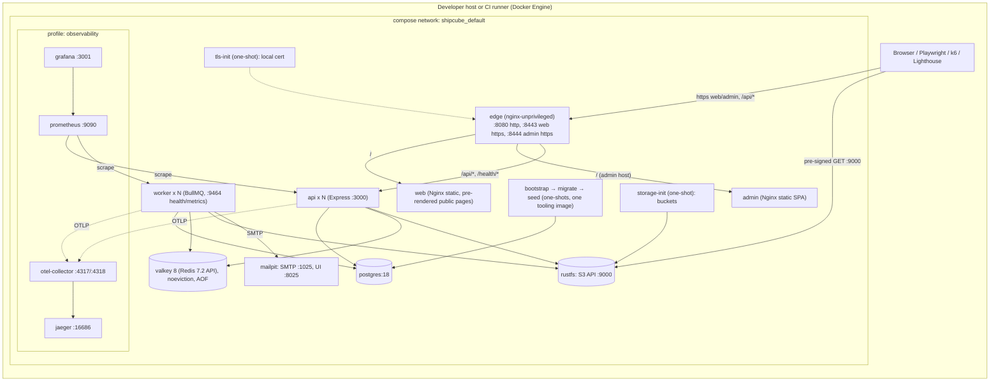
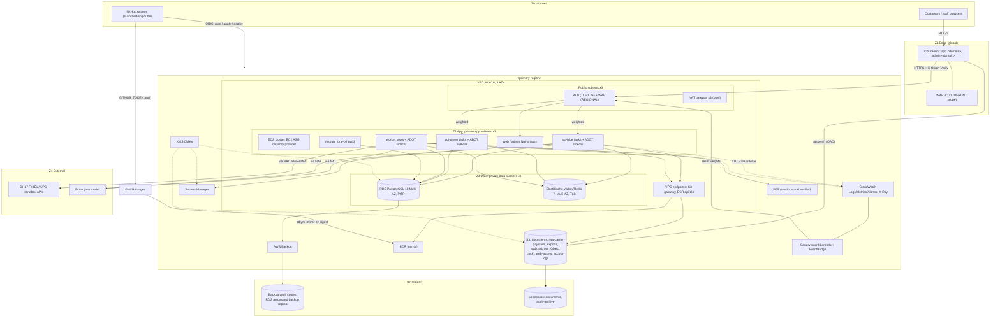
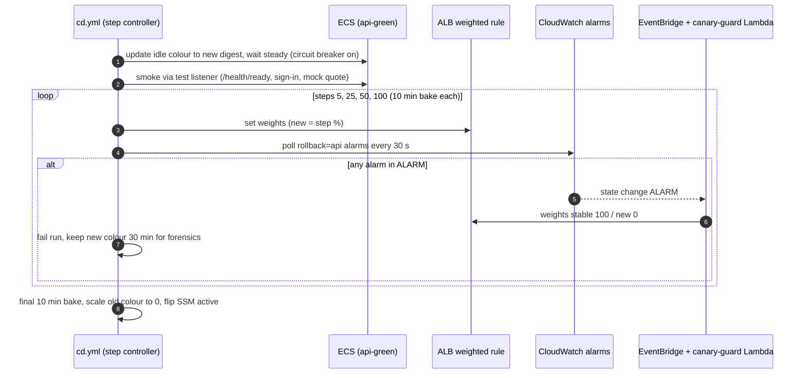
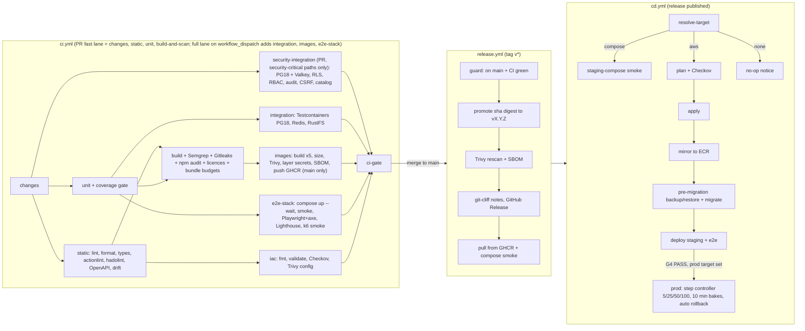

# Platform Architecture: Multi-Carrier Shipping Platform (repo `shipcube`)

| Field | Value |
|---|---|
| Version | 1.0 |
| Date | 2026-11-12 |
| Owner | platform-architect (P3 Architecture) |
| Status | Draft for G2 |
| Inputs | `CLAUDE.md` §2, §3, §5, §9; `docs/sdlc/BRIEF.md` §3.1 to §3.3, §4.1, §4.10, §4.11, §4.13, §9, §10, §11, §12; `REQUIREMENTS.md` REQ-PLAT-001..022, REQ-SEC-001..016, REQ-DATA-001..003, REQ-DOC-006..008; `NFR.md` NFR-PERF, NFR-SCALE, NFR-AVAIL, NFR-REC, NFR-WEB-005, NFR-SEC, NFR-OBS, NFR-OPS, NFR-AUDIT-007; `ASSUMPTIONS.md` A-004, A-028..A-040, A-053; `DECISIONS.md` D-002..D-007, D-022, D-025, D-026, D-035; P3 design brief (2026-11-12) |
| Consumers | principal-architect (ADRs, G2), threat-modeler, data-architect, api-designer, devops-engineer (P5), qa-lead, performance-engineer, security-analyst, release-manager |

## 1. Scope and budget constraint

This document is the platform design for the Platform. It covers local and CI environments, container images, the AWS target topology, compute, Terraform, CI/CD, observability, environments and configuration, resilience and DR, cost, and runbooks.

**Budget rule.** `CLOUD_BUDGET_MONTHLY_USD = 0` until M5 (CLAUDE.md §3, D-002, A-004). So:

- Everything AWS-related here is **designed, written as Terraform, validated (`fmt`, `validate -backend=false`) and policy-checked (Checkov)**, and **never applied**. No AWS account, credentials, state bucket or resource exists in this run.
- Staging is the local/ephemeral Compose stack (D-002). Production has no target, so the release ends with a tag, a GitHub Release and GHCR images (D-005, D-006).
- Deploy, canary and `apply` jobs exist in `cd.yml` but are **no-op with an explicit message** until the `DEPLOY_TARGET_*` operating parameters and the matching repository variables are set (REQ-PLAT-007, NFR-OPS-003/004).
- Paid CI capacity is also spend. §7.8 and §11.1 budget GitHub Actions minutes, because the repository is **private** (checked with `gh repo view` on 2026-11-12), so the free plan's minutes are finite.

**Fixed inputs (not re-opened):** Node.js 24 LTS, PostgreSQL 18, Redis 7.x, Docker multi-stage images, Compose locally, RustFS as the local S3-compatible store, Mailpit, ECS on EC2 with a capacity provider, Terraform with Checkov, GitHub Actions on `sukhchdit/shipcube`, release = tag + GitHub Release + GHCR images, and CANARY_STEPS 5→25→50→100 with 10-minute bakes (brief §3.3, §10; P3 design brief).

**Decisions made in this document** (principal-architect logs them in `DECISIONS.md` and the ADRs; IDs are local to this file):

| ID | Decision | Section |
|---|---|---|
| PD-01 | **CloudFront: yes.** CloudFront fronts both apps and the API on the same host (`/api/*` → ALB → api). HTML comes from the Nginx tasks behind the ALB; hashed `/assets/*` come from a versioned S3 assets bucket through Origin Access Control (OAC). | §4.4 |
| PD-02 | **GHCR → ECS: mirror to ECR at M5.** `cd.yml` copies the released digest from GHCR to a per-account ECR repo, reading GHCR with `GITHUB_TOKEN` and writing ECR through OIDC. ECS pulls from ECR by digest. No PAT, no `repositoryCredentials`, no pull-through cache. | §4.9 |
| PD-03 | **Terraform state: S3 native locking** (`use_lockfile = true`, Terraform ≥ 1.11). No DynamoDB lock table. | §6.3 |
| PD-04 | **Progressive delivery for `api`: a pipeline-driven step controller** over two ECS services (blue/green) with ALB weighted target groups. It implements 5→25→50→100 exactly, with an independent alarm-driven "canary guard" Lambda for rollback. ECS native `CANARY`/`LINEAR` cannot express these steps (§5.5). | §5.5 |
| PD-05 | **ALB target health uses `/health/live`, not `/health/ready`.** This avoids replacing every task during a Multi-AZ database failover. Readiness gates deployments through smoke checks. | §5.3 |
| PD-06 | **Telemetry collector: an ADOT sidecar per task.** Traces go to the X-Ray OTLP endpoint (Transaction Search). Metrics are scraped from `/metrics` and sent as CloudWatch EMF. | §8 |
| PD-07 | **A separate tooling image** (`shipcube-tooling`, `prisma/Dockerfile`; *renamed 2026-11-14 from `shipcube-migrate`, D-ARCH-117*) holds the Prisma CLI, the verified schema engine, migrations, bootstrap SQL and seeds, and runs the three one-shots `bootstrap`, `migrate` and `seed` by `command`. Runtime images carry no DDL tooling. | §3.1 |
| PD-08 | **A local `edge` reverse proxy** mirrors CloudFront + ALB path routing (`/api/*` → api pool). It is the NFR-SCALE-002 load balancer. | §2 |
| PD-09 | **Trivy, Gitleaks, Checkov, hadolint and Syft run as digest-pinned container images**, not marketplace actions where avoidable. This follows the March 2026 `trivy-action` tag compromise (Appendix A). | §7 |
| PD-10 | **GitHub Actions minutes budget (superseded on 2026-11-12 by D-ORCH-001, human):** hosted PR fast lane, heavy suites run **locally** by test-runner with evidence committed under `docs/05-quality/`, and a dispatch-only hosted full lane at wave ends and gates. No self-hosted runner by default (kept as a label switch), no paid minutes. The original C + D default (self-hosted `heavy` runner) is recorded in §7.8 as history. | §7.8, ADR-0023 amendment |

---

## 2. Local environment (Docker Compose)

Requirements: REQ-PLAT-005, REQ-DATA-001..003, NFR-OPS-001 (≤ 180 s all-healthy with warm images, D-035; G1-C1 closed, so there is one value), NFR-SCALE-002, NFR-AVAIL-002, NFR-OBS-003, US-003.

### 2.1 Files

| File | Purpose |
|---|---|
| `compose.yaml` | The product stack: one command, `docker compose up`. |
| `compose.debug.yaml` | Optional override that publishes `api:3000` and `worker:9464` to `127.0.0.1` for debugging. It is not used when scaling. |
| `.env.example` | Every configuration key with **placeholder values only** (REQ-SEC-011, NFR-OPS-005). A CI script diffs it against the `packages/config` schema. |
| `compose.env` | **Local-only, non-secret** defaults that make `docker compose up` work with no setup, including `SEED_*` demo passwords (D-022, REQ-DATA-002) and local database/Redis/RustFS credentials. Every value is visibly marked `local-only-…`. The file is allow-listed by path in `.gitleaks.toml`. Production start-up refuses any value that matches a documented placeholder or a `local-only-` prefix (REQ-SEC-011). |
| `.env` (git-ignored) | Optional **non-secret** developer overrides (ports, log level, feature defaults). *Amended 2026-11-12 (SEC-P3-08):* carrier-sandbox and Stripe test credentials no longer go here; they live only in user-scoped environment variables or in `.env.local` (§2.7). |
| `.env.local` (git-ignored) | *Added 2026-11-12 (SEC-P3-08).* The only file location allowed for carrier-sandbox and Stripe test credentials on a developer host (§2.7). Never referenced by value from `compose*.yaml` or `compose.env`; `.gitignore` and the Gitleaks pre-commit hook both cover it. |
| `.npmrc` (committed, root) | *Added 2026-11-12 (SEC-P3-04).* `ignore-scripts=true`, `engine-strict=true`, `save-exact=true`, `fund=false`, `update-notifier=false`. *Amended 2026-11-12 (SPK-01, ADR-0023 am. I):* plus `audit=false` and `min-release-age=7` (the bundled npm is 11.19.1 ≥ 11.10; `engines.npm ">=11.10"`); `tools/isolated/*` carry a byte-identical copy. Holds no registry token, ever (a private registry would use BuildKit `--secret` only, §3.2). Copied into every Dockerfile install stage together with the manifests. Lane A `check-install-flags` fails if `ignore-scripts=true` is missing (§7.1). *Amended 2026-11-12 (PR1-SEC-01, ADR-0023 am. J item 1):* plus `@platform:registry=https://registry.invalid/` — the `@platform` scope on npmjs.com is a third-party organisation, and the pin makes any registry resolution of a workspace name fail closed (`ENOTFOUND`); `check-install-flags` asserts the exact line here and in the `tools/isolated/*` copies, and `check-lockfile` requires every `@platform/*` lockfile entry to be a workspace link. |
| `infra/local/valkey/users.acl` | *Added 2026-11-12 (SEC-P3-08 item 2, SEC-P3-12 item 4).* Valkey ACL file mounted read-only into `redis` (§2.2). Users `api`, `worker` and `healthcheck`; the `default` user is `off`. Passwords are stored as `#<sha256>` of the `local-only-*` values in `compose.env` (no plaintext duplicate); a repository test asserts that the hashes match `compose.env`. Allow-listed by path in `.gitleaks.toml` like `compose.env`. |
| `tools/hooks/pre-commit` + `npm run hooks:install` | *Added 2026-11-12 (SEC-P3-08 item 7).* In-house Node script (no new dependency) that installs a git pre-commit hook running Gitleaks in its digest-pinned container on staged files (§2.7). |
| `infra/local/edge/*.conf`, `infra/local/otel/*.yaml`, `infra/local/prometheus.yml`, `infra/local/grafana/` | Configuration for the local edge and the observability profile. |

### 2.2 Service table

All third-party images are pinned as `name:tag@sha256:<digest>` (NFR-OPS-002). Host ports bind to `127.0.0.1` only, except the edge ports. Service names match the Docker DNS names that the configuration uses.

| Service | Image | Role | Host ports | Health check (interval / timeout / retries / start period) | `depends_on` |
|---|---|---|---|---|---|
| `postgres` | `postgres:18-bookworm` (or `-trixie`, see OI-03) | Primary DB. `wal_level=replica`. Runs `infra/local/postgres/init/*.sql` on first boot to create roles `platform_migrator` and `platform_app` (ADR-0005). | `127.0.0.1:5432` | `pg_isready -U $POSTGRES_USER -d $POSTGRES_DB` (3 s / 3 s / 20 / 10 s) | none |
| `redis` | `valkey/valkey:8` pinned by digest (Valkey 8, Redis 7.2-compatible, BSD-3-Clause; OI-01 resolved by ADR-0001 / D-ARCH-005, G2-C2 2026-11-12) | BullMQ, rate-limit counters, revocation set, flag cache. *Amended 2026-11-12 (SEC-P3-08 item 2, SEC-P3-12 item 4):* command `--aclfile /etc/valkey/users.acl --appendonly yes --maxmemory-policy noeviction` (BullMQ requires `noeviction`); the single shared `--requirepass` is removed. `infra/local/valkey/users.acl` is mounted read-only. ACL users, **the same locally and in AWS** (§4.3): `api` = `on #<hash> ~auth:* ~rl:* ~cache:* ~carrier:* ~sse:* &sse:* +@all -@dangerous`; `worker` = `on #<hash> ~bull:* ~carrier:* ~audit:* ~cache:* +@all -@dangerous +info` (`INFO` is in `@dangerous`, and BullMQ reads the server version and eviction policy through it; SPK-01/`valkey-compat` confirm the exact command set); `healthcheck` = `on #<hash> -@all +ping`; `default` = `off`. Key-prefix names follow the ADR-0013/ADR-0016 amendments (principal-architect). Each service's `REDIS_URL` carries its own ACL user (`redis://api:<local-only-…>@redis:6379`); the `compose.env` values stay `local-only-*`. *Amended 2026-11-19 (ADR-0013 amendment 3 item 13, D-ARCH-160): TASK-214 adds `--maxmemory ${REDIS_MAXMEMORY:-512mb}` to the command, so that a full instance refuses writes at a known ceiling and the memory alarms have a denominator; until TASK-214 merges the command above is the one in `compose.yaml`.* | `127.0.0.1:6379` | `valkey-cli --user healthcheck --pass $REDIS_HEALTHCHECK_PASSWORD --no-auth-warning ping` (3 s / 2 s / 20 / 5 s). *Amended 2026-11-12 (SEC-P3-08).* | none |
| `rustfs` | `rustfs/rustfs:<1.0.x>` | S3-compatible object store. Image runs as UID 10001. | `127.0.0.1:9000` (S3 API; the console port 9001 is **not** published, see the paragraph below the table) | `GET http://localhost:9000/health` (5 s / 3 s / 20 / 5 s). If the image has no HTTP client, readiness comes from `storage-init` instead (§2.4). | none |
| `storage-init` | `amazon/aws-cli` (pinned) | One-shot. Creates buckets `documents`, `raw-carrier-payloads`, `exports`, `audit-archive` with versioning enabled (and `web-assets` for parity). Idempotent: "already exists" is success. Retries until RustFS answers. | none | exits 0 | `rustfs: service_started` |
| `mailpit` | `axllent/mailpit` | SMTP catcher for notifications (REQ-NOTIF). | `127.0.0.1:1025` (SMTP), `127.0.0.1:8025` (UI) | `mailpit readyz` (5 s / 3 s / 10 / 3 s) | none |
| `bootstrap` | `shipcube-tooling` (built locally from `prisma/Dockerfile`; *three one-shots on one image, amended 2026-11-14, D-ARCH-117, TASK-014*) | One-shot, `command: [bootstrap]`: roles, schemas and the audit DDL lane from `prisma/bootstrap/` over `DATABASE_BOOTSTRAP_URL` (the only service that receives it; PR13-SEC-08). `check-tooling-env` runs first and exits 1 naming only the variable. | none | exits 0 | `postgres: service_healthy` |
| `migrate` | `shipcube-tooling`, `command: [migrate]` | One-shot: verifies the pinned schema engine (`tools/deps/prisma-cli.mjs --verify-only`), then `prisma migrate deploy` as `platform_migrator` over `DATABASE_MIGRATOR_URL`. Never prints connection strings. | none | exits 0 | `bootstrap: service_completed_successfully` |
| `seed` | `shipcube-tooling`, `command: [seed]` | One-shot: the `reference` seed, then the `demo` seed (REQ-DATA-001..003; the demo seed is refused when `APP_ENV=production`, AT-US-049-03), run from the TypeScript sources through `tsx` exactly as `npm run db:seed` / `db:seed:demo`. Upserts by natural key. Never prints passwords. | none | exits 0 | `migrate: service_completed_successfully` |
| `api` | `shipcube-api` (built) | Express API on port 3000. Runs as `platform_app`. *Amended 2026-11-12 (SEC-P3-08, SEC-P3-03 item 7):* Redis as ACL user `api`; mounts volume `audit-anchors` **read-only** at `/data/audit-anchors` for the chain verifier (public key only). | none (through `edge`). `compose.debug.yaml` publishes 3000. | `node /app/healthcheck.mjs api` → `GET /health/ready`, 2 s budget (5 s / 3 s / 6 / 20 s); *path amended 2026-11-14: the probe lives in `tools/docker/`, root-owned in the image, not in `dist/`* | `migrate` and `seed`: `service_completed_successfully` (their own `depends_on` enforce the chain `bootstrap → migrate → seed`), `redis: service_healthy`, `storage-init: service_completed_successfully` |
| `worker` | `shipcube-worker` (built) | BullMQ processors and schedulers. Health and metrics on 9464 (internal). *Amended 2026-11-12 (SEC-P3-08, SEC-P3-03 item 7):* Redis as ACL user `worker`. Writes audit anchors to `AUDIT_ANCHOR_SINK=file:///data/audit-anchors/anchors.ndjson` on the dedicated named volume `audit-anchors`, mounted read-write **only** into `worker` (the local file sink is mandatory in `local` and `test`, SEC-P3-03 item 5). | none | `node /app/healthcheck.mjs worker` → `GET :9464/health/ready` (5 s / 3 s / 6 / 20 s) | as `api`, plus `mailpit: service_healthy` |
| `web` | `shipcube-web` (Nginx static) | Customer app, with pre-rendered public pages (D-026). | none | `wget -q --spider http://127.0.0.1:8080/healthz` (5 s / 2 s / 6 / 3 s) | none |
| `admin` | `shipcube-admin` (Nginx static) | Staff SPA (D-008). | none | as `web` | none |
| `edge` | `nginxinc/nginx-unprivileged` (pinned) plus mounted config | Local stand-in for CloudFront + ALB. Host routing: web on `:8080` (HTTP) and `:8443` (HTTPS); admin on `:8444` (HTTPS). `/api/*` and `/health/*` go to the `api` upstream, and everything else to `web` or `admin`. The `api` upstream uses `server api:3000 resolve` with Docker DNS `resolver 127.0.0.11 valid=5s`, so scaled replicas join automatically. SSE gets `proxy_buffering off`. `/metrics` returns 404 at the edge. Sets `X-Forwarded-For` and `X-Forwarded-Proto` like the ALB. | `8080`, `8443`, `8444` (all interfaces, configurable) | `wget …/healthz` (5 s / 2 s / 6 / 3 s) | `web`, `admin`: `service_healthy`; `api: service_healthy` |
| `tls-init` | `alpine` (pinned) with openssl | One-shot. Creates a self-signed local certificate in the `edgecerts` volume on first run. No key is committed. Needed because `__Host-` refresh cookies require `Secure`, and not every Playwright engine treats `http://localhost` as a secure context (OI-11). | none | exits 0 | none (`edge` depends on it, `service_completed_successfully`) |

**`rustfs` and the store vhost (amended 2026-11-13: PR30-SEC-04/-08, ADR-0021 amendment 3 item 1; D-ARCH-100).** The image is pinned by the multi-arch index digest that the storage contract suite pins (`apps/api/src/platform/storage/tests/rustfs.ts`); a TASK-014 test compares the two. Only `127.0.0.1:9000` is published. The image defaults `RUSTFS_CONSOLE_CORS_ALLOWED_ORIGINS=*` and serves a console on 9001, so the console is disabled or its CORS allow-list emptied, and 9001 is never published. The root credentials come from the same secret references as `STORAGE_ACCESS_KEY_ID_REF` and `STORAGE_SECRET_ACCESS_KEY_REF` (local-only values in `compose.env`). The browser fetches pre-signed URLs through an `edge` store vhost in front of `STORAGE_PUBLIC_ENDPOINT` that passes `Host` through unchanged (SigV4 signs it), forwards GET and HEAD only, and adds `X-Content-Type-Options: nosniff`; that vhost is the only place the Platform can make the header appear (CloudFront response-headers policy at M5). `storage-init` keeps the bucket list of its row above; the `audit-anchors` bucket is not created in Compose, whose anchor sink is the `file:` volume above (the `s3:` sink is exercised by integration tests, which create the bucket themselves).

**`observability` profile** (`docker compose --profile observability up`; NFR-OBS-003, REQ-PLAT-019):

| Service | Image | Ports (127.0.0.1) | Notes |
|---|---|---|---|
| `otel-collector` | `otel/opentelemetry-collector-contrib` (pinned) | 4317 (gRPC), 4318 (HTTP) | Receives OTLP from api and worker. Exports traces to Jaeger and scrapes `api:3000/metrics` and `worker:9464/metrics` for Prometheus. The pipeline config matches the AWS ADOT config except for the exporters (parity). |
| `jaeger` | `jaegertracing/jaeger` v2 all-in-one (pinned) | 16686 (UI) | Trace UI. In-memory storage. |
| `prometheus` | `prom/prometheus` (pinned) | 9090 | Loads the burn-rate rules from `infra/observability/rules/*.yaml`, the same SLO rule source used to generate CloudWatch alarms (§8.4). |
| `grafana` | `grafana/grafana-oss` (pinned) | 3001 | Dashboards provisioned from `infra/observability/dashboards/` (RED, queues, carriers). |

api and worker read `OTEL_ENABLED=${OTEL_ENABLED:-false}` and `OTEL_EXPORTER_OTLP_ENDPOINT=http://otel-collector:4318`. Telemetry is off by default (REQ-PLAT-019). If the collector is unreachable, exports are dropped and the app does not fail.

### 2.3 Volumes and clean state

| Volume | Mounted at | Notes |
|---|---|---|
| `pgdata` | `/var/lib/postgresql` | **PostgreSQL 18 images moved `PGDATA` to `/var/lib/postgresql/18/docker` and declare `/var/lib/postgresql` as the volume.** Mounting the old `/var/lib/postgresql/data` path breaks start-up (Appendix A). |
| `redisdata` | `/data` | AOF persistence, so queued jobs survive `docker compose restart`. |
| `rustfsdata` | `/data` | Owned by UID 10001. |
| `edgecerts` | `/etc/nginx/certs` | Self-signed local certificate. |
| `audit-anchors` | `/data/audit-anchors` (`worker` read-write; `api` read-only) | *Added 2026-11-12 (SEC-P3-03 item 7).* Append-only NDJSON audit anchor log (`anchors.ndjson`; each record carries `anchor_seq` and the previous anchor's hash). Mounted into no other service. The worker and api images create `/data/audit-anchors` owned by `node` (UID 1000), so the named volume inherits that ownership on first mount and `read_only: true` root filesystems still work. Removed by `down -v` like every volume; the next `up` starts a new anchor log (the verifier treats an empty log with an empty chain as consistent, and an empty log with existing entries as `ANCHOR_MISSING`). |
| `obsdata` (profile only) | Prometheus and Grafana data | |

`docker compose down -v` removes every named volume. The next `up` recreates roles, schema, buckets and seed rows with the same natural keys (US-003, scenario "Reset returns to clean state").

### 2.4 `docker compose up` sequencing and the 180-second budget

```
postgres ─healthy─► bootstrap ─completed─► migrate (migrate deploy) ─completed─► seed (reference → demo) ─completed─┐
redis ─healthy──────────────────────────────────────────────────────────────────────────────────────────────────────┤
rustfs ─started─► storage-init (buckets + versioning) ─completed────────────────────┼─► api, worker ─healthy─► edge ─healthy
mailpit ─healthy (worker only) ─────────────────────────────────────────────────────┘
tls-init ─completed───────────────────────────────────────────────────────────────────► edge
web, admin ─healthy───────────────────────────────────────────────────────────────────► edge
```

| Step | Budget (warm images, reference host) | How it is kept small |
|---|---|---|
| postgres healthy | ≤ 10 s | Small default config. Init SQL only on first boot. |
| `bootstrap` (roles, schemas, audit DDL lane; *added 2026-11-14, D-ARCH-117*) | ≤ 5 s; idempotent re-run ≤ 2 s | Plain SQL files in order; every statement is re-runnable (`IF NOT EXISTS`, `DO $$ … $$` guards). The three one-shots share one image, so there is one build and one pull. |
| `migrate deploy` | ≤ 20 s first run, ≤ 3 s re-run | Squashed baseline migration per milestone. |
| Reference seed (≈ 250 countries, subdivisions, currencies, holidays 2026–2027, HS sample, transit days, compliance packs) | ≤ 30 s | Batched `INSERT … ON CONFLICT DO UPDATE` in chunks of 500 rows. One transaction per dataset. |
| Demo seed (14 users, bcrypt cost 12) | ≤ 10 s | Hashes computed concurrently. Skips users that already exist. |
| api and worker ready | ≤ 15 s | No work at start-up besides config validation and pool warm-up. Readiness checks PG, Redis and storage with a 2 s timeout each (REQ-PLAT-018). |
| edge ready | ≤ 5 s | |
| **Critical path** | **≈ 90 s (target ≤ 180 s)** | CI measures `docker compose up -d --wait --wait-timeout 180` and records the time (NFR-OPS-001). Cold build and pull time are reported, not gated (A-039). |

- **Idempotent re-run:** `migrate deploy` is a no-op when the schema is current, seeds upsert by natural key, and `storage-init` treats existing buckets as success. A second `up` leaves row counts unchanged (US-003).
- **Failing migration:** `migrate` exits non-zero, so `seed`, `api` and `worker` never start (`service_completed_successfully` is not met), and `docker compose up --wait` fails with the migration error in the logs. Prisma errors name objects, never connection strings (US-003, scenario 4). The same holds for a failing `bootstrap` or `seed`.
- **Caveat to verify in P5:** the interaction between `--wait` and one-shot services in the pinned Compose version. Fallback: a `npm run stack:up` Node script that polls `docker compose ps --format json`. *Verified 2026-11-14 (TASK-014, PR #39 stack suite): `--wait` honours the three one-shots; cold start 43.7 s with warm images against the 180 s budget.*

**Hot-reload development** is outside the one-command contract. A developer runs `docker compose up postgres redis rustfs storage-init mailpit seed` (which pulls in `bootstrap` and `migrate` through `depends_on`) and then `npm run dev` on the host. Vite proxies `/api` to `localhost:3000`.

### 2.5 Scale-out test (NFR-SCALE-002)

`docker compose up -d --wait --scale api=2 --scale worker=2` works because `api` and `worker` publish no host ports. The `edge` upstream re-resolves `api` through Docker DNS and round-robins across replicas, with `max_fails=1 fail_timeout=5s` and passive retry of idempotent methods only (`proxy_next_upstream error timeout http_502` for GET and HEAD). The `scale-test` suite (local heavy lane `wave`/`gate` profiles and release candidates, ADR-0023 amendment A) does the following:

1. Runs the API and e2e suites against 2+2 replicas.
2. Kills one `api` container mid-run with `docker kill`. The pass bound is ≤ 1 % failed requests, excluding requests in flight on the killed replica.
3. Runs 1,000 Mock bookings across 2 workers and asserts zero duplicate carrier, payment or email side effects by counting Mock carrier calls, Mock gateway calls and Mailpit messages (REQ-PLAT-014).
4. Verifies that rate-limit counters are shared across replicas (NFR-SEC-005 on 2 replicas).

### 2.6 Local deployment diagram



**Pre-signed URLs locally.** SigV4 signs the `Host` header. The API therefore uses two S3 clients: an internal client (`S3_ENDPOINT=http://rustfs:9000`) for put and get, and a presign client (`S3_PUBLIC_ENDPOINT=http://localhost:9000`, path-style) whose URLs the browser can reach. In AWS both are the regional S3 endpoint (REQ-DOC-007, 300 s TTL).

### 2.7 Developer host hygiene (Added 2026-11-12, SEC-P3-04, SEC-P3-08 item 7)

The developer host runs lane B and holds the only copies of carrier-sandbox and Stripe test credentials in this run, so it gets the same install-script and secret rules as CI.

1. **Setup:** `npm ci --ignore-scripts`, then `npm run deps:rebuild` (the allow-listed install-time steps, §3.2), then `npm run hooks:install`. The root `.npmrc` already sets `ignore-scripts=true`, so a forgotten flag does not re-enable lifecycle scripts. Adding a dependency uses `npm install --ignore-scripts <pkg>@<exact>` (`save-exact=true`); the release cooldown and lockfile checks of §7.1 apply to the resulting lockfile in lane A.
2. **Credentials:** carrier-sandbox and Stripe test credentials live only in **user-scoped environment variables** (Windows user environment) or in the git-ignored `.env.local`. They never appear in `compose*.yaml`, `compose.env` or `.env`. `compose.yaml` passes the variables by name only (`CARRIER_DHL_CLIENT_SECRET: ${CARRIER_DHL_CLIENT_SECRET:-}`), so an unset variable yields the Mock carrier (CLAUDE.md §5). The config loader reads `.env.local` only when `APP_ENV=local`.
3. **Pre-commit hook:** `npm run hooks:install` (in-house Node script, no new dependency; not wired to any npm lifecycle hook because `ignore-scripts=true` skips `prepare`) writes `.git/hooks/pre-commit`, which runs Gitleaks from its digest-pinned container (PD-09) on the staged files only and blocks the commit on a finding. It names the file and rule, never the value (NFR-SEC-002).
4. **No `pre*`/`post*` npm script hooks.** With `ignore-scripts=true`, `npm run <x>` still runs `<x>` but skips its `pre<x>`/`post<x>` scripts (npm docs, Appendix A). Root and workspace `package.json` files therefore chain steps explicitly (`"quality:heavy": "node tools/quality/heavy.mjs"`), and the repository structure test rejects any script named `pre<x>`/`post<x>` where `<x>` is another script in the same file or an npm lifecycle event (`install`, `prepare`, `pack`, `publish`), as well as `install`, `preinstall`, `postinstall` and `prepare` in the root and workspace manifests.

---

## 3. Container images

Requirements: REQ-PLAT-006, REQ-SEC-013, NFR-OPS-002, NFR-WEB-005, NFR-SEC-006, US-004.

### 3.1 Deployables and GHCR naming

| Image | GHCR name | Dockerfile / target | Contents |
|---|---|---|---|
| api | `ghcr.io/sukhchdit/shipcube-api` | `apps/api/Dockerfile` target `runtime` | Compiled API, the generated Prisma client package, production `node_modules` pruned to the api workspace and its internal packages, the API contract (`/api/docs`), the entrypoint preflight and the health probe. Runtime base: `debian:trixie-slim` + the Node binary (*2026-11-14, D-ARCH-116*). No CA bundle is baked in this run (§3.2 "CA stores"). |
| worker | `ghcr.io/sukhchdit/shipcube-worker` | `apps/worker/Dockerfile` target `runtime` | Compiled worker plus `apps/api/dist` (it reaches the api runtime through `@platform/api`) and the same pruning. pdfkit fonts are bundled with pdfkit. Same runtime base as `api`. |
| web | `ghcr.io/sukhchdit/shipcube-web` | `apps/web/Dockerfile` | Static build plus Nginx config. |
| admin | `ghcr.io/sukhchdit/shipcube-admin` | `apps/admin/Dockerfile` | Static build plus Nginx config. |
| tooling (PD-07; *was `migrate`, renamed 2026-11-14, D-ARCH-117*) | `ghcr.io/sukhchdit/shipcube-tooling` | `prisma/Dockerfile` target `tooling` | Prisma CLI pinned to the client version with the verified schema engine, `prisma/` schema, migrations, bootstrap SQL and seed sources, `prisma.config.ts`, `tsx` and the `@platform/source` closure of the seed (`packages/{shared,authz,config}` sources). One image runs the three one-shots `bootstrap`, `migrate` and `seed` (`tools/docker/tooling-entrypoint.sh`); each receives only its own credential through its env file. Keeping DDL tooling out of runtime images is least privilege and also helps the size budget. Closure invariant: §3.2 "Image invariants". |

### 3.2 Node images (api, worker, tooling): stage plan

**Runtime base of the service images (amended 2026-11-14, D-ARCH-116; ADR-0001 amendment 2026-11-14; `rulings/wave-0-task-014-rulings.md`; resolves OI-03 and OI-08).** The `runtime` stage of `api` and `worker` is **`debian:trixie-slim@sha256:<digest>` plus exactly one artefact copied from the `base` node image, `/usr/local/bin/node`**, not the full `node:24-*-slim` image. Measured on the PR #39 images: Debian trixie-slim 83.6 MiB + Node 24.22.3 binary 121.0 MiB = 204.6 MiB of fixed cost; the full node image adds ≈ 47 MiB of npm, corepack, yarn, V8 headers and `ca-certificates`, which would put `api` at ≈ 324 MiB and `worker` at ≈ 344 MiB against the 300 MiB budget (§3.4). Rules:

1. **Two digest-pinned `FROM`s, one Debian codename.** `node:<exact version>-<codename>-slim@sha256` for `base` (build stages) and `debian:<codename>-slim@sha256` for `runtime`; the codenames match (lane A rule `runtime-codename` in `tools/ci/check-dockerfiles.mjs`). The official nodejs.org binary needs glibc ≥ 2.28 and links only `libc`, `libm`, `libdl`, `libpthread`, `libstdc++` and `libgcc_s` dynamically (verified with `ldd`), so the pairing is compatible by construction; parity keeps one Debian release in the image. `RUN … node --version` and the preflight are the build-time fail-fast.
2. **Binary only.** No npm, npx, corepack, yarn, `docker-entrypoint.sh`, `nodejs` symlink or `/usr/local/include/node` in `runtime`; the only `COPY --from=base` is the binary. The runtime has no package manager.
3. **CVE response by rebuild.** A Node security release is a bump of the `node:` tag + digest; a Debian point release (glibc, libstdc++, dash, coreutils) is a digest-only bump of `debian:trixie-slim`. Both are proposed by Dependabot (`docker` ecosystem over the five Dockerfiles, `docker-compose` over `compose.yaml`, 7-day cooldown, §7.1) and shipped as new images; nothing is patched in place. Trivy never inventoried the Node runtime through dpkg in the official image either, so this is not a scanner regression.
4. **CA stores.** The runtime carries no `ca-certificates` and no `/etc/ssl`. Outbound TLS (carriers, Stripe, SMTP/SES, OTLP) uses Node's bundled Mozilla CA store (the nodejs.org build default). The PostgreSQL `sslrootcert` is a file under `DATABASE_CA_DIRECTORIES` (`/etc/ssl/platform`; `/etc/ssl/certs` is absent and inert). At M5 the RDS global bundle is baked into `/etc/ssl/platform/` as a public certificate and refreshed by PR. `--use-openssl-ca` selects a store that does not exist and fails every TLS connection closed; it does not belong in the entrypoint `NODE_OPTIONS` allow-list.
5. **The shell stays.** `tools/docker/entrypoint.sh` (dash) strips `NODE_OPTIONS` with `env -u` and runs the preflight **before** the first Node process, then `exec`s the app with `--disable-sigusr1` (PR3-SEC-13, D-TASK014-03). A shell-less base (any distroless variant) removes that control, and `gcr.io/distroless/nodejs24-*` would replace the pinned official Node build by Google's; OI-08's "move to distroless" is therefore superseded. The fixed-cost lever, if ever needed, is `gcr.io/distroless/cc-debian13` + a static busybox `sh`/`env` (risks R-ARCH-31), by superseding amendment only.
6. **Tooling image.** `prisma/Dockerfile`'s final stage may use the full node base (no budget applies, §3.4) or the same slim-runtime pattern; the latter removes the V8-header secret-scan allow-list entry (D-TASK014-13) and ≈ 47 MiB and is recommended (ruling R6).

| Stage | Base | Actions |
|---|---|---|
| `base` | `node:24.22.3-trixie-slim@sha256:<digest>` (*OI-03 resolved 2026-11-14: trixie; the brief's `bookworm-slim` is superseded by ADR-0001's baseline*). Used by `manifests`, `deps`, `build` and `prod-deps`; **not** the runtime base of `api`/`worker` (paragraph above). | `ENV NODE_ENV=production CHECKPOINT_DISABLE=1 SCARF_ANALYTICS=false`. No apt packages. |
| `deps` | `base` | Copy `package.json`, `package-lock.json` **and `.npmrc`** plus every workspace `package.json` only. Run `npm ci --ignore-scripts` with a BuildKit cache mount (`--mount=type=cache,target=/root/.npm`). Includes dev dependencies for the build. *Amended 2026-11-12 (SEC-P3-04).* |
| `build` | `deps` | Copy sources. `npm exec --no -- prisma generate` (allow-listed step, see below; *`npx` → `npm exec --no --` 2026-11-12, SPK-01 / SEC-P3-31*), then `npm run build -w apps/<app>` (`tsc -b`; emits `dist/` for the app and every referenced `packages/*`). *Amended 2026-11-12 (SEC-P3-04, SPK-01).* |
| `prod-deps` | `base` | Workspace-pruned production install: copy the manifests and `.npmrc`, `npm ci --ignore-scripts --omit=dev --omit=optional --workspace=apps/<app>` with internal packages linked (*`--omit=optional` added 2026-11-12, SPK-01 F-14 / ADR-0022 am. 11: `--omit=dev` alone leaves the `devOptional` Prisma CLI, `@prisma/studio-core` → `elkjs` EPL-2.0, `@visx/*` alpha and `typescript` in place*), then `npm rebuild bcrypt --ignore-scripts=false` **only if** the pinned `bcrypt` cannot load its bundled N-API prebuild without a build step (*SPK-01 result: it loads; the step is skipped on `linux-x64` and Windows*), then removal of `*.md`, `*.map` (outside `dist`), tests and type declarations from `node_modules`. *Amended 2026-11-12 (SEC-P3-04, SPK-01).* |
| `runtime` | **`debian:trixie-slim@sha256:<digest>` + `COPY --from=base /usr/local/bin/node`** (*amended 2026-11-14, D-ARCH-116; was `base`*) | `groupadd`/`useradd` `node` (UID/GID 1000, as in the node image); `/data/audit-anchors` owned by `node` (§2.3). Code and `node_modules` are **root-owned, read-only for `node`** (*amended 2026-11-14, TASK-014; was `--chown=node:node`*): the build output (`apps/<app>/dist`, `packages/*/dist` + `packages/*/package.json`, `prisma/package.json` + `prisma/dist/client`, never `src/`; `tools/docker/prune-dist.mjs` first strips `**/*.test.*`, `**/__fixtures__/**`, `tests/`, `fixtures/`, `spikes/` directories, declarations, maps, the non-PostgreSQL and unused Prisma query compilers and the TASK-276 query-counter seam — SPK-01 F-13, D-TASK014-16), `prod-deps` `node_modules`, the API contract (`api` only), `tools/docker/entrypoint.sh` and the root-owned probes `tools/docker/{preflight,healthcheck}.mjs` at `/app/` (*paths amended 2026-11-14; they are build and health tools, not `dist/` code*). No CA bundle (paragraph "CA stores" above). `USER 1000:1000`, then `RUN node /app/preflight.mjs /app/apps/<app>/dist` (*ADR-0022 am. 13*: imports every production module, every `@platform/*` package and `@platform/prisma/client` — proves `dist/` resolution without the `@platform/source` condition and that no omitted optional dependency is needed). `EXPOSE 3000` (api) or `9464` (worker). `HEALTHCHECK CMD ["/usr/bin/env","-u","NODE_OPTIONS","node","/app/healthcheck.mjs","<app>"]` (no curl in slim images). `ENTRYPOINT ["/app/entrypoint.sh"]`, `CMD ["dist/main.js"]`: the entrypoint runs the `@platform/config` preflight with `NODE_OPTIONS` removed, then `exec node --disable-sigusr1 --enable-source-maps dist/main.js` (no `--conditions`, no `--experimental-vm-modules`; a Dockerfile test rejects both). OCI labels: `org.opencontainers.image.source`, `revision`, `version`, `licenses`. |
| `tooling` (*was `migrate`; renamed 2026-11-14, D-ARCH-117; lives in `prisma/Dockerfile`, not in `apps/api/Dockerfile`*) | `base` (or the slim-runtime pattern, rule 6 above) | Install scoped to the `prisma` workspace with its dev dependencies (`--workspace=prisma --include=dev`, lifecycle scripts never run), `deps:rebuild` (fetches and verifies the schema engine; the only network call), `prune-migrate-image.mjs --stub-studio`, `prune-dist.mjs --node-modules`; then the Prisma CLI, `prisma/{schema,migrations,bootstrap,seed}`, `prisma.config.ts`, `tools/db/{bootstrap,check-tooling-env,…}.ts`, `tools/deps/{prisma-cli,prisma-engines,npm-cli}.mjs`, `tsx` and the `package.json` + `src/` of `packages/{shared,authz,config}` (the `@platform/source` closure of the seed; `tools/docker/tooling-closure.test.ts` guards it). `ENV PRISMA_SCHEMA_ENGINE_BINARY=<verified file>`. `USER 1000:1000`; `RUN tooling-entrypoint.sh prisma-version` proves CLI + engine work with no network (SEC-TC-64 (vi)). `ENTRYPOINT ["/app/tools/docker/tooling-entrypoint.sh"]`, `CMD ["prisma-version"]`; the one-shots pass `bootstrap`, `migrate` or `seed`. **Closure invariant (D-ARCH-117):** the image holds only the closure of the `prisma` workspace, `tsx` and the seed's `@platform/source` packages — never `typescript`, `eslint*`, `prettier`, `@redocly/*`, `react*`, `@swc/core`, `@babel/*`, test frameworks or any other root devDependency outside that closure (the PR #39 head shipped the whole root devDependency closure, 588.8 MiB; review requirement R1). Earlier text, still valid: `build` output, the Prisma CLI and engines, `prisma/`. *Amended 2026-11-12 (SPK-01 F-14, ADR-0022 am. 12):* after its install (`--ignore-scripts --omit=optional`; the Prisma CLI is kept deliberately) the stage runs `node tools/docker/prune-migrate-image.mjs`, which removes `node_modules/@prisma/studio-core` and `node_modules/@prisma/dev` with their exclusive subtrees (`elkjs` `EPL-2.0` — *corrected 2026-11-12, PR1-SEC-05* — `@visx/*` 4.0.x-alpha, `d3-*`) — `prisma` 7.10.1 declares Studio as a regular dependency (*PR1-SEC-04 (b), 2026-11-12: `prisma/build/cli.js` requires `@prisma/studio-core/data/*` at module level, so the stub fallback of ADR-0022 am. 12 is the expected path; the `migrate` stage also fetches and verifies `schema-engine-debian-openssl-3.0.x` against `tools/deps/prisma-engines.json` in the build stage and sets `ENV PRISMA_SCHEMA_ENGINE_BINARY` — ADR-0022 am. 14*), so `--omit=optional` does not drop it; the image test proves `prisma migrate status`/`deploy` and the seed CLI still work (fallback: an in-image stub `@prisma/studio-core` that throws). `USER node`. `ENTRYPOINT ["node","dist/migrate-and-seed.js"]` (steps selectable by args). |

*Image invariants (added 2026-11-12, SPK-01 / ADR-0022 am. 12; amended 2026-11-14, ADR-0022 am. 15, D-ARCH-117), asserted by the image tests in lane B `wave`/`gate` and lane C `images`, with the Trivy licence scan as backstop:* `node_modules/prisma` absent from `api` and `worker`; `node_modules/@prisma/studio-core`, `elkjs` and any `*-alpha.*` version absent from every image; **no `typescript` in any image** (asserted by the stack find check for every image, including `tooling`); no `src/*.ts` of workspace packages in the **service** images (`api`, `worker`, `web`, `admin`) — the `tooling` image carries the seed's `@platform/source` sources by design (sheet line 533) and nothing outside the closure invariant of its row; `/app/preflight.mjs` exits 0 in `api` and `worker`; `tooling-entrypoint.sh prisma-version` exits 0 with `--network none`.

*Generated Prisma client in the `api` and `worker` images (added 2026-11-13, D-TASK020-05; D-ARCH-102, D-ARCH-105; ADR-0002 amendment 2026-11-13):* the `runtime` stage copies `prisma/package.json` and `prisma/dist/client` (JavaScript, optionally without `*.d.ts`) in addition to `apps/<app>/dist` and `packages/*/dist`; the `prod-deps` stage links the `@platform/prisma` workspace through `apps/api`'s dependency (the `worker` reaches it through `@platform/api`), and its dev-only Prisma CLI stays out (`--omit=dev --omit=optional`). The `build` stage already runs `deps:rebuild` (which generates `prisma/generated`) before `npm run build -w apps/<app>`, which builds `prisma/client` by project reference. Never copied: `prisma/generated` (TypeScript source), `prisma/schema`, `prisma/migrations`, `prisma/bootstrap`, `prisma/seed`, `prisma/tests`. `.dockerignore` leaves `prisma/client/tsconfig.json` visible to the build stage. Image tests: `/app/preflight.mjs` (*path amended 2026-11-14*) imports `@platform/prisma/client` (proves the `default` condition resolves to `dist` without `--conditions`); `find` finds no `prisma/generated` and no `schema-engine*`; the existing SEC-TC-64 (vi) assertion that `api` and `worker` hold no `node_modules/@prisma/engines` is unchanged (the engine-free client needs only `@prisma/client` and `@prisma/adapter-pg`).

Rules for every Dockerfile, checked by hadolint plus a custom Node test that parses the Dockerfiles (US-004):

- Every `FROM` is digest-pinned. `FROM node:24` without a digest fails the lint.
- No `ARG` or `ENV` holds a secret. No `COPY` of `.env*`, and a strict `.dockerignore` excludes `.git`, `.env*`, `node_modules`, `coverage`, `*.pem`, `*.key`, `.claude`, `docs` (except the one API contract file that the api image ships) and, at every depth, `**/tests`, `**/spikes`, `**/fixtures` and test files — a bare `tests` entry anchors at the context root and misses `prisma/tests` (PR27-SEC-01, amended 2026-11-13, D-ARCH-100). Dockerfiles copy explicit paths only, never `COPY . .` or the bare `prisma` directory; a lane A matcher test and an image `find` check enforce both. Registry auth is not needed because the npm registry is public. If a private registry is ever added, it uses BuildKit `--secret` mounts only.
- Runtime runs as non-root. ECS sets `readonlyRootFilesystem: true` with a tmpfs on `/tmp` and `initProcessEnabled: true` so signals are forwarded (REQ-PLAT-022). Compose uses `init: true` and `read_only: true` plus `tmpfs: /tmp`.
- The `HEALTHCHECK` targets readiness locally (US-004 scenario 4: an unreachable PG makes the container unhealthy). ECS uses a liveness container check (PD-05, §5.3).
- *Added 2026-11-12 (SEC-P3-04):* every `npm ci`/`npm install` in a Dockerfile carries `--ignore-scripts`, and `.npmrc` is copied with the manifests (it must not be listed in `.dockerignore`). Lane A `check-install-flags` (§7.1) enforces both.

**Install-time work (Amendment 2026-11-12, SEC-P3-04).** No package lifecycle script runs anywhere: not on hosted runners, not in BuildKit, not on the developer host. The work that lifecycle scripts used to do becomes one explicit, allow-listed root script, `npm run deps:rebuild`, and nothing else in the repository runs package scripts:

| Step | Where it runs | Notes |
|---|---|---|
| `npm rebuild bcrypt --ignore-scripts=false` | `prod-deps` stage, lane A/C runners, developer host | Skipped when the pinned `bcrypt` loads its bundled N-API prebuild without a build step. *SPK-01 result (2026-11-12): bcrypt 6.0.0 ships N-API prebuilds for `win32-x64`, `linux-x64` glibc + musl, `linux-arm64` and `darwin-*` inside the package; the rebuild is skipped and no compiler toolchain is needed in images.* The CLI flag overrides `.npmrc` for this one package only. |
| `prisma-engines` — pin-and-verify the native `schema-engine` (*added 2026-11-12, PR1-SEC-02; ADR-0023 am. J item 2*) | `build` stage, `migrate` stage, lane A/C runners, developer host; runs **before** `prisma generate` | Refuses to start if `PRISMA_ENGINES_MIRROR`, `PRISMA_ENGINES_CHECKSUM_IGNORE_MISSING`, `PRISMA_SCHEMA_ENGINE_BINARY` or any other engine-redirecting `PRISMA_*` variable is inherited; checks `tools/deps/prisma-engines.json` `enginesVersion` against the installed `@prisma/engines-version`; reuses `node_modules/@prisma/engines/schema-engine-<target>` only when its SHA-256 matches the manifest (offline/cached mode), otherwise fetches from the fixed origin `https://binaries.prisma.sh/all_commits/` and verifies against the manifest; mismatch → delete + exit 1, no engine left. Permitted targets: `debian-openssl-3.0.x` (images, `ubuntu-latest`), `windows` (developer host). The per-user Prisma cache is never read or trusted. This is the only network call `deps:rebuild` makes, and its header says so. |
| `npm exec --no -- prisma generate` through `tools/deps/prisma-cli.mjs` (*was `npx prisma generate`; SEC-P3-31 / SPK-01 2026-11-12; wrapper added 2026-11-12, PR1-SEC-02*) | `build` stage, `migrate` stage, lane A/C runners, developer host | Prisma 7 is engine-free for the client. *SPK-01 result: `prisma generate` with the `prisma-client` generator needs no lifecycle script (35 ms generation, 4.8 s CLI wall time); the generated client type-checks under the full strict family and loads in Jest.* *Corrected 2026-11-12 (PR1-SEC-02):* the CLI nevertheless downloads the native `schema-engine` at run time before `generate`/`migrate`/`db`/`validate` when it is not already present — SPK-01 passed on a warm per-user cache. Every Prisma CLI call (`deps:rebuild`, `db:*` scripts, the migration linter, the `migrate` image entrypoint) therefore runs through `tools/deps/prisma-cli.mjs`, which performs the `prisma-engines` checks and exports `PRISMA_SCHEMA_ENGINE_BINARY=<verified file>` and `CHECKPOINT_DISABLE=1` to the child, so Prisma's downloader and cache copy never run; `check-no-raw-prisma` rejects a bare `prisma` anywhere. The `migrate deploy` path is proven by TASK-003's harness; the engine is fetched and verified in the `migrate` **build** stage, never at container runtime (read-only root filesystem; `docker run --network none <migrate> prisma --version` must exit 0, ADR-0022 am. 14). |
| `npm exec --no -- playwright install --with-deps <browser>` (*was `npx …`*) | Developer host (lane B) and lane C `e2e-stack` only | Browser per lane C shard; `chromium` for lane B `pr`, all three for `wave`/`gate`. Never in images or lane A. |

`deps:rebuild` invokes binaries only through `npm exec --no -- <bin>` so a missing local binary fails instead of being downloaded (SEC-TC-64); lane A's `check-no-npx` (inside `check-install-flags`) rejects `npx` anywhere in scripts, workflows, Dockerfiles and compose files (ADR-0023 am. I item 3). *Added 2026-11-12 (PR1-SEC-02/09, ADR-0023 am. J items 2 and 6):* the bcrypt fallback row is a developer-host convenience only — runtime image stages have no compiler toolchain and run `/app/preflight.mjs` (*path amended 2026-11-14*), so a prebuild that fails to load is a build failure, and `check-install-flags` rejects `npm rebuild` in any Dockerfile; hosted lanes may cache `node_modules/@prisma/engines/schema-engine-*` keyed by `enginesVersion` + OS because the `prisma-engines` step re-verifies whatever the cache restores (a poisoned cache fails closed); `check-workflow-policy` rejects the engine-redirecting `PRISMA_*` variables and `npm_config_ignore_scripts=false` in workflows.

esbuild, Rollup, SWC and similar tools ship their platform binaries as `optionalDependencies` and need no install script; SPK-01 verifies that the lockfile generated on Windows contains the `linux-x64` optional packages, which the lane A install on Linux proves on every PR.

### 3.3 Nginx images (web, admin)

| Stage | Base | Actions |
|---|---|---|
| `build` | Same pinned Node base | Copy the manifests and `.npmrc`, `npm ci --ignore-scripts` (*Amended 2026-11-12, SEC-P3-04*; no `deps:rebuild` step is needed for the static apps), then `npm run build -w apps/web` (React Router framework mode, `ssr: false`, `prerender: [...]`, D-026). Output is `build/client/`, holding pre-rendered HTML per public route and locale, `index.html` as the SPA fallback (`/` itself is **not** pre-rendered: Nginx redirects it to `/{lng}/`, ADR-0026 amendment 4), hashed `assets/`, and pre-compressed `*.gz`. Then the **CSP hash step** (below). |
| `runtime` | `nginxinc/nginx-unprivileged:<mainline>-alpine-slim@sha256:<digest>` (listens on 8080, runs as UID 101) | Copy `build/client/` to `/usr/share/nginx/html` and `nginx.conf` plus generated `csp.conf`. `HEALTHCHECK CMD wget -q --spider http://127.0.0.1:8080/healthz`. Read-only root filesystem with tmpfs on `/var/cache/nginx`, `/tmp` and `/var/run`. |

**Nginx behaviour** (asserted by the header and response tests in NFR-WEB-005 and REQ-SEC-001):

- `server_tokens off`. Only `GET` and `HEAD` are allowed (`limit_except`), and other methods get 405. Dotfiles are denied. `client_max_body_size 1k`.
- **Root redirect (ADR-0026 amendment 4, D-UX-005):** `location = /` answers `302 Location: /$lng/` where `$lng` is the `lng` cookie when it is `en|es|fr`, else the first supported language in `Accept-Language` order (regex `map`), else `en`; with `Cache-Control: no-store` and `Vary: Cookie, Accept-Language`. No JavaScript is needed, so `/en/` is reachable with scripts disabled. The same image performs the redirect in AWS (CloudFront default behaviour is `CachingDisabled`, so per-user redirects are never cached at the edge).
- **Routing:** `try_files $uri $uri/index.html /index.html;`. Pre-rendered pages are served as files. Every non-pre-rendered client route gets the SPA fallback `index.html` with status 200, per React Router pre-rendering docs (the fallback is `index.html` rather than `__spa-fallback.html` because `/` is not pre-rendered). `/healthz` returns 200 with plain text. Unknown `/assets/*` returns a real 404 rather than the fallback.
- **`noindex` (ADR-0026 amendment 5, D-UX-029):** `web` adds `X-Robots-Tag: noindex` on `/{lng}/track` when `$arg_number` is non-empty, through a `map` (an `if` block would drop the inherited `add_header`s); `admin` sends `X-Robots-Tag: noindex, nofollow` on every response and serves `robots.txt` with `Disallow: /`. The API sends `X-Robots-Tag: noindex` on every response (ADR-0016 amendment 6).
- **Brand assets (ADR-0026 amendment 6, D-UX-018):** `/brand/*` is served from an operator-mounted directory (Compose volume `brand-assets`; in AWS the `web-assets` bucket prefix `brand/`). The repository ships no logo files; missing assets return a real 404 and the UI falls back to monograms.
- **Caching:** `/assets/*` (hashed) gets `Cache-Control: public, max-age=31536000, immutable`. HTML, `index.html`, `manifest.webmanifest`, `robots.txt` and `/brand/*` get `Cache-Control: no-cache`.
- **Compression:** `gzip_static on` (pre-compressed at build) plus dynamic `gzip` for small text. The stock nginx image has no Brotli module, so Brotli comes from CloudFront edge compression in AWS. gzip alone satisfies NFR-WEB-005 ("Brotli or gzip") locally.
- **Headers (REQ-SEC-001/002/003, NFR-SEC-006):** `X-Content-Type-Options: nosniff`, `Referrer-Policy: strict-origin-when-cross-origin`, `Permissions-Policy` (camera, microphone, geolocation, payment=(self "https://js.stripe.com") etc.), `Cross-Origin-Opener-Policy: same-origin`, `X-Frame-Options: DENY`, and the CSP below. HSTS (`max-age=31536000; includeSubDomains`) is sent only when `HSTS_ENABLED=true`, which is the default in the image. Compose sets it to `false` for plain-HTTP local use (REQ-SEC-003).

**CSP for static, pre-rendered HTML.** A per-response nonce requires the server to rewrite every response, which does not work with immutable static files or CloudFront caching. So the policy is **hash-based**:

1. After the build, a Node script (`tools/csp-hashes.ts`) parses every emitted HTML file (pre-rendered pages and the `index.html` SPA fallback). It extracts each inline `<script>` body, including React Router's hydration context scripts, and computes `sha256-<base64>`.
2. It writes `csp.conf` with one `add_header Content-Security-Policy "…" always;` per app. The policy is the union of all inline-script hashes plus `'self'`: `default-src 'self'; script-src 'self' 'sha256-…' … https://js.stripe.com; style-src 'self'; style-src-attr 'unsafe-inline'; img-src 'self' data:; font-src 'self'; connect-src 'self' https://api.stripe.com; frame-src https://js.stripe.com https://hooks.stripe.com; object-src 'none'; base-uri 'self'; form-action 'self'; frame-ancestors 'none'; report-uri /api/v1/security/csp-report`. Allowed origins come from build-time config with exact hosts, never wildcards (NFR-SEC-006).
3. `style-src-attr 'unsafe-inline'` is needed only if Radix or motion set inline style attributes. It is permitted because REQ-SEC-002 and NFR-SEC-006 restrict `script-src` only. The P5 developer must justify it in the task report, or remove it if not needed.
4. Builds must be deterministic so hashes are stable. A CI test asserts that every inline script in every HTML file matches a hash in `csp.conf`, and the Playwright `securitypolicyviolation` listener asserts zero violations (NFR-SEC-006).
5. The API sets its own CSP through Helmet (`default-src 'none'; frame-ancestors 'none'`). `/api/docs` (Swagger UI) gets a route-specific policy and is disabled in production by config.

### 3.4 Size budgets, scanning, SBOM, tagging

| Check | Rule | Tool (run as a digest-pinned container, PD-09) |
|---|---|---|
| Size | api and worker ≤ **300 MiB** (314,572,800 bytes), Nginx images ≤ **60 MiB**, measured as the **sum of the uncompressed layer sizes** of the final image (`docker history --human=false --format '{{.Size}}'`, bytes). *Amended 2026-11-14 (D-ARCH-118, D-TASK014-07; resolves OI-08):* `docker image inspect .Size` is **not** the measurement — under Docker Desktop's containerd store it also counts the compressed blobs (api 359.6 vs 276.4 MiB). The unit is binary like every other byte budget here (ECS MiB, `--max-old-space-size`); product-manager aligns NFR-OPS-002 / A-039 wording. The gate fails above 100 % and writes a `WARN` line at ≥ 90 % (270 / 54 MiB). PR #39 head: api 276.4 MiB, worker 296.0 MiB (98.7 %), web 20.7, admin 20.6; fixed cost 204.6 MiB (§3.2). The worker's headroom is restored by the prune plan of `rulings/wave-0-task-014-rulings.md` §4.3 (task `imgheadroom`: worker ≤ 270, api ≤ 255 MiB). The `tooling` image is **reported, not gated** (one-shot, no inbound traffic; its size is governed by the closure invariant of §3.2). | stack suite `images.stack.test.ts` (`[platform.md §3.4]`), lane B `pr`/`wave`/`gate`, lane C `images` |
| Dockerfile lint | hadolint plus the custom digest, non-root and HEALTHCHECK assertions | `hadolint/hadolint` |
| Vulnerabilities | Trivy image scan with `--severity CRITICAL,HIGH --ignore-unfixed=false`. The build fails on Critical or High with a fix available. Unfixed findings become tracked tasks (REQ-SEC-013). Trivy config scan also runs on Dockerfiles and Terraform. | `aquasec/trivy` image, digest-pinned, with release signature verified |
| Secrets in layers | `docker save`, layer extraction, then `gitleaks dir` over the filesystem, plus `docker history --no-trunc` scanned for secret patterns. A failure names the layer, never the value (US-004). | `zricethezav/gitleaks` image |
| SBOM | CycloneDX JSON per image (OS and npm packages) with Syft. A source-level CycloneDX SBOM comes from `npm sbom --sbom-format cyclonedx`. Both are attached to the GitHub Release (D-005, NFR-OPS-003). | `anchore/syft` image, npm |
| Provenance | GitHub artifact attestations need GitHub Enterprise Cloud for private repositories, so they are **not available** on this repo's plan. Signing is deferred to M5 (OI-10). | — |

**Tagging:**

- Every `main` build pushes `sha-<40-char git sha>`, which is immutable by convention. PR builds are never pushed (US-005).
- Releases promote the **same digest** built on `main` for the tagged commit. Promotion uses `docker buildx imagetools create` (no rebuild) and adds `vX.Y.Z` and `X.Y`, plus `latest` only for non-pre-release tags. Pre-releases such as `v0.1.0-m0` (D-006) get only their exact tag.
- Deployments reference images **by digest**, never by tag (§5).
- Platform: `linux/amd64` in this run. `linux/arm64` (Graviton) is added at M5 if chosen (§11). Building arm64 under QEMU on 2-vCPU runners roughly doubles image minutes.

---

## 4. AWS target topology (brief §10)

### 4.1 Account and region model

- **Accounts (recommended for M5):** `shipcube-staging` and `shipcube-prod`, at minimum, under AWS Organizations. Optionally add `shipcube-shared`, which holds Terraform state, the ECR mirror and the CI OIDC roles. Each environment's blast radius is one account.
- **Region:** `<primary-region>` and `<dr-region>` are configuration (`AWS_REGION`, Terraform variable `region`). No identifier embeds a region (brief §10 "Multi-region is LATER"). The working default for estimates is `us-east-1` primary with `us-west-2` DR. Data residency for EU, UK and India (GDPR, UK GDPR, DPDP; brief §4.12) is an open decision (OI-09).
- **CloudFront certificates and the CloudFront-scope WAF** live in `us-east-1` by AWS rule. The Terraform `cloudfront` module uses an aliased provider.

### 4.2 Network (module `network`)

| Tier | Subnets (×3 AZ) | Contents | Routing |
|---|---|---|---|
| Public | `/24` ×3 | ALB, NAT gateways only. `map_public_ip_on_launch = false`. | IGW |
| Private app | `/20` ×3 | ECS container instances (ASG), ECS tasks (`awsvpc`, ENI trunking on), Lambda seams (M4) | NAT per AZ (prod), single NAT (staging) |
| Private data | `/24` ×3 | RDS subnet group, ElastiCache subnet group | No internet route |

- **VPC endpoints:** S3 gateway endpoint (free) everywhere. In prod, also interface endpoints for `ecr.api` and `ecr.dkr`, so image pulls stay off the NAT. Other AWS APIs (Secrets Manager, Logs, KMS, STS, X-Ray) go through NAT at launch, with an interface-endpoint upgrade listed as a security and cost lever in §11.
- **Flow logs:** VPC flow logs to CloudWatch Logs (KMS), 30-day retention.
- **Egress control:** carrier and Stripe IPs are not stable, so security-group egress for app tasks is `tcp/443 → 0.0.0.0/0`. Compensating controls:
  - the application SSRF allow-list (REQ-SEC-010);
  - **Route 53 Resolver DNS Firewall** with a domain allow-list (carrier, Stripe and AWS service domains) in `ALERT` mode at staging and `BLOCK` mode at prod.
  
  AWS Network Firewall is the stronger alternative but costs several hundred USD per month per AZ, so it is deferred.

**Security groups (least privilege):**

| SG | Inbound | Outbound |
|---|---|---|
| `sg-alb` | 443 from the CloudFront origin-facing managed prefix list only | 3000 to `sg-api`, 8080 to `sg-web` |
| `sg-api` | 3000 from `sg-alb` | 5432 to `sg-rds`, 6379 to `sg-redis`, 443 to endpoints and internet |
| `sg-worker` | none | 5432, 6379, 443 |
| `sg-web` (web and admin) | 8080 from `sg-alb` | none |
| `sg-migrate` | none | 5432 to `sg-rds`, 443 (Secrets Manager) |
| `sg-rds` | 5432 from `sg-api`, `sg-worker`, `sg-migrate` | none |
| `sg-redis` | 6379 from `sg-api`, `sg-worker` | none |
| `sg-endpoints` | 443 from app SGs | none |

### 4.3 Data tier

**RDS for PostgreSQL 18 (module `rds`).** RDS supports major version 18 since 2025-11-14, and the release notes list minors up to 18.4 (Appendix A). Configuration:

- **Multi-AZ DB instance** in prod (synchronous standby, automatic failover). Single-AZ in staging (Checkov suppression, §6.5). A Multi-AZ *DB cluster* (two readable standbys, faster failover) is the 10× upgrade path.
- Storage: gp3, encrypted with the env CMK `rds`. `deletion_protection` on in staging and prod. Final snapshot on destroy (destroy is never used outside ephemeral environments, CLAUDE.md §5).
- Backups: retention 14 days (staging 7), PITR on. RDS uploads transaction logs to S3 every 5 minutes, which is the basis of RPO ≤ 5 min (§10.1). **Cross-Region automated backup replication** to `<dr-region>` in prod.
- Parameter group: `rds.force_ssl=1`, `ssl_min_protocol_version=TLSv1.2`, `shared_preload_libraries=pg_stat_statements`, `log_min_duration_statement=500`, `idle_in_transaction_session_timeout=30s`, `log_connections` on. ~~Per-role `statement_timeout` is set by migration (`platform_app` 25 s, below the 30 s request cap in REQ-SEC-015).~~ *Amended 2026-11-13 (PR #9 code review n3; ADR-0005 am. 10 item 12, D-ARCH-064; D-ARCH-074):* `statement_timeout` is layered and nothing about it is set "by migration" — role settings are bootstrap-lane objects. (1) **Role backstop 30 s**: `ALTER ROLE platform_app SET statement_timeout = '30s'` in `prisma/bootstrap/02-role-backstops.sql`, which applies only to sessions that bypass the pool (the role default is overridden by any connection startup parameter). (2) **Pool backstop 25 s**: every pooled connection of api/worker starts with `statement_timeout = DB_STATEMENT_TIMEOUT_MS` (default 25 000, TASK-006, D-TASK006-03), so stray statements outside `withTenantTx` (readiness, system paths) are bounded below the 30 s request cap of REQ-SEC-015. (3) **Per transaction 5 s**: `withTenantTx` sets `statement_timeout = DB_TX_STATEMENT_TIMEOUT_MS` (default 5 000), `lock_timeout` 2 s and `idle_in_transaction_session_timeout` 15 s in the eight-setting context statement (data-model §4.1); these win inside every request/job transaction. C13 asserts the role rows (`search_path`, the two bootstrap timeouts, the 30 s backstop and `lc_messages = 'C'`), and readiness reports `db_role_setting_drift` on any difference. The RDS parameter-group `idle_in_transaction_session_timeout=30s` above is the cluster-wide outer bound; the role (15 s) and transaction values sit inside it.
- Master credentials are managed by RDS in Secrets Manager (`manage_master_user_password`). The `platform_app` and `platform_migrator` passwords live in their own secrets and rotate with the alternating-users strategy (§9.3). IAM database authentication is enabled as an option (OI-noted in §9.3).
- *Amended 2026-11-12 (SEC-P3-03 item 7; G4 precondition for any production release):*
  - **Master credentials are break-glass only.** No task role, execution role or CI role (`gha-*`) can read the RDS-managed master secret; only a dedicated break-glass role (assumed through SSM/IAM Identity Center at M5, session tagged) holds `secretsmanager:GetSecretValue` on it. RDS-managed rotation stays on. An EventBridge rule on the CloudTrail `GetSecretValue` event for that secret raises a `Shipcube/Security` alarm on every access (RB-11/RB-14). The `platform_audit_owner` role (ADR-0007 amendment 7) is `NOLOGIN` and has no secret. *Amended 2026-11-12 (SEC-P3-27, SEC-P3-33 item 10; ADR-0007 amendment 8):* on RDS the bootstrap master is not a superuser, so while the bootstrap lane runs it needs `SET` on the two no-member roles `platform_audit_owner` and `platform_schema_owner` (PostgreSQL 16+ `createrole_self_grant`), and the lane ends by removing the `SET` option so that exactly one ADMIN-only `pg_auth_members` row per role remains for the master (`admin_option = true`, `set_option = false`, `inherit_option = false`); catalog test C13 allows exactly that row and it is treated as break-glass like the master secret. The schema owner is changed before ~~the database owner~~ any database-level statement (*amended 2026-11-12, batch 0.2, D-ARCH-045: the database is **not** transferred to `platform_migrator`; it stays owned by the bootstrap role — the master on RDS — and the migrator holds `CONNECT` only, so it cannot set database-wide defaults, create schemas or install extensions; SEC-P3-34 items 1–3 are implemented in TASK-003*). The exact statements are an SPK-08 item (data-model.md §4.4 amendment).
  - **`pgaudit` DDL logging:** `shared_preload_libraries=pg_stat_statements,pgaudit`, `pgaudit.log='ddl, role'`, `pgaudit.log_parameter=off` (no bind values, so no PII in logs). `enabled_cloudwatch_logs_exports = ["postgresql"]` exports to `/aws/rds/instance/<id>/postgresql`, KMS `logs`, retention ≥ the audit retention of §4.8. No app or CI role holds `logs:DeleteLogGroup`, `logs:DeleteLogStream` or `logs:PutRetentionPolicy` on that group.
- Database Insights (standard) and Enhanced Monitoring at 60 s. Auto minor version upgrade on, with a maintenance window off-peak for the US→IN lane.
- PG 18 extension note: some extensions were dropped in 18 (`postgis_topology`, `plrust`). Neither is used. `uuidv7()` is native.

**ElastiCache (module `elasticache`).** Redis 7.x semantics are the requirement (P3 design brief). Configuration:

- Engine variable `engine = "valkey" | "redis"`. **Default `valkey`** (Valkey 7.2+/8, wire-compatible with Redis OSS 7.2). It is about 20 % cheaper per node than Redis OSS and uses the BSD licence, which also resolves OI-01. The `redis` engine (Redis OSS 7.1) is the fallback if the BullMQ or `rate-limit-redis` compatibility suites fail on Valkey in CI (§7.3, `valkey-compat`, local heavy lane `gate` profile).
- Replication group with cluster mode **disabled**: primary plus one replica in two AZs, Multi-AZ auto-failover.
- `transit_encryption_enabled = true` (mode `required`), at-rest encryption with CMK, RBAC user group with user `app`. ACL is limited to the key prefixes `bull:*`, `rl:*`, `revoked:*`, `ff:*`, `quote:*`, and `-@dangerous`.
  - *Amended 2026-11-12 (SEC-P3-08 item 2, SEC-P3-12 item 4):* the single `app` user is replaced by **one RBAC user per service with the same access strings as the local ACL file** (§2.2): `api` (`~auth:* ~rl:* ~cache:* ~carrier:* ~sse:* &sse:* +@all -@dangerous`) and `worker` (`~bull:* ~carrier:* ~audit:* ~cache:* +@all -@dangerous +info`). Passwords in `redis/api` and `redis/worker` (§4.7). No usable default user: if the engine's user group requires a user named `default`, it is a custom user with access string `off -@all` (AWS documents that Valkey user groups do not require one; confirm at M5, Appendix A). A worker compromise therefore cannot read session or rate-limit keys, and an api compromise cannot enqueue or edit BullMQ jobs (SEC-P3-12).
- `maxmemory-policy noeviction` (BullMQ requirement). Every non-queue key must carry a TTL, enforced by a repository lint plus a test. Alarm at 70 % memory. Daily snapshot with 7-day retention. *Amended 2026-11-19 (ADR-0013 amendment 3, D-ARCH-159, D-ARCH-160): queue keys are bounded too (completed 24 h / 10,000, failed 7 days / 1,000, dead-letter records 14 days / 2,000, per queue), and a second alarm pages at 85 %.*
- At 10×, queues and cache/rate-limit move to separate clusters (OI-15).

**S3 buckets (module `s3`)** follow a naming pattern of `<project>-<env>-<purpose>-<suffix>` (placeholders, no account IDs in names). All buckets have Block Public Access on, Object Ownership `BucketOwnerEnforced`, a TLS-only bucket policy (`aws:SecureTransport`), versioning, SSE-KMS with an S3 Bucket Key, server access logging to `access-logs`, and the tagging standard (§6.4).

| Bucket | Purpose / requirement | Specifics |
|---|---|---|
| `documents` | Labels, invoices, customs documents (REQ-DOC-006..008, brief §4.10) | CMK `s3-data`. Keys contain UUIDs only. Pre-signed GET with 300 s TTL and `response-content-disposition=attachment`. CRR to `<dr-region>` (prod). Lifecycle: noncurrent versions → Standard-IA after 30 days. Deletion only by retention jobs (M4/M5). |
| `raw-carrier-payloads` | Redacted raw carrier request/response (REQ-CARR-018) | CMK `s3-data`. Lifecycle expiry = compliance-pack retention (variable). No CRR (Backup covers it). |
| `exports` | Generated exports (M2+) | Expire after 7 days. |
| `audit-archive` | Closed audit partitions plus SHA-256 manifest (ADR-0007, NFR-AUDIT-007) | **S3 Object Lock, compliance mode**, default retention `audit_retention_years` (variable set from compliance packs). In compliance mode no user, including root, can delete or shorten retention. Versioning is required. Created with Object Lock enabled at creation. CMK `audit`. CRR with replica Object Lock in `<dr-region>`. Archived partitions contain PII tokens only (A-045), so the WORM store holds no erasable personal data. |
| `audit-anchors` | *Added 2026-11-12 (SEC-P3-03 item 7). G4 precondition for any production release.* External sink for the hourly signed audit anchors (ADR-0007 amendment 7) | **S3 Object Lock, compliance mode**, default retention **≥ 7 years** (variable `audit_anchor_retention_years`, never below the longest compliance-pack audit retention), enabled at creation, versioning on, CMK `audit`. Bucket policy: the worker task role holds `s3:PutObject` only (no `s3:DeleteObject*`, no `s3:PutObjectRetention`, no `s3:BypassGovernanceRetention`, no lifecycle or policy actions); api and the verifier hold `s3:GetObject`/`ListBucket`; no CI role can write. CRR with replica Object Lock to `<dr-region>` (prod). **Alternative** (chosen at M5 if cheaper or simpler): a CloudWatch Logs group with a retention policy, KMS `audit`, where no app or CI role holds `logs:DeleteLogGroup`, `logs:DeleteLogStream` or `logs:PutRetentionPolicy` (enforced by an SCP or permission boundary as well as the role policies). Locally the sink is the `audit-anchors` volume (§2.3). |
| `inbound-mail` | SES inbound (brief §3.3, M4) | Designed now, created when M4 lands. Expire 30 days after processing. |
| `uploads-quarantine` | Upload scanning (M4, D-025) | Designed now, created at M4. Scanned with **GuardDuty Malware Protection for S3** (managed) rather than a ClamAV Lambda. The decision is re-confirmed at M4. |
| `web-assets` | Hashed `/assets/*` for both apps (PD-01) | CloudFront OAC. Holds the last N releases' assets for 30 days, which prevents version skew during rolling and canary deploys (§4.4). |
| `access-logs` | ALB, CloudFront and S3 access logs | **SSE-S3**, because ALB access logs do not support SSE-KMS (Checkov suppression, §6.5). Expire after 90 days. |
| `tfstate` (per account, bootstrap stack) | Terraform state (§6.3) | Versioning, CMK, TLS-only, deny-delete policy, noncurrent versions kept 90 days. |

### 4.4 Edge: CloudFront, WAF, ALB (PD-01)

**Decision: CloudFront in front of everything, with Nginx tasks still serving HTML.** Reasons:

1. **Parity.** The same `shipcube-web` and `shipcube-admin` images run in Compose, CI and AWS, so headers, CSP and routing are tested once (REQ-PLAT-006, NFR-WEB-005).
2. **Same-origin API.** `app.<domain>/api/*` and `admin.<domain>/api/*` route to the API. Refresh cookies (`__Host-rt_web`, `__Host-rt_admin`, ADR-0006) stay host-only with no third-party cookie issues, and CORS is reduced to an allow-list that is empty in prod (REQ-SEC-014 still enforced).
3. **Edge performance** for LCP ≤ 2.5 s on 4G (NFR-WEB-001): edge caching of immutable assets, Brotli, HTTP/3.
4. **Edge WAF and DDoS absorption** in front of the ALB.

An S3-only static origin was rejected: it would duplicate the header and CSP config into CloudFront response-header policies and lose image parity. An ALB-only setup (no CloudFront) was rejected for the edge-performance and DDoS reasons above.

**Distributions:** `app.<domain>` (web) and `admin.<domain>` (admin), each with:

| Behaviour | Origin | Cache | Notes |
|---|---|---|---|
| `/assets/*` | S3 `web-assets` via OAC | `CachingOptimized`, compress on | Response-headers policy adds `nosniff` and CORP. Keeps old releases' assets, so a client holding old HTML never gets a 404 for its chunks during a deploy. |
| `/api/*` | ALB (HTTPS only, TLS 1.2+) | `CachingDisabled`. Origin request policy `AllViewerExceptHostHeader` plus custom origin header `X-Origin-Verify` (value from Secrets Manager, rotated). | SSE works through CloudFront. The origin read timeout of 30 s exceeds the 15 s heartbeat (REQ-API-017). `POST`/`PUT`/`PATCH`/`DELETE` allowed. |
| `/health/*`, `/metrics` | none (CloudFront Function returns 404) | — | Internal only. |
| default (`*`) | ALB → Nginx tasks | `CachingDisabled` for HTML. Nginx `no-cache` is honoured. | Pre-rendered public pages are small, and HTML must reflect the current release. |

- **Viewer security policy:** `TLSv1.2_2021`, HTTP→HTTPS redirect, ACM certificate in us-east-1. The API derives the client IP from `X-Forwarded-For` with `TRUST_PROXY_HOPS=2` (CloudFront and the ALB are the two trusted hops). `CloudFront-Viewer-Address` is not read: one mechanism decides the client IP (ADR-0016 amendment 12 item 9, D-ARCH-179). The value is safe only while `sg-alb` admits nothing but the CloudFront origin-facing prefix list and the ALB refuses a request without `X-Origin-Verify`; a Terraform test pins the three together (TASK-215). The first pipeline that deploys to a real target adds a post-deploy smoke check that the audited IP of a request is not an ALB or CloudFront address (devops-engineer; a precondition of G4 for a production release, PR041-SEC-05). This matters for rate limits and audit IPs (OI-16, threat model).
- **ALB:**
  - HTTPS listener with `ELBSecurityPolicy-TLS13-1-2-2021-06` (TLS 1.2 minimum, NFR-SEC-007). HTTP listener redirects only.
  - `sg-alb` admits the CloudFront origin-facing prefix list only, and a listener rule denies requests without a valid `X-Origin-Verify` header (403).
  - Rules by host and path: `app.*` + `/api/*` → `tg-api-blue`/`tg-api-green` (weighted, §5.5); `admin.*` + `/api/*` → same; `app.*` default → `tg-web`; `admin.*` default → `tg-admin`; `/metrics` → fixed 404.
  - `drop_invalid_header_fields = true`, `desync_mitigation_mode = strictest`, access logs to `access-logs`, deletion protection on (staging and prod), idle timeout 60 s.
- **WAF (module `waf`):** two web ACLs per environment.
  - **CloudFront ACL (scope CLOUDFRONT):** AWS managed `CommonRuleSet` (with `SizeRestrictions_BODY` set to COUNT on `/api/*`, because API bodies may legitimately exceed 8 KB up to the application's 1 MB cap, REQ-SEC-015), `KnownBadInputsRuleSet`, `AmazonIpReputationList`, `SQLiRuleSet`, `AnonymousIpList` (COUNT), Bot Control common (COUNT, prod only).
  - Rate-based rules as flood protection, coarser than the application limits of DR-A22 and A-035: global 2,000 requests per 5 min per IP; `/api/v1/auth/*` 100 per 5 min per IP; `/api/v1/public/*` 600 per 5 min per IP.
  - Optional admin IP allow-list (`admin_allowed_cidrs`, empty by default).
  - **ALB ACL (scope REGIONAL):** the same managed groups as defence in depth plus a rule requiring `X-Origin-Verify`, as brief §4.11 requires WAF on the load balancer.
  - WAF logs go to CloudWatch Logs with field redaction for `authorization` and `cookie` headers.
- **CloudFront flat-rate plans** (Free $0, Pro $15, Business $200 per distribution per month) bundle CloudFront, WAF, Route 53 DNS and CloudWatch Logs ingestion. The Free plan allows 1 M requests, 100 GB and 5 WAF rules. The Pro plan allows 10 M requests and 25 WAF rules. Plans don't support WAF rule groups (individual rules only) or VPC origins below Business. **Staging uses the Free plan.** Prod chooses between Pro, Business or pay-as-you-go at M5 from measured request volume (§11), because API calls through CloudFront count toward the allowance.

### 4.5 Compute tier (summary; detail in §5)

ECS cluster `shipcube-<env>` with one EC2 Auto Scaling group capacity provider (managed scaling, managed termination protection, managed draining). Instances use ECS-optimised Amazon Linux 2023 AMIs, resolved from the SSM public parameter at plan time and pinned per release. Settings: IMDSv2 required (hop limit 1, so tasks cannot reach instance credentials), EBS encrypted with CMK, no SSH key. Access is through SSM Session Manager, audited, with ECS Exec disabled in prod by default.

Services: `api-blue`, `api-green`, `worker`, `web`, `admin`, plus the one-off `migrate` task definition.

### 4.6 Messaging, mail and Lambda seams

- **SES (module `ses`):** domain identity with Easy DKIM, custom MAIL FROM and a DMARC record. Configuration set with event destinations (bounce, complaint, delivery) → SNS → the API webhook (M5). Accounts start in the **SES sandbox** (verified recipients only). Requesting production access is an account-owner action at M5 (OI-17). The worker sends with `ses:SendRawEmail`, conditioned on `ses:FromAddress`. Locally, the worker uses SMTP to Mailpit through the same `MailTransport` interface.
- **Lambda seams (designed, not written in this run; "no silent stubs"):**
  - `inbound-mail-processor` (M4): SES receipt rule → `inbound-mail` bucket → Lambda (VPC-attached, `sg-lambda`). It POSTs an HMAC-signed message to an internal API route on a dedicated internal ALB listener reachable only from `sg-lambda`. SES inbound is available only in a subset of regions; check at M4.
  - Upload scan (M4): GuardDuty Malware Protection for S3 tags objects. An EventBridge rule moves clean objects and quarantines the rest.

### 4.7 Secrets, keys, identity

- **Secrets Manager** path: `/shipcube/<env>/<name>`. Contents: `db/app`, `db/migrator`, RDS-managed master, `redis/app`, `jwt/signing-keys` (ES256 JWK set with `kid`), `csrf/secret`, `edge/origin-verify`, `stripe/secret-key`, `stripe/webhook-secret`, `carriers/dhl|fedex|ups` (sandbox until G4, CLAUDE.md §5). All are encrypted with CMK `secrets`. Rotation is covered in §9.3.
  - *Amended 2026-11-12 (SEC-P3-08):* `redis/app` is replaced by `redis/api` and `redis/worker` (one ACL user each, §4.3). `stripe/secret-key` holds a **restricted** `rk_test_` key (§9.2). `stripe/webhook-secret` becomes one secret **per webhook endpoint** (`stripe/webhook/<endpoint>`), referenced by `STRIPE_WEBHOOK_SECRET_REF`. New: `carriers/token-cache-key` (`CARRIER_TOKEN_CACHE_KEY`). Every application key secret follows the ADR-0018 key register (`<key_id>:<base64>`, optional `_PREVIOUS`, §9.3). The HMAC `AUDIT_CHECKPOINT_KEY` is withdrawn; anchors are signed by the asymmetric KMS key `audit-anchor-signing` below. The RDS-managed master secret is break-glass only (§4.3).
- **KMS** (per environment, annual automatic rotation, separate key-admin and key-user principals):

| Key | Used for |
|---|---|
| `rds` | RDS storage and snapshots |
| `s3-data` | documents, payloads, exports, web-assets |
| `audit` | audit-archive |
| `secrets` | Secrets Manager |
| `logs` | CloudWatch Logs, VPC flow logs |
| `ebs` | instance volumes |
| `app-envelope` | Envelope encryption of TOTP secrets and the audit PII vault (ADR-0006, ADR-0007) through `GenerateDataKey` with encryption context `{purpose, env}`. Locally, a `KeyProvider` adapter uses an env key. |
| `partner-credentials` (M3 seam) | Per-tenant data keys: one DEK per organisation, wrapped under this CMK with encryption context `{org_id}`, so a ciphertext cannot be decrypted under another tenant's context. Only the M3 partner module's role gets `kms:Decrypt` with an `kms:EncryptionContext:org_id` condition. |
| `audit-anchor-signing` | *Added 2026-11-12 (SEC-P3-08, SEC-P3-03 item 4).* Asymmetric key, `KeySpec = ECC_NIST_P256`, `KeyUsage = SIGN_VERIFY`, algorithm `ECDSA_SHA_256`, non-exportable. Key policy: `kms:Sign` **only** for the worker task role; `kms:Verify` and `kms:GetPublicKey` for the api role and the verifier; nobody else uses it. The public key is published with each release so a third party (regulator) can verify anchors outside KMS. No automatic rotation (asymmetric keys); rotation = a new key and a new `key_id` (`audit-anchor-v<n>`), with the retired public key kept for verification. Replaces the HMAC `AUDIT_CHECKPOINT_KEY`. |

*Amended 2026-11-12 (SEC-P3-08 item 1):* `app-envelope` envelope encryption uses `GenerateDataKey` at M5 with the plaintext DEK cached in process memory for **≤ 5 min**; encryption context `{purpose, env, key_id}`.

- **IAM:** one task role per service, plus a shared execution role scoped to that service's secrets (§5.2). CI roles come from GitHub OIDC (§7.6). Instance role: `AmazonEC2ContainerServiceforEC2Role`-equivalent, scoped down, plus SSM core. Permission boundary on every role Terraform creates. No IAM users, no access keys (brief §4.11).

### 4.8 Observability, backup and audit services

CloudWatch Logs, metrics, dashboards and alarms; X-Ray Transaction Search (§8); AWS Backup (§10.2); CloudTrail. CloudTrail is an organisation trail to the log-archive bucket with Object Lock governance mode, plus CloudTrail Lake optional. AWS Config conformance pack optional at M5. GuardDuty is enabled per account (low cost at this scale).

**Amendment (2026-11-12, SEC-P3-03 item 7): tamper-evident audit sinks at M5.** These are a **G4 precondition for any production release**; release-manager checks them in the G4 dossier.

| Control | Design |
|---|---|
| Anchor sink | Bucket `audit-anchors` with Object Lock compliance mode, retention ≥ 7 years (§4.3), **or** a CloudWatch Logs group with a retention policy where no app or CI role holds `logs:DeleteLogGroup`/`logs:DeleteLogStream`/`logs:PutRetentionPolicy`. The worker writes one object (or log event) per hourly anchor; `AUDIT_ANCHOR_SINK=s3://<audit-anchors>/<env>/` or `cloudwatch://<group>`. |
| Writer permissions | Worker task role: `s3:PutObject` on `audit-anchors/<env>/*` only; no delete, no `s3:BypassGovernanceRetention`, no retention or policy actions; `kms:Sign` on `audit-anchor-signing`. The permission boundary of every task role and of `gha-plan`/`gha-deploy-*` denies `s3:BypassGovernanceRetention`, `s3:PutBucketObjectLockConfiguration` and the three `logs:` actions above, so a role added later cannot gain them. The `audit-anchors` bucket and the anchor and `pgaudit` log groups are created by the per-account `bootstrap` stack (§6.1); the `gha-apply-*` roles carry an explicit deny on those ARNs, so a routine `apply` cannot shorten their retention or delete them. A Checkov custom policy asserts both on the plan. |
| DB superuser path | RDS master credentials break-glass only, every access alarmed (§4.3). |
| DDL evidence | `pgaudit` (`pgaudit.log = 'ddl, role'`) exported to CloudWatch Logs with the same no-delete rule (§4.3), so a superuser `ALTER TABLE … DISABLE TRIGGER` on an audit table leaves a record outside the database. A metric filter on DDL against `audit_*` objects by any user other than `platform_audit_owner` raises `audit.ddl_outside_owner` (RB-11). |
| Verifier | Reads anchors from the sink with the public key only (`kms:GetPublicKey`/`Verify`) and fails on `ANCHOR_MISSING` (ADR-0007 amendment 7). |

### 4.9 Container registry: GHCR to ECR mirror (PD-02)

Options considered:

| Option | Credential | Assessment |
|---|---|---|
| ECS `repositoryCredentials` pulling GHCR directly | GitHub PAT (`read:packages`) in Secrets Manager | Rejected. A long-lived personal token is tied to one human's account. Every task start depends on GHCR availability. Pulls cross NAT. |
| ECR pull-through cache with a `ghcr.io` upstream | GitHub PAT in Secrets Manager (`ecr-pullthroughcache/` prefix) | Rejected for the same PAT reason. The cache is populated lazily, so the first pull after release still depends on GHCR. |
| **CD mirrors the released digest to ECR** | `GITHUB_TOKEN` to read GHCR plus OIDC role to push to ECR | **Chosen.** No long-lived credentials anywhere (brief §4.11). The ECR repo has immutable tags, scan-on-push and a lifecycle policy (keep the last 30 releases). Image pulls stay in-region through ECR VPC endpoints. The digest is preserved byte for byte (`crane copy` / `buildx imagetools create`). The GHCR copy remains the system of record (D-005). |

### 4.10 Topology diagram



### 4.11 Security zones and trust boundaries

These terms are shared with `threat-model.md`. threat-modeler owns the STRIDE analysis, and this table supplies the infrastructure controls.

| Zone | Members | Boundary into the next zone | Infrastructure controls at the boundary |
|---|---|---|---|
| Z0 Internet | Browsers, attackers, carrier webhooks, Stripe webhooks | **TB1** Internet → Edge | TLS 1.2+ (CloudFront), WAF managed and rate rules, Shield Standard, HSTS |
| Z1 Edge | CloudFront, CloudFront WAF, ALB, ALB WAF | **TB2** Edge → App | ALB reachable only from the CloudFront prefix list plus `X-Origin-Verify`; path allow-list (`/metrics` and `/health` blocked); ALB→task traffic inside the VPC (TLS terminated at the ALB; end-to-end TLS optional at M5) |
| Z2 App | ECS tasks (api, worker, web, admin, migrate), ADOT sidecars, Lambda seams | **TB3** App → Data | SG-to-SG rules; TLS to RDS (`verify-full`) and Redis; DB roles `platform_app` (no `BYPASSRLS`) vs `platform_migrator`; RLS; IAM task roles scoped to bucket prefixes and keys |
| Z3 Data | RDS, ElastiCache, S3, Secrets Manager, KMS | — | Encryption at rest (CMKs), no internet route, Object Lock on audit-archive, Backup vault lock |
| Z4 External | Carrier APIs, Stripe, SES | **TB4** App → External | NAT egress; SSRF allow-list client (REQ-SEC-010); DNS Firewall allow-list; timeouts, retries and breakers (NFR-RES); sandbox/test endpoints only until G4 |
| Z5 Control plane | GitHub Actions, AWS APIs, Terraform state | **TB5** CI → AWS account | GitHub OIDC with environment-scoped `sub`; no long-lived keys; plan → Checkov → apply only in CI (CLAUDE.md §5); CloudTrail |

---

## 5. Compute decision and runtime detail

Inputs: brief §3.1, §3.3, §10; ROLLBACK_TRIGGERS and CANARY_STEPS (CLAUDE.md §3); NFR-SCALE-003, NFR-AVAIL-002.

### 5.1 ECS on EC2 vs plain ASG with launch templates

Each driver is scored 1 (poor) to 5 (best).

| Driver (weight) | ECS on EC2 + capacity provider | Plain ASG + launch templates (Docker on each instance) | Notes |
|---|---|---|---|
| Progressive delivery with CANARY_STEPS and auto rollback (×3) | 5: ALB weighted target groups per service, ECS circuit breaker, CloudWatch alarm rollback, native blue/green, canary and linear strategies available | 2: needs instance-level blue/green ASGs, AMI or user-data rollouts, slow (minutes per instance) | Decisive |
| Bin-packing api + worker + web + admin + sidecars on few instances (×2) | 5: task placement (`binpack` on memory, AZ spread) | 2: one process set per instance, or a hand-rolled supervisor | Matters at launch scale (3 instances) |
| Health analysis and replacement (×2) | 5: container health checks, ELB health, circuit breaker, managed draining | 3: ASG ELB health replaces whole instances | |
| Operational burden (×2) | 4: AMI patching via ASG instance refresh; ECS agent managed by AMI | 2: Docker and Compose on hosts, log shipping, process supervision, AMI baking | ECS Managed Instances (GA 2025) would reduce this further (see below) |
| Cost at launch (×1) | 4: same EC2 price, better packing; ECS control plane free | 3: more instances for isolation | |
| Brief fit (§3.3 default) (×1) | 5 | 3 | |
| **Weighted total** | **51 / 55** | **26 / 55** | |

**Result: ECS on EC2 with an ASG capacity provider** (as the brief defaults; principal-architect records it in the ADR). **ECS Managed Instances** is a capacity-provider type where AWS provisions, patches and right-sizes EC2 in the account. It is noted as a reversible M5 option, because services can move between capacity providers. It is still "EC2 behind an ALB" in brief terms. It is not chosen now because Terraform support and pricing need M5 verification.

**Capacity provider settings:**

- Managed scaling `target_capacity = 90` %, leaving headroom for the blue/green overlap and placement.
- `minimum_scaling_step_size = 1`, `maximum_scaling_step_size = 2`.
- Managed termination protection on, managed draining on.
- ASG: mixed instances policy (`m7i.large`, `m6i.large`, `m7a.large`; Graviton variants if arm64 is adopted). On-demand only at launch; a spot capacity provider for `worker` is a 10× cost lever. Min 3 / desired 3 / max 9 in prod, spread across 3 AZs. Instance refresh on AMI change with 90 % minimum healthy.

### 5.2 Task definitions

All tasks use `networkMode = awsvpc` (task-level SGs, ENI trunking enabled on the account), `requiresCompatibilities = EC2`, digest-pinned images, `readonlyRootFilesystem = true` with tmpfs `/tmp`, `initProcessEnabled = true`, no privileged mode, and `user` = image non-root UID.

| Task | CPU / memory (task) | Containers | Ports | Secrets (`valueFrom` Secrets Manager ARN + JSON key) | Health check | Stop timeout |
|---|---|---|---|---|---|---|
| `api` | 1024 CPU units / 2048 MiB. App container 768 / 1536 hard (`NODE_OPTIONS=--max-old-space-size=1152`); ADOT sidecar 256 / 512. | `api`, `adot` | 3000 | `DATABASE_URL` parts (`db/app`), `REDIS_AUTH` (`redis/app`), `JWT_SIGNING_KEYS`, `CSRF_SECRET`, `STRIPE_*`, `CARRIER_*` | Container: `node /app/healthcheck.mjs api --live` (15 s / 3 s / 3 retries / 30 s start; *path amended 2026-11-14; the `--live` mode is an M5 addition to `tools/docker/healthcheck.mjs`, PR #39 open item*). ALB: `/health/live` (PD-05). | 35 s |
| `worker` | 1024 / 2048 (app 768 / 1536; ADOT 256 / 512) | `worker`, `adot` | 9464 (internal) | DB, Redis, Stripe, carriers, SES identity via IAM (no SMTP secret) | `node /app/healthcheck.mjs worker --live` on 9464 (*path amended 2026-11-14*) | 35 s (REQ-PLAT-022: 30 s drain + margin) |
| `web` / `admin` | 256 / 256 | `nginx` | 8080 | none | `wget /healthz` | 10 s |
| `migrate` (one-off `RunTask`) | 512 / 1024 | `tooling` image, `command: ["migrate"]` (*amended 2026-11-14, D-ARCH-117*) | none | `db/migrator` only | exit code | n/a |
| `seed` (one-off `RunTask` after `migrate`; *added 2026-11-14, D-ARCH-117*) | 512 / 1024 | `tooling` image, `command: ["seed"]` | none | `db/migrator` only | exit code (the demo seed is a refused no-op when `APP_ENV=production`, AT-US-049-03) | n/a |
| `bootstrap` (one-off `RunTask`, once per environment; *added 2026-11-14, D-ARCH-117*) | 512 / 1024 | `tooling` image, `command: ["bootstrap"]` | none | `db/bootstrap` only (the only task definition that can read it; run by `cd.yml` after `infra-apply`, never from a terminal) | exit code | n/a |

- **Logs:** log driver `awslogs` with `mode=non-blocking`, `max-buffer-size=25m`, group `/shipcube/<env>/<service>`, KMS `logs`. Pino writes JSON to stdout (NFR-OBS-001).
- **Non-secret config** is plain environment variables: `APP_ENV`, `AWS_REGION`, `S3_BUCKET_*`, `OTEL_*`, `DEPLOY_COLOUR`, `TRUST_PROXY_HOPS=2`, `DB_POOL_MAX`. `TRUST_PROXY_HOPS` has no usable default here: the schema default is 0 and the API refuses to start in staging and production unless the value is set and at least 1 (D-ARCH-179).
- **IAM per task role:**
  - api: `s3:GetObject`/`PutObject` on `documents/*` and `raw-carrier-payloads/*`; `kms:GenerateDataKey`/`Decrypt` on `s3-data` and `app-envelope`; `xray:PutTraceSegments`/`PutSpans`; `logs:PutLogEvents` (EMF); `cloudwatch:PutMetricData` with a namespace condition.
  - worker: as api, plus `ses:SendRawEmail` (from-address condition) and `s3:PutObject` on `audit-archive/*` (Object Lock retention header required by bucket policy; M5).
  - migrate: no S3 and no KMS beyond secret decryption.
  - The execution role reads only that service's secrets.
  - *Amended 2026-11-12 (SEC-P3-03 item 7, SEC-P3-08):* worker additionally `s3:PutObject` on `audit-anchors/<env>/*` (no delete, no `s3:BypassGovernanceRetention`) and `kms:Sign` on `audit-anchor-signing`; api `kms:GetPublicKey`/`kms:Verify` on that key and `s3:GetObject`/`ListBucket` on `audit-anchors`. Redis secrets per service: api `REDIS_URL` from `redis/api`, worker from `redis/worker` (replaces the shared `REDIS_AUTH` from `redis/app` in the table above). No task or execution role can read the RDS master secret (§4.3).

### 5.3 Health semantics (PD-05)

- **ALB target group health → `/health/live`** (interval 10 s, timeout 5 s, healthy 2, unhealthy 3). Readiness fails when PG or Redis is unreachable (REQ-PLAT-018). If the ALB used readiness, a 60–120 s RDS Multi-AZ failover would mark every task unhealthy, and ECS would replace the whole fleet into the same outage. That would turn a brief dependency blip into a longer, self-inflicted one. With `/health/live` the API stays in service and returns structured 503 problem responses for dependency failures. If every target is unhealthy, the ALB fails open anyway.
- **Readiness is still used** as a deployment gate: the step controller polls `/health/ready` on the new colour through the test listener before any traffic shift (§5.5). It is also the compose and container health check locally (US-004), and it is reported on dashboards.
- **Deregistration delay:** 30 s; slow start 30 s. ECS deregisters a target and waits for draining before sending SIGTERM. The app then drains in-flight work within 30 s (REQ-PLAT-022, NFR-AVAIL-002), and `stopTimeout` of 35 s bounds it.

### 5.4 Service autoscaling (NFR-SCALE-003)

| Service | Min / max (prod) | Policies | Signal source |
|---|---|---|---|
| `api` (active colour) | 3 / 12 | (1) Target tracking `ALBRequestCountPerTarget` = 1,800 per minute (30 req/s per task; recalibrated from the P6/M5 load test). (2) Target tracking `ECSServiceAverageCPUUtilization` = 60 %. Scale-out cooldown 60 s, scale-in 300 s. | ALB, ECS |
| `worker` | 2 / 10 | (1) Target tracking on custom metric `Shipcube/QueueBacklogPerTask` = 20, computed by metric math: `sum(bullmq_queue_waiting{queue in booking,payments,documents,pickups,notifications}) / RunningTaskCount`. (2) Step scaling on `bullmq_oldest_waiting_age_seconds{queue=booking}` > 30 s (+2 tasks). (3) CPU 70 %. *Amended 2026-11-19 (ADR-0013 amendment 3 item 12, D-ARCH-160): the two metrics are `platform_queue_jobs{state="waiting"}` and `platform_queue_oldest_waiting_age_seconds`.* | EMF from `/metrics` (NFR-OBS-002 queue gauges) |
| `web`, `admin` | 2 / 4 | CPU 60 % | ECS |
| `migrate` | n/a | n/a | n/a |

During a rollout, the step controller sets `DisableScaleIn` on the stable colour, so it keeps full capacity for instant rollback. Scale-in is restored after the final bake.

**Statelessness, pooling and load levelling:**

- The API keeps no in-process session or file state. Rate-limit counters, the revocation set and the flag cache live in Redis (REQ-SEC-005, REQ-PLAT-020). Files stream to S3. ALB stickiness is off.
- The SSE quote stream must resume on any replica from persisted results (`Last-Event-ID`). That is a contract item for api-designer (OI-14).
- **DB pooling:** one `pg` Pool per process through `@prisma/adapter-pg`. `DB_POOL_MAX` is api 10 and worker 5. Budget: Σ(tasks × pool) ≤ 0.8 × `max_connections` − reserved. Transaction-local `set_config(…, true)` (ADR-0005) is compatible with RDS Proxy transaction pooling, which is the 100× option.
- **Redis connections:** BullMQ uses about 2 connections per Worker per queue, so about 20 per worker task. That is far below ElastiCache limits.
- **Queue-based load levelling:** the booking saga, documents, notifications and tracking polls run asynchronously through the outbox → BullMQ (ADR-0004, ADR-0013). API latency is decoupled from carrier latency. Per-carrier BullMQ limiters and the bulkhead of 10 concurrent calls (NFR-RES-003) bound carrier load. The worker scales on backlog, not CPU.

### 5.5 Deployment and progressive delivery (PD-04)

**Why not CodeDeploy or ECS-native traffic shifting alone.** ECS supports native `BLUE_GREEN`, `LINEAR` (equal `stepPercent` increments with `stepBakeTimeInMinutes`) and `CANARY` (one canary percentage, a bake, then 100 %) strategies with alarm-based rollback, launched 2025-10-30 (Appendix A). CodeDeploy's ECS configurations have the same two shapes. **Neither can express 5 → 25 → 50 → 100** (CANARY_STEPS). New designs are also directed to the native ECS strategies rather than CodeDeploy. So:

**`api`: pipeline-driven step controller over blue/green services.**

- Two ECS services, `api-blue` and `api-green`. Each uses the ECS rolling strategy internally with `deploymentCircuitBreaker {enable, rollback}` and the colour's alarms attached. Each has its own target group (`tg-api-blue`, `tg-api-green`) in one weighted forward action on the ALB `/api/*` rules, plus a **test listener** (port 8443, reachable only from the CI smoke Lambda/SG) that always forwards to the idle colour.
- Sequence, all in `cd.yml` (§7.5):
  1. Resolve the stable colour from SSM parameter `/shipcube/<env>/deploy/api/active`.
  2. Update the idle colour's service to the new task definition (image digest), with desired count = stable's count. Wait for steady state. The circuit breaker rolls back failing tasks.
  3. Run smoke tests against the test listener (`/health/ready`, sign-in, mock quote, OpenAPI conformance sample).
  4. Shift weights **5 → 25 → 50 → 100**, baking **10 minutes** at each step (CANARY_STEPS). During each bake, the automated analysis polls alarm states every 30 s.
  5. After 100 %, bake a further 10 min with the old colour kept warm. Then scale the old colour to 0, restore scale-in, and flip the SSM `active` parameter.
- **Automated analysis metrics and rollback triggers** (ROLLBACK_TRIGGERS). Each is a CloudWatch alarm tagged `rollback=api`:

| Trigger | Alarm definition |
|---|---|
| Error rate > 2× baseline | Metric math on the two target groups over 1-min periods: `(green 5xx / green requests) > max(2 × (blue 5xx / blue requests), 0.001)` for 2 of 3 datapoints, evaluated only when green requests ≥ 50 per minute. The baseline is the **concurrent** stable colour, not history. |
| p95 latency > NFR budget | Application histogram `http_server_request_duration` p95 for `group=non_carrier`, dimension `deployment_colour=green`, > 300 ms (NFR-PERF-001) for 3 of 5 minutes. The application metric is used because ALB `TargetResponseTime` includes SSE streams of up to 6 s. |
| SLO fast burn | The composite availability fast-burn alarm (§8.4) |
| Failed health checks | `UnHealthyHostCount(tg-api-green) > 0` for 2 min, or an ECS deployment circuit-breaker failure event |

- **Wiring:**
  - (a) The step controller checks the alarms during each bake. On `ALARM` it sets the weights to stable 100 / new 0, marks the run failed, and leaves the new colour running for forensics for 30 min.
  - (b) **Independent of the runner**, EventBridge matches "CloudWatch Alarm State Change → ALARM" for alarms tagged `rollback=api`. It invokes the `canary-guard` Lambda, which reads the SSM `active` parameter and resets listener weights to the stable colour (idempotent), and writes `/shipcube/<env>/deploy/api/state = ROLLED_BACK`. The controller job sees this state and fails. Rollback therefore happens even if the GitHub runner dies mid-bake.
  - (c) The ECS circuit breaker covers start-up failures inside a colour.
- **Database compatibility:** both colours run against one schema, so migrations follow expand → migrate → contract (CLAUDE.md §5, NFR-AVAIL-003). The `migrate` task runs before step 2 and only performs expand-phase changes. Data-changing migrations trigger the backup and restore gate first (§10.3).

**`worker`:** ECS rolling with `minimumHealthyPercent = 100`, `maximumPercent = 200`, circuit breaker with rollback, and alarms `worker-job-failure-ratio > 2× baseline` (failed / completed jobs over 5 min vs the previous 1 h), `dlq-growth > 0` for the booking or payments queues, and `worker-unhealthy`. These go in the deployment's `alarms` list, so ECS rolls back automatically. *Amended 2026-11-19 (ADR-0013 amendment 3 item 14, D-ARCH-160): `dlq-growth` is the alarm `QueueDeadLetterNew` for those two queues. It reads the counter `platform_queue_dead_lettered_total`, because the dead-letter depth is now bounded and trimmed.* Job payloads carry a schema version, and processors accept N and N-1, so old and new workers can coexist.

**`web` / `admin`:** ECS rolling (min 100 %, max 200 %) with the circuit breaker and a 5xx alarm. Hashed assets for both versions are in `web-assets` before the HTML flips, so there is no chunk 404 skew.

**Fallback (requires a logged deviation):** if the step controller is judged too custom at M5, replace it with ECS native `CANARY` (`canaryPercent = 5`, canary bake 10 min, deployment `bakeTimeInMinutes = 10`) and record the CANARY_STEPS change (OI-02).



---

## 6. Terraform layout and policy-as-code

Requirements: brief §3.3, §10; NFR-OPS-004; CLAUDE.md §5 (IaC via pipeline only, no `destroy` outside ephemeral environments).

### 6.1 Layout

```
infra/
  bootstrap/                 # state bucket + KMS key per account; applied once by cd.yml (workflow_dispatch), then state migrated into the bucket
  modules/
    network/                 # VPC, subnets x3 AZ, NAT, IGW, flow logs, S3 gateway + ECR endpoints, DNS Firewall
    alb/                     # ALB, listeners (prod + test), target groups (api-blue/green, web, admin), rules, origin-verify rule
    waf/                     # web ACLs (CLOUDFRONT + REGIONAL), managed rules, rate rules, logging
    cloudfront/              # distributions (app, admin), OAC, behaviours, CloudFront Functions, response-headers policy  [added]
    dns-acm/                 # Route 53 records, ACM certs (us-east-1 alias + regional)                                       [added]
    ecs-cluster/             # cluster, launch template, ASG, capacity provider, instance role, ENI trunking setting
    ecs-service/             # task definition + service + autoscaling + alarms; inputs: image digest, colour, deployment config
    canary-guard/            # EventBridge rule + Lambda + IAM (weight reset)                                                  [added]
    rds/                     # PG 18 instance, parameter group, subnet group, monitoring, cross-region backup replication
    elasticache/             # replication group (valkey|redis), RBAC users, parameter group
    s3/                      # bucket factory (versioning, KMS, BPA, TLS policy, lifecycle, replication, Object Lock option)
    ecr/                     # mirror repositories (immutable tags, scan on push, lifecycle)                                    [added]
    kms/                     # CMKs + key policies
    secrets/                 # secret containers (no values), rotation configuration
    ses/                     # identity, DKIM, MAIL FROM, configuration set, SNS destinations
    cloudwatch/              # log groups, metric filters, dashboards, SLO and rollback alarms (generated from infra/observability/slo/*.yaml)
    backup/                  # vault (+ vault lock in prod), plans, cross-region copy, restore-testing plan
    iam-oidc/                # GitHub OIDC provider, CI roles (plan, apply-<env>, deploy-<env>), permission boundary
  envs/
    dev/      main.tf  variables.tf  terraform.tfvars  backend.hcl  versions.tf
    staging/  ...
    prod/     ...
  policies/
    checkov/  .checkov.yaml  custom/ (required tags, region-agnostic names)
```

Modules marked `[added]` go beyond the briefed list because the CloudFront (PD-01), ECR mirror (PD-02) and canary (PD-04) decisions need them. M4 seams (`ses-inbound`, `upload-scan` Lambda) are designed in §4.6 but not written until M4.

**Overlays.** `dev` is an ephemeral, cheapest single-AZ variant meant for short-lived experiments; `destroy` is allowed only here. `staging` is two AZs with single-AZ RDS and Redis. `prod` is three AZs and Multi-AZ throughout. Differences live in `terraform.tfvars` only (instance sizes, counts, `multi_az`, NAT count, WAF plan, retention). There is no per-environment module code. Region and account are variables, and no resource name contains a region or an account ID.

**Versions:** `required_version = ">= 1.11, < 2.0"`, with the exact version pinned in `.terraform-version` at P5. The AWS provider is pinned to a single major (`~> 6.x`, confirmed at P5) and the lock file `.terraform.lock.hcl` is committed. Licence note: Terraform CLI is BUSL-1.1, which is not on LICENSE_ALLOWLIST. It is a build tool fixed by the brief, not a distributed dependency, so a logged licence exception is needed (OI-07). OpenTofu (MPL-2.0) is the drop-in alternative.

### 6.2 Plan and apply contract

| Stage | Where | Runs in this run? |
|---|---|---|
| `terraform fmt -check -recursive` | `ci.yml` (`iac` job) | Yes |
| `terraform init -backend=false` + `validate` for every module and overlay (matrix) | `ci.yml` | Yes |
| Checkov on HCL (`--framework terraform`) | `ci.yml` | Yes |
| Trivy config scan of `infra/` | `ci.yml` | Yes |
| `terraform plan -out` (OIDC plan role, read-only) + Checkov on plan JSON (`--framework terraform_plan`) + plan summary as a PR comment + security-analyst automated review | `cd.yml` `infra-plan` | **No-op**: skipped with the notice "No deploy target configured (CLAUDE.md §3 DEPLOY_TARGET_STAGING blank); Terraform plan requires AWS credentials" |
| `terraform apply <saved plan>` | `cd.yml` `infra-apply` (environment-protected, main/tag only) | **No-op**, same guard |
| `destroy` | Only `envs/dev`, `workflow_dispatch` with an ephemeral flag | Not used |

### 6.3 Remote state with locking (PD-03)

- **Backend:** S3, `bucket` and `key` passed through `-backend-config=backend.hcl` (placeholders committed, e.g. `bucket = "<tfstate-bucket>"`, `key = "shipcube/<env>/main.tfstate"`, `region = "<primary-region>"`), `encrypt = true`, `kms_key_id` = the state CMK, **`use_lockfile = true`**.
- **Why S3 native locking.** It is GA since Terraform 1.11. The lock is a `.tflock` object next to the state. The DynamoDB arguments are deprecated and slated for removal in a future minor version. One bucket per account, created by `infra/bootstrap`. No DynamoDB table to pay for or secure.
- **Bucket hardening:** versioning, SSE-KMS, Block Public Access, TLS-only, deny `s3:DeleteObject` on `*.tfstate` except for the break-glass role, access logging. Only the CI plan and apply roles can read or write. The plan role can write only `*.tflock`.

### 6.4 Tagging standard

Set through provider `default_tags` and enforced by a custom Checkov policy (fails on missing keys):

| Tag | Values |
|---|---|
| `Project` | `shipcube` |
| `Environment` | `dev` / `staging` / `prod` |
| `Service` | `network`, `api`, `worker`, `web`, `admin`, `data`, `edge`, `observability`, `ci` |
| `Owner` | `platform` |
| `CostCenter` | `<cost-center>` |
| `DataClassification` | `public` / `internal` / `confidential` / `restricted` (RDS, documents and audit-archive are `restricted`) |
| `ManagedBy` | `terraform` |
| `Repository` | `sukhchdit/shipcube` |
| `Rollback` | `api` / `worker` (alarms only; used by the canary guard) |

### 6.5 Checkov configuration and expected suppressions

`.checkov.yaml`: `framework: [terraform, terraform_plan, dockerfile, github_actions]`, `soft-fail: false`, `compact: true`, `download-external-modules: false`, plus the custom policies directory. Every suppression is inline (`#checkov:skip=<ID>:<reason> (ref)`) with a reason and a reference (NFR-OPS-004). Check IDs are **expected** and must be confirmed against the pinned Checkov version in P5.

| Expected check | Resource / overlay | Reason | Reference |
|---|---|---|---|
| CKV_AWS_145 (S3 encrypted with KMS) | `access-logs` bucket | ALB access logging supports SSE-S3 only | §4.3 |
| CKV_AWS_18 (S3 access logging) | `access-logs` bucket | Cannot log to itself | §4.3 |
| CKV_AWS_144 (S3 cross-region replication) | `exports`, `raw-carrier-payloads`, `web-assets`, `access-logs`; all buckets in `dev`/`staging` | Non-critical or reproducible data. AWS Backup covers it. CRR is on for prod `documents` and `audit-archive`. | §10 |
| CKV2_AWS_62 (S3 event notifications) | Buckets without consumers | No consumer until M4 | §4.6 |
| CKV_AWS_157 (RDS Multi-AZ) | `staging`, `dev` | Cost. Prod is Multi-AZ. | §11 |
| CKV_AWS_293 / CKV_AWS_150 (deletion protection RDS/ALB) | `dev` only | Ephemeral overlay where `destroy` is allowed | CLAUDE.md §5 |
| CKV_AWS_338 (log retention ≥ 1 year) | Application log groups | Data minimisation. App logs are 30 days (prod), 14 days (staging). The tamper-evident audit trail is in the DB and Object Lock, not in logs. | ADR-0007, brief §4.12 |
| CKV_AWS_382 (unrestricted SG egress) | `sg-api`, `sg-worker` (tcp/443 only) | Carrier and Stripe endpoints have no stable IP ranges. Compensated by the SSRF allow-list and DNS Firewall. | REQ-SEC-010 |
| CKV2_AWS_57 (Secrets Manager rotation) | `stripe/*`, `carriers/*`, `edge/origin-verify` (until its rotation Lambda lands) | Third-party credentials cannot be rotated automatically. Manual rotation runbook RB-13. | §9.3 |
| CKV_AWS_310 (CloudFront origin failover) | Both distributions | Single regional origin. The ALB is multi-AZ. Regional failover is a LATER item (§10.5). | brief §10 |
| CKV_AWS_374 (CloudFront geo restriction) | Both distributions | Global customer base. Optional geo block is a WAF variable. | brief §2 |
| CKV_AWS_272 (Lambda code signing) | `canary-guard` | Signing profile added at M5 with the release signing decision (OI-10) | §3.4 |
| CKV_AWS_117 (Lambda in VPC) | `canary-guard` | Calls only AWS control-plane APIs. VPC attachment would require NAT for no benefit. | §5.5 |

The target is **0 unsuppressed failures**. A failure without a suppression fails `ci.yml`.

---

## 7. CI/CD design (GitHub Actions)

Requirements: REQ-PLAT-007, REQ-PLAT-008, REQ-SEC-013, NFR-OPS-003, NFR-SEC-002, NFR-QUAL, US-005, D-004, D-005, D-006; brief §10, §11.

### 7.1 Cross-cutting rules

- **Pinned actions:** every `uses:` is pinned to a full commit SHA with a version comment. Dependabot (`.github/dependabot.yml`, ecosystems `github-actions`, `npm`, `docker`, `terraform`) proposes updates weekly. actionlint plus a custom check fails on any unpinned `uses:`. This follows the March 2026 tag-repointing compromise of `aquasecurity/trivy-action` and `setup-trivy` (CVE-2026-33634, Appendix A).
  - *Amended 2026-11-12 (SEC-P3-04 item 2):* every ecosystem entry (`npm`, `github-actions`, `docker`, `terraform`) sets `cooldown: { default-days: 7 }` and groups its weekly version updates (`groups` with `patterns: ["*"]`, split by `dependency-type` for `npm`), matching `DEP_MIN_AGE_DAYS=7` below. Cooldown does not apply to Dependabot **security** updates (Appendix A); those still pass the package-age check below or need an override entry.
- **Supply chain: install scripts, release cooldown, lockfile integrity** (*Added 2026-11-12, SEC-P3-04*):
  - **No lifecycle scripts.** The root `.npmrc` sets `ignore-scripts=true` (plus `engine-strict`, `save-exact`, `fund=false`, `audit=false`, `update-notifier=false`, `min-release-age=7` and the `@platform:registry=https://registry.invalid/` scope pin — *PR1-SEC-01, 2026-11-12* — §2.1), and every install is `npm ci --ignore-scripts`: Dockerfile stages `deps`, `prod-deps` and `build` (§3.2, §3.3), every workflow step, `quality:heavy`, `quality:fastlane` and the developer setup (§2.7). Install-time work is the allow-listed `npm run deps:rebuild` (§3.2); nothing else runs package scripts.
  - **`check-install-flags`** (lane A, `tools/ci/check-install-flags.mjs`, Node): fails on any `npm ci` or `npm install` lacking `--ignore-scripts` in `.github/workflows/**`, `**/Dockerfile*`, `compose*.yaml` and every `package.json` `scripts` entry, and fails if `.npmrc` lacks `ignore-scripts=true`. *Amended 2026-11-12 (SPK-01, ADR-0023 am. I):* also fails if `.npmrc` lacks `min-release-age=7`; if a Dockerfile install carries `--omit=dev` without `--omit=optional`; if the `migrate` stage lacks the `prune-migrate-image.mjs` step; on any `npx` in scripts, workflows, Dockerfiles or compose files (`check-no-npx`, SEC-P3-31); and it covers the `tools/isolated/*` manifests and `.npmrc` copies too. *Amended 2026-11-12 (PR1-SEC, ADR-0023 am. J):* also fails if `.npmrc` lacks `@platform:registry=https://registry.invalid/`; on a Dockerfile install in a stage that has not copied `package-lock.json` and `.npmrc` (installs run from the repository root only); on `npm rebuild` in a Dockerfile; and on a bare `prisma` invocation in scripts, workflows, Dockerfiles or compose files (`check-no-raw-prisma` — the CLI runs through `tools/deps/prisma-cli.mjs`, §3.2). `check-lockfile` additionally requires every `@platform/*` entry to be a workspace link without `resolved`/`integrity`. `check-workflow-policy` additionally rejects `PRISMA_ENGINES_MIRROR`, `PRISMA_ENGINES_CHECKSUM_IGNORE_MISSING`, `PRISMA_SCHEMA_ENGINE_BINARY` and the other engine-redirecting variables of ADR-0023 am. J item 2, rejects `npm_config_ignore_scripts=false`, and requires the workflow-level `NPM_CONFIG_IGNORE_SCRIPTS: "true"`, `CHECKPOINT_DISABLE: "1"` and `SCARF_ANALYTICS: "false"`. The licence check reads named exceptions from `tools/ci/licence-exceptions.json` (today `elkjs@0.11.1`, `EPL-2.0`, dev closure via `prisma` → `@prisma/studio-core`) and the freshness gate reads `tools/ci/maintenance-exceptions.json` (today `bcrypt@6.0.0` until 2027-05-11 and `node-abort-controller@3.1.1` via `bullmq`), failing on expired entries (D-ARCH-003 rev 4, D-ARCH-042, D-ARCH-043).
  - **Build must not mutate the tree** (*added 2026-11-12, SPK-01 F-SEC-1, ADR-0023 am. I item 4*): after `npm run build` the fast lane, lane C and `quality:fastlane` run `git status --porcelain` and fail on any output (modified tracked file or new non-ignored file). `@react-router/dev` 8.5 otherwise rewrites `package.json` and runs `npm install isbot` when an app lacks a custom `app/entry.server.tsx` (ADR-0026 am. 10 makes the entry mandatory; the repository-structure test asserts it). `quality:heavy` records `build_clean` in `summary.json`; `false` → `INVALID`.
  - **Release cooldown.** The existing package-age script (licence + 18-month maintenance check) gains `DEP_MIN_AGE_DAYS=7`: any direct or transitive version whose registry `time[<version>]` is fewer than 7 days before the lockfile commit's timestamp fails lane A. Scope: the lockfile diff on PRs; the whole lockfile in lane C. **Security-fix override:** an entry in `tools/ci/dependency-overrides.json` (`pkg@version`, the DECISIONS.md ID, `expires` ≤ 30 days after the entry); expired entries fail lane A.
  - **Lockfile integrity** (`tools/ci/check-lockfile.mjs`, lane A): every `packages[*].resolved` starts with `https://registry.npmjs.org/`; every non-link entry has `integrity: sha512-…`; no `git+`, `git:`, `github:`, `file:` (outside workspace links) or `http:` sources. Then `npm audit signatures` runs after the install (verifies registry signatures and provenance attestations; npm ≥ 8.15 / ≥ 9.5, Appendix A). *Amended 2026-11-12 (SPK-01 F-08/F-15, ADR-0023 am. I item 7):* entries with `inBundle: true` are exempt from the `resolved`/`integrity` rule (bundled inside the parent tarball, e.g. `@tailwindcss/oxide-wasm32-wasi`); npm aliases are resolved through the entry's `name` field; the licence check reads legacy `licenses: [{type}]` arrays from installed manifests, keeps an explicit LICENSE-file override list (`png-js` → MIT) and parses SPDX operators case-insensitively. All checks run over **every** `package-lock.json` in the repository (root, `tools/isolated/stryker`, `tools/isolated/lhci`); `npm audit --audit-level=high` gates the root lockfile and `tools/isolated/stryker`, while the LHCI lockfile is a tool-container build input whose image is Trivy-scanned and reported (ADR-0024 am. item 5).
  - **Image job isolation:** `images` is the only `ci.yml` job with `packages: write`; it `needs: build-and-scan`, and none of its steps run package scripts (all installs happen inside BuildKit with `--ignore-scripts`). Outside `ci.yml`, only the `release.yml` promote job holds `packages: write`, and it runs no `npm` command (it only re-tags digests, §7.4).
- **Scanners as containers:** Trivy, Gitleaks, Checkov, hadolint, Syft, Semgrep (`semgrep/semgrep` image, the vendor-documented way) and k6 run as `docker run <image>@sha256:…`. This avoids marketplace wrappers that download binaries at runtime.
- **Least-privilege tokens:** top-level `permissions: {}`. Each job grants only what it needs (`contents: read`; `packages: write` only in the publish jobs; `id-token: write` only for OIDC jobs; `pull-requests: write` only for plan comments). *Amended 2026-11-12 (SEC-P3-04 item 4):* in `ci.yml` the only publish job is `images` (`needs: build-and-scan`, no package scripts in any step); in `release.yml` it is the promote job (no `npm`). `check-workflow-policy` (below) asserts both.
- **Concurrency:**
  - `ci.yml`: group `ci-${{ github.workflow }}-${{ github.event.pull_request.number || github.ref }}`, `cancel-in-progress: false` for PRs as well as for `main` (*amended 2026-11-16: ADR-0023 am. L item 1 and am. M item 4, D-ARCH-126 — runs of one PR queue, so a docs push never cancels the full run it inherits its proof from; GitHub keeps one pending run per group and supersedes it on the next push; the earlier `true` for PRs is withdrawn*).
  - `release.yml`: group `release`, no cancel.
  - `cd.yml`: group `cd-<env>`, no cancel. A deploy is never interrupted mid-bake.
- **Required checks:** branch protection on `main` requires PR review status from the agents' process (D-004), linear history, no force pushes (CLAUDE.md §5), and one required status check: **`ci-gate`**. `ci-gate` is an aggregator job that `needs` every job and fails if any needed job failed or was cancelled. Path-filter skips count as success. This keeps branch protection stable as jobs evolve.
- **Hardening:** `step-security/harden-runner` in audit mode (optional, pinned) to record egress. No `pull_request_target`. The repo is private, so fork PRs are not a concern, but workflows still never pass secrets to PR-triggered jobs.
  - *Amended 2026-11-12 (SEC-P3-08 item 3):* carrier-sandbox and Stripe test secrets are **environment secrets** of the GitHub Environment **`carrier-sandbox`** (deployment branch policy: `main` only; no required reviewers, CLAUDE.md §5), used only by the `contract-live` job on `workflow_dispatch` (§7.3). **Repository secrets hold nothing custom**: CI uses only `GITHUB_TOKEN`. **`check-workflow-policy`** (lane A, `tools/ci/check-workflow-policy.mjs`, Node) parses every workflow and fails if any job reachable from a `pull_request` or `push` trigger references `environment: carrier-sandbox`, `secrets.CARRIER_*` or `secrets.STRIPE_*`; if `secrets.CARRIER_*`/`secrets.STRIPE_*` appear in any job without `environment: carrier-sandbox`; if any job other than `images` (`ci.yml`) and the promote job (`release.yml`) grants `packages: write`; or if `pull_request_target` appears (SEC-TC-51).

### 7.2 `ci.yml`: pull-request fast lane, `main` pushes, dispatch-only full lane

**Lane model (D-ORCH-001, ADR-0023 amendment A — authoritative).** The job table below is the full shape of the workflow; which jobs run depends on the trigger:

| Trigger | Jobs executed | Notes |
|---|---|---|
| `pull_request` (non-draft) | L0 `changes`, the L1–L2 **fast-lane** steps (`static`, `unit`, `build-and-scan`) executed inside one `fast-lane` job (one checkout, one `npm ci --ignore-scripts` + `npm run deps:rebuild`), `iac` only when `infra/**` changed, **`security-integration` only when a security-critical path changed** (*Amended 2026-11-12, SEC-P3-07*; see below), L4 `ci-gate` | Incremental (`jest --changedSince`, ESLint cache, `tsc -b`) unless a full-trigger path changed; diff-coverage gate; ≈ 8 job-min typical, ≤ 15 worst case; `security-integration` ≈ 10–12 job-min when triggered |
| `push` to `main` (path-filtered to code) | Same as `pull_request`, incremental against the push's `before` SHA | Only when repository variable `CI_MAIN_FAST_LANE=true` (default `false`, §7.8) |
| `workflow_dispatch` (`profile: wave-end \| release-candidate`) | Everything: fast lane non-incremental with repository coverage thresholds, `integration`, `images` (push `sha-*` to GHCR), `e2e-stack` sharded per browser, `iac`, `ci-gate` | Dispatched before G3, before G4, per release candidate and at wave ends (*Amended 2026-11-12, SEC-P3-07:* **default 3 `wave-end` dispatches per month**, not one per wave end; waves whose end has no lane C run rely on the lane B `wave` profile, and the orchestrator may dispatch more when the §7.8 guards show headroom); heavy jobs use `runs-on: ${{ fromJSON(vars.HEAVY_RUNNER_LABELS \|\| '["ubuntu-latest"]') }}` so a self-hosted runner remains a label switch |

The integration, API/generated, full-browser e2e, k6, ZAP and Trivy suites run **locally** on every relevant PR (test-runner, `npm run quality:heavy`), with evidence committed under `docs/05-quality/` and checked by the fast lane (`quality:check-evidence`, ADR-0023 amendment B–C; *Amended 2026-11-12, SEC-P3-07:* the check recomputes the verdict and enforces the required-suite manifest, see "Evidence integrity" below). There is no merge queue (`merge_group`); linear history is enforced by rebase and the post-merge toggle above.

Ordering follows REQ-PLAT-007 and US-005 as **dependency levels**: jobs on the same level run in parallel, and `needs` enforce the documented order. A failing unit test skips build, scans and image build (US-005, scenario 2). The NFR-OPS-003 stage-presence test asserts that the `needs` graph is a topological extension of the brief §10 order; stages that execute only on `workflow_dispatch` still count as present.

| Level | Job | Steps | Est. minutes (2-vCPU) |
|---|---|---|---|
| L0 | `changes` | Path filter (apps, packages, infra, docs-only). Docs-only PRs skip heavy jobs. | 0.5 |
| L1 | `static` | Checkout → `setup-node` (Node 24, npm cache) → `check-install-flags` + `check-lockfile` + `check-workflow-policy` (before any install; *Amended 2026-11-12, SEC-P3-04/08*) → `npm ci --ignore-scripts` (restore `node_modules` cache keyed on lockfile hash) → `npm audit signatures` → `npm run deps:rebuild` → lint (ESLint incl. boundaries, REQ-PLAT-002) → format check (Prettier) → type-check (`tsc -b`) → actionlint → hadolint → migration linter (NFR-AVAIL-003) → `.env.example` vs schema (REQ-SEC-011) → i18n keys (D-023) → repo structure test (REQ-PLAT-001) → OpenAPI lint (`@redocly/cli`) + generated-client drift (REQ-API-019) + route/OpenAPI drift test (NFR-AUDIT-004) | 4 |
| L1 | `unit` | `npm ci --ignore-scripts` → `npm run deps:rebuild` (*Amended 2026-11-12, SEC-P3-04*) → Jest unit (`@swc/jest`) with coverage → **coverage gate** (85/75 overall; 95 % on `packages/pricing`, `packages/audit`, `packages/authz`, ledger vacuous until M4; REQ-PLAT-008) → upload lcov (1-day retention) | 6 |
| L2 | `integration` (needs `unit`) | Testcontainers on the runner's Docker: `postgres:18`, the Redis 7.x/Valkey image, RustFS. RLS, audit triggers, partitions, migrations up → down → up (NFR-DATA-004), outbox, BullMQ idempotency. "Service containers" in REQ-PLAT-007 are satisfied by Testcontainers: the containers are started by the test harness, which US-005 scenario 5 accepts. | 8 |
| L2 | `build-and-scan` (needs `static`, `unit`) | `npm run build` (all workspaces) → Semgrep (`semgrep/semgrep`, rules incl. raw-SQL ban REQ-SEC-009) → Gitleaks on the PR diff (full history in the local `gate` profile and in the dispatched full lane) → `npm audit --omit=dev --audit-level=high` → licence check against LICENSE_ALLOWLIST + package-age script (NFR-SEC-012; *Amended 2026-11-12, SEC-P3-04:* also `DEP_MIN_AGE_DAYS=7` release cooldown with `tools/ci/dependency-overrides.json`, lockfile diff on PRs, whole lockfile in lane C) → `git status --porcelain` must be empty after the build (*added 2026-11-12, SPK-01 F-SEC-1*) → bundle budgets (`size-limit` + `@size-limit/file`, NFR-WEB-004) | 5 |
| L2 | `iac` (needs `static`) | `terraform fmt -check` → `init -backend=false` + `validate` (matrix of modules and overlays in one job, looped) → Checkov → Trivy config | 3 |
| L3 | `images` (needs `build-and-scan`) | Buildx with GHA cache (`type=gha`, per-image scope) builds 5 images sequentially in one job (avoids 5× job overhead) → size budget → Trivy image → layer secret scan → Syft SBOM (artifact, 7 days) → **push `sha-<sha>` to GHCR only on `main`** (US-005, scenario 3). *Amended 2026-11-12 (SEC-P3-04 item 4):* the only `ci.yml` job with `packages: write`; no step runs `npm` on the runner (installs happen inside BuildKit with `--ignore-scripts`). | 7 |
| L2 | `security-integration` (needs `changes`; *Added 2026-11-12, SEC-P3-07*) | Runs on `pull_request` **only when the diff touches** `packages/authz/**`, `packages/audit/**`, `packages/config/**`, `prisma/**`, `apps/api/src/platform/**` or `apps/api/src/modules/identity/**` (*amended 2026-11-17, ADR-0023 am. N item 1, D-ARCH-139: the list also holds `jest.config.ts`, `tools/test-support/**`, `tools/db/**`, `tools/deps/**`, `tests/generated/rls/**` and `tests/generated/api-mounts.ts`, minus the test files and fixtures under the three `tools/` folders; implemented by TASK-287, selection rules as amended by am. L item 2 and am. M item 1*). `npm ci --ignore-scripts` → `npm run deps:rebuild` → Testcontainers PostgreSQL 18 + Valkey → suites RLS cross-tenant, RBAC matrix, audit generator + audit immutability, CSRF/cookie, catalog C1–C14 on the PR head (C13/C14 added by SEC-P3-03; SEC-P3-33 item 7). Part of `ci-gate`. **Degraded mode never applies** to these paths: when hosted minutes are exhausted, such PRs wait for the monthly reset. `permissions: contents: read`, no secrets. | ≈ 10–12 |
| L3 | `e2e-stack` (needs `unit`) | Builds images from the same GHA cache (cache hits after `images` warms it) → `tls-init` → `docker compose up -d --wait` (timed, NFR-OPS-001) → smoke (sign in both apps, mock quote, M0 mock booking API → queue → worker → audit) → Playwright `@critical` on Chromium desktop + mobile with axe → header/CSP checks → Lighthouse CI on pre-rendered pages (NFR-WEB-001..005) → k6 smoke (1 min, 10 req/s, thresholds) → logs JSON-schema check (NFR-OBS-001) → `compose down -v` | 12 to 14 |
| L4 | `ci-gate` | Aggregates results | 0.2 |

- **Wall-clock.** Fast lane (PRs): ≈ 8–15 min in one job (target ≤ 20 min, NFR-OPS-003). Full lane (dispatch): critical path ≈ `unit` 6 + `e2e-stack` per-browser shard ≈ 14 → ≈ 20–25 min; measured and reported. Sharding costs ≈ 6 extra job-minutes per full run (two more compose start-ups), affordable at ≤ 8 full runs a month (§7.8).
- **Full lane only:** the full Playwright matrix (Chromium, Firefox, WebKit × mobile and desktop, one job per browser) runs in `e2e-stack`, and `images` pushes `sha-<sha>` to GHCR. A release tag therefore needs a green full-lane run on its SHA (§7.4).
- **No merge queue.** `merge_group` is not used; it would double the per-merge minutes.

#### Amendment (2026-11-12, SEC-P3-07): evidence integrity

Mirrors ADR-0023 amendment B/C as amended by principal-architect; scripts by devops-engineer, manifest content by qa-lead.

1. **Verdict recomputed.** `quality:check-evidence` (lane A) recomputes the verdict from the attached JUnit XML and JSON: every suite has `failures + errors = 0`, and the required-suite manifest (item 2) is satisfied. The `verdict` field in `summary.json` is informational only; any mismatch between the declared and the recomputed verdict → **FAIL**.
2. **Required-suite manifest** `tools/quality/required-suites.json` (code-owned via CODEOWNERS; qa-lead maintains its content). Per profile (`pr | wave | gate`) and per changed-path rule (the ADR-0023 §C table), it lists the required suites with `min_tests`. Every required suite must be present with `tests ≥ min_tests` (and `> 0`), and the JUnit counts must equal the counts in `summary.json`. Suites marked `security: true` must have **`skipped = 0`**: `rls-cross-tenant`, `rbac-matrix`, `audit-generator`, `audit-immutability`, `abuse`, `ssrf`, `csrf-cookie`, `idempotency`, `catalog-c1-c12`. The manifest also carries `tooling_inputs` (item 4).
3. **Clean tree and environment.** The heavy-lane script runs `git status --porcelain --untracked-files=all` over `apps/**`, `packages/**`, `prisma/**`, `tools/**`, `tests/**`, `*.config.*`, `.env*` (except `.env.example`), `compose*.yaml`, `package*.json` and `.npmrc`; any entry → `INVALID`. `summary.json` adds `lockfile_sha256`, `testcontainers_images[{image, digest}]` and `env_overrides[]` (the **names** only of any `SKIP_*`/`TEST_*` variables set, never values); any `SKIP_*` → `INVALID`.
4. **Staleness exemption narrowed** to an explicit allow-list: evidence stays valid across a diff only if every changed path is under `docs/**`, **minus** `docs/03-architecture/api/**`, **minus** every path in the manifest's `tooling_inputs` (paths read by build or test tooling). Any other changed path makes the evidence stale.
5. **Security-critical paths** (`packages/authz/**`, `packages/audit/**`, `packages/config/**`, `prisma/**`, `apps/api/src/platform/**`, `apps/api/src/modules/identity/**`; *amended 2026-11-17: the full trigger list is ADR-0023 am. N item 1, and a plan card states the run only as derived from that list, am. N item 2*) additionally need the hosted `security-integration` job (table above) green on the PR head. Lane B evidence alone never suffices for them, and degraded mode never applies.
6. **Wave-end cross-check.** The lane C `wave-end` run writes `inventory.json` (suite names and test counts from its own results on `main`) and compares it with every lane B evidence merged in the wave. A discrepancy (missing suite, lower test count, a suite passing locally and failing in lane C) fails the wave end, is logged as an incident in DECISIONS.md, and the offending PR is **reverted with a revert commit** (no history rewrite, CLAUDE.md §5). In months with fewer lane C `wave-end` runs than wave ends (§7.8), the next lane C run covers every lane B evidence merged since the previous one.
7. `quality:fastlane` (degraded mode) and `quality:heavy` install with `npm ci --ignore-scripts` + `npm run deps:rebuild` like every other lane (SEC-P3-04).

Verification: SEC-TC-48 (fixtures for each FAIL/INVALID case above).

### 7.3 `nightly.yml` (`workflow_dispatch` only; no `schedule`) and the local heavy-lane profiles

Under D-ORCH-001 the hosted `nightly.yml` keeps these job definitions but has **no schedule**: a scheduled run would cost ≈ 70 min/night (≈ 2,100 min/month) on hosted runners. The same suites run **locally** through `npm run quality:heavy -- --profile <pr|wave|gate>` (test-runner), writing evidence to `docs/05-quality/` (ADR-0023 amendment B). *Amended 2026-11-12 (SEC-P3-04, SEC-P3-07):* `quality:heavy` installs with `npm ci --ignore-scripts` + `npm run deps:rebuild` and writes evidence under the integrity rules of §7.2 "Evidence integrity". The hosted jobs are dispatched only when minutes allow or if a self-hosted runner is ever configured (`HEAVY_RUNNER_LABELS`).

| Job / suite | Local profile (cadence) | Hosted | Notes |
|---|---|---|---|
| `e2e-full` | `wave`, `gate` (every wave end; before each gate) | dispatch | Full browser matrix, all journeys, ZAP baseline against the compose stack (NFR-SEC-002), 0 CSP violations |
| `scale-test` | `wave`, `gate` | dispatch | §2.5 (NFR-SCALE-002) |
| `load` | `wave` | dispatch (reported, not gated on 2 vCPU) | k6 ramp/steady/spike at the gate rate (100 req/s, A-029) against compose with 2 API replicas on the developer host; host CPU and `dropped_iterations` recorded in `k6-*.summary.json` |
| `soak` | `gate` (weekly cadence during P5, OI-12) | dispatch | 60 min at 100 req/s, heap trend (NFR-PERF-007) |
| `mutation` | `gate` | dispatch | Stryker on `packages/pricing` (A-038: ≥ 80 %), incremental; `stryker-summary.json` |
| `contract-live` | opt-in: `CARRIER_LIVE_SANDBOX=1 npm run test:contract:live` when credentials exist (D-003); credentials come from user-scoped environment variables or `.env.local` only (§2.7) | dispatch, **only when secrets exist** | The job maps `secrets.CARRIER_*`/`STRIPE_*` presence to an output. If absent, it prints "Live sandbox credentials not configured (D-003); skipping" and exits 0. Otherwise it sets `CARRIER_LIVE_SANDBOX=1` and runs the shared contract suite against sandboxes (brief §11). *Amended 2026-11-12 (SEC-P3-08 item 3; ADR-0023 §4 as amended):* the job declares `environment: carrier-sandbox` and is the **only** consumer of its environment secrets; it runs only on `workflow_dispatch` from `main` (deployment branch policy). The secrets are no longer repository secrets, and no `pull_request`/`push` job can reference them (`check-workflow-policy`, §7.1). The Stripe secret is the restricted `rk_test_` key (§9.2). After the run, SEC-TC-50 scans Redis for plaintext carrier tokens. |
| `restore-rehearsal` | `gate`, and for any PR adding a `-- @data-changing` migration | `release-candidate` | §10.3 (NFR-REC-003). Report in `docs/05-quality/tests/runs/…` |
| `security-deep` | `gate` | dispatch | Gitleaks full history, Trivy rescan of the latest GHCR `sha-*` and release images (new CVEs), OSV scan |
| `valkey-compat` | `gate` | dispatch | Integration suite against Valkey and Redis OSS images (OI-01) |

### 7.4 `release.yml` (on push of tags `v*`)

1. **Guard:** the tag's commit is on `main`, a **full-lane** `ci.yml` run (`workflow_dispatch`, profile `release-candidate`) for that SHA concluded `success` (checks API; this is what produced the `sha-<sha>` images), and `docs/05-quality/tests/runs/` holds a `gate` profile evidence directory with `verdict: PASS` for the same SHA (ADR-0023 amendment C; *Amended 2026-11-12, SEC-P3-07:* the verdict is recomputed from the attachments and the required-suite manifest, §7.2, never read from the declared field). Otherwise fail.
2. **Promote, don't rebuild:** `buildx imagetools create` re-tags `ghcr.io/sukhchdit/shipcube-{api,worker,web,admin,tooling}:sha-<sha>` (*`migrate` → `tooling` 2026-11-14, D-ARCH-117*) as `:vX.Y.Z` (plus `:X.Y` and `:latest` for full releases). Login uses `GITHUB_TOKEN` with `packages: write`; GITHUB_TOKEN is read-only for packages unless granted.
3. Re-run the Trivy scan on the promoted digests. Fail on new Critical/High with a fix.
4. Generate SBOMs (CycloneDX per image plus the source SBOM).
5. Release notes from Conventional Commits with `git-cliff` (container, pinned). Changelog section for the version.
6. Create the GitHub Release (`contents: write`) with notes, SBOMs, image digest list and the G3/G4 gate verdict links. Pre-release when the tag has a suffix (`v0.1.0-m0`, D-006).
7. **Verification:** pull each image by digest in a clean job and start the compose stack from GHCR images (`compose.release.yaml` uses `image:` instead of `build:`), then run the smoke test (NFR-OPS-003: "images pulled and started from GHCR in a clean environment").

### 7.5 `cd.yml` (on release published, or `workflow_dispatch` with `version`)

| Job | Condition | Steps |
|---|---|---|
| `resolve-target` | Always | Reads repository variables `DEPLOY_TARGET_STAGING`, `DEPLOY_TARGET_PRODUCTION`, `AWS_ROLE_ARN_PLAN`, `AWS_ROLE_ARN_STAGING`, `AWS_ROLE_ARN_PROD` (placeholders only in docs). Outputs `staging_mode` = `compose` (default, D-002) or `aws`, and `prod_mode` = `none` or `aws`. |
| `staging-compose` | `staging_mode == compose` | Starts the stack from the release's GHCR digests in the runner, runs the smoke and `@critical` e2e. This is the ephemeral staging of D-002. |
| `infra-plan-staging` → `infra-apply-staging` | `staging_mode == aws` | OIDC (`aws-actions/configure-aws-credentials`, pinned) → plan → Checkov on the plan → summary → apply the saved plan. GitHub environment `staging`. |
| `mirror-images` | Any `aws` mode | GHCR → ECR by digest (PD-02) |
| `migrate-staging` | `aws` | If the release contains a migration marked data-changing: AWS Backup on-demand snapshot → restore into a temporary instance → verification script → delete the temporary instance. Then `aws ecs run-task migrate` and wait for exit 0. |
| `deploy-staging` | `aws` | Register task definitions (digests) → step controller with compressed bakes (1 min) for staging → smoke + `@critical` e2e against the staging URL |
| `deploy-prod` | `prod_mode == aws` **and** the release is not a pre-release **and** `docs/sdlc/gates/G4-*.md` at the tag records `PASS` | Environment `production` (deployment branch policy: tags `v*` only; no human reviewers, because guardrails replace approvals, CLAUDE.md §5) → infra plan/apply → mirror → migrate → step controller with CANARY_STEPS → post-deploy verification |
| `noop-notice` | Any mode `none` | Writes a job summary: "No deploy target configured. The release ends with tag + GitHub Release + GHCR images (CLAUDE.md §3, D-002/D-005). To enable: set DEPLOY_TARGET_* in CLAUDE.md §3 and the repository variables above." Exit 0. |

### 7.6 OIDC to AWS (designed; module `iam-oidc`)

- Provider: `token.actions.githubusercontent.com`, audience `sts.amazonaws.com`.
- Trust conditions **always** include `aud` and an exact `sub`:

| Role | Allowed `sub` | Permissions |
|---|---|---|
| `gha-plan` | `repo:sukhchdit/shipcube:pull_request` and `repo:sukhchdit/shipcube:ref:refs/heads/main` | ReadOnly (scoped) + state bucket read + `*.tflock` write |
| `gha-apply-staging` | `repo:sukhchdit/shipcube:environment:staging` | Terraform-managed services in that account, under a permission boundary; no IAM user or access-key actions |
| `gha-deploy-staging` | `repo:sukhchdit/shipcube:environment:staging` | `ecs:RegisterTaskDefinition`/`UpdateService`/`RunTask` on named resources, `iam:PassRole` on the task roles only, `elasticloadbalancing:ModifyRule`/`ModifyListener` on named ARNs, `ecr:*` push on mirror repos, `ssm:GetParameter`/`PutParameter` on `/shipcube/staging/deploy/*`, `backup:StartBackupJob`/`StartRestoreJob` |
| `gha-apply-prod`, `gha-deploy-prod` | `repo:sukhchdit/shipcube:environment:production` | As staging, for the prod account |

- Session duration is 1 h. Session tags carry `run_id` for CloudTrail correlation.

### 7.7 Pipeline diagram



### 7.8 GitHub Actions minutes budget (PD-10)

Facts (Appendix A):

- The repository is **private**. GitHub Free includes **$12** of hosted compute per month, which is about **2,000 minutes** on the standard Linux 2-core x64 runner at $0.006/min (after the January 2026 price cut).
- With no payment method, usage is **blocked** once the allowance is consumed.
- Private-repo `ubuntu-latest` is **2 vCPU / 8 GB**, not the 4 vCPU of public repos. This invalidates A-029's "4 vCPU runner" reference host (OI-04).
- Artifacts and packages share a 500 MB storage pool on Free. The cache has a separate 10 GB per repo. GHCR container storage is currently free.

**Original estimate (P3 design, before D-ORCH-001), kept for the record:** PR runs with every job ≈ 45 job-min × 300 runs ≈ 13,500; `main` full-matrix runs ≈ 6,000; nightly ≈ 2,100; weekly jobs ≈ 520 — **≈ 22,000 min/month, about 11× the free allowance.** Options raised to the human as Q-007: A. make the repo public ($0; 4 vCPU runners; exposes the code); B. allow ≈ $100–150/month of Actions spend (needs a budget change, CLOUD_BUDGET is $0); C. self-hosted runner on the developer host (label `heavy`; ties CI to one machine); D. PR fast lane only (≈ 6,500 min/month, still over). The design default was C + D.

**Decision (human, 2026-11-12, D-ORCH-001): hosted PR fast lane + local heavy suites + dispatch-only full lane.** No self-hosted runner, no paid minutes, repository stays private. The authoritative design is ADR-0023 amendment A–D; the budget it produces:

*Amended 2026-11-12 (SEC-P3-07):* the table adds the hosted `security-integration` job and lowers the default number of lane C `wave-end` dispatches from 5 to 3 to stay inside the allowance. The previous figures are kept in brackets.

| Hosted workload | Job-min per run | Runs per month (P5 estimate: 100 PRs, 100 merges, 5 wave ends, 2 gates; ≈ 15 PRs touching security-critical paths) | Minutes |
|---|---|---|---|
| PR fast lane (incremental, single job; local pre-flight makes most PRs pass first time) | ≈ 8 typical / 14 full-trigger → blended ≈ 9 | 100 × 1.3 | ≈ 1,170 |
| `iac` steps on infra PRs | 3 | 10 | 30 |
| **`security-integration`** on PRs touching security-critical paths (*Added 2026-11-12, SEC-P3-07*) | ≈ 11 (10–12) | ≈ 15 | **≈ 165** (range 150–180) |
| Full lane `wave-end` (`workflow_dispatch`) | ≈ 85 | **3** (was 5; *Amended 2026-11-12, SEC-P3-07*) | **≈ 255** (was ≈ 425) |
| Full lane `release-candidate` (pre-G3, pre-G4) | ≈ 85 | 2 | ≈ 170 |
| `release.yml` (`v0.1.0-m0`, `v0.1.0`) | ≈ 15 | 2 | 30 |
| `cd.yml` no-op notice | 0.2 | 2 | 1 |
| **Subtotal, default configuration** (*Amended 2026-11-12, SEC-P3-07*) | | | **≈ 1,825 (≈ 91 % of ≈ 2,000)** (was ≈ 1,830, ≈ 92 %) |
| Optional post-merge fast lane on `main` (`CI_MAIN_FAST_LANE=true`) | ≈ 4.5 | 85 code merges | + ≈ 380 → ≈ 2,205 (over; therefore off by default) |

Waves whose end has no lane C `wave-end` run rely on the lane B `wave` profile; the next lane C run performs the inventory cross-check for all lane B evidence merged since the previous run (§7.2 "Evidence integrity" item 6). The orchestrator may dispatch more `wave-end` runs when the usage guards below show headroom. `security-integration` is never dropped to save minutes: if the allowance runs out, PRs on security-critical paths wait for the reset.

Built-in mitigations kept: docs-only path filters; one `images` job instead of a matrix; `node_modules`, `.tsbuildinfo` and ESLint caches; artifacts with 1-day retention and never image tarballs (500 MB pool). **Guards:** usage checked weekly by the orchestrator (GitHub → Settings → Billing → Usage; devops-engineer confirms the `gh api` usage endpoint in Wave 0 and adds `npm run ci:minutes`); at ≥ 70 % before the 21st → `CI_MAIN_FAST_LANE=false` and no further `wave-end` dispatches that month; at ≥ 90 % → full lane for gates only; at 100 % → degraded mode (lane A executed locally and committed as evidence; ADR-0023 amendment C). Levers if measurements exceed the estimate, in order: fewer `wave-end` dispatches (the local `wave` profile covers the wave), option A, option C through the `HEAVY_RUNNER_LABELS` variable, option B.

**Self-hosted runner as an alternative, not the default.** All heavy jobs declare `runs-on: ${{ fromJSON(vars.HEAVY_RUNNER_LABELS || '["ubuntu-latest"]') }}`; setting the variable to `["self-hosted","heavy"]` moves them without any other change (ephemeral runner, private repository only, no `pull_request_target`).

*Amended 2026-11-14 (SPK-07 §6 measured; ADR-0023 amendment L; D-ARCH-126..129; `rulings/wave-0-ci-minutes.md`).* The table above is superseded. Measured 2026-11-01..14: 771 billed minutes (Dependabot runs on standard runners are not billed and are excluded), 123 PR runs at a flat ≈ 6.6 min each; 59 of them had a docs-only head commit (security records, lane B evidence) and re-proved an already-proven code tree; `security-integration` was selected on 73 % of PRs and ran on every push. Budget v2 per month at the Wave-0 rate (100 PRs, 143 code pushes, 132 docs pushes, six security suites ≈ 8 min a run, one `wave-end` + nightly):

| Scenario (ADR-0023 am. L) | Lane A code | Lane A docs | `security-integration` | Lane C + nightly | Total |
|---|---|---|---|---|---|
| Today's workflow with the six suites | 944 | 871 | 1,520 | 83 | ≈ 3,418 (171 %) |
| Stage 1 — push-scoped light mode, job once per code tree on merge-candidate heads, production-closure lockfile rule (PR #46 fix cycle) | 944 | 488 | 496 | 83 | ≈ 2,011 (101 %) |
| Stage 2 — `scans` folded into `ci-gate`, CODE-gated commitlint/actionlint/install (TASK-286) | 844 | 264 | 496 | 83 | ≈ 1,687 (84 %) |
| + incremental fast lane (TASK-287) | 672 | 264 | 496 | 83 | ≈ 1,515 (76 %) |
| **+ orchestrator process levers P1/P2 (unions only when needed; one docs push per review round)** | 564 | 204 | 432 | 83 | **≈ 1,283 (64 %)** |

Guards now act on the **forecast** (`npm run ci:minutes --forecast`): ≥ 70 % → tier-1 lane C only (≤ 1 `wave-end` a month), P1/P2 mandatory; actual ≥ 90 % → gates only, except a tier-1 `wave-end` already planned for the month up to 95 %; 100 % → degraded mode (unchanged, never for security-critical paths). `wave-end` at most once a month while the forecast exceeds 60 %; nightly only with a `wave-end`. The ≤ 20-minute wall-clock (NFR-OPS-003) holds with `security-integration` serial after `fast-lane` in stage 2 (≤ 15 min median).

*Amended 2026-11-16 (SHEET-FOLD-8; ADR-0023 am. M; D-ARCH-132/133; `rulings/wave-0-sheet-fold-8.md`).* Measured 2026-11-15 after the PR #46 union pushes: 1,004 billed minutes (50.2 %), forecast 2,059 / 2,000 (103 %) at 68.6 min/day — the 70 %-forecast tier is applied early (D-ORCH-100). Stage 2 is TASK-286 `cigatefold` (dispatched 2026-11-15, must land in November), the incremental lane TASK-287 `fastlaneinc`. Facts corrected by am. M: lane C lives in its own dispatch-only `lane-c.yml` (no `ref` input, no GHCR push — publishing is `release.yml`'s); base-ref gate tooling bootstraps from `RANGE_BASE` = the **merge base** until TASK-286 switches `pull_request` runs to `TOOLS_REF` = the tip of `main` (until then P1 (c) requires a union whenever `main` changed lane A's own bootstrap tooling, D-ORCH-103); `devOptional` lockfile entries count as production closure for `security-integration` selection; the vulnerability audit and registry signatures run on every push once TASK-286 lands (interim: the proof run is at most 24 h old at merge); a code proof is a run of the same PR into `main` (never another base; agents never retarget a PR).

---

## 8. Observability platform

Requirements: REQ-PLAT-011/012/018/019, REQ-SEC-012, NFR-OBS-001..004, NFR-AVAIL-001; brief §9 observability row.

### 8.1 Logs

- Pino JSON goes to stdout. Each line carries `time`, `level`, `msg`, `service`, `version`, `correlation_id`, `org_id`/`tenantId`, `actor_id`, and `trace_id`/`span_id` when tracing is on. Redaction follows REQ-PLAT-012 and NFR-PRIV-001.
- Shipping: `awslogs` → CloudWatch Logs `/shipcube/<env>/<service>`. Retention: prod 30 days, staging 14 days. KMS. Log class Standard. Infrequent Access is a cost lever for `worker`.
- **Metric filters** turn security events (`event_type=security`, by `event`, REQ-SEC-012) into `Shipcube/Security` metrics, alarmed per §8.5.
- Locally: `docker compose logs`. The e2e job validates every line against the JSON schema (NFR-OBS-001).

### 8.2 Metrics

- `@prometheus-io/client` (the successor of the deprecated `prom-client`, ADR-0017 am. 1) exposes `/metrics`: api on 3000 (blocked at the edge), worker on 9464.
- RED metrics: `http_server_request_duration_seconds` histogram with labels `method`, `route` (template), `status_class`, `group` (`non_carrier` / `carrier` / `sse`), `deployment_colour`. Queue gauges: ~~`bullmq_queue_waiting|active|failed|delayed`, `bullmq_dlq_depth`, `bullmq_oldest_waiting_age_seconds`~~ `platform_queue_jobs{queue,state}`, `platform_queue_dead_letter_jobs{queue}`, `platform_queue_oldest_waiting_age_seconds{queue}`, the counter `platform_queue_dead_lettered_total{queue}`, and the Valkey gauges `platform_valkey_memory_used_bytes` and `platform_valkey_memory_max_bytes` (*amended 2026-11-19, ADR-0013 amendment 3 item 12, D-ARCH-160: the names TASK-035 implemented are canonical*). Outbox relay lag. Carrier call duration, breaker state and bulkhead rejections per carrier (no account IDs as labels). Audit chain verification status. DB pool usage. Process metrics.
- **AWS:** an ADOT collector **sidecar** in each api and worker task (PD-06). A daemon is cheaper per instance, but `awsvpc` tasks cannot reach it on a stable address, while a sidecar shares `localhost`. The collector's `prometheus` receiver scrapes `localhost:<port>/metrics` every 30 s, and the `awsemf` exporter writes to namespace `Shipcube/<env>`.
- **Cost control:** every unique metric and dimension combination is a billed custom metric. So `metric_declarations` publish only:
  - (a) service-level RED (no `route` dimension);
  - (b) per-route RED for a named critical-route list (auth, quotes, checkout, tracking, audit viewer);
  - (c) queue gauges;
  - (d) colour-scoped canary metrics.
  
  Full per-route detail stays queryable in the EMF log events through Logs Insights without becoming metrics. CloudWatch's OTLP metrics endpoint with PromQL is in preview since April 2026 and is re-evaluated at M5.

### 8.3 Traces

- The OpenTelemetry Node SDK (REQ-PLAT-019) instruments HTTP (Express), `pg`/Prisma, ioredis/BullMQ (enqueue and process, with context propagated in the job payload `trace_context`, ADR-0004 outbox column) and outbound `undici` HTTP to carriers and Stripe. Span attributes are scrubbed of PII and secrets.
- Export: OTLP → ADOT sidecar → **X-Ray OTLP endpoint** (`/v1/traces`, SigV4, Transaction Search enabled). X-Ray SDKs and daemon entered maintenance on 2026-02-25 (end of support 2027-02-25), so OpenTelemetry is the supported path.
- Sampling:
  - parent-based, with a 10 % ratio for general routes;
  - **100 % for booking journeys** (`order.checkout`, saga jobs, NFR-OBS-003);
  - 100 % for 5xx, via the collector `tail_sampling` policy (errors) inside each sidecar.
- Locally: Jaeger (profile `observability`). In CI: an in-memory span exporter asserts the API → outbox → worker → carrier chain (NFR-OBS-003).

### 8.4 SLIs, SLOs and burn-rate rules as code

SLO definitions live in `infra/observability/slo/*.yaml`, the single source. A generator emits Prometheus rules (local) and CloudWatch metric-math alarms (Terraform `cloudwatch` module). A test asserts that the two outputs agree.

| SLO | SLI | Target (30-day) | Source |
|---|---|---|---|
| API availability | Non-5xx / total ALB responses on `/api/*`, excluding `/health/*` and planned maintenance windows | 99.9 % (error budget 43.8 min) | NFR-AVAIL-001 |
| Apps availability | Non-5xx / total CloudFront responses for `app.*` and `admin.*` | 99.9 % | NFR-AVAIL-001 |
| API latency | Share of `group=non_carrier` requests under 300 ms ≥ 95 % and under 800 ms ≥ 99 % | p95 300 ms / p99 800 ms | NFR-PERF-001 |
| Rate-shopping first result | `time_to_first_result` ≤ 1.5 s for ≥ 95 % | 95 % | NFR-PERF-002 |
| Booking completion | PAID → LABEL_READY ≤ 10 s for ≥ 95 % (Mock/sandbox) | 95 % | NFR-PERF-004 |
| Public tracking latency | ≤ 200 ms for ≥ 95 % | 95 % | NFR-PERF-005 |

**Multi-window, multi-burn-rate alerts** (NFR-AVAIL-001 defaults):

| Alert | Condition | Severity | Action |
|---|---|---|---|
| Fast burn | Burn rate ≥ **14.4×** over **1 h** AND over **5 min** | Page | Also a canary rollback trigger |
| Slow burn | Burn rate ≥ **6×** over **6 h** AND over **30 min** | Page | |
| Budget erosion | Burn rate ≥ 1× over 3 days | Ticket | |

Burn rate is (error ratio) / (1 − SLO). In CloudWatch each window is a metric-math alarm, and the AND is a composite alarm.

### 8.5 Dashboards and alert → runbook mapping

**Dashboards (Terraform `cloudwatch` module; Grafana equivalents locally):**

1. Service RED (api, worker, web/admin)
2. Edge (CloudFront and ALB 4xx/5xx, WAF blocks by rule)
3. Rate shopping and carriers (per-carrier p95, timeouts, breaker state, bulkhead rejects)
4. Booking saga and queues (depth, age, DLQ, saga step durations, compensations, outbox lag)
5. Data (RDS CPU, connections, freeable memory, replica lag, storage, slow queries; Redis memory, connections, failovers)
6. Security (security events by name, rate-limit hits, cross-tenant probes, CSP reports)
7. Audit (chain verification result, audit write failures, partitions ahead)
8. SLO and error budget

| Alert | Threshold (initial) | Runbook |
|---|---|---|
| SLO fast/slow burn (API, apps) | §8.4 | RB-10 |
| Canary rollback fired | Any `rollback=api` alarm during a deploy | RB-03 |
| 5xx ratio (service) | > 1 % for 5 min | RB-10 |
| `UnHealthyHostCount` > 0 | 5 min | RB-02 |
| Queue backlog / oldest job age (booking) | Age > 60 s for 5 min | RB-07 |
| `QueueDeadLetterNew`: new dead letters on a queue (*amended 2026-11-19, ADR-0013 amendment 3 item 14, D-ARCH-160; was "DLQ depth growth"*) | `platform_queue_dead_lettered_total` increased in 15 min; page for `booking` and `payments`, ticket for the other queues | RB-07 |
| `QueueDeadLetterDepthHigh`: dead-letter records near their count bound (*added 2026-11-19, same amendment*) | `platform_queue_dead_letter_jobs` ≥ 1,600 (80 % of 2,000) for 5 min; page | RB-07 |
| Outbox relay lag | > 30 s for 5 min | RB-06 |
| Carrier breaker open | Any carrier open > 5 min | RB-08 |
| Payment webhook signature failures | > 5 in 5 min | RB-09 |
| Audit chain broken (`audit.chain_broken`) | Any | RB-11 |
| Audit write failure (`audit_write_failed`) | Any | RB-11 |
| Audit partitions ahead | < 2 months | RB-12 |
| Login failures / account locks spike | > 5× 1-h baseline | RB-14 |
| `refresh_token_reuse`, `cross_tenant_probe` | > 0 in 5 min | RB-14 |
| WAF blocked requests spike | > 10× baseline | RB-15 |
| RDS CPU > 80 %, free storage < 20 %, connections > 80 % | 10 min | RB-04 |
| `ValkeyMemoryHigh` / `ValkeyMemoryCritical`: Valkey memory against its ceiling (*amended 2026-11-19, ADR-0013 amendment 3 items 13 and 14, D-ARCH-160; was "Redis memory > 70 %"*) | ≥ 70 % for 10 min, ticket; ≥ 85 % for 5 min, page | RB-06 |
| Redis failover event | Any | RB-06 |
| SES bounce > 4 %, complaint > 0.08 % | Rolling 24 h | RB-20 |
| AWS Budgets forecast > budget | Monthly | RB-19 |
| Certificate expiry < 30 days (ACM import paths only) | Any | RB-16 |

Paging destination: an SNS topic per severity → email/chat integration configured at M5. No external communication in this run (CLAUDE.md §5).

---

## 9. Environments and configuration

### 9.1 Environment matrix

| Environment | Now (this run) | Later (M5+) | Data | Carriers / payments |
|---|---|---|---|---|
| Local | Compose (§2) | Same | Seed + synthetic only (REQ-DATA-001..003) | Mock carrier, Mock gateway. Stripe test and carrier sandbox are opt-in through `.env` (D-003). |
| Ephemeral PR preview | Compose inside the CI runner (`e2e-stack`), torn down after the job. No public URL. | Optional per-PR ECS preview (dev account) if budget allows | Seed + synthetic | Mock |
| Staging | `cd.yml` `staging-compose` runs release images from GHCR in the runner (D-002) | AWS staging account, Terraform overlay `staging` | Seed + **synthetic volume** (NFR-PERF-006 generator). Never production data (brief §10). | Carrier **sandboxes** and Stripe **test mode** (CLAUDE.md §5) |
| Production | None (D-002) | AWS prod account, after G4 | Real | Sandbox until G4 for a production release, then production endpoints |

**Parity rules:**

- The same images (by digest) run everywhere.
- Config differs only by environment variables and secret references.
- Compose mirrors CloudFront + ALB routing (`edge`), uses an S3 API (RustFS), Redis with AUTH and `noeviction`, and PG 18 with the same roles and RLS. *Amended 2026-11-12 (SEC-P3-08, SEC-P3-12):* Redis AUTH is now the per-service ACL users `api` and `worker` with the same key-prefix access strings as ElastiCache, and no default user (§2.2, §4.3).
- Telemetry pipeline config is shared between the local collector and ADOT except for exporters.
- Known non-parity: TLS to PG and Redis, KMS (env-key adapter), WAF, and SES (Mailpit). Each is behind an adapter or a config guard with tests.

**Masked data:** production data never leaves production (brief §10). The legacy backup is never used (CLAUDE.md §5, brief App. A). Any future prod-like dataset for staging must be synthetic or produced by an audited masking job inside the prod account (M5 design item).

### 9.2 Configuration (`packages/config`)

- A typed schema (REQ-PLAT-004, NFR-OPS-005) validated at start-up. Invalid configuration aborts within 5 s, naming keys only.
- `APP_ENV ∈ {local, test, staging, production}` drives guards, not behaviour forks.
- **Secret references:** in ECS, secrets arrive as environment variables injected from Secrets Manager by the agent (`valueFrom`). The app never calls Secrets Manager on the hot path. Locally, the same keys come from `compose.env` and `.env`. Keys holding secrets are marked `secret: true` in the schema, so they are redacted in logs and refused if equal to a placeholder or `local-only-*` when `APP_ENV=production` (REQ-SEC-011, REQ-DATA-002).
  - *Amended 2026-11-12 (SEC-P3-08 item 5):* the placeholder and `local-only-*` refusal applies when **`APP_ENV ∈ {staging, production}`**, not only production (SEC-TC-51). Locally, the same keys come from `compose.env` and `.env`, and carrier-sandbox/Stripe test credentials only from user-scoped environment variables or `.env.local` (§2.7).
- `.env.example` lists every key with placeholders. A CI script fails on drift.
- **Debug and logger guards** (*Added 2026-11-12, SEC-P3-08 item 6; R-22*): outside `APP_ENV=local` the config schema refuses start-up when `NODE_DEBUG` or `DEBUG` is set, or when `NODE_OPTIONS` contains `--inspect` or `--inspect-brk` (any `--inspect*`). nodemailer transports are created with `logger: false, debug: false`; AWS SDK v3 clients get no `logger` (left unset). A unit test asserts each guard.
- **Stripe key scope** (*Added 2026-11-12, SEC-P3-08 item 4*):
  - The default `STRIPE_SECRET_KEY_REF` resolves to a **restricted** `rk_test_` key with the minimum permissions: PaymentIntents, SetupIntents, PaymentMethods and Customers **write**; Refunds **write**; Events **read**; everything else none.
  - An `sk_test_` key is accepted only with `PAYMENT_ALLOW_FULL_TEST_KEY=true`, which logs a WARN at start-up. A live key (`sk_live_`/`rk_live_`) is refused (`PAYMENT_LIVE_KEY_FORBIDDEN`, ADR-0018) until a production release passes G4.
  - Each webhook endpoint has its own signing secret: `STRIPE_WEBHOOK_SECRET_REF` points at the secret of that environment's endpoint (`stripe/webhook/<endpoint>`, §4.7), never a secret shared between environments or endpoints.
- **Carrier OAuth token cache** (*Added 2026-11-12, SEC-P3-08 item 2*): `CARRIER_TOKEN_CACHE=redis|memory`. With `redis` (default), tokens are stored under `carrier:*` encrypted with AES-256-GCM under `CARRIER_TOKEN_CACHE_KEY`, 96-bit random nonce, AAD = `carrier_token ‖ account_id ‖ key_id`; with `memory`, tokens stay in process memory only and each replica fetches its own. No plaintext token is ever written to Redis (SEC-TC-50).

### 9.3 Secret rotation

| Secret | Rotation | Mechanism |
|---|---|---|
| RDS master | 30 days | RDS-managed rotation |
| `db/app`, `db/migrator` | 30 days | Secrets Manager rotation Lambda (AWS-provided template), **alternating-users** strategy, so running tasks keep a valid credential until their next restart. Tasks are cycled weekly by a scheduled `ecs update-service --force-new-deployment` from `cd.yml`. Option: RDS IAM authentication for `platform_app` (15-min tokens through a `pg` password function), decided at M5. |
| `redis/app` → `redis/api`, `redis/worker` (*Amended 2026-11-12, SEC-P3-08*) | 90 days | RBAC user with two passwords during rotation; one user per service, rotated independently |
| `jwt/signing-keys` | 90 days | Add a new `kid` (publish), switch signing after 1 day, retire the old `kid` after the max token lifetime (15 min access; refresh tokens are opaque, ADR-0006). RB-13. |
| `csrf/secret`, `edge/origin-verify` | 90 days | Dual-value window: accept the old and new value for 1 h |
| Stripe and carrier credentials | On provider schedule or incident | Manual through RB-13. Sandbox and test until G4. *Amended 2026-11-12 (SEC-P3-08):* the Stripe key is a restricted `rk_test_` key; each webhook endpoint secret rotates on its own (Stripe allows a grace window during which both signing secrets are valid). |
| Application keys of the ADR-0018 key register (*Added 2026-11-12, SEC-P3-08*) | Per the register | Dual-read rotation with `<NAME>_PREVIOUS` (below) |
| `audit-anchor-signing` (KMS `ECC_NIST_P256`) (*Added 2026-11-12, SEC-P3-08, SEC-P3-03*) | On compromise, or by the register's cadence | New KMS key, new `key_id` `audit-anchor-v<n+1>`; the retired public key stays published so older anchors still verify |

**Amendment (2026-11-12, SEC-P3-08 item 1): key register and key format.** The key register (purpose, algorithm, consuming process, storage, rotation cadence and method, `key_id` format, blast radius for every key) lives in the **ADR-0018 amendment** (principal-architect); this section only states the platform mechanics:

- Every application key variable holds **`<key_id>:<base64>`**, with `key_id` formatted **`<purpose>-v<n>`** (for example `vault-v2`). An optional **`<NAME>_PREVIOUS`** holds the retired key for **dual reads** during rotation: reads try the `key_id` stored with the ciphertext or HMAC lookup value, writes always use the current key. A rotation is: deploy the new key with the old one in `_PREVIOUS` → re-encrypt or re-compute in a throttled, resumable batch job (CLAUDE.md §5) → remove `_PREVIOUS` in a later release.
- The config schema **rejects identical values across any two keys** (one key per purpose; SEC-TC-49).
- **Envelope encryption via KMS `GenerateDataKey` at M5** (`app-envelope`, §4.7), plaintext DEK cached in process memory for ≤ 5 min. Locally the `KeyProvider` env adapter reads the same `<key_id>:<base64>` format.
- **Audit anchor signing** uses the asymmetric KMS key `audit-anchor-signing` (`ECC_NIST_P256`, `Sign` only for the worker task role; everyone else `Verify` or the public key). It **replaces the HMAC `AUDIT_CHECKPOINT_KEY`**, which is removed from the schema, `.env.example` and Secrets Manager. Locally the private key is a `local-only` value in `compose.env` (refused in staging and production, §9.2) and the verifier receives only the public key.
- Valkey ACL passwords (`redis/api`, `redis/worker`) and `CARRIER_TOKEN_CACHE_KEY` follow the same register.

### 9.4 TLS and the local relaxation rules

| Hop | AWS | Local (`APP_ENV=local|test` only) |
|---|---|---|
| Browser → edge | CloudFront TLS 1.2+ (`TLSv1.2_2021`), HSTS 1 year + includeSubDomains (REQ-SEC-003) | `edge` HTTPS with a self-signed cert on 8443/8444 and HTTP on 8080. **No HSTS.** |
| Edge → origin | CloudFront → ALB HTTPS (ACM). ALB `ELBSecurityPolicy-TLS13-1-2-2021-06`. | Plain HTTP inside the Docker network |
| App → PostgreSQL | `sslmode=verify-full`, RDS CA bundle baked into the image, `rds.force_ssl=1` | Plain (`sslmode=disable`) is allowed **only** when `APP_ENV ∈ {local,test}`. The config schema rejects it otherwise (NFR-SEC-007 unit test). |
| App → Redis | TLS (`rediss://`) + AUTH user | Plain with AUTH, under the same guard |
| App → S3 / AWS APIs | HTTPS (SDK default) | RustFS over HTTP, local only |
| App → carriers / Stripe | HTTPS only, through the SSRF client (REQ-SEC-010) | Same, plus Mock in-process |

---

## 10. Resilience and disaster recovery

Requirements: NFR-REC-001..003, NFR-AVAIL-001/002, NFR-DATA-004, REQ-PLAT-013..017/022, A-053, CLAUDE.md §5 (database rules).

### 10.1 Objectives by failure scope

| Failure | Mechanism | RPO | RTO (target) |
|---|---|---|---|
| Task or instance loss | ECS reschedules; ASG replaces; ALB health | 0 | < 2 min |
| AZ loss | 3-AZ spread; RDS Multi-AZ failover (≈ 60–120 s); ElastiCache Multi-AZ failover; NAT per AZ | 0 (synchronous standby) | < 5 min |
| Data corruption or bad migration | RDS PITR to a new instance, then cut over (RB-04) | ≤ 5 min (PITR log upload interval) | ≤ 60 min |
| Regional loss | Cross-region automated backup replication (PITR in the DR region), AWS Backup copies, S3 CRR, Terraform `prod-dr` overlay (pilot light) | Minutes (replicated logs) | Hours today. ≤ 60 min requires the active-passive build-out in §10.5 (OI-09). |
| Redis loss (full) | §10.4 | Queue state rebuilt from the outbox | ≤ 30 min |

### 10.2 Backup plans (module `backup`)

- **AWS Backup vault per account** with vault lock (compliance mode) in prod and the KMS `backup` key.
- Plans:
  - RDS daily (35-day retention) and monthly (12 months);
  - ElastiCache daily (7 days);
  - S3 `documents` continuous backup (PITR 35 days) and daily.
  
  **Cross-region copy** of daily and monthly backups to `<dr-region>` (brief §10).
- **AWS Backup restore testing** plan: monthly automated restore of the latest RDS recovery point in the DR region, with a validation Lambda running row-count and chain-verify checks. This is M5 evidence for NFR-REC-001/002.

### 10.3 Restore rehearsal: compose now, AWS later

**`restore-rehearsal` job** (local heavy lane `gate` profile and on any PR adding a migration annotated `-- @data-changing`; hosted on `release-candidate` dispatch; NFR-REC-003, NFR-DATA-004, CLAUDE.md §5; ADR-0023 amendment A):

1. Start the stack and seed. Generate synthetic volume, and write a marker stream (one row per second) for the observed data-loss window (NFR-REC-001 informational).
2. Back up: `pg_dump -Fc` as `platform_migrator` and `aws s3 sync` of RustFS buckets. A `dr-rehearsal` profile also turns on WAL archiving to a volume plus `pg_basebackup` to measure PITR to a timestamp.
3. Start a fresh compose project (`-p restore-<run>`) and restore with `pg_restore` and `s3 sync`.
4. Verify with `tools/verify-restore.ts`:
   - row counts per table match;
   - every FK is valid (anti-join checks);
   - RLS policies and audit triggers are present;
   - the **audit hash chain verifies**;
   - the SHA-256 of every stored document matches its recorded hash.
5. Report JSON and Markdown as an artifact, with restore time measured (≤ 15 min sanity target, NFR-REC-002). The script exits non-zero on any mismatch.

**In AWS (M5):** before a data-changing migration, `cd.yml` takes an AWS Backup on-demand snapshot, restores it to a temporary instance, runs the same verification script through a one-off ECS task, and then migrates (§7.5). Backfills run as throttled, resumable worker jobs (CLAUDE.md §5).

### 10.4 Graceful shutdown, statelessness and Redis loss

- **SIGTERM** (REQ-PLAT-022, NFR-AVAIL-002):
  - API: readiness flips to 503, the server stops accepting new connections, keep-alive connections close, and in-flight requests finish within 30 s. SSE streams get `complete`/`error` and close.
  - Worker: `worker.close()` stops taking jobs and waits for active jobs for up to 30 s. Jobs still running lose their lock and are re-delivered, which is safe under REQ-PLAT-014.
  - ECS `stopTimeout` 35 s and ALB deregistration delay 30 s bracket this.
- **Stateless API requirements** (enforced by review and the scale test): no in-memory caches that must be coherent (local caches TTL ≤ 30 s and only for flags or reference data); no local disk writes outside `/tmp` scratch; no sticky sessions; scheduled work only in the worker (REQ-PLAT-015); idempotency records in PG (ADR-0016).
- **Redis outage behaviour:**
  - **Rate limiting (A-053, REQ-SEC-006):** auth routes fall back to per-instance in-memory limits, other routes fail open with an ERROR security log, and readiness reports Redis down.
  - **Revocation set** (`revoked:sid`, ADR-0006): on Redis recovery, a startup task rebuilds it from `sessions` revoked in the last 15 min. During the outage, revoked sessions' access tokens may live up to 15 min. This residual risk is recorded for threat-modeler.
  - **Feature flags:** fall back to the DB, with the configured default on DB failure (REQ-PLAT-020).
  - **BullMQ:** enqueue fails, the outbox rows remain unpublished, and the relay retries. **No event is lost**, because the outbox is the source of truth (REQ-PLAT-016/017).
  - **Total Redis data loss** (failover to an empty node): RB-06 replays the outbox from `now − Δ`, which re-enqueues events whose consumers have no `processed_events` row. Consumers dedupe, so this is safe. The saga sweeper (5 min, REQ-PAY-018) recovers in-flight sagas from `saga_executions`. Repeatable jobs are re-registered at worker start (REQ-PLAT-015).
  - ElastiCache AOF is not available for Multi-AZ replication groups. Multi-AZ replication plus daily snapshots plus outbox replay is the durability story.

### 10.5 Multi-region (LATER; brief §10)

Rules already followed now: the API is stateless; region is configuration (`AWS_REGION`, Terraform `region`); no region-specific identifiers in names, keys or IDs (UUIDv7); S3 keys contain no region; hostnames are global (CloudFront).

| Step | What must change |
|---|---|
| **Active-passive (warm standby)** | Route 53 failover records (or CloudFront origin groups) with health checks on the primary ALB. RDS **cross-region read replica** promoted on failover (or Aurora Global Database if RDS is replaced; an ADR). S3 CRR for documents and audit-archive (already designed). ElastiCache **Global Datastore**, or accept the empty-Redis recovery of §10.4. ECR replication. Secrets Manager multi-region replica secrets. Multi-region KMS keys for envelope-encrypted data (TOTP, PII vault), because data keys wrapped by a single-region CMK cannot be decrypted in the DR region. Terraform `prod-dr` overlay continuously applied at reduced capacity. The DR runbook is rehearsed quarterly to prove RTO ≤ 60 min. |
| **Active-active** | **Write partitioning by tenant**: each organisation pinned to a home region (`orgs.home_region`), with the edge routing by tenant (subdomain or token claim) and cross-region requests redirected or forwarded. **Global uniqueness**: UUIDv7 is already collision-safe; order numbers `<alpha-2>-<8 digits><Luhn>` need region-partitioned `number_sequences` ranges or a region digit (an ADR before active-active). **Audit chain per region and stream**: `stream_id` is extended with region, and the nightly `CHAIN_CHECKPOINT` anchors all regions' heads in a global checkpoint (ADR-0007 extension). Outbox and BullMQ stay region-local. Cross-region events go through an explicit replication stream. Reference data is replicated read-only. Rate limiting is per region, with a global coarse limit at the WAF. Data residency enforcement (EU, UK, IN) through tenant pinning. |

---

## 11. Cost model

### 11.1 Now: $0

| Item | Why it is free | Caveat |
|---|---|---|
| Local Compose stack | Developer hardware | |
| GHCR images | Container storage and bandwidth "currently free" per GitHub billing docs. Pulls from Actions with `GITHUB_TOKEN` are free. | GitHub promises at least one month's notice before any change |
| GitHub Actions | $12 included compute on GitHub Free for private repos (≈ 2,000 Linux 2-core minutes); 500 MB artifact/package storage; 10 GB cache per repo | The original all-hosted design needed ≈ 22,000 min. Under D-ORCH-001 (hosted PR fast lane + local heavy suites + dispatch-only full lane) the estimate is **≈ 1,830 min/month (≈ 92 %)** with usage guards (§7.8, ADR-0023 amendment D). *Amended 2026-11-12 (SEC-P3-07):* **≈ 1,825 min/month (≈ 91 %)** after adding `security-integration` (≈ 165) and lowering default `wave-end` dispatches from 5 to 3 (§7.8). Exceeding it blocks hosted runs until the monthly reset (no payment method), handled by the degraded mode. |
| Terraform `fmt`/`validate`/Checkov | Runs in CI and creates nothing | `plan` needs AWS credentials, so it is not run |
| AWS | Nothing is created | New AWS accounts get credit-based Free Tier credits (introduced 2025). This could fund a short M5 staging trial. Verify at M5. |

### 11.2 Indicative monthly estimates (M5 budget question)

These are **ranges, not quotes**, based on on-demand list prices for `us-east-1` recalled and partially verified on 2026-11-12. Re-price with the AWS Pricing Calculator at M5. Excludes tax, support plans and data transfer beyond modest egress.

| Line item | Minimal staging (2 AZ, single-AZ data) | Launch prod (30 req/s peak, 3 AZ, Multi-AZ; A-028) | 10× (300 req/s) | 100× (3,000 req/s) |
|---|---|---|---|---|
| EC2 for ECS | 2 × t3.medium: $60 | 3 × m7i.large: $180–225 | 6–8 × m7i.large: $400–600 | 30–40 large-equivalent: $2,500–4,000 |
| ALB | $20–25 | $30–50 | $60–120 | $300–600 |
| NAT / VPC endpoints | 1 NAT: $35–45 (NAT instance: about $5) | 3 NAT + ECR endpoints: $150–200 | $250–400 | $800–1,500 |
| RDS PostgreSQL 18 | db.t4g.small single-AZ + 20 GB: $30–40 | db.m7g.large Multi-AZ + 100 GB + backups: $300–380 | db.r7g.xlarge Multi-AZ + 1 read replica: $900–1,200 | Multi-AZ cluster or Aurora (ADR), r7g.4xlarge class, RDS Proxy: $5,000–9,000 |
| ElastiCache (Valkey) | cache.t4g.micro: $10–12 | cache.t4g.medium × 2: $70–95 | m7g.large × 2, split queue/cache clusters: $300–450 | Cluster mode, BullMQ hash-tagged prefixes: $1,200–2,500 |
| CloudFront + WAF | Free flat-rate plan ×2: $0, plus ALB WAF $10–15 | Pay-as-you-go $20–60 + WAF $30–60 (or flat-rate Pro $15 or Business $200 per distribution) | Business flat-rate ×2 ($400) or pay-as-you-go $150–400 | Premium or pay-as-you-go: $1,000–3,000 |
| S3 + Backup + cross-region copies + ECR | $5–10 | $30–80 | $100–250 | $500–1,500 |
| CloudWatch (logs, metrics, alarms, dashboards) + X-Ray | $20–40 | $80–200 | $200–400 | $800–2,000 |
| Secrets Manager + KMS | $10–12 | $15–25 | $20–30 | $30–60 |
| Route 53, public IPv4, SES, Lambda, GuardDuty | $12–20 | $40–70 | $80–150 | $300–600 |
| **Total (on-demand)** | **≈ $230–300** (≈ $120–170 with an office-hours schedule: ASG to 0, RDS stopped at night) | **≈ $1,000–1,450** | **≈ $2,800–4,200** | **≈ $15,000–30,000** |
| With 1-year Savings Plans / RIs | n/a | ≈ $750–1,100 | ≈ $2,000–3,000 | ≈ $10,000–20,000 |

**Notes:**

- **10×** is within NFR-SCALE-001's "no architectural change" envelope: only replicas and sizes change. The first expected bottlenecks are RDS write IOPS on audit and outbox inserts, then Redis CPU.
- **100× requires architecture work**: RDS Proxy, read routing for list endpoints, Redis cluster mode with `{bull}` hash tags, queue-specific worker services, audit partition write fan-out, and cached reference endpoints at CloudFront. The figure is order-of-magnitude only.
- **Biggest levers:**
  - Graviton (arm64) instances, about 20 % cheaper;
  - Savings Plans;
  - a single NAT in non-prod;
  - Valkey over Redis OSS (about 20 %);
  - EMF metric declarations limited to the critical set (§8.2);
  - log retention discipline;
  - spot capacity for workers at 10×.
- **CI spend** (separate from cloud): $0 within $12 of included compute, otherwise about $0.006/min overage (§7.8).

---

## 12. Runbooks and open issues

### 12.1 Runbook list (written as skeletons in P5 under `docs/runbooks/`; completed at M5; NFR-OBS-004)

| ID | Title | Purpose |
|---|---|---|
| RB-01 | Local environment troubleshooting | Diagnose `compose up` failures: ports, volumes, PG 18 data path, migration errors, `down -v` reset. |
| RB-02 | Deploy and progressive delivery | Run, monitor and resume the step controller; read the canary analysis; interpret ECS circuit-breaker events. |
| RB-03 | Rollback | Automatic rollback verification, manual pipeline re-run of the previous digest, and DB compatibility checks (expand/contract). |
| RB-04 | Database restore (PITR) | Restore RDS to a point in time into a new instance, verify integrity (chain, FKs, document hashes), cut over by secret/endpoint switch. |
| RB-05 | Regional DR failover | Promote the DR region from replicated backups and S3 replicas; DNS/CloudFront origin switch; post-failover verification. |
| RB-06 | Redis/ElastiCache failure and outbox replay | Fail over or rebuild Redis, rebuild the revocation set, replay the outbox from T−Δ, confirm saga sweeper recovery. |
| RB-07 | Queue backlog and DLQ triage | Identify stuck queues, inspect DLQ jobs (redacted), redrive safely, scale workers. |
| RB-08 | Carrier outage | Confirm an open breaker, communicate a degraded carrier (UI notice), adjust timeouts or bulkheads through config, verify recovery. |
| RB-09 | Payment gateway and webhook issues | Signature failures, webhook replay, authorisation and capture mismatches, refunds stuck (REQ-PAY-018 sweeper). |
| RB-10 | SLO burn (fast/slow) | Triage error-budget burn: recent deploys, dependency health, edge or WAF issues; decide rollback. |
| RB-11 | Audit chain broken or audit write failure | Freeze, identify the first bad entry, preserve evidence, escalate as an S1 security incident, verify the archive. |
| RB-12 | Audit partition headroom | Run partition pre-creation manually, check the job schedule, alarm verification. |
| RB-13 | Secret and key rotation | JWT `kid` rotation, DB alternating-user rotation, Redis RBAC passwords, origin-verify header, third-party key rotation. |
| RB-14 | Security event spike | Credential stuffing, MFA brute force, token reuse, cross-tenant probes: block at WAF, revoke sessions, preserve logs. |
| RB-15 | WAF false positives and tuning | Move rules to COUNT, add scoped exceptions, verify with sampled requests. |
| RB-16 | Certificates and DNS | ACM validation and renewal issues, Route 53 record errors, CloudFront alias problems. |
| RB-17 | Pre-migration backup and restore test | Execute and verify the gate before data-changing migrations; throttled backfill operation. |
| RB-18 | Terraform state lock and drift | Clear a stale `.tflock` safely, detect drift with `plan`, never edit state by hand. |
| RB-19 | Cost anomaly | AWS Budgets or Cost Anomaly alert triage; scale-down levers; CI minutes exhaustion. |
| RB-20 | SES deliverability | Bounce and complaint rate breaches, suppression list, sandbox status. |
| RB-21 | New Critical CVE in a released image | Rescan, rebuild base, promote, deploy through the pipeline; waiver procedure (REQ-SEC-013). |
| RB-22 | Supply-chain incident (compromised action or dependency) | Identify affected runs, rotate exposed credentials, pin to known-good SHAs (lesson from CVE-2026-33634). |
| RB-23 | CI capacity exhausted | Follow the §7.8 guards: stop `wave-end` dispatches (gates only), rely on the local heavy lane and local pre-flight; at 100 % switch to the degraded mode (fast lane executed locally and committed as evidence, ADR-0023 amendment C) until the monthly reset; record it in DECISIONS.md. Longer-term levers, in order: fewer dispatches, public repository, self-hosted runner via `HEAVY_RUNNER_LABELS`, budget. |

### 12.2 Open issues for principal-architect

| ID | Issue | Recommendation | Owner |
|---|---|---|---|
| OI-01 | `redis:7` resolves to the 7.4 line, licensed RSALv2/SSPLv1. Neither is on LICENSE_ALLOWLIST. Redis 8 adds AGPLv3, also not on the list. | **Resolved 2026-11-12 (ADR-0001, D-ARCH-005; G2-C2):** Valkey (BSD-3, Redis 7.2-compatible) locally (`valkey/valkey:8`, §2.2) and the ElastiCache `valkey` engine (§4.3); every "Redis 7" label in ARCHITECTURE.md, threat-model.md and this file now reads Valkey 8. Alternative: pin `redis:7.2` (BSD-3), but check its support status. Weekly `valkey-compat` job proves BullMQ and `rate-limit-redis`. Needs an ADR note, because the brief says "Redis 7". | principal-architect, dependency-auditor |
| OI-02 | CANARY_STEPS 5/25/50/100 cannot be expressed by ECS native or CodeDeploy traffic shifting. | Adopt PD-04 (step controller + canary guard) in the progressive-delivery ADR. Fallback: ECS native `CANARY` 5 % with a logged CANARY_STEPS deviation. | principal-architect |
| OI-03 | Node base image: brief says `bookworm-slim`; Docker Hub's default slim is now trixie (Debian 13), and bookworm is in Debian LTS. | **Resolved 2026-11-14 (ADR-0001 baseline + amendment 2026-11-14, D-ARCH-116):** `node:24.22.3-trixie-slim` by digest for the build stages and `debian:trixie-slim` by digest + the Node binary for the `api`/`worker` runtime (§3.2); bcrypt's N-API prebuild and the engine-free Prisma client need no bookworm-specific library (TASK-014 preflight green). Earlier recommendation: prefer `node:24-trixie-slim`; keep `bookworm-slim` if a native dependency needs it. | principal-architect |
| OI-04 | The private repo gives about 2,000 free CI minutes per month on 2-vCPU runners. The original estimate was about 22,000 min. A-029's "4 vCPU runner" reference host does not hold for a private repo. | **Resolved 2026-11-12 (human, Q-007 → D-ORCH-001; architecture in ADR-0023 amendment, D-ARCH-010):** hosted PR fast lane, heavy suites locally by test-runner with evidence under `docs/05-quality/`, dispatch-only full lane at wave ends and gates; ≈ 1,830 min/month estimated, with usage guards (*Amended 2026-11-12, SEC-P3-07:* ≈ 1,825 with `security-integration` and 3 default `wave-end` dispatches, §7.8). No self-hosted runner by default (label switch kept). **Open for performance-engineer (P4):** re-baseline A-029 so the k6 gate runs on the developer host (its spec recorded with every result); hosted 2-vCPU k6 smoke is reported, not gated. | performance-engineer |
| OI-05 | D-025, REQ-DOC-006, NFR-OPS-001, NFR-REC-003 and NFR-AUDIT-007 name MinIO. The fixed design uses RustFS (MinIO is archived). | product-manager aligns the wording ("S3-compatible storage (RustFS)"). There is no functional change because the adapter is S3-API only. | product-manager |
| OI-06 | US-005 scenario "contains no terraform apply step" conflicts with `cd.yml` holding a gated `infra-apply` job (requested design). | Scope the US-005 test to `ci.yml`, and add an assertion that `cd.yml` apply and deploy jobs are guarded by `resolve-target` outputs. | qa-lead, product-manager |
| OI-07 | Terraform CLI is BUSL-1.1, which is outside LICENSE_ALLOWLIST. | **Resolved 2026-11-16 (ADR-0001 amendment, D-ARCH-138):** tooling licence exception — the CLI runs only in CI (`iac`) and on developer hosts, is never distributed, never in the npm closure or an image (the npm `licence-exceptions.json` register is not the place: it governs packages); the HCL stays OpenTofu-compatible and `.terraform-version` plus the SHA-pinned setup action make the OpenTofu (MPL-2.0) switch a one-line fallback. Earlier text: log a tooling licence exception or switch to OpenTofu through an ADR. | principal-architect |
| OI-08 | Size budget of 300 MB for api and worker is ambiguous (compressed vs uncompressed) and tight for Node. | **Resolved 2026-11-14 (D-ARCH-116, D-ARCH-118; `rulings/wave-0-task-014-rulings.md`):** 300 MiB = sum of uncompressed layer sizes (§3.4); the runtime is `debian:trixie-slim` + the Node binary (§3.2), measured api 276.4 / worker 296.0 MiB. The "distroless Node 24" fallback is **superseded**: the entrypoint preflight needs `sh` + `env` before the first Node process, and distroless `nodejs24` replaces the pinned official Node build. Headroom comes from the §3.4 prune plan; the recorded fixed-cost lever is `cc-debian13` + static busybox (R-ARCH-31). Earlier recommendation: define it as uncompressed; if exceeded, move to a distroless Node 24 runtime. | principal-architect, devops-engineer |
| OI-09 | Primary and DR region and data residency (GDPR/UK GDPR/DPDP) are undecided. Regional RTO ≤ 60 min needs the active-passive build-out. | Decide at M5 with compliance input. Region stays configuration. | principal-architect, product-manager |
| OI-10 | GitHub artifact attestations require Enterprise Cloud for private repos. Cosign keyless signing writes the repo identity to the public Rekor log. | Defer signing to M5. Choose there between cosign keyless (accept disclosure), cosign with a KMS key (AWS KMS signing key), or a public repo. | security-analyst |
| OI-11 | `__Host-` refresh cookies require `Secure`. Engines differ on treating `http://localhost` as secure. | Local edge serves HTTPS with a self-signed cert (`tls-init`). Drop it in P5 if all three Playwright engines accept Secure cookies on `http://localhost`. | devops-engineer, qa-lead |
| OI-12 | NFR-PERF-007 says the soak runs nightly. The minutes budget moves it off hosted runners. | **Updated 2026-11-12:** the soak runs in the local heavy lane `gate` profile (weekly cadence during P5), evidence in `docs/05-quality/performance/runs/…/k6-soak.summary.json`; a nightly hosted soak only if CI capacity ever exists (self-hosted label switch or a budget). nfr-strategy.md PERF-007 updated accordingly. | performance-engineer |
| OI-13 | PD-05 (ALB health on `/health/live`) narrows REQ-PLAT-018 readiness to a deployment gate in AWS. | Confirm in the deployment ADR. api-designer documents both endpoints' consumers. | principal-architect, api-designer |
| OI-14 | The SSE quote stream must resume on any replica (no stickiness). | api-designer specifies `Last-Event-ID` resume from persisted results. | api-designer |
| OI-15 | BullMQ requires `noeviction`. Cache, rate-limit and revocation keys share the instance. | TTL on every non-queue key (lint and test), memory alarm at 70 %, split clusters at 10×. | data-architect, devops-engineer |
| OI-16 | Client-IP derivation behind CloudFront + ALB (2 hops) and the compose edge (1 hop) for rate limits and audit IP. | `TRUST_PROXY_HOPS` config: 0 by default, 1 in Compose, 2 on AWS, required in staging and production. `CloudFront-Viewer-Address` is not read (**resolved 2026-11-20**, ADR-0016 amendment 12 item 9, D-ARCH-179; the hop matrix is in the TASK-041 security record §4.3). | threat-modeler, api-designer |
| OI-17 | SES production access and the inbound-receiving region list are account-owner actions. | Track as M4/M5 tasks. Mailpit until then. | release-manager |

### 12.3 Security-review amendments (2026-11-12)

Traceability from `docs/05-quality/security/P3-architecture-security-review.md` to the sections of this document changed on 2026-11-12. Every change is marked in place ("Amended 2026-11-12 (SEC-P3-xx)" or an "Amendment (2026-11-12, SEC-P3-xx)" sub-section). ADR-0018, ADR-0023, ADR-0007 and risks.md amendments are written by principal-architect; this table covers platform.md only.

| Finding | Required change (summary) | Sections changed | Verification |
|---|---|---|---|
| SEC-P3-04 item 1 | `npm ci --ignore-scripts` everywhere; root `.npmrc`; allow-listed `npm run deps:rebuild`; lane A `check-install-flags` | §2.1 (`.npmrc` row), §2.7 (new), §3.2 (stages, Dockerfile rule, "Install-time work"), §3.3 (`build` stage), §7.1 (supply-chain bullet), §7.2 (lane table, `static`, `unit`), §7.3 (`quality:heavy`), §7.2 "Evidence integrity" item 7 (`quality:fastlane`) | SEC-TC-45, SEC-TC-32 (extended) |
| SEC-P3-04 item 2 | `DEP_MIN_AGE_DAYS=7` release cooldown, `dependency-overrides.json`, Dependabot `cooldown` | §7.1 (Dependabot bullet, supply-chain bullet), §7.2 (`build-and-scan`) | SEC-TC-45 |
| SEC-P3-04 item 3 | `check-lockfile.mjs` (registry-only `resolved`, `sha512` integrity), `npm audit signatures` | §7.1, §7.2 (`static`) | SEC-TC-45 |
| SEC-P3-04 item 4 | `images` the only `ci.yml` job with `packages: write`, after `build-and-scan`, no package scripts | §7.1 (least-privilege and supply-chain bullets), §7.2 (`images` row) | SEC-TC-51 (policy test), SEC-TC-45 |
| SEC-P3-07 items 1–4 | Verdict recomputed; required-suite manifest with `skipped = 0` security suites; clean tree with untracked files and `SKIP_*`; narrowed staleness allow-list | §7.2 "Evidence integrity" items 1–4, §7.4 step 1 | SEC-TC-48 |
| SEC-P3-07 item 5 | Hosted `security-integration` job on security-critical paths; degraded mode never applies | §7.2 (lane table, new job row, "Evidence integrity" item 5), §7.8 | SEC-TC-48 |
| SEC-P3-07 item 6 | Lane C `wave-end` `inventory.json` cross-check; incident + revert commit | §7.2 "Evidence integrity" item 6, §7.8 note | SEC-TC-48 |
| SEC-P3-07 (budget) | + `security-integration` ≈ 165; `wave-end` 5 → 3 (≈ 255); subtotal ≈ 1,825 (≈ 91 %) | §7.2 (dispatch row), §7.8 table, §11.1, OI-04 note | `npm run ci:minutes` (Wave 0) |
| SEC-P3-08 item 1 | Key format `<key_id>:<base64>`, `_PREVIOUS`, distinct values, KMS envelope with ≤ 5 min DEK cache, asymmetric `ECC_NIST_P256` anchor key replacing `AUDIT_CHECKPOINT_KEY` (register in ADR-0018) | §4.7 (secrets list, KMS table), §5.2 IAM, §9.3 (rows and amendment) | SEC-TC-49 |
| SEC-P3-08 item 2 | Carrier OAuth tokens AES-256-GCM in Redis or memory; Valkey ACL users per service locally and in AWS | §2.1 (`users.acl`), §2.2 (`redis`, `api`, `worker`), §4.3 (ElastiCache), §4.7, §5.2, §9.1, §9.2, §9.3 | SEC-TC-50 |
| SEC-P3-08 item 3 | `carrier-sandbox` environment secrets, `contract-live` only; `check-workflow-policy.mjs` | §7.1 (hardening bullet), §7.3 (`contract-live`) | SEC-TC-51 |
| SEC-P3-08 item 4 | Restricted `rk_test_` key; `sk_test_` only with `PAYMENT_ALLOW_FULL_TEST_KEY`; webhook secret per endpoint | §4.7, §9.2, §9.3 | SEC-TC-51 (config), contract tests |
| SEC-P3-08 items 5–6 | Placeholder refusal for `staging` and `production`; debug-flag and logger guards | §9.2 | SEC-TC-51 |
| SEC-P3-08 item 7 | Developer-host credentials only in user env or `.env.local`; Gitleaks pre-commit hook via `hooks:install` | §2.1 (`.env`, `.env.local`, hooks rows), §2.7 | NFR-SEC-002 |
| SEC-P3-12 item 4 | Valkey ACL users per service (as SEC-P3-08 item 2) | §2.2, §4.3, §9.1 | SEC-TC-20, SEC-TC-50 |
| SEC-P3-03 item 7 | Local anchor file sink on a worker-only volume; M5 `audit-anchors` Object Lock compliance (≥ 7 y) or no-delete CloudWatch Logs; worker `s3:PutObject` only; RDS master break-glass; `pgaudit` DDL to CloudWatch; G4 precondition | §2.2 (`api`, `worker`), §2.3 (`audit-anchors` volume), §4.3 (RDS bullets, bucket row), §4.7 (KMS key), §4.8 (amendment), §5.2 IAM | SEC-TC-44, G4 dossier check |

The §7.7 pipeline diagram gained the `security-integration` node (SEC-P3-07; Mermaid labels carry no marker). Not changed: the §4.10 topology diagram still shows the S3 node without `audit-anchors` (Mermaid labels carry no amendment markers); the bucket list of §4.3 is authoritative.

---

## Appendix A: External facts verified (2026-11-12)

| Fact relied on | Source (checked 2026-11-12) |
|---|---|
| ECS native `BLUE_GREEN`, `LINEAR`, `CANARY` strategies (single canary step; equal linear steps), `bakeTimeInMinutes`, alarms and lifecycle hooks; launched 2025-10-30 | https://aws.amazon.com/about-aws/whats-new/2025/10/amazon-ecs-built-in-linear-canary-deployments ; https://docs.aws.amazon.com/AmazonECS/latest/APIReference/API_DeploymentConfiguration.html ; https://docs.aws.amazon.com/AmazonECS/latest/developerguide/linear-deployment-implementation.html ; https://aws.amazon.com/blogs/containers/gradual-deployments-in-amazon-ecs-with-linear-and-canary-strategies |
| ECS deployment circuit breaker with rollback (rolling deployments) | https://docs.aws.amazon.com/AmazonECS/latest/APIReference/API_DeploymentConfiguration.html |
| ECS capacity provider managed scaling behaviour; ECS Managed Instances as an alternative capacity type | https://docs.aws.amazon.com/AmazonECS/latest/developerguide/managed-scaling-behavior.html ; https://aws.amazon.com/blogs/containers/deep-dive-amazon-ecs-managed-instances-provisioning-and-optimization |
| RDS for PostgreSQL 18 GA 2025-11-14 (from 18.1); minors up to 18.4 listed; extensions dropped in 18 | https://aws.amazon.com/about-aws/whats-new/2025/11/amazon-rds-postgresql-major-version-18 ; https://docs.aws.amazon.com/AmazonRDS/latest/PostgreSQLReleaseNotes/postgresql-versions.html |
| ElastiCache Valkey about 20 % cheaper than Redis OSS (node-based); cache.t4g.micro about $9.34/month (secondary source) | https://upstash.com/blog/aws-elasticache-pricing-explained-2026-full-cost-breakdown ; https://www.usage.ai/blogs/aws/reserved-instances/elasticache/ |
| S3 Object Lock compliance mode: no user including root can delete or shorten retention; versioning required | https://docs.aws.amazon.com/AmazonS3/latest/userguide/object-lock.html |
| Terraform S3 backend native locking (`use_lockfile`, GA in 1.11); DynamoDB locking deprecated | https://developer.hashicorp.com/terraform/language/backend/s3 ; https://developer.hashicorp.com/terraform/language/v1.11.x/upgrade-guides |
| ECR pull-through cache supports `ghcr.io` with a Secrets Manager credential (`ecr-pullthroughcache/` prefix) | https://docs.aws.amazon.com/AmazonECR/latest/userguide/pull-through-cache-creating-rule.html ; https://aws.amazon.com/about-aws/whats-new/2023/11/amazon-ecr-pull-through-cache-additional-upstream-registries |
| CloudFront flat-rate plans (Free/Pro/Business/Premium; WAF, Route 53, Logs bundled; Free 1 M requests / 100 GB / 5 WAF rules; Pro 10 M requests; no rule groups; VPC origins from Business) | https://docs.aws.amazon.com/AmazonCloudFront/latest/DeveloperGuide/flat-rate-pricing-plan.html ; https://aws.amazon.com/about-aws/whats-new/2025/11/aws-flat-rate-pricing-plans |
| X-Ray SDKs and daemon maintenance from 2026-02-25, end of support 2027-02-25; OpenTelemetry/ADOT path; X-Ray OTLP endpoint with Transaction Search | https://docs.aws.amazon.com/xray/latest/devguide/xray-sdk-daemon-timeline.html ; https://docs.aws.amazon.com/xray/latest/devguide/xray-sdk-migration.html ; https://docs.aws.eu/AmazonCloudWatch/latest/monitoring/CloudWatch-OpenTelemetry-Sections.html |
| GitHub OIDC to AWS: `aud` `sts.amazonaws.com`, restrict `sub`, environment-scoped subjects | https://docs.github.com/en/actions/how-tos/secure-your-work/security-harden-deployments/oidc-in-aws ; https://github.com/marketplace/actions/configure-aws-credentials-action-for-github-actions |
| GHCR publishing with `GITHUB_TOKEN` requires `packages: write`; artifact attestations need `attestations: write` + `id-token: write` | https://docs.github.com/en/actions/tutorials/publish-packages/publish-docker-images |
| Artifact attestations for private repos require GitHub Enterprise Cloud | https://github.com/actions/attest-build-provenance |
| GitHub Actions billing: Free plan $12 included compute (private repos), Linux 2-core $0.006/min, usage blocked without payment method; public repos free; artifact storage 500 MB; cache 10 GB | https://docs.github.com/en/billing/concepts/product-billing/github-actions ; https://resources.github.com/actions/2026-pricing-changes-for-github-actions/ ; https://github.blog/changelog/2025-12-16-coming-soon-simpler-pricing-and-a-better-experience-for-github-actions/ |
| Private-repo standard runner 2 vCPU / 8 GB; public 4 vCPU / 16 GB | https://docs.github.com/en/actions/reference/runners/github-hosted-runners |
| GHCR container storage and bandwidth currently free; Actions pulls with `GITHUB_TOKEN` free | https://docs.github.com/en/billing/concepts/product-billing/github-packages |
| `trivy-action` / `setup-trivy` tag compromise 2026-03-19/20 (CVE-2026-33634); pin to SHAs | https://www.aquasec.com/blog/trivy-supply-chain-attack-what-you-need-to-know/ ; https://snyk.io/articles/trivy-github-actions-supply-chain-compromise |
| gitleaks-action licence key needed for organisation repos, not personal accounts (CLI image used anyway) | https://github.com/marketplace/actions/gitleaks |
| Semgrep CI uses the `semgrep/semgrep` container image | https://semgrep.dev/docs/semgrep-ci/sample-ci-configs |
| RustFS: Docker image `rustfs/rustfs`, ports 9000/9001, `/health` probe, UID 10001; versioning, pre-signed URLs and Object Lock supported (compatibility not identical to AWS); 1.0 GA in 2026 | https://docs.rustfs.com/installation/docker/ ; https://docs.rustfs.com/operations/status-check ; https://docs.rustfs.com/features/versioning ; https://docs.rustfs.com/administration/protocols/s3 |
| PostgreSQL 18 Docker image: `PGDATA` `/var/lib/postgresql/18/docker`; mount `/var/lib/postgresql` | https://github.com/docker-library/postgres/issues/1370 ; https://github.com/docker-library/postgres/pull/1259 |
| React Router pre-rendering with `ssr: false`: `__spa-fallback.html` when `/` is pre-rendered | https://reactrouter.com/how-to/pre-rendering |
| `nginxinc/nginx-unprivileged` listens on 8080, non-root (UID 101) | https://hub.docker.com/r/nginxinc/nginx-unprivileged |
| Node 24 official images published as `-trixie-slim` and `-bookworm(-slim)` | https://hub.docker.com/_/node ; https://github.com/nodejs/docker-node/pull/2587 |
| Redis licensing: RSALv2/SSPLv1 from 2024 (7.4 line); Redis 8 adds AGPLv3 | https://www.infoq.com/news/2025/05/redis-agpl-license |
| *Added 2026-11-12 (SEC-P3-04):* Dependabot `cooldown` key: `default-days` (falls back to 3 days when omitted), `semver-major/minor/patch-days`, `include`/`exclude` (≤ 150 entries each); `default-days` supported for `npm`, `github-actions`, `docker` and `terraform` (semver keys not for the last three); cooldown applies to version updates only, not security updates | https://docs.github.com/en/code-security/reference/supply-chain-security/dependabot-options-reference |
| *Added 2026-11-12 (SEC-P3-04):* `npm audit signatures` verifies registry signatures (npm ≥ 8.15.0) and provenance attestations of installed packages (npm ≥ 9.5.0), so both npm 10 and npm 11 support it; dependencies must be installed first (`npm ci`); missing signatures from a registry that supports them produce an error | https://docs.npmjs.com/verifying-registry-signatures/ ; https://docs.npmjs.com/cli/v11/commands/npm-audit/ |
| *Added 2026-11-12 (SEC-P3-04):* npm `ignore-scripts=true`: package.json scripts of dependencies are not run; `npm run <x>` still runs `<x>` but not its `pre`/`post` scripts | https://docs.npmjs.com/cli/v11/using-npm/config/ |
| *Added 2026-11-12 (SEC-P3-04, informational):* npm config `min-release-age` (days) refuses versions published fewer than N days ago; introduced in npm 11.10.0 per a secondary source | https://docs.npmjs.com/cli/v11/using-npm/config/ ; https://dev.classmethod.jp/en/articles/npm-min-release-age-dependabot-cooldown/ |
| *Added 2026-11-12 (SEC-P3-08):* KMS asymmetric `ECC_NIST_P256` keys with `SIGN_VERIFY` and `ECDSA_SHA_256`; `GetPublicKey` lets third parties verify outside KMS | https://docs.aws.amazon.com/kms/latest/APIReference/API_GetPublicKey.html ; https://docs.aws.amazon.com/kms/latest/APIReference/API_Verify.html |

**To verify in Wave 0 (added 2026-11-12, SEC-P3-04/08):**

- The pinned `bcrypt` 6 loads its bundled N-API prebuild under `--ignore-scripts` on `linux-x64` (glibc) and on Windows, so `npm rebuild bcrypt` is skipped (SPK-01). **Confirmed 2026-11-12 (SPK-01 §1):** prebuilds for `win32-x64`, `linux-x64` glibc + musl, `linux-arm64`, `darwin-*` ship inside the package.
- The Prisma 7 CLI (`generate`, `migrate deploy`) needs nothing from a skipped `postinstall` (SPK-01). **`generate` confirmed 2026-11-12** (engine-free `prisma-client` generator, no install script); `migrate deploy` is proven by TASK-003's harness.
- The lockfile generated on Windows contains the `linux-x64` optional binaries of esbuild, Rollup and SWC (SPK-01; lane A on Linux proves it on every PR). **Open:** the `ubuntu-latest` half closes with TASK-007's first lane A run.
- Exact behaviour of `npm audit signatures` for packages without provenance (expected: reported as unattested, not a failure) and its exit code on an invalid signature.
- The npm version bundled with the pinned Node 24 image. If it is ≥ 11.10.0, principal-architect may add `min-release-age=7` to `.npmrc` as defence in depth for `npm install` (this does not replace the lane A cooldown check, which also covers lockfiles edited outside npm). **Confirmed 2026-11-12 (SPK-01):** Node 24.22.3 bundles npm 11.19.1; `min-release-age=7` is in `.npmrc` and `engines.npm` is `>=11.10` (ADR-0023 am. I item 1).
- The ElastiCache user-group `default` user requirement for the Valkey engine (AWS docs disagree by page; the design works either way, §4.3).
- The Valkey command set BullMQ needs under `-@dangerous` (`INFO` re-added for the worker) and the pub/sub channel grant for SSE (`valkey-compat`, SPK-01).
- Stripe's webhook secret roll grace window and the restricted-key permission names as shown in the Stripe dashboard at the pinned API version.

Not independently re-verified, and to be confirmed in P5/M5: exact Checkov check IDs for the pinned version; ALB access-log SSE-S3-only constraint; SES inbound region list; the AWS Free Tier credit programme; behaviour of `docker compose up --wait` with one-shot services; BullMQ's official Valkey support statement; whether `rustfs/rustfs` ships an HTTP client for its health check.

---

## 13. Handoff Report

- **Agent:** platform-architect  **Phase:** P3 Architecture  **Task/Scope:** `docs/03-architecture/platform.md` (platform, environments, CI/CD, progressive delivery, observability, DR, cost)
- **STATUS:** DONE
- **Summary:** A one-command Compose stack (with an `edge` proxy that mirrors CloudFront + ALB, RustFS, Mailpit, a migrate+seed job and an `observability` profile) is designed to reach healthy in about 90 s against the 180 s target. The hardened image plan uses hash-based CSP for pre-rendered HTML. The AWS target is 3 AZs with CloudFront + WAF + ALB, ECS on EC2, RDS PG 18 Multi-AZ, ElastiCache (Valkey) and Object Lock audit archive, plus the Terraform layout with S3 native state locking and Checkov. CI/CD is four workflows with OIDC, digest promotion and no-op CD. Progressive delivery uses a step controller that implements 5/25/50/100 exactly with an independent rollback guard. Also covered: SLO burn-rate rules as code, DR and multi-region path, and cost at $0, staging, launch, 10× and 100×.
- **Artifacts written/changed:** `docs/03-architecture/platform.md` (new). No other files changed.
- **Evidence:** Facts verified on 2026-11-12 (Appendix A). Repository visibility confirmed PRIVATE (`gh repo view`). Requirement files were read only.
- **Decisions made (for DECISIONS.md / ADRs by principal-architect):** PD-01..PD-10 (§1). Highest-impact: PD-01 (CloudFront yes, same-origin API), PD-02 (GHCR → ECR mirror through OIDC, no PAT), PD-03 (S3 native locking), PD-04 (step controller for CANARY_STEPS), PD-05 (ALB health on liveness). All reversible before M5.
- **Assumptions / defaults applied:**
  - Launch peak of 30 req/s (A-028) for sizing. Medium confidence; re-baselined at M5.
  - `us-east-1` / `us-west-2` used only for estimates. Low confidence; decided by OI-09.
  - About 100 PRs in P5 for the CI minutes estimate. Medium confidence; measured in P5.
- **Optional questions (non-blocking):** CI capacity for a private repo (OI-04). Options: public repo / Actions spend / self-hosted runner / fast lane. **Default applied at the time:** self-hosted `heavy` runner plus a fast lane. Impact if wrong: CI blocks when the free allowance runs out, which stalls merges. *[Superseded on 2026-11-12 by the human's answer D-ORCH-001: hosted fast lane + local heavy suites + dispatch-only full lane; see §7.8 and ADR-0023 amendment.]*
- **Risks / follow-ups:**
  - CI minutes exhaustion (HIGH, sdlc-orchestrator).
  - Redis image licence (MEDIUM, principal-architect/dependency-auditor).
  - Image size budget for Node (MEDIUM, devops-engineer).
  - Requirement wording still says MinIO (LOW, product-manager).
  - US-005 apply-step test scope (LOW, qa-lead).
  - Revocation gap during a Redis outage (LOW, threat-modeler).
- **Recommended next agent & action:** principal-architect: fold PD-01..PD-10 into ADRs (deployment and progressive delivery, edge, registry, state, telemetry) and resolve OI-01, OI-02, OI-03, OI-07 and OI-08. sdlc-orchestrator: raise OI-04. threat-modeler: adopt zones Z0–Z5 and boundaries TB1–TB5 (§4.11).
- Amended 2026-11-12 (SEC-P3-03/04/07/08/12), see §12.3
