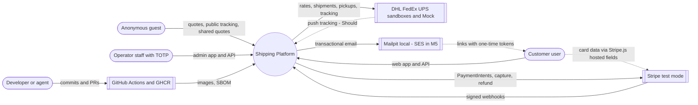
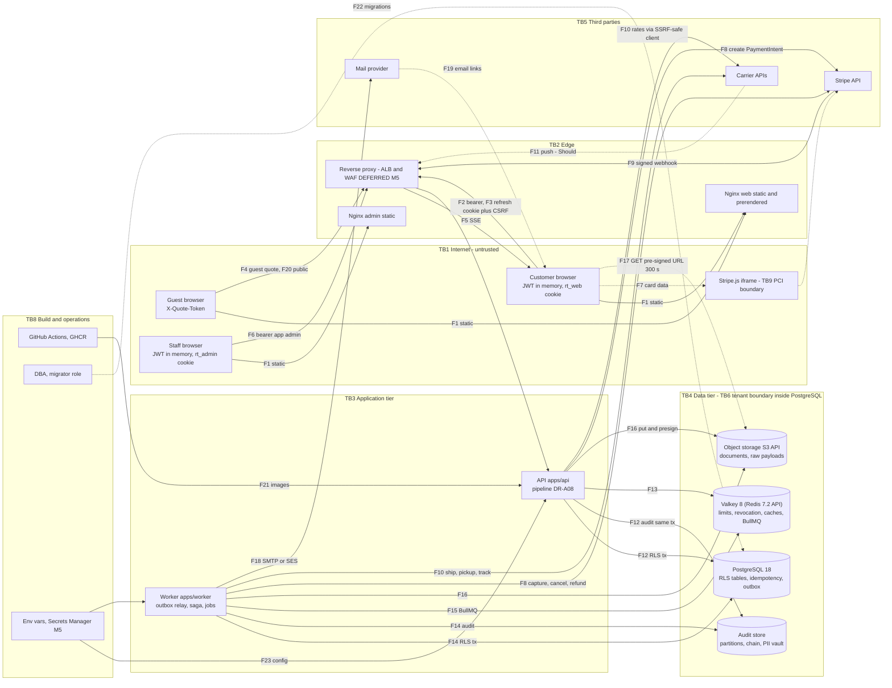
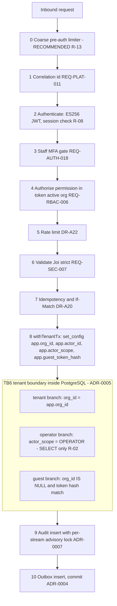
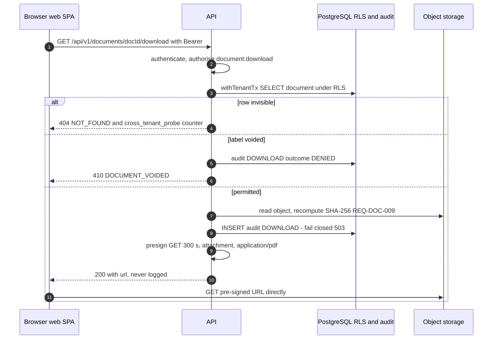
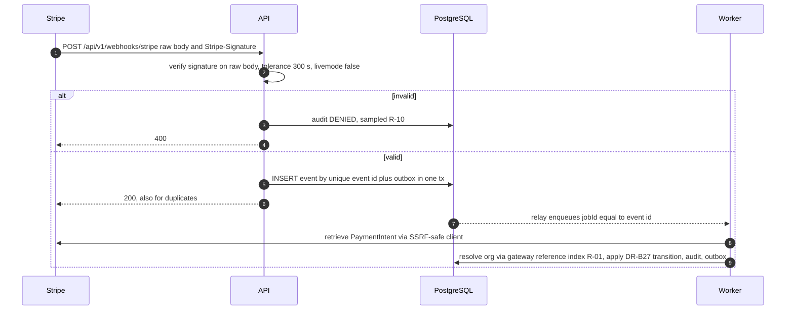
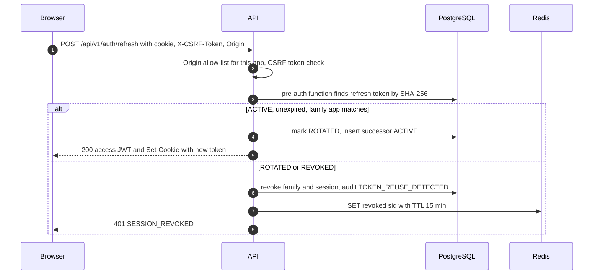

# Threat Model: Multi-Carrier Shipping Platform (M0 + M1)

| Field | Value |
|---|---|
| Version | 1.0 |
| Date | 2026-11-12 |
| Owner | threat-modeler, for security-analyst |
| Status | Draft for G2 |
| Inputs | P3 design brief (principal-architect), `CLAUDE.md` §5/§9/§11, `docs/sdlc/BRIEF.md` §4.2–§4.13, §9, §11, App. A/B; `REQUIREMENTS.md` (REQ-AUTH, ORG, RBAC, AUDIT, RLS, API, SEC, ADMIN, QUOTE, PAY, DOC, TRACK, NOTIF, DR-A01..A28, EC-A01..A50, DR-B14/B20/B21/B27/B31, EC-B01..B48); `NFR.md` (NFR-SEC/PRIV/AUDIT/TENANT); `ASSUMPTIONS.md` A-041..A-056, A-065, A-067; stories EPIC-01..17 |
| Consumers | principal-architect, data-architect, api-designer, platform-architect, security-analyst, qa-lead, product-manager |

## 1. Scope and methodology

**In scope (M0 + M1).** `apps/api`, `apps/worker`, `apps/web` (pre-rendered public pages plus SPA), `apps/admin`, the packages `shared`, `authz`, `audit`, `carriers`, `pricing`, `config`; PostgreSQL 18 with RLS; Valkey 8 (Redis 7.2-compatible; rate limits, revocation, caches, BullMQ); S3-compatible object storage (RustFS locally); Mailpit; Stripe test mode; DHL, FedEx and UPS sandboxes plus the Mock carrier; GitHub Actions and GHCR; the local Docker Compose stack.

**Out of scope.** M2–M5 features (partner API keys, outbound webhooks, ledger, on-behalf actions, signed actions, audit export, KYC, sanctions screening) except where M1 builds a seam. **AWS infrastructure** threats are listed in §5.17 and marked **DEFERRED to M5**, because CLOUD_BUDGET_MONTHLY_USD = 0 and Terraform is never applied in this run.

**Assumptions.** AS-1: in deployed environments the API runs on its own host (for example `api.<domain>`), on the same site as the web and admin origins, behind Nginx or an ALB. AS-2: no production data exists in any environment (BRIEF §10). AS-3: Compose runs on one developer machine. AS-4: Stripe runs in test mode only (REQ-PAY-004).

**Method.**
1. A DFD (§4) with numbered flows and trust boundaries.
2. STRIDE per element and per boundary-crossing flow (§5).
3. LINDDUN for every place that processes personal data (§6).
4. Abuse cases with tests that prove them (§7).
5. A mitigation matrix to REQ, ADR, NFR and story IDs (§8).
6. OWASP ASVS 4.0.3 L2 chapter mapping (§9).
7. Residual risks and recommendations (§10).

**Rating.** Likelihood (L/M/H) × Impact (L/M/H/C), where C means cross-tenant compromise, platform-wide compromise or loss of audit integrity. The resulting severity uses the CLAUDE.md §11 scale: C×H gives CRITICAL; C×L/M or H×M/H gives HIGH; H×L or M×M/H gives MEDIUM; M×L or L×any gives LOW; INFO means no realistic exploit. The rating is adjusted for exploitability. **Severity rates the residual risk of the design as briefed, before the recommendations in §10 are applied.** No CRITICAL threat remains at design level. Several HIGH threats remain.

**Legend.** Expl. = exploitability (Trivial / Easy / Moderate / Hard). Verification types: UNIT, PROP (property test), API (Supertest + OpenAPI validation), RBAC-GEN, AUDIT-GEN, RLS-INT (Testcontainers, runtime role), CAT (catalog SQL test), CFG (start-up/config test), E2E (Playwright), K6, ZAP, SEMGREP, CI (pipeline policy), MAN (manual review). `R-xx` means a recommendation (§10.1). `SEC-TC-xx` means a new security test case (§10.2). `SEC-Cxx` means a control in §8; these IDs are distinct from REQ-SEC-nnn.

## 2. Assets, classification and critical functions

Classification uses the REQ-AUDIT-009 classes: PUBLIC, INTERNAL, PERSONAL, SENSITIVE_PERSONAL, SECRET. CIA lists the confidentiality, integrity and availability need (H/M/L).

| Asset | Location | Class | C/I/A | Key controls |
|---|---|---|---|---|
| Password hashes | `users` | SECRET | H/H/M | bcrypt ≥ 12 (REQ-AUTH-003); never in logs or audit (REQ-AUDIT-008) |
| Access JWT and ES256 signing keys | browser memory; secret store | SECRET | H/H/H | 15 min lifetime, `kid` rotation, no claims beyond the ADR-0006 set |
| Refresh tokens | cookie; `refresh_tokens` (SHA-256 hash) | SECRET | H/H/M | rotation and reuse detection (REQ-AUTH-007/008, DR-A03) |
| TOTP secrets | `users` (AES-256-GCM) | SECRET | H/H/M | encrypted at rest; shown once (REQ-AUTH-015) |
| Recovery codes | bcrypt hashes | SECRET | H/H/L | single-use (REQ-AUTH-016) |
| Email-verify, reset, invitation, MFA-challenge and re-auth tokens | hashed in DB | SECRET | H/H/L | DR-A01 lifetimes, single-use |
| CSRF tokens | memory plus cookie | INTERNAL | M/H/L | REQ-SEC-004 |
| PII of users (name, email, IP, user agent) | `users`, `sessions`, audit, logs | PERSONAL | H/M/M | RLS, redaction (NFR-PRIV-001) |
| Shipment-party PII (names, addresses, phone, email) | shipments, address book, documents, raw carrier payloads | PERSONAL | H/H/M | RLS, DR-A12 SENSITIVE fail-closed views |
| Customs data and tax/identity references | customs lines; REQ-BOOK-008 references | SENSITIVE_PERSONAL | H/H/M | masked, never logged or audited in clear |
| Payment references and gateway tokens | payments, saved methods | SECRET (tokens), INTERNAL (brand, last 4) | H/H/M | SAQ A (REQ-PAY-005); tokens redacted (REQ-AUDIT-008) |
| Stripe secret key and webhook secret | env / secret manager | SECRET | H/H/H | test-mode prefix guard (REQ-PAY-004) |
| Carrier credentials (secret refs) and cached OAuth tokens | env / Secrets Manager; Redis | SECRET | H/H/H | REQ-CARR-015/016 |
| Price snapshots and pricing config | shipments; seed | INTERNAL | M/H/M | immutable plus SHA-256 (REQ-PRICE-017) |
| Audit entries, hash chain, checkpoints | `audit_entries` | INTERNAL | M/**H**/H | triggers, INSERT/SELECT-only role, chain (REQ-AUDIT-012..015) |
| Audit PII vault and envelope key | `audit_pii_vault` | PERSONAL / SECRET | H/H/M | ADR-0007 tokenisation |
| Idempotency records (stored responses) | `idempotency_keys` | inherits the response (up to PERSONAL / SECRET) | H/H/M | DR-A20 scope; see T-79 |
| Outbox events, job payloads, DLQ | Postgres; Redis | INTERNAL (PERSONAL if payloads carry PII) | M/H/H | DR-A25 |
| Documents and labels | object storage | PERSONAL | H/H/M | private, SSE, hashed, 300 s pre-signed URLs (REQ-DOC-005..009) |
| Raw carrier payloads | object storage | PERSONAL (after redaction: INTERNAL) | M/M/L | REQ-CARR-018 |
| Guest quote tokens | client; `quotes.guest_token_hash` | SECRET | M/M/L | ≥ 128 bits (REQ-RLS-013) |
| Share tokens | link; `quote_shares` | SECRET | M/M/L | ≥ 128 bits (NFR-SEC-013) |
| Order and tracking numbers | shipments, public tracking | INTERNAL (guessable) | M/M/M | DR-B31 minimised exposure |
| Correlation IDs | headers, logs, audit | INTERNAL | L/M/L | REQ-PLAT-011 regex |
| Feature flags | `feature_flags`, Redis cache | INTERNAL | L/H/M | `featureflag:manage`, audited (REQ-PLAT-021) |
| Compliance-pack content (tax, legal texts) | `compliance_packs` | PUBLIC | L/H/M | immutable versions (REQ-COMP-002) |
| Consent records, notification log | DB | PERSONAL | M/H/L | REQ-UI-023, REQ-NOTIF-012 |
| Seed credentials | `SEED_*` env | SECRET | H/H/L | REQ-DATA-002 |
| CI secrets, GITHUB_TOKEN, images | GitHub, GHCR | SECRET / INTERNAL | H/H/M | REQ-SEC-013, REQ-PLAT-006/007 |

**Critical functions.** In priority order:
- CF1: authentication, MFA and sessions.
- CF2: tenant isolation (RLS) and authorisation.
- CF3: booking saga with payment authorise, capture and refund.
- CF4: price computation and the snapshot.
- CF5: audit capture and integrity.
- CF6: document issuance.
- CF7: rate-shopping availability.
- CF8: public tracking and its minimised exposure.

## 3. Actors, trust levels and attacker profiles

| Actor | Trust | Authenticates by | Reach in M0+M1 |
|---|---|---|---|
| Anonymous guest | Untrusted | none, or `X-Quote-Token` | reference data, `POST /quotes`, own guest quote, SSE, public tracking, shared quotes, consents, CSP report |
| Customer user: Owner / Admin / Shipper / Finance / Viewer | Authenticated, tenant-scoped | password (+ optional TOTP) → JWT `app=web` | own organisation's data by permission (REQ-ACCT scope note) |
| Operator staff: Super Admin, Admin, Operations, Finance, Support, Sales, Compliance Auditor, Content Manager | Privileged, cross-tenant read on marked routes | password + mandatory TOTP (REQ-AUTH-018) → JWT `app=admin` | audit viewer (`audit:read`), own sessions, recovery codes |
| System jobs (worker, schedulers, seed) | Trusted code, tenant context from job | DB role `platform_app` | saga, polling, sweepers, partitions, chain verification |
| Stripe | Semi-trusted third party | webhook signature (REQ-PAY-011) | `POST /webhooks/stripe` |
| Carriers | Semi-trusted third party | responses over TLS; push signature (Should) | adapter responses; `POST /webhooks/carriers/{code}` |
| Mail provider | Semi-trusted | SMTP (Mailpit) / SES API (M5) | receives rendered email |
| CI pipeline | Trusted build | GitHub OIDC (M5), GITHUB_TOKEN | builds and publishes images |
| Developer / autonomous agent with repo access | Trusted, reviewed | Git + DoD review (CLAUDE.md §5) | code, seeds, migrations |
| DBA / `platform_migrator` | Highly privileged | DB credentials | schema, triggers, policies |

| Attacker | Capability | Goals | Primary targets |
|---|---|---|---|
| AT1 External unauthenticated (incl. botnets) | scripts, many IPs, IPv6 ranges, leaked credential lists | takeover, scraping, DoS, spam relay, fraud | CF1, CF7, CF8, webhooks |
| AT2 Malicious tenant user | free accounts, up to 10 owned orgs (A-047), multiple memberships | cross-tenant read/write, privilege escalation, price or payment manipulation | CF2, CF3, CF4 |
| AT3 Malicious co-member (same org, lower role) | valid membership | escalate role, use others' saved cards | CF2 |
| AT4 Compromised staff account | operator scope on cross-tenant routes | bulk PII exfiltration via the audit viewer, covering tracks | CF2, CF5 |
| AT5 Malicious insider with DB or Redis access | superuser / migrator, Redis write | tamper audit, read PII, forge jobs | CF5, CF2 |
| AT6 Supply-chain attacker | malicious npm package, GitHub Action, base image | CI secret theft, backdoor | build, all |
| AT7 Compromised third party | carrier or Stripe secret leak, malicious responses | forge events, inject content | webhooks, adapters |

## 4. Data-flow diagrams

### 4.1 L0 context

### 4.2 L1 containers and trust boundaries

| Boundary | Between | What must hold |
|---|---|---|
| TB1 | Internet ↔ edge | TLS (M5), HSTS, CSP, CORS, rate limits, WAF (M5) |
| TB2 | Edge ↔ API | trusted-proxy chain (EC-A12), header normalisation, `/metrics` never exposed |
| TB3 | API/worker ↔ data tier | least-privilege DB role (REQ-RLS-005), Redis ACL/TLS, scoped storage credentials |
| TB4 | Data-tier internals | audit append-only (REQ-AUDIT-014) |
| TB5 | Platform ↔ third parties | outbound allow-list (REQ-SEC-010); inbound signatures (REQ-PAY-011, REQ-TRACK-006) |
| TB6 | Tenant ↔ tenant ↔ guest rows (inside PostgreSQL) | RLS tenant, operator and guest branches (ADR-0005) |
| TB7 | Customer context ↔ operator context | separate apps, cookies and MFA gate (REQ-AUTH-018, REQ-ADMIN-003) |
| TB8 | Developer/CI ↔ runtime | review gates, scanners, pinned digests (REQ-SEC-013, REQ-PLAT-006) |
| TB9 | Browser ↔ Stripe iframe | card data never reaches the Platform (REQ-PAY-005) |

| Flow | Channel and authN | Highest data class | Boundaries |
|---|---|---|---|
| F1 | HTTPS static | PUBLIC | TB1 |
| F2, F6 | HTTPS JSON, bearer JWT | PERSONAL | TB1, TB2 |
| F3 | refresh cookie + `X-CSRF-Token` + Origin | SECRET | TB1, TB2 |
| F4 | `X-Quote-Token` header | INTERNAL (postcodes) | TB1, TB2, TB6 |
| F5 | SSE (`text/event-stream`), bearer or quote token | INTERNAL | TB1 |
| F7 | browser → Stripe directly | card data | TB9 |
| F8, F10 | HTTPS outbound with secret key / carrier credentials | SECRET + PERSONAL | TB5 |
| F9, F11 | HTTPS inbound, signature | INTERNAL | TB1, TB5 |
| F12, F14 | Postgres via `withTenantTx` with `set_config` | PERSONAL, SECRET | TB3, TB6 |
| F13, F15 | Redis protocol | SECRET (OAuth tokens), INTERNAL | TB3 |
| F16, F17 | S3 API; pre-signed GET | PERSONAL | TB3, TB1 |
| F18, F19 | SMTP / SES; email links | SECRET (tokens) | TB5 |
| F20 | public tracking, shared quote, reference data, consents | INTERNAL | TB1 |
| F21, F22, F23 | CI publish, DBA access, configuration | SECRET | TB8 |

### 4.3 L2: request pipeline and tenant context

### 4.4 L2: document download via pre-signed URL

### 4.5 L2: Stripe webhook

### 4.6 L2: refresh rotation and reuse detection

## 5. STRIDE per element

The "Existing mitigation" column cites the design as briefed. "Gap / residual" names what is still missing and points to §10.

### 5.1 Clients (web SPA, admin SPA)

| ID | Threat and scenario | STRIDE | Asset | Existing mitigation | Gap / residual | L/I | Sev | CWE | OWASP | Expl. | Verification |
|---|---|---|---|---|---|---|---|---|---|---|---|
| T-01 | XSS through rendered untrusted text (receiver name, carrier original description, pickup instructions, compliance-pack legal text). Same-origin script then uses the in-memory token and calls `/auth/refresh` with a freshly fetched CSRF token | T,I,E | access token, tenant PII | React encoding; REQ-SEC-016 single sanitiser; REQ-SEC-002 CSP; REQ-AUTH-010; REQ-PICK-012 | Memory storage prevents persistence, not in-page abuse. Static pages need build-time CSP hashes because Nginx cannot add nonces. Pack legal text must go through the sanitiser. Evaluate Trusted Types (R-22) | M/H | MEDIUM | CWE-79 | A03 | Moderate | E2E CSP-violation listener (NFR-SEC-006), ZAP, SEMGREP (US-043, US-046) |
| T-02 | A compromised bundled package or Stripe.js reads form fields | T,I | PII | REQ-PAY-005 hosted fields; NFR-SEC-006 exact Stripe host; REQ-SEC-013 | Stripe.js cannot use SRI (vendor guidance), so this is a documented ASVS 14.2.3 exception (RR-08); R-21 | L/H | MEDIUM | CWE-829 | A08 | Hard | CI SBOM / Trivy (US-048) |
| T-03 | Guest token kept in browser storage across the registration redirect (EC-B04) is read by XSS or a shared-device user | I | guest quote | REQ-RLS-013 ≥ 128 bits; REQ-QUOTE-016 token dies on claim | Storage location unspecified: use sessionStorage and delete on claim or expiry | L/L | LOW | CWE-922 | A04 | Moderate | E2E storage check (US-171) |
| T-04 | Open redirect through the sign-in return URL (`//evil`, `/\evil`, encoded forms) | S | credentials | REQ-ADMIN-001 same-origin relative | The web app's redirect (REQ-AUTH-010) must use the same validator | L/M | LOW | CWE-601 | A01 | Easy | UNIT (US-020, US-030) |
| T-05 | Clickjacking | T | user actions | REQ-SEC-001 XFO DENY; REQ-SEC-002 `frame-ancestors 'none'` | none | L/M | LOW | CWE-1021 | A04 | Easy | API header test (US-043) |
| T-06 | Authenticated PII JSON cached by the browser or a shared cache (back button on a shared device) | I | PII | REQ-API-012 ETags | No `Cache-Control` rule: default `private, no-store` (R-13, ASVS 8.2.1) | M/M | MEDIUM | CWE-525 | A04 | Easy | SEC-TC-29 |
| T-07 | Login CSRF: victim is logged into the attacker's account and saves addresses there | S,I | victim PII | SameSite=Strict (REQ-AUTH-006); REQ-SEC-014 CORS | REQ-SEC-004 covers only cookie routes; add an Origin check to login, register, reset and verify (R-06) | L/M | LOW | CWE-352 | A01 | Moderate | SEC-TC-09 |

### 5.2 Edge (Nginx, reverse proxy)

| ID | Threat and scenario | STRIDE | Asset | Existing mitigation | Gap / residual | L/I | Sev | CWE | OWASP | Expl. | Verification |
|---|---|---|---|---|---|---|---|---|---|---|---|
| T-08 | Admin app discovered, indexed or fingerprinted | I | admin surface | REQ-ADMIN-010; REQ-SEC-001 no banners | Network allow-listing / WAF for admin DEFERRED M5 | L/L | LOW | CWE-200 | A05 | Easy | API header test (US-033) |
| T-09 | One-time tokens in URL paths and queries reach edge logs, browser history and Referer: `/public/shared-quotes/{shareToken}`, `/invitations/{token}/accept`, verify/reset links, `?customer_reference=&postcode=` | I | share, invitation and reset tokens; quasi-identifiers | REQ-PLAT-012 logs route templates (API only); REQ-SEC-001 Referrer-Policy; DR-A01 single-use | Carry tokens in the URL fragment and send them in body or header; POST for postcode/reference lookups; edge log format without query string; `no-referrer` on token pages (R-14) | M/M | MEDIUM | CWE-598 | A04 | Moderate | SEC-TC-28 (NFR-PRIV-001) |
| T-10 | TLS stripping or downgrade | T,I | all traffic | REQ-SEC-003 HSTS; NFR-SEC-007 | Local Compose is plain HTTP by design; real TLS checks DEFERRED M5 | L/H | LOW | CWE-319 | A02 | Hard | CFG insecure-DB/Redis guard; Checkov |
| T-11 | Spoofed `X-Forwarded-For` or rotating IPv6 addresses evade per-IP limits and falsify the audited IP | S,R,D | limits, audit IP | EC-A12 trusted proxy chain; REQ-AUDIT-003 | `trust proxy` must be an explicit CIDR/hop list per environment (Compose ≠ AWS); key IPv6 by /64 (R-13) | M/M | MEDIUM | CWE-348 | A05 | Easy | SEC-TC-27 (US-040) |

### 5.3 API: identity and sessions (ADR-0006)

| ID | Threat and scenario | STRIDE | Asset | Existing mitigation | Gap / residual | L/I | Sev | CWE | OWASP | Expl. | Verification |
|---|---|---|---|---|---|---|---|---|---|---|---|
| T-12 | Credential stuffing and password spraying | S | accounts | REQ-AUTH-013/014; DR-A22 10/min/IP and 5/min/identifier; REQ-AUTH-002 breached list; REQ-SEC-012 | Botnets stay under per-IP limits until the WAF (M5). The top-10k list is small for ASVS 2.1.7 (R-31) | M/H | MEDIUM | CWE-307 | A07 | Easy | API limit tests (NFR-SEC-005, US-022) |
| T-13 | Account lockout used as targeted DoS (10 failures per 15 min against the victim's email) | D | availability of one account | DR-A02; reset clears the lock (EC-A10) | Behaviour is by design (REQ-AUTH-014). Device-cookie exemption is a product decision (R-25, RR-01) | H/M | MEDIUM | CWE-645 | A04 | Trivial | API (US-022, US-021) |
| T-14 | Email enumeration via response body or timing on login, register or reset | I | user existence | REQ-AUTH-001/005/011; NFR-SEC-003 ≤ 100 ms p95; DR-A02 counters for unknown identifiers | Run a dummy bcrypt for unknown emails and enqueue mail through the outbox on both branches. `MFA_REQUIRED` reveals that the password is right (accepted) | M/L | LOW | CWE-204 | A07 | Moderate | API 200-sample timing (US-015, US-017, US-021) |
| T-15 | Email bombing or spam relay via registration ("account already exists"), resend, reset and invitations | D | victim inbox, mail reputation | DR-A22 3/h per identifier on resend/reset; REQ-ORG-010 resend ≤ 3 | Registration sits in the 5/min auth class (≈ 300 mails/h per victim); no daily invitation cap (R-23) | M/M | MEDIUM | CWE-799 | A04 | Trivial | API limit tests (US-015, US-083) |
| T-16 | Stolen refresh cookie replayed | S | session | REQ-AUTH-007/008, DR-A03, REQ-AUTH-006 | Attacker holds the session until the victim's next refresh (≤ 15 min). The 30-day customer lifetime deviates from ASVS 3.3.2 L2 (R-26) | M/H | MEDIUM | CWE-294 | A07 | Moderate | API EC-A04/A05 (US-018) |
| T-17 | The `__Host-` prefix with `Path=/api/v1/auth` is invalid (the prefix requires `Path=/`). Browsers drop the cookie, refresh breaks, and the likely workaround (drop the prefix, add Domain) is weaker | S,T | refresh cookie | ADR-0006 | Design defect. Use `__Host-rt_*` with `Path=/` on the dedicated API host (ASVS 3.4.4), and read the cookie only on refresh/logout (R-06) | H/M | MEDIUM | CWE-693 | A05 | n/a | SEC-TC-09 (NFR-SEC-004) |
| T-18 | CSRF on refresh/logout | T | session | REQ-SEC-004 Origin + `X-CSRF-Token`; SameSite=Strict; EC-A46 | "Double-submit" is undefined across origins (JS cannot read the API cookie). Use HMAC(key, `__Host-csrf` HttpOnly cookie id), rotate at login, bind Origin to app cookie (R-06) | L/M | LOW | CWE-352 | A01 | Moderate | NFR-SEC-008 (US-044) |
| T-19 | JWT forgery or confusion (`alg` none/HS256, `kid`/`jku` injection, cross-app use, skew). Also: a staff member with a customer membership switches to the OPERATOR org in the web app and escapes the 12 h cap (REQ-ADMIN-004) | S,E | sessions, operator scope | ES256 via jose, no roles in token (REQ-AUTH-005), server-side permissions (REQ-RBAC-008) | Pin `algorithms:['ES256']`, local JWKS only, check iss/aud/`app`, leeway ≤ 30 s. OPERATOR org only with `app=admin` (R-08) | L/H | MEDIUM | CWE-347 | A07 | Hard | SEC-TC-11 (US-017, US-081) |
| T-20 | Revocation bypass when Redis is down or the `revoked:sid` write is lost (denylist fails open) | S,E | revoked sessions | REQ-AUTH-009 within 5 s | Failure mode undefined. Postgres `sessions.status` as source of truth; on Redis error check the DB (fail closed); allowlist of ACTIVE sids (R-08) | L/H | MEDIUM | CWE-613 | A07 | Moderate | SEC-TC-10 (US-019) |
| T-21 | MFA brute force by requesting fresh challenge tokens when the 5-failure lock applies per challenge. With ±1 step (3 valid codes) about 36,000 guesses per day fit within login limits, roughly 10 % daily success | S,E | MFA accounts incl. staff | REQ-AUTH-017; DR-A02; challenge single-use and bound to /24 | Lock scope is ambiguous ("lock the challenge"). It must be per user (R-07) | M/H | **HIGH** | CWE-307 | A07 | Easy | SEC-TC-02 (US-024) |
| T-22 | MFA challenge token replayed or used as an access token; TOTP code replayed within its step | S | MFA | REQ-AUTH-017 single-use; EC-A06 | The challenge token needs its own `typ`/`aud` that bearer middleware rejects | L/H | LOW | CWE-294 | A07 | Hard | API (US-024) |
| T-23 | Staff first-sign-in enrolment hijack: whoever first authenticates with a seeded or leaked staff password enrols their own TOTP and gets Super Admin | S,E | operator accounts | REQ-DATA-002 aborts default passwords only in production; DR-B28 MFA_ENABLED notice | Not covered for staging or shared environments. Refuse defaults when APP_ENV ∉ {local, test}; first staff enrolment needs an emailed one-time code (R-07, R-20) | M/C | **HIGH** | CWE-1392 | A07 | Trivial when reachable | SEC-TC-03 (US-025, US-050) |
| T-24 | Recovery-code CPU DoS and brute force: up to 10 bcrypt compares per attempt (≈ 2.5 s CPU) | D,S | MFA, API capacity | REQ-AUTH-016 ≥ 50 bits, hashed, single-use | Use `id-secret` codes with one compare, or HMAC-SHA-256 with a secret pepper (R-07) | M/M | MEDIUM | CWE-407 | A04 | Easy | SEC-TC-12 |
| T-25 | Stolen session plus known password disables TOTP or regenerates recovery codes, because password re-auth is accepted | E | MFA | REQ-AUTH-019/020 re-auth proof | MFA-weakening scopes must require a TOTP or recovery-code proof (R-07) | L/H | MEDIUM | CWE-308 | A07 | Moderate | SEC-TC-13 (US-026) |
| T-26 | Reset-token interception, reuse or Host-header poisoning | S | accounts | REQ-AUTH-011/012; REQ-NOTIF-007 configured base URL | Mailbox compromise means takeover of non-MFA accounts. Assert that a reset never disables MFA | L/H | MEDIUM | CWE-640 | A07 | Moderate | API (US-021) |
| T-27 | Session fixation | S | session | new refresh family at login (REQ-AUTH-007); no tokens in URLs (REQ-AUTH-010) | Rotate the pre-session CSRF cookie at login | L/M | LOW | CWE-384 | A07 | Hard | SEC-TC-09 |
| T-28 | bcrypt cost 12 (≈ 250 ms) exhausts the libuv threadpool under distributed login/register floods | D | API availability | DR-A22 limits before the handler | Botnets until the WAF (M5). Add a concurrency cap on hashing (p-limit) | M/M | MEDIUM | CWE-400 | A04 | Easy | K6 spike on `/auth/login` |
| T-29 | bcrypt ignores bytes after 72, which contradicts EC-A03 ("fully significant"). A naive raw-digest pre-hash can contain NUL bytes | S | passwords | REQ-AUTH-002/003; EC-A03 | ADR-0006 must define bcrypt(base64(HMAC-SHA-256(pepper, password))) | L/M | LOW | CWE-916 | A02 | Hard | SEC-TC-14 (US-015) |

### 5.4 API: authorisation, tenancy and pipeline (ADR-0005, ADR-0016)

| ID | Threat and scenario | STRIDE | Asset | Existing mitigation | Gap / residual | L/I | Sev | CWE | OWASP | Expl. | Verification |
|---|---|---|---|---|---|---|---|---|---|---|---|
| T-30 | Cross-tenant IDOR with a crafted UUID | I,T | tenant data | REQ-RLS-002/004/007 forced RLS; REQ-RBAC-007 404; EC-A08 counter | UUIDv7 reveals creation time (INFO) | L/H | LOW | CWE-639 | A01 | Easy | RLS-INT + RBAC-GEN (US-077, US-071, NFR-TENANT-001) |
| T-31 | Same-tenant IDOR on user-owned resources (saved payment methods, notification log, preferences, sessions) | I,T | other members' data | DR-A14 own sessions; REQ-AUTH-022 | Payment methods and notification log need user-level policies (`user_id = app.actor_id`), otherwise co-members can list or charge them (R-04) | M/H | MEDIUM | CWE-639 | A01 | Easy | SEC-TC-30 (NFR-SEC-011, US-217, US-289) |
| T-32 | Confused deputy: path `{orgId}` (for example `/organisations/{orgId}/members`) differs from the token's active org. Permission is checked in org A while data is addressed in org B, where the caller is only a Viewer | E | org membership, roles | REQ-ORG-005 active org in token | Rule needed: RLS context always comes from the token, and `{orgId}` must equal the active org, else 404. Enforced by `defineRoute` tenancy metadata and a build test (R-03) | M/H | **HIGH** | CWE-441 | A01 | Trivial for multi-org users | SEC-TC-01 (US-063, US-068, US-085) |
| T-33 | Mass assignment (`org_id`, role, status, version, price, `on_behalf_of_org_id`), including nested objects | T,E | integrity | REQ-SEC-007; REQ-ORG-007; REQ-RLS-009; EC-A18 | Map DTOs explicitly, never spread `req.body` into Prisma `data` (SEMGREP rule) | L/H | LOW | CWE-915 | A08 | Easy | API fuzz (NFR-SEC-009/011, US-045, US-064) |
| T-34 | Client header, query or body tries to obtain the operator scope or change the RLS context | E | all tenants | REQ-RLS-006, DR-A15 server-only | none for client input | L/H | LOW | CWE-639 | A01 | Easy | API (US-076) |
| T-35 | SQL injection or any raw SQL runs `set_config('app.actor_scope','OPERATOR',true)` or changes `app.org_id`. The GUCs are mutable inside the transaction | E,I | all tenants | REQ-SEC-009 parameterised + SEMGREP; REQ-RLS-005 NOBYPASSRLS | The policy trusts the GUC alone. The operator branch should also call `app_is_active_operator(app.actor_id)`; `set_config` only through one helper (R-02) | L/C | MEDIUM | CWE-89 | A03 | Hard | SEC-TC-06 |
| T-36 | The operator branch also permits writes in every tenant (WITH CHECK mirrors), although M0/M1 only needs cross-tenant reads | E,T | all tenants | DR-A15 audited | Least privilege: operator branch `FOR SELECT` until a superseding ADR in M2 (R-02) | L/H | MEDIUM | CWE-269 | A01 | Moderate (AT4) | SEC-TC-06 CAT |
| T-37 | Pre-authentication and cross-tenant system lookups have no designed RLS path: users by email (login, register, reset, invitation), refresh tokens by hash, public tracking, shared quotes, Stripe webhook by gateway reference, carrier push by tracking number, sweepers and polling | E,I | all tenants | DR-A14 own rows only; REQ-RLS-008 iterate orgs | Without a design, implementations drift to the migrator role, BYPASSRLS or broad policies. ADR-0005 must list narrow SECURITY DEFINER functions and global no-PII index tables (R-01) | M/C | **HIGH** | CWE-284 | A01 | Arises at implementation | SEC-TC-05 (US-074) |
| T-38 | Permission cache poisoned (if kept in Redis) or stale | E | authz | REQ-RBAC-008 TTL ≤ 5 s | Keep the cache in process memory per instance (R-08) | L/H | LOW | CWE-639 | A01 | Hard | API timing (US-068) |
| T-39 | Authorisation runs before rate limiting (DR-A08), so 401 floods and authenticated denied floods are not limited, and each denial writes a `PERMISSION_DENIED` row under the stream lock | D | DB, audit | REQ-AUDIT-010 (400 not audited) | Add a coarse limiter at step 0; above N denials/min per actor, write one aggregated summary entry (R-10, R-13) | M/M | MEDIUM | CWE-770 | A04 | Trivial | SEC-TC-15 (US-040, US-069) |
| T-40 | Probing just below the 20/min cross-tenant 404 threshold | I | existence | 74 random bits in UUIDv7; REQ-SEC-012 | none | L/L | INFO | CWE-204 | A01 | Hard | n/a |
| T-41 | `filter[x]` needs the extended `qs` parser: prototype pollution and parameter explosion | T,D | process | REQ-SEC-007; REQ-API-008 allow-lists | qs depth ≤ 2, parameterLimit ≤ 50, arrayLimit ≤ 20, `allowPrototypes:false` (R-13) | L/M | LOW | CWE-1321 | A08 | Moderate | SEC-TC-36 |
| T-42 | ReDoS through seeded regexes (postcode formats, pack reference formats) applied to user input | D | API | REQ-SEC-008 shared constants | Safe-regex check at seed validation; cap input length before matching | L/M | LOW | CWE-1333 | A04 | Moderate | UNIT seed validation (US-051, US-177) |

### 5.5 API: quotes, guest access, SSE and share links

| ID | Threat and scenario | STRIDE | Asset | Existing mitigation | Gap / residual | L/I | Sev | CWE | OWASP | Expl. | Verification |
|---|---|---|---|---|---|---|---|---|---|---|---|
| T-43 | Guest token guessed or brute-forced | S,I | guest quote | REQ-RLS-013 ≥ 128 bits; REQ-QUOTE-002 uniform 404, 20/min/IP | none | L/L | LOW | CWE-330 | A01 | Hard | RLS-INT (US-080, US-155) |
| T-44 | Claim race or hijack with a leaked token. The claim also updates only `quotes`, so `quote_options` stay visible to the guest and invisible to the org | T,I | guest quote | single conditional UPDATE; REQ-QUOTE-016 409; EC-A44 | The claim must re-scope options and shares atomically, or children must inherit visibility via EXISTS on the parent (R-04) | M/M | MEDIUM | CWE-362 | A04 | Moderate | SEC-TC-07 (US-166) |
| T-45 | Shared-quote read needs cross-org access for which no RLS branch exists. Risk of a broad workaround that leaks PII | I | quote data | REQ-QUOTE-015 minimal projection; NFR-SEC-013 ≥ 128 bits; 404 on revoke | A SECURITY DEFINER function returns only the allow-listed projection, which enforces minimisation in the DB (R-01) | M/M | MEDIUM | CWE-200 | A01 | Moderate | SEC-TC-08 (US-165, NFR-PRIV-004) |
| T-46 | Rate-shopping amplification: anonymous quotes fan out to 3+ carriers, so the global per-account bulkhead (10) and sandbox quotas (DHL daily) run out. Everyone gets `CARRIER_BUSY`, and the carrier account may be suspended | D | CF7 | REQ-QUOTE-002 20/min, 100/h/IP; REQ-CARR-010 cache; REQ-CARR-017 breaker and bulkhead | Distributed sources; no per-IP SSE cap; no bulkhead reserve for saga calls; WAF M5 (R-15) | M/H | **HIGH** | CWE-770 | A04 | Easy (botnet) | SEC-TC-26 (US-126, US-130) |
| T-47 | SSE exhaustion: many concurrent streams, and reopening a stream re-triggers the fan-out | D | API sockets | REQ-API-018 30 s cap, disconnect cancels work | Per-IP (2) and per-user (5) stream caps; fan-out once at POST, the stream only subscribes (R-15) | M/M | MEDIUM | CWE-400 | A04 | Easy | K6 (US-042, US-135, US-207) |
| T-48 | Rate-cache poisoning by a Redis writer flows into price snapshots | T | prices | REQ-CARR-010 cost-only cache; DR-B15 | Depends on Redis integrity (T-92) | L/M | LOW | CWE-345 | A08 | Hard | UNIT cache key (US-134) |
| T-49 | Price snapshot changed after booking | T | CF4 | REQ-PRICE-017 immutable + DENIED audit; EC-B14 | DB enforcement still to specify: trigger plus no UPDATE grant (data-architect) | L/H | LOW | CWE-471 | A04 | Hard | RLS-INT as runtime role |
| T-50 | `X-Mock-Scenario` honoured in a reachable non-production environment (`latency=30000` amplifies T-46/T-47), or in production through misconfiguration | T,D | availability | REQ-CARR-006; EC-B41 | Gate on an explicit `MOCK_SCENARIOS_ENABLED` (default false outside local/test); edge strips the header (R-20) | L/M | LOW | CWE-489 | A05 | Easy | CFG (US-123) |

### 5.6 API: orders and payments (ADR-0012)

| ID | Threat and scenario | STRIDE | Asset | Existing mitigation | Gap / residual | L/I | Sev | CWE | OWASP | Expl. | Verification |
|---|---|---|---|---|---|---|---|---|---|---|---|
| T-51 | Client manipulates amount or currency | T | CF3 | REQ-PAY-006 server-computed; 409 `AMOUNT_MISMATCH` | none | L/H | LOW | CWE-602 | A04 | Easy | API (US-209) |
| T-52 | Forged status or amount sent to `POST /payments/{id}/confirm` | S,T | CF3 | REQ-PAY-012 state from the retrieved gateway object | The confirm endpoint must retrieve the PaymentIntent and ignore body status (R-17) | L/H | MEDIUM | CWE-345 | A08 | Easy | SEC-TC-23 (US-212) |
| T-53 | Card data posted to the Platform | I | SAQ A scope | REQ-PAY-005; EC-B30; NFR-SEC-013 PAN scanner | none | L/H | LOW | CWE-359 | A04 | Easy | API + E2E scanner (US-211) |
| T-54 | Card testing across many orders (production risk) | D | gateway account | REQ-PAY-010 5/order/h; REQ-PAY-007 verified email | Per-user and per-IP caps across orders (R-30); Radar in M5 | L/H | MEDIUM | CWE-799 | A04 | Moderate | API limits |
| T-55 | Coupon redemption limit raced (counted at PAID, EC-B24) | T | revenue | REQ-PRICE-011 | Conditional atomic increment; reservation policy decided by PM (R-28) | M/L | LOW | CWE-362 | A04 | Moderate | API concurrency (US-194) |
| T-56 | A co-member charges another member's saved card, or the client supplies an arbitrary `pm_` id | E,T | payment methods | REQ-PAY-014 tokens only | Scope methods per user; derive the PM from the retrieved SetupIntent (R-04, R-17) | M/M | MEDIUM | CWE-639 | A01 | Easy | SEC-TC-30 (US-217) |

### 5.7 API: documents

| ID | Threat and scenario | STRIDE | Asset | Existing mitigation | Gap / residual | L/I | Sev | CWE | OWASP | Expl. | Verification |
|---|---|---|---|---|---|---|---|---|---|---|---|
| T-57 | Download without permission, across tenants, or of a voided label | I | documents | REQ-RBAC-012; REQ-DOC-007/008/014; EC-B33/B34 fail-closed | none | L/H | LOW | CWE-862 | A01 | Easy | API + AUDIT-GEN (US-072, US-225, US-226, US-229) |
| T-58 | Pre-signed URL shared within 300 s (labels hold addresses) | I | PII | REQ-DOC-007 TTL 300 s, never logged; DOWNLOAD audited | Accepted (RR-02). Sign the exact key with forced `response-content-type` and attachment disposition | M/M | LOW | CWE-200 | A01 | Easy | API expiry and headers (NFR-SEC-013) |
| T-59 | Carrier-supplied label bytes are malicious, or an object is served inline as HTML from the storage origin | T,I | users | REQ-DOC-005/006 private, hashed; attachment disposition | Validate magic bytes and size ≤ 5 MB; set Content-Type at put time (R-16) | L/M | LOW | CWE-20 | A04 | Hard | UNIT (US-222) |
| T-60 | Insider tampers with a stored document | T | documents | REQ-DOC-009 recompute hash | The hash lives in the DB; versioning and Object Lock in M5 | L/M | LOW | CWE-354 | A08 | Hard | API (US-227) |
| T-61 | Documents emailed to arbitrary recipients | I | PII | REQ-DOC-010 account address only, 5/h | none | L/M | LOW | CWE-200 | A01 | Easy | API (US-228) |

### 5.8 API: public endpoints

| ID | Threat and scenario | STRIDE | Asset | Existing mitigation | Gap / residual | L/I | Sev | CWE | OWASP | Expl. | Verification |
|---|---|---|---|---|---|---|---|---|---|---|---|
| T-62 | Enumeration of sequential order numbers (the Luhn digit is no secret) scrapes status, carrier, city-level route and ETA | I | shipment metadata | REQ-TRACK-010 limits; DR-B31; REQ-TRACK-012; A-050 | Botnets until the WAF. Require the destination postcode for order-number lookups (R-24) or accept the residual (RR-09) | M/M | MEDIUM | CWE-200 | A01 | Easy | API (US-247, US-249) |
| T-63 | Timing oracle reveals hidden or not-yet-trackable numbers | I | existence | REQ-TRACK-012 < 50 ms | Run the same index lookups on every path. The Luhn fast path covers only malformed input | L/L | LOW | CWE-208 | A01 | Hard | API timing (US-247) |
| T-64 | A customer-reference lookup discloses another org's shipment | I | PII | REQ-TRACK-009; EC-B39 | none | L/M | LOW | CWE-200 | A01 | Moderate | API (US-250) |
| T-65 | CSP-report and consent endpoints used to flood storage and logs, or for log injection | D,T | logs, consent store | REQ-SEC-002 20/min/IP; Pino JSON escaping | 16 KB body cap, content-type allow-list, server-issued anonymous id (R-22) | M/L | LOW | CWE-117 | A09 | Easy | API (US-043, US-114) |
| T-66 | Cache-busting floods on reference endpoints | D | API | REQ-DATA-016 ETag and max-age; 120/min/IP | none | L/L | LOW | CWE-400 | A04 | Easy | K6 |

### 5.9 API: inbound webhooks

| ID | Threat and scenario | STRIDE | Asset | Existing mitigation | Gap / residual | L/I | Sev | CWE | OWASP | Expl. | Verification |
|---|---|---|---|---|---|---|---|---|---|---|---|
| T-67 | Forged Stripe webhook | S,T | CF3 | REQ-PAY-011 raw-body signature, 300 s; NFR-SEC-013 | Capture the raw body only on this route; require `livemode === false`; event-type allow-list (R-17) | L/H | LOW | CWE-345 | A08 | Hard | SEC-TC-23 (US-213) |
| T-68 | Webhook replay, duplicate or out-of-order delivery | T | CF3 | REQ-PAY-012 dedupe, state from retrieved object; EC-B11 | none | L/M | LOW | CWE-294 | A08 | Moderate | API (US-213) |
| T-69 | Signature-failure flood: each failure writes a DENIED audit row on the shared SYSTEM stream | D | audit | general 120/min/IP | Sample DENIED audit rows (first N/min per IP), always count; Stripe IP allow-list at the WAF in M5 (R-10) | M/M | MEDIUM | CWE-770 | A04 | Easy | K6 |
| T-70 | No tenant context for webhook processing; the org may be derived from attacker-influenced data | E | tenancy | REQ-RLS-008 | Global `gateway_reference_index`, plus a cross-check against PaymentIntent metadata set by the server (R-01) | L/H | MEDIUM | CWE-639 | A01 | Hard | RLS-INT |
| T-71 | `/webhooks/mock-gateway` or `mock_*` tokens reachable in a deployed environment can forge PAID | S,T | CF3 | REQ-PAY-002 tokens rejected in production | Do not mount the route when APP_ENV=production (start-up assertion); require an HMAC in staging (R-17) | L/H | MEDIUM | CWE-489 | A05 | Easy if mounted | SEC-TC-24 (US-199) |
| T-72 | Forged or replayed carrier push: a fake PICKED_UP blocks cancellation and refund (DR-B20); a fake DELIVERED stops polling | S,T | CF3, tracking | REQ-TRACK-006 signature, 401; REQ-TRACK-005 dedupe | Treat pushes as hints: confirm with `track()` before cancellation-blocking or terminal transitions (R-16) | L/M | MEDIUM | CWE-345 | A08 | Moderate | SEC-TC-22 (US-252) |

### 5.10 Worker (ADR-0004, ADR-0013, ADR-0014)

| ID | Threat and scenario | STRIDE | Asset | Existing mitigation | Gap / residual | L/I | Sev | CWE | OWASP | Expl. | Verification |
|---|---|---|---|---|---|---|---|---|---|---|---|
| T-73 | A forged or edited BullMQ job with another `org_id` makes the worker act in a foreign tenant | E,T | tenancy | REQ-RLS-008 context from payload; DR-A25 | Re-derive the org from the Postgres outbox or saga row (jobId = event id); Redis ACL (R-18) | L/H | MEDIUM | CWE-345 | A08 | Hard (needs Redis write) | SEC-TC-20 (US-078, US-011) |
| T-74 | PII in job payloads, the DLQ and Redis | I | PII | REQ-PLAT-013 DLQ redacted | Payloads carry IDs only (R-18) | M/M | MEDIUM | CWE-359 | A04 | Moderate | UNIT payload schema |
| T-75 | The saga keeps running after a cancellation (documents or pickup scheduled for a VOIDED shipment), or the saga and the sweeper race | T | CF3 | DR-B03; REQ-RLS-011; REQ-PAY-018 | Re-check DR-B01 state and version before each step; saga and sweeper share a per-order advisory lock (R-19) | M/M | MEDIUM | CWE-367 | A04 | Moderate | SEC-TC-21 (US-196, US-202, US-219) |
| T-76 | Double label or double capture through retries or duplicate delivery | T | CF3 | DR-B04 G2/G3; REQ-BOOK-021/023; EC-B06/B47 | Carriers without idempotent create go to EXCEPTION for manual handling (RR-07) | L/H | LOW | CWE-837 | A04 | Moderate | API + UNIT (US-203, US-205) |
| T-77 | Poison messages flood retries and the DLQ | D | queues | REQ-PLAT-013 5 attempts, non-retryable classes | none | L/L | LOW | CWE-400 | A04 | Moderate | UNIT (US-009) |
| T-78 | Repeatable jobs fire on several instances (double sweeps) | T | CF3 | REQ-PLAT-015; consumer dedupe | none | L/M | LOW | CWE-837 | A04 | Hard | UNIT (US-010) |

### 5.11 PostgreSQL (tenant data, idempotency, outbox)

| ID | Threat and scenario | STRIDE | Asset | Existing mitigation | Gap / residual | L/I | Sev | CWE | OWASP | Expl. | Verification |
|---|---|---|---|---|---|---|---|---|---|---|---|
| T-79 | The idempotency store is a global table without RLS that holds full response bodies (tenant PII) for 24 h. A scope bug replays tenant A's response to tenant B. Anonymous `POST /quotes` has no org, actor or guest token in scope yet, so a colliding key replays another guest's `guest_token`. One-time secrets (TOTP secret, recovery codes, share token) would be stored in clear | I,E | tenant PII, secrets | REQ-API-009 scope; DR-A20; EC-A29 | Add RLS (tenant and guest branches) or encrypt bodies; mark secret-returning routes `not-applicable`; anonymous scope includes IP /64 (R-05) | M/H | **HIGH** | CWE-524 | A04 | Moderate | SEC-TC-04 (US-038) |
| T-80 | The members-list policy joins `users` too broadly and exposes names and emails across orgs | I | PII | DR-A14 | Restrict visibility to co-members of `app.org_id` (data-architect) | L/M | LOW | CWE-200 | A01 | Moderate | RLS-INT (US-085) |
| T-81 | Backups and replicas hold every tenant's PII and the vault, so erasure is incomplete | I | PII | CLAUDE.md §5 backup + restore test | Backup encryption and retention DEFERRED M5 (RR-05) | L/H | MEDIUM | CWE-530 | A02 | Hard | M5 runbook |
| T-82 | Runtime role misconfigured (BYPASSRLS, owner, superuser) or migrator credentials at runtime | E | all | REQ-RLS-005 catalog test | none | L/C | LOW | CWE-250 | A05 | Hard | CAT (US-074) |
| T-83 | Long interactive transactions hold audit advisory locks and exhaust the pool | D | availability | Prisma transaction timeout | No external calls inside `withTenantTx` (lint); explicit timeout config | M/M | MEDIUM | CWE-400 | A04 | Moderate | UNIT lint, K6 |

### 5.12 Audit store (ADR-0007)

| ID | Threat and scenario | STRIDE | Asset | Existing mitigation | Gap / residual | L/I | Sev | CWE | OWASP | Expl. | Verification |
|---|---|---|---|---|---|---|---|---|---|---|---|
| T-84 | A superuser disables the triggers, rewrites entries and recomputes the unkeyed SHA-256 chain and the in-DB checkpoint, so the change goes undetected | T,R | CF5 | REQ-AUDIT-012..015; nightly CHAIN_CHECKPOINT | The anchor sits in the same trust domain. Sign checkpoints with a key DB roles cannot read and export them to append-only storage (Object Lock in M5) (R-09) | L/C | **HIGH** | CWE-345 | A09 | Hard (AT5) | SEC-TC-17 (US-093, EC-A23) |
| T-85 | One SYSTEM-stream advisory lock serialises every anonymous or system entry (guest quotes, public lookups, unknown-user login failures, webhook receipts). Lock contention becomes a platform-wide DoS | D | CF1, CF5 | per-org streams (A-043) | Shard SYSTEM into k sub-streams included in the checkpoint; add a lock-wait metric (R-10) | M/H | **HIGH** | CWE-400 | A04 | Easy | SEC-TC-16 (NFR-AUDIT-005) |
| T-86 | Audit growth from VIEW storms (600/min/user), denied floods and public lookups | D | storage | REQ-AUDIT-010; rate limits | Per-stream growth alert; aggregation (R-10) | M/M | MEDIUM | CWE-779 | A09 | Easy | K6 + metric |
| T-87 | PII outside the tokenised fields: `ip_address`, raw `user_agent`, `reason` and list filter summaries (for example receiver-name search terms, REQ-ACCT-002) are hashed into the chain in clear, so they cannot be erased or retention-limited | I | PII | A-045 vault for old/new values | Tokenise these values; keep a coarse IP and the UA family in clear; HMAC blind index for the IP filter (R-11) | H/M | MEDIUM | CWE-359 | A04 | n/a (compliance) | SEC-TC-19 (NFR-PRIV-002, US-091) |
| T-88 | NFR-AUDIT-005's "feature-flagged benchmark baseline" built as a runtime flag would silently bypass audit | R,T | CF5 | REQ-PLAT-021 flag changes audited | Audit-off as a build profile only; start-up refuses it outside APP_ENV=benchmark (R-12) | L/C | **HIGH** | CWE-778 | A09 | Easy if it exists | SEC-TC-18 |
| T-89 | Vault: AES-GCM without AAD allows ciphertext swaps between tokens; a single env key | T,I | vault | AES-256-GCM envelope (ADR-0007) | AAD = token‖subject‖class; key-id prefix for rotation; RLS on the vault (R-11) | L/M | LOW | CWE-325 | A02 | Hard | UNIT |
| T-90 | Missing future partition blocks every mutation | D | CF5 | REQ-AUDIT-017; EC-A21 readiness degraded | none | L/H | LOW | CWE-400 | A04 | n/a | job test (US-095) |
| T-91 | Every `audit:read` holder sees decrypted PII across tenants | I | PII | REQ-AUDIT-023 operator only; REQ-AUDIT-022 VIEW audited | Add an `audit:read:pii` permission in M2 (RR) | L/M | LOW | CWE-359 | A01 | Moderate (AT4) | RBAC-GEN (US-097) |

### 5.13 Redis

| ID | Threat and scenario | STRIDE | Asset | Existing mitigation | Gap / residual | L/I | Sev | CWE | OWASP | Expl. | Verification |
|---|---|---|---|---|---|---|---|---|---|---|---|
| T-92 | Redis access lets an attacker delete `revoked:*`, poison caches, read carrier OAuth tokens and job payloads, and forge jobs | S,T,I,E | sessions, secrets | NFR-SEC-007 TLS outside local | AUTH and per-service ACL users; Compose binds 127.0.0.1; encrypted token cache; DB as source of truth (R-08, R-16, R-18, R-20) | L/H | MEDIUM | CWE-306 | A05 | Moderate | CFG; Checkov M5 |
| T-93 | Rate limiting fails open during a Redis outage | D,S | limits | REQ-SEC-006 in-memory auth fallback; EC-A32 | Per-instance limit × N instances | L/M | LOW | CWE-770 | A04 | Moderate | resilience test (US-040) |

### 5.14 Object storage

| ID | Threat and scenario | STRIDE | Asset | Existing mitigation | Gap / residual | L/I | Sev | CWE | OWASP | Expl. | Verification |
|---|---|---|---|---|---|---|---|---|---|---|---|
| T-94 | Bucket public or listable, SSE off, signer credentials too broad, RustFS default credentials exposed | I | documents | REQ-DOC-006 private + SSE; UUID-only keys | Signer limited to Get/Put on prefixes; local binding to 127.0.0.1; block-public-access via Checkov (M5) | L/H | MEDIUM | CWE-732 | A05 | Moderate | CFG; Checkov |
| T-95 | Raw carrier payloads keep PII when redaction misses fields; tracking raw payloads (signatory names) are not explicitly redacted | I | PII | REQ-CARR-018 redaction tests | Extend redaction to tracking payloads (R-29) | M/M | MEDIUM | CWE-359 | A04 | n/a | UNIT synthetic PII (US-136) |

### 5.15 Third parties and outbound flows (ADR-0010, ADR-0012)

| ID | Threat and scenario | STRIDE | Asset | Existing mitigation | Gap / residual | L/I | Sev | CWE | OWASP | Expl. | Verification |
|---|---|---|---|---|---|---|---|---|---|---|---|
| T-96 | SSRF via redirects, DNS rebinding, IPv6-mapped or decimal IPs, metadata hosts (169.254.169.254, fd00:ec2::254, 169.254.170.2). Vendor SDKs (Stripe, AWS, nodemailer) bypass the safe client | I,E | internal network, cloud credentials | REQ-SEC-010; NFR-SEC-010; EC-A45; hosts from config only (REQ-CARR-015) | Pin the validated IP; also block 100.64/10, 0/8, ::ffff:0:0/96 and fc00::/7; route Stripe through `createFetchHttpClient`; document SDK exceptions (R-17) | L/H | MEDIUM | CWE-918 | A10 | Hard | SEC-TC-25 (US-047) |
| T-97 | Malicious carrier response: huge or deeply nested JSON, `__proto__` keys, scripts in descriptions, oversized base64 labels | T,D | API, users | REQ-SEC-010 size cap; REQ-CARR-007 canonical codes; DR-B31 no free text in public | Schema-validate at the adapter boundary; no deep-merge (R-16) | L/M | LOW | CWE-20 | A08 | Hard | contract negatives (US-125) |
| T-98 | Carrier credentials leaked through logs, errors, fixtures or HTTP library debug output | I | carrier accounts | REQ-CARR-015/019; REQ-PLAT-012; Gitleaks | Never enable library debug logging (R-22) | L/H | LOW | CWE-532 | A09 | Moderate | sentinel test (US-128, US-137) |
| T-99 | Spoofed platform mail used for phishing; labels as attachments expose PII in mailboxes | S,I | users | REQ-NOTIF-003/015; REQ-DOC-010 | SPF, DKIM and DMARC DEFERRED M5 (RR-11) | M/M | MEDIUM | CWE-290 | A07 | Easy | M5 |
| T-100 | Mailpit UI (8025) or RustFS console exposed on a shared host or staging lets anyone read every verify, reset and invitation link and take over any account there | S,I,E | accounts | REQ-NOTIF-003 | Bind to 127.0.0.1; never deploy Mailpit beyond local/CI (R-20) | M/H | **HIGH** | CWE-668 | A05 | Trivial when exposed | SEC-TC-34 (US-003, US-276) |
| T-101 | A live Stripe key is configured | T | real money | REQ-PAY-004; EC-B31 start-up refusal | none | L/H | LOW | CWE-15 | A05 | n/a | CFG (US-210) |

### 5.16 Build, supply chain and operations

| ID | Threat and scenario | STRIDE | Asset | Existing mitigation | Gap / residual | L/I | Sev | CWE | OWASP | Expl. | Verification |
|---|---|---|---|---|---|---|---|---|---|---|---|
| T-102 | Malicious dependency (typosquat, hijacked maintainer, install-script worm stealing CI tokens) | T,E | build, runtime | REQ-SEC-013; NFR-SEC-012 | `npm ci --ignore-scripts` with a rebuild allow-list (bcrypt, prisma); update cooldown; provenance (R-21) | M/C | **HIGH** | CWE-1357 | A08 | Moderate | SEC-TC-32 |
| T-103 | CI secret exfiltration via `pull_request_target`, unpinned actions or an over-privileged GITHUB_TOKEN | I,E | sandbox and Stripe test secrets, GHCR | REQ-SEC-013 Gitleaks; REQ-PLAT-007 publish from main/tag only | Pin actions by SHA, default `permissions: read`, protected environments, workflow linter; OIDC in M5 (R-21) | M/H | **HIGH** | CWE-522 | A08 | Moderate | SEC-TC-32 (US-005) |
| T-104 | Image tampering between build and run | T | runtime | REQ-PLAT-006 pinned digests, SBOM | cosign signing and verification M5 | L/H | MEDIUM | CWE-494 | A08 | Hard | M5 |
| T-105 | Secrets committed or baked into layers | I | secrets | REQ-SEC-011; REQ-PLAT-006 image history scan | none | L/H | LOW | CWE-798 | A07 | Easy | CI (US-048) |
| T-106 | Restricted legacy data copied into fixtures, logs or prompts | I | legacy PII | CLAUDE.md §5; REQ-CARR-019; REQ-DATA-003 `.example` | Fixture lint for reserved domains and synthetic markers (R-21) | L/H | MEDIUM | CWE-359 | A04 | Easy | CI |
| T-107 | A developer or agent weakens a control (seed grants, disabled test) | T,E | CF2, CF5 | REQ-RBAC-004; REQ-AUDIT-015; DoD review (CLAUDE.md §5) | CODEOWNERS on `packages/authz`, `packages/audit`, `prisma/migrations` (R-21) | L/H | MEDIUM | CWE-284 | A04 | Moderate | CI |
| T-108 | A migration drops triggers, alters policies or grants BYPASSRLS | T,E | CF2, CF5 | REQ-AUDIT-014/015; REQ-RLS-005 | Migration lint with a security-analyst approval marker (R-21) | L/H | MEDIUM | CWE-284 | A04 | Moderate | SEC-TC-33 (US-094) |
| T-109 | A feature flag gates or disables a control | T,E | controls | REQ-PLAT-021 `featureflag:manage` operator-only, audited | A registry rule: no flag gates a security control | L/M | LOW | CWE-15 | A05 | Moderate | UNIT (US-014) |
| T-110 | Config errors leak values; placeholder secrets reach production | I | secrets | REQ-PLAT-004 names only; REQ-SEC-011 placeholder refusal | none | L/M | LOW | CWE-209 | A05 | n/a | CFG (US-002) |

### 5.17 AWS infrastructure (DEFERRED to M5)

| ID | Threat | Planned control | NFR | Owner |
|---|---|---|---|---|
| T-111 | Volumetric and bot attacks with no WAF (amplifies T-12, T-46, T-62) | ALB + AWS WAF managed and rate-based rules (BRIEF §4.11) | NFR-SEC-001 | platform-architect |
| T-112 | Long-lived IAM keys, over-privileged task roles | GitHub OIDC, least-privilege task roles, Checkov | NFR-SEC-001 | platform-architect |
| T-113 | IMDS credential theft via SSRF | IMDSv2 required, hop limit 1, plus R-17 blocklist | NFR-SEC-010 | platform-architect |
| T-114 | KMS key policies for TOTP, the vault and documents | per-environment CMKs, grants to task roles only | NFR-SEC-001 | platform-architect |
| T-115 | No TLS or at-rest encryption on RDS and ElastiCache | `verify-full`, encryption at rest | NFR-SEC-007 | platform-architect |
| T-116 | Audit archive deletable | S3 Object Lock (compliance mode) with manifest | NFR-AUDIT-007 | data-architect |
| T-117 | Secret rotation (JWT, Stripe, carrier keys) | Secrets Manager rotation | NFR-SEC-001 | platform-architect |
| T-118 | Network exposure (API, RDS or Redis public) | private subnets, security groups, only ALB and NAT public | NFR-SEC-001 | platform-architect |
| T-119 | Log tampering or over-retention in CloudWatch | restricted log groups, retention and KMS | NFR-PRIV-001 | platform-architect |

## 6. LINDDUN privacy threats

| ID | Area | LINDDUN | Threat | Existing design | Gap / recommendation | Sev | Verification |
|---|---|---|---|---|---|---|---|
| L-01 | Public tracking (DR-B31) | Identifiability | City-level events, ETA and carrier in small towns, combined with knowledge of the sender, locate the receiver | DR-B31 allow-list; NFR-PRIV-004 contract test; REQ-TRACK-011 | Accept with minimisation; reconsider postcode factor (R-24) | MEDIUM | API schema test (US-248) |
| L-02 | Public tracking | Linkability | Sequential order numbers link all orders and lanes over time | A-050; REQ-TRACK-010 | R-24, or accept RR-09 | MEDIUM | API (US-249) |
| L-03 | Public tracking | Detectability | Existence of a number is inferred | REQ-TRACK-012 uniform 404 and timing | none | LOW | API timing |
| L-04 | Public tracking audit | Disclosure | ANONYMOUS VIEW entries store the IP and a plain SHA-256 of a low-entropy tracking number, which can be brute-forced back | REQ-TRACK audit expectation; REQ-AUDIT-011 | HMAC with a secret key; coarse IP (R-11) | MEDIUM | SEC-TC-35 |
| L-05 | Shared quotes | Disclosure | The share token in the path is logged; the projection includes city, packages and prices | REQ-QUOTE-015 no postcode or name; NFR-SEC-013 | Fragment token; DB projection function (R-01, R-14) | LOW | SEC-TC-08 |
| L-06 | Shared quotes | Linkability | Viewer IPs (third parties) are kept in the owner org's audit stream | REQ-QUOTE audit with token ID | Coarse IP for anonymous viewers (R-11) | LOW | AUDIT-GEN |
| L-07 | Guest quotes | Identifiability, Non-compliance | Postcodes plus IP in ANONYMOUS entries; unclaimed quotes never deleted during the run (DR-B14) | REQ-QUOTE-001 24 h validity | Design a retention job (M4/M5) against pack retention periods (NFR-PRIV-005) | MEDIUM | RR-05 |
| L-08 | Guest claim | Unawareness | Claiming links earlier anonymous activity to the account | REQ-QUOTE-016 | Disclose in the privacy notice (REQ-COMP-007) | LOW | MAN |
| L-09 | Audit trail | Non-repudiation | Immutable IP/UA/session per action takes away plausible deniability | BRIEF §4.9 legal basis | Accepted; disclose in the privacy notice | LOW | MAN |
| L-10 | Audit trail | Disclosure, Non-compliance | IP, UA, reason and filter values in clear break erasure (T-87) | A-045 vault for old/new values | R-11 | MEDIUM | SEC-TC-19 |
| L-11 | Audit erasure vs chain | Non-compliance | Deleting vault rows keeps the chain valid, but backups, WAL and logs still hold the values | ADR-0007 tokens hashed, `[ERASED]` rendering | Backup retention M5 (RR-05) | MEDIUM | SEC-TC-19 |
| L-12 | Audit viewer | Disclosure | Operators see decrypted PII across tenants | REQ-AUDIT-022/023 | `audit:read:pii` in M2 | LOW | RBAC-GEN |
| L-13 | Logs (NFR-PRIV-001) | Disclosure | Joi messages echo `{#value}`; pg/Prisma error detail; carrier error text; edge logs keep query strings (`?postcode=`) | REQ-PLAT-012 redaction and email masking; NFR-PRIV-001 sentinels | Custom Joi messages, scrubbed DB errors, edge log format, POST lookups (R-14, R-22) | MEDIUM | SEC-TC-31, SEC-TC-28 |
| L-14 | Logs | Linkability | A client-supplied correlation ID links requests across sessions | REQ-PLAT-011 regex | Record it as `client_correlation_id`, generate our own (R-22) | LOW | UNIT |
| L-15 | Notification log | Non-compliance | REQ-NOTIF-012 stores the recipient address; NFR-PRIV-004 allows the user ID only | variables redacted, no body | Resolve the inconsistency (R-27) | LOW | API log-row test (US-289) |
| L-16 | Shipment parties | Unawareness | Receivers (not users) are processed without direct notice | REQ-NOTIF-015 no mail to parties | Privacy notice covers third-party subjects | LOW | MAN |
| L-17 | Consent records | Non-compliance | A client-generated anonymous ID can be forged; consent evidence is weak | REQ-UI-023; NFR-PRIV-005; EC-A47 history | Server-issued signed ID, append-only, user ID when signed in (R-22) | LOW | API (US-114) |
| L-18 | Consent | Unawareness | Legal text is draft (A-048) | REQ-COMP-004 banner | Legal review before M5 | LOW | MAN |
| L-19 | Email enumeration (REQ-AUTH-001/005/011) | Detectability | Account existence revealed | identical responses; NFR-SEC-003 | T-14 notes | LOW | API timing |
| L-20 | Sessions list | Disclosure | IP and UA shown | REQ-AUTH-021 /24 or /48, parsed UA | none | INFO | API |
| L-21 | Tax and identity references (REQ-BOOK-008) | Disclosure | Restricted references reach logs, audit or raw payloads | masked; never logged or audited | Classify SENSITIVE_PERSONAL; vault-tokenise; redact raw payloads (REQ-CARR-018) | MEDIUM | UNIT sentinel (US-177) |
| L-22 | Data subject rights | Non-compliance | M1 cannot fully honour erasure or retention | **Guaranteed now:** classification registry and build test (REQ-AUDIT-009, NFR-PRIV-003); vault tokens and the `data_subjects` map (ADR-0007); soft delete with a 30-day grace (REQ-ACCT-017, Could); export (REQ-ACCT-016, Could); retention periods recorded per pack (NFR-PRIV-005) | Hard deletion, retention jobs, requests from non-user subjects and the processing inventory follow in M4/M5 | MEDIUM | NFR-PRIV-003 build test |
| L-23 | Tracking raw payloads | Disclosure | "Signed by" names are stored with events (REQ-TRACK-001) | REQ-CARR-018 covers booking calls | R-29 | MEDIUM | UNIT (US-241) |
| L-24 | Telemetry | Disclosure | Span attributes carry PII | REQ-PLAT-019 forbids it | Attribute allow-list | LOW | UNIT (US-013) |
| L-25 | Rate cache | Linkability | Postcodes in Redis keys for 300 s | DR-B15 | Hash the key | LOW | UNIT (US-134) |

## 7. Abuse cases

Business-flow groups: account takeover (AC-15..27), payment manipulation (AC-29..36, 44, 54), data exfiltration (AC-01..03, 09..11, 37, 38, 42, 45, 48), tenant breakout (AC-01, 04..08, 12..14, 39), automated abuse (AC-23, 24, 27, 40, 46..49).

| ID | Abuse case (threats) | Preconditions | Steps | Expected behaviour | Proving test |
|---|---|---|---|---|---|
| AC-01 | Cross-tenant IDOR by crafted ID (T-30) | User in org A; ID of B's shipment | GET, PATCH or DELETE `/shipments/{idB}`; repeat 25 times in a minute | 404 `NOT_FOUND`, identical to a missing ID; no row touched; no PERMISSION_DENIED entry; `cross_tenant_probe` after > 20/min (EC-A08) | RBAC-GEN cross-tenant + RLS-INT (US-077, US-071, NFR-TENANT-001) |
| AC-02 | Same-org IDOR on user-owned data (T-31, T-56) | Two members of one org | Member 2 lists or deletes member 1's saved method, session or notification log | 404; nothing changed | SEC-TC-30 (NFR-SEC-011, US-217, US-027) |
| AC-03 | Mass assignment (T-33) | Any writer | Body includes `org_id`, `created_by`, `version`, `role`, `status`, price fields, `on_behalf_of_org_id`, also nested | 400 `VALIDATION_ERROR` `UNKNOWN_FIELD`; nothing persisted (EC-A18) | API fuzz (US-045, US-064, NFR-SEC-011) |
| AC-04 | Privilege escalation by seed edit (T-107) | Repo access | Grant `audit:read` to customer Viewer in seed | CI fails the REQ-RBAC-004 guard; role change only through a migration with a CONFIG_CHANGE audit | UNIT guard (US-066, US-073) |
| AC-05 | Privilege escalation by role change (T-32) | org Admin | Assign Owner; change own role; modify an Owner; demote the last Owner | 403 / 422 `LAST_OWNER`; audited | API (US-085, US-269) |
| AC-06 | Confused deputy through `{orgId}` (T-32) | Admin in A, Viewer in B | With active org A, call `PATCH /organisations/{B}/members/{m}` | 404; no B data read or written | SEC-TC-01 |
| AC-07 | Operator scope injection (T-34, T-35) | Customer user | Send `X-Actor-Scope: OPERATOR`, `?scope=operator`, `filter[org_id]=B` to the audit API | 403 `AUTHZ_DENIED` + PERMISSION_DENIED; scope never set | API (US-076) + SEC-TC-06 |
| AC-08 | Operator org activated from the web app (T-19) | Staff with a customer membership | Web login, then `POST /auth/switch-organisation` to OPERATOR | 403; operator context only with `app=admin` and the 12 h cap | SEC-TC-11 |
| AC-09 | Guest-token brute force (T-43) | none | Random `X-Quote-Token` against known quote IDs | 404 uniform; 429 after 20/min/IP | RLS-INT (US-080, US-155) |
| AC-10 | Guest-token leakage via URL or Referer (T-03, T-09) | Guest | Pass the token as `?token=` on GET or SSE; inspect logs and Referer | Query token ignored (404); header redacted in logs; storage cleared after claim | E2E + log sentinel (US-171, SEC-TC-28) |
| AC-11 | Share-token enumeration and leakage (T-45, T-09) | Owner shared a quote | Random tokens; revoked token; inspect payload and logs | 404 uniform; ≥ 128 bits; allow-listed fields only; anonymous VIEW stores the token ID | SEC-TC-08 (US-165) |
| AC-12 | Quote claim race (T-44) | Two accounts hold the token | Both claim concurrently | One succeeds; other 409 `QUOTE_ALREADY_CLAIMED`; options visible only to the winner; guest token dead | SEC-TC-07 (US-166) |
| AC-13 | Idempotency replay with a different body (T-79) | Checkout done with key K | Repeat K with another amount or order | 422 `IDEMPOTENCY_KEY_REUSED`; same body → replay with `Idempotent-Replayed: true`, no second audit or outbox (EC-A27/A28) | API (US-038) |
| AC-14 | Idempotency collision across tenants or guests (T-79) | Two tenants or guests use the same key | Same key, same path | Independent results (EC-A29); no other guest's `guest_token` returned; no secrets stored | SEC-TC-04 |
| AC-15 | Refresh-token theft and reuse (T-16) | Attacker has the cookie | Attacker refreshes, then the victim refreshes | Second presentation revokes family and session; 401 `SESSION_REVOKED`; `TOKEN_REUSE_DETECTED` (EC-A05) | API (US-018) |
| AC-16 | CSRF on refresh/logout, plus login CSRF (T-18, T-07) | Victim signed in | Cross-site form POST without a token or with a foreign Origin | 403 `CSRF_REJECTED`; no state change (EC-A46) | API + E2E (US-044, NFR-SEC-008) |
| AC-17 | Access-token theft via XSS (T-01) | Injection in a receiver name | Stored `` in an address; view the shipment | Rendered as text; CSP blocks inline script; token never in storage | E2E CSP listener, ZAP (US-043) |
| AC-18 | Session fixation (T-27) | Attacker plants a CSRF or pre-session cookie | Victim logs in | New refresh family and new CSRF binding; old values useless | SEC-TC-09 |
| AC-19 | MFA challenge reuse or misuse (T-22) | Password known | Reuse a challenge token; send it as Bearer; replay a TOTP within its step | 401 `MFA_INVALID` or `AUTH_REQUIRED`; EC-A06 | API (US-024) |
| AC-20 | Recovery-code reuse (T-24) | One code used | Submit it again | 401 `MFA_INVALID`; use audited and notified | API (US-023) |
| AC-21 | Staff enrolment skip or hijack (T-23) | Seeded staff without TOTP | Call `/audit/entries`; log in with the default password on staging | 403 `MFA_ENROLMENT_REQUIRED` (EC-A13); seed refuses defaults outside local/test; enrolment needs the emailed code | API (US-025) + SEC-TC-03 |
| AC-22 | MFA brute force across fresh challenges (T-21) | Password known | 5 wrong codes, new login, 5 more | User-level `MFA_LOCKED` after 5 in total; security event and notice | SEC-TC-02 |
| AC-23 | Lockout DoS against a victim (T-13) | Victim email known | 10 wrong passwords from rotating IPs | Account locked 15 min (429 `ACCOUNT_LOCKED`); victim can reset to unlock; ACCOUNT_LOCKED audited and emailed | API (US-022, EC-A09/A10) |
| AC-24 | Credential stuffing (T-12) | Credential list | 1000 pairs from 1 IP, then from 50 IPs | 429 after 10/min/IP and 5/min/identifier; delays; `rate_limit_auth` events | API 2-replica (NFR-SEC-005, US-040) |
| AC-25 | Password-reset interception or poisoning (T-26) | Mailbox access, or a forged `Host` | Request reset with `Host: evil`; reuse a token; reset an MFA user | Link built from configured base URL; reuse 400, expiry 410; all sessions revoked; MFA still required | API (US-021) |
| AC-26 | Email enumeration via timing (T-14) | none | 200 samples, known vs unknown, on login, register and reset | Same body and status; p95 difference ≤ 100 ms | API timing (NFR-SEC-003) |
| AC-27 | Email bombing via register, resend, reset, invite (T-15) | Victim email | Repeat each in a loop | At most 3 mails/h per identifier (with R-23); invitations capped | API limits (US-015, US-083) |
| AC-28 | SSRF via host override or redirect (T-96) | Malicious upstream fixture | Carrier redirects to 169.254.169.254 or a rebinding DNS name | `SSRF_BLOCKED`, `ssrf_blocked` event, generic upstream error (EC-A45) | SEC-TC-25 (US-047) |
| AC-29 | Stripe webhook forgery (T-67) | none | Unsigned or wrongly signed POST; `livemode:true` event | 400; DENIED audit (sampled); `webhook_signature_invalid` | API (US-213) |
| AC-30 | Stripe webhook replay and out-of-order (T-68) | A valid event captured | Replay inside 300 s; deliver `succeeded` before `requires_action` | 200 duplicate with no side effect; state from the retrieved PI; single PAID transition (EC-B11) | API (US-213) |
| AC-31 | Mock gateway in production (T-71) | Production mode | POST `/webhooks/mock-gateway`; pay with `mock_ok` | 404 route; token rejected | SEC-TC-24 |
| AC-32 | Double capture or double label (T-76) | Booking in flight | Duplicate job; worker crash after carrier confirm | One carrier shipment, one capture (EC-B06/B47) | API + UNIT (US-203, US-205) |
| AC-33 | Client amount manipulation (T-51) | Checkout | Send a lower amount | 409 `AMOUNT_MISMATCH` | API (US-209) |
| AC-34 | Coupon limit race (T-55) | Coupon with 1 redemption left | 5 concurrent orders reach PAID | At most 1 redemption counted | API concurrency (US-194) |
| AC-35 | Cancellation vs first scan, and saga after cancel (T-75) | Shipment LABEL_READY | Cancel and PICKED_UP event concurrently; cancel before the pickup step | Version check picks one winner (EC-B27); no `schedulePickup` after cancel | SEC-TC-21 |
| AC-36 | Forged carrier push to block a refund (T-72) | Push endpoint known | Unsigned or replayed PICKED_UP | 401; with a valid signature, not applied until a poll confirms | SEC-TC-22 (US-252) |
| AC-37 | Pre-signed URL reuse after expiry (T-58) | URL obtained | Use it at t+301 s; share it | Storage rejects it after expiry; re-issue needs permission + DOWNLOAD audit | API (NFR-SEC-013, US-225) |
| AC-38 | Download without permission, cross-tenant or voided (T-57) | Finance or Viewer role; foreign doc ID | Request a download | 403 + DENIED / 404 / 410 `DOCUMENT_VOIDED` (EC-B33) | RBAC-GEN + AUDIT-GEN (US-072, US-229) |
| AC-39 | Audit tampering by a DBA (T-84) | Superuser | UPDATE as the app role, then disable the trigger, rewrite and recompute the chain | Trigger raises; verification finds the break (EC-A23); signed checkpoint mismatch | RLS-INT (US-094) + SEC-TC-17 |
| AC-40 | Audit flooding (T-39, T-69, T-85, T-86) | Viewer account; anonymous | Malformed 400s, forbidden POSTs, invalid webhooks, VIEW storms | 400 not audited (REQ-AUDIT-010); denials and signature failures aggregated; growth alert; other streams' p95 within budget | SEC-TC-15, SEC-TC-16 |
| AC-41 | Erasure request vs chain integrity (T-87) | Subject with tokenised values | Delete the subject's vault rows (seam test) | Chain verifies; viewer shows `[ERASED]`; no PII in clear columns | SEC-TC-19 |
| AC-42 | PII leaking into logs or audit values (L-13) | Sentinel data | Run e2e with sentinel names, emails, phones, tax IDs; trigger a 400 | No sentinel in any container log or audit value | NFR-PRIV-001/002 + SEC-TC-31 |
| AC-43 | Mock scenario header in production (T-50) | Production mode | `X-Mock-Scenario: latency=30000` | Ignored; Mock not registered (EC-B41) | CFG (US-123) |
| AC-44 | Live Stripe key configured (T-101) | `sk_live_` in env | Start the API | Exit with `PAYMENT_LIVE_KEY_FORBIDDEN`, no network call (EC-B31) | CFG (US-210) |
| AC-45 | Carrier secret in logs (T-98) | Credentials configured | Force auth failure and 5xx from the carrier | Logs and errors carry no secret; config errors name keys only | sentinel UNIT (US-128) |
| AC-46 | SSE connection exhaustion (T-47) | Guest | 200 parallel streams from 1 IP | Per-IP cap; streams close by 30 s; client abort stops carrier calls within 1 s | K6 + API (US-042) |
| AC-47 | Rate-limit bypass via XFF spoofing or IPv6 rotation (T-11) | Direct client | Rotate `X-Forwarded-For`; rotate addresses within a /64; vary path case or trailing slash | Same limiter key (first untrusted hop, /64, route ID) (EC-A12) | SEC-TC-27 |
| AC-48 | Public-tracking scraping (T-62) | none | Iterate order numbers with valid Luhn digits | Luhn rejects typos only; 10 failed/min/IP → 429; only DR-B31 fields | API (US-247, US-249) |
| AC-49 | Cookie-consent forgery (L-17) | none | POST `/consents` for arbitrary anonymous IDs | Server-issued ID required; rate-limited; append-only | API (US-114) |
| AC-50 | Dependency or supply-chain compromise (T-102) | Malicious package version | Add it through a PR | Licence, CVE or age check fails; install scripts disabled; lockfile enforced | SEC-TC-32 (NFR-SEC-012) |
| AC-51 | CI secret exfiltration (T-103) | Fork PR | Workflow tries to print or send secrets | No secrets for forks; token read-only; no `pull_request_target` | SEC-TC-32 |
| AC-52 | Seed default passwords outside local (T-23) | APP_ENV=staging or production | Run the demo seed with defaults | Abort before writing any user (EC-A41, extended) | SEC-TC-03 (US-049) |
| AC-53 | Audit disabled at runtime (T-88) | Admin with `featureflag:manage` | Toggle an audit-off flag | No such flag exists; benchmark profile refused at start-up | SEC-TC-18 |
| AC-54 | PAN posted to the Platform API (T-53) | Checkout | Body with `card_number` | 400 `CARD_DATA_NOT_ACCEPTED`; redacted (EC-B30) | API (US-211) |
| AC-55 | Invitation token misuse | Invitation for x@ | Accept as y@; reuse; after expiry | 403 `INVITATION_EMAIL_MISMATCH` / 400 / 410 (EC-A16) | API (US-084) |
| AC-56 | Open redirect (T-04) | none | `returnUrl=//evil.example` | Replaced by the default landing route | UNIT (US-030) |

**Count: 56 abuse cases.**

## 8. Mitigation matrix

| Control | Threats | REQ / DR | ADR | NFR | Stories | Verification |
|---|---|---|---|---|---|---|
| SEC-C01 Tenant isolation (RLS, fail-closed, branches) | T-30, 31, 32, 34, 35, 36, 37, 40, 44, 80, 82 | REQ-RLS-001..013, REQ-ORG-005, DR-A14, DR-A15 | ADR-0005 | NFR-TENANT-001, NFR-SEC-011 | US-074..080, US-257 | RLS-INT generated, CAT |
| SEC-C02 Route metadata and RBAC | T-32, 38, 39, 57 | REQ-RBAC-001..014, DR-A07, DR-A08 | ADR-0016, ADR-0005 | NFR-TENANT-002, NFR-AUDIT-004 | US-065..073 | RBAC-GEN, build route test |
| SEC-C03 Input validation, mass assignment, parser limits | T-33, 41, 42, 53 | REQ-SEC-007/008/015, REQ-API-006..008, REQ-ORG-007, REQ-PAY-005 | ADR-0016 | NFR-SEC-009, NFR-SEC-011 | US-045, US-046, US-064, US-211 | fast-check fuzz, SEMGREP |
| SEC-C04 Credential authentication | T-12, 13, 14, 15, 28, 29 | REQ-AUTH-001..005/011/013/014/024, DR-A02, DR-A22 | ADR-0006 | NFR-SEC-003, NFR-SEC-005 | US-015, US-017, US-021, US-022, US-029 | API timing and limits |
| SEC-C05 Session tokens and revocation | T-16, 17, 19, 20, 27 | REQ-AUTH-005..010/021/022, REQ-ADMIN-004, DR-A01, DR-A03 | ADR-0006 | NFR-SEC-004 | US-018, US-019, US-020, US-027, US-033 | API fake clock, E2E cookies |
| SEC-C06 MFA, re-auth, staff admission | T-21..26 | REQ-AUTH-015..020, REQ-ADMIN-002/003/008 | ADR-0006 | NFR-SEC-004 | US-023..026, US-030, US-031 | API |
| SEC-C07 Browser protections (CSP, headers, CSRF, CORS, HSTS) | T-01, 02, 04..08, 10, 18 | REQ-SEC-001..004/014/016 | ADR-0016 | NFR-SEC-006, NFR-SEC-008 | US-043, US-044 | E2E, ZAP |
| SEC-C08 Rate limiting and anti-automation | T-11, 39, 46, 47, 54, 62, 65, 66, 93 | REQ-SEC-005/006, REQ-API-014, REQ-QUOTE-002, REQ-TRACK-010, REQ-PAY-010, DR-A22 | ADR-0016 | NFR-SEC-005 | US-040, US-155, US-249, US-212 | API on 2 replicas, K6 |
| SEC-C09 Idempotency and concurrency | T-55, 76, 79 | REQ-API-009..013, DR-A16, DR-A20 | ADR-0014 | NFR-SEC-011 | US-038, US-039 | API |
| SEC-C10 Audit capture and immutability | T-84, 85, 86, 88, 90 | REQ-AUDIT-001..017/022..024, DR-A09..A13 | ADR-0007 | NFR-AUDIT-001..006 | US-086..096 | AUDIT-GEN, CAT, tamper test |
| SEC-C11 Audit privacy (redaction, classification, vault) | T-87, 89, 91 | REQ-AUDIT-008/009, A-045 | ADR-0007 | NFR-PRIV-002, NFR-PRIV-003 | US-091, US-092 | PROP redaction, sentinel |
| SEC-C12 Logging, correlation, security events | T-09, 65, 98 | REQ-PLAT-011/012, REQ-SEC-012 | ADR-0017 | NFR-PRIV-001 | US-008, US-047 | log sentinel E2E |
| SEC-C13 Outbound client and carrier resilience | T-46, 96, 97 | REQ-SEC-010, REQ-CARR-015..018, DR-B32 | ADR-0010 | NFR-SEC-010, NFR-RES-001..003 | US-047, US-128..130, US-136 | malicious-server tests |
| SEC-C14 Payment integrity | T-51..56, 67..71, 101 | REQ-PAY-001..014/018, DR-B27 | ADR-0012 | NFR-SEC-013 | US-199, US-209..213, US-217, US-219 | API, fixtures, PAN scanner |
| SEC-C15 Saga, state machine, price snapshot | T-49, 75, 76, 78 | REQ-BOOK-018..024/029/030, REQ-PRICE-017, DR-B01, B03, B04, B20, B21 | ADR-0014, ADR-0004 | NFR-AUDIT-001 | US-196, US-197, US-202..206, US-215, US-216 | failure injection |
| SEC-C16 Documents | T-57..61 | REQ-DOC-005..010/014, REQ-RBAC-012, DR-A12, DR-A13 | ADR-0007 | NFR-SEC-013 | US-072, US-220, US-225..229 | API + AUDIT-GEN |
| SEC-C17 Public-exposure minimisation | T-45, 62, 63, 64 | REQ-TRACK-008..012, REQ-QUOTE-015, DR-B31 | ADR-0005 (R-01) | NFR-PRIV-004 | US-165, US-247..250 | schema contract, timing |
| SEC-C18 Guest quotes and claim | T-03, 43, 44 | REQ-QUOTE-002/016, REQ-RLS-013, DR-B14 | ADR-0005 | NFR-TENANT-001 | US-080, US-155, US-166, US-171 | RLS-INT, concurrency |
| SEC-C19 Secrets and environment guards | T-23, 50, 71, 100, 101, 105, 109, 110 | REQ-SEC-011, REQ-PLAT-004, REQ-CARR-005/006/015, REQ-PAY-002/004, REQ-DATA-002, REQ-NOTIF-003, REQ-API-003 | ADR-0001, ADR-0017 | NFR-SEC-002 | US-002, US-048, US-050, US-123, US-128, US-210, US-276 | CFG start-up tests |
| SEC-C20 Supply chain and CI | T-102..108 | REQ-SEC-013, REQ-PLAT-006/007, REQ-RBAC-004, REQ-AUDIT-015 | ADR-0001 | NFR-SEC-002, NFR-SEC-012 | US-004, US-005, US-048, US-066, US-094 | CI policy |
| SEC-C21 Tracking-ingestion integrity | T-72 | REQ-TRACK-002/005/006, DR-B18, DR-B20 | ADR-0010 | NFR-TENANT-001 | US-242, US-252 | signed fixtures |
| SEC-C22 Worker and job trust | T-73, 74, 77, 78 | REQ-RLS-008, REQ-PLAT-013..017, DR-A25 | ADR-0004, ADR-0013 | NFR-TENANT-001 | US-009..011, US-078 | forged-job test |
| SEC-C23 Data-store hardening | T-48, 81, 83, 92, 94, 95 | REQ-RLS-005, REQ-DOC-006, REQ-CARR-018 | ADR-0005, ADR-0013 | NFR-SEC-007 | US-074, US-136, US-220 | CAT, CFG, Checkov |
| SEC-C24 Privacy controls | L-01..25 | REQ-UI-023, REQ-ACCT-012/016/017, REQ-COMP-007, REQ-NOTIF-012/015 | ADR-0007 | NFR-PRIV-004, NFR-PRIV-005 | US-060, US-114, US-266, US-270, US-271, US-285, US-289 | API, schema tests |
| SEC-C25 Mail and notification safety | T-15, 99, 100 | REQ-NOTIF-003/005/007/013..015, DR-B28 | ADR-0013 | NFR-PRIV-004 | US-276, US-279, US-282, US-285 | CFG, template escaping test |
| DEFERRED infrastructure | T-111..119 | BRIEF §4.11, §10 | platform ADRs (M5) | NFR-SEC-001, NFR-SEC-007, NFR-AUDIT-007 | — | Checkov now; testssl and AWS review M5 |

**Detection coverage.** The REQ-SEC-012 catalogue (`login_failed`, `account_locked`, `mfa_failed`, `mfa_locked`, `refresh_token_reuse`, `permission_denied`, `csrf_rejected`, `ssrf_blocked`, `rate_limit_auth`, `cross_tenant_probe`, `webhook_signature_invalid`, `audit_write_failed`, `audit_chain_broken`, `live_key_forbidden`) detects T-12, 13, 16, 18, 21, 30, 39, 67, 84, 96 and 101. Recommended additions:

| Event | Detects |
|---|---|
| `jwt_rejected` | T-19 |
| `public_lookup_probe` (sequential or failed bursts) | T-62 |
| `job_context_mismatch` | T-73 |
| `audit_flood_suppressed` | T-39, T-69 |
| `config_guard_violation` | T-23, T-50, T-71, T-88 |
| `checkpoint_signature_invalid` | T-84 |

## 9. ASVS 4.0.3 L2 chapter coverage (seed for the NFR-SEC-001 checklist)

| Chapter | Status | Covered by design | Needs AWS (DEFERRED M5) | Manual review / deviations |
|---|---|---|---|---|
| V1 Architecture | Mostly | this model; ADR-0004..0017; trust boundaries §4; route metadata (REQ-RBAC-005); classification (REQ-AUDIT-009) | V1.6 key management (KMS), V1.9 TLS | Confirm R-01..R-12 land in the ADRs before G2 |
| V2 Authentication | Covered with gaps | 2.1 password policy (REQ-AUTH-002), 2.2 anti-automation (DR-A02/A22), 2.4 bcrypt ≥ 12, 2.5 recovery (REQ-AUTH-011/012), 2.7/2.8 TOTP and recovery codes | WAF rate rules (2.2.1 strength) | 2.1.7: top-10k list is small (R-31); 72-byte rule (T-29); 2.8.x MFA lock scope (T-21) |
| V3 Session management | Covered with deviations | 3.2 new token at login, 3.3.1 logout, 3.4 cookie flags, 3.5 JWT ES256, 3.7 re-auth (REQ-AUTH-020) | — | **3.3.2 L2 deviation**: 30-day customer refresh / 90-day cap (R-26); admin needs a 30-min idle timeout; **3.4.4** `__Host-` requires `Path=/` (T-17) |
| V4 Access control | Covered | RLS forced (REQ-RLS-002), deny by default, 404 cross-tenant, RBAC-GEN, admin MFA (REQ-AUTH-018), CSRF 4.2.2 | — | Confused deputy (T-32), operator write branch (T-36) |
| V5 Validation, sanitisation, encoding | Covered | Joi strict (REQ-SEC-007), Joi/Zod parity (REQ-SEC-008), React encoding, sanitiser (REQ-SEC-016), parameterised SQL (REQ-SEC-009), SSRF 5.2.6 (REQ-SEC-010), template escaping (REQ-NOTIF-005) | — | qs limits (T-41), ReDoS (T-42) |
| V6 Stored cryptography | Partial | AES-256-GCM for TOTP and vault, bcrypt, SHA-256, CSPRNG tokens (DR-A01) | 6.4 secret management (KMS, Secrets Manager) | AAD and key-id design (T-89) |
| V7 Error handling and logging | Covered | problem+json without leaks (REQ-PLAT-009), Pino redaction (REQ-PLAT-012), security events (REQ-SEC-012), audit | 7.3.3/7.3.4 log protection and time sync (CloudWatch) | Joi value echo (L-13) |
| V8 Data protection | Partial | classification, minimised public views (DR-B31), SAQ A, no PII in URLs (R-14) | 8.1.x backup encryption | 8.2.1 `no-store` (T-06); 8.3 DSR deferred to M4/M5 (L-22) |
| V9 Communication | Deferred | HTTPS-only outbound (REQ-SEC-010), HSTS logic (REQ-SEC-003) | 9.1/9.2 TLS at ALB, RDS, Redis (NFR-SEC-007) | Local plain HTTP is not claimed compliant |
| V10 Malicious code | Covered | SBOM, Trivy, Semgrep, Gitleaks (REQ-SEC-013), pinned digests | image signing (10.3.2 deploy verification) | 14.2.3 SRI exception for Stripe.js (RR-08) |
| V11 Business logic | Covered | state machines (DR-B01, DR-B27), saga guarantees (DR-B04), limits, idempotency (DR-A20) | — | Races T-44, T-55, T-75 |
| V12 Files and resources | Mostly N/A | no uploads in M1 (D-025); 12.4/12.5 private storage, attachment disposition, pre-signed 300 s; 12.6 SSRF | S3 policy (block public access) | Label validation (T-59) |
| V13 API and web service | Covered | 13.1 contract-first OpenAPI, 13.2 schema validation, 415, CSRF; GraphQL and SOAP N/A | — | Tokens out of paths (R-14) |
| V14 Configuration | Covered | typed config (REQ-PLAT-004), headers (REQ-SEC-001), CORS (REQ-SEC-014), dependency policy (NFR-SEC-012), no debug in production (REQ-API-003) | 14.1 hardened infrastructure baselines | Compose binding and Mailpit (T-100) |

## 10. Residual risks and recommendations

### 10.1 Recommendations

Priority: **P1** = settle in the ADR or contract before G2 PASS. **P2** = before the affected story starts in P5. **P3** = M5.

| ID | Recommendation | Threats | Target | Owner | Pri |
|---|---|---|---|---|---|
| R-01 | Define the pre-authentication and system access paths. (a) An allow-list of SECURITY DEFINER functions, owned by a NOLOGIN role, with a fixed `search_path` and minimal columns: user by email hash, refresh/reset/invitation token by hash, share-quote projection. (b) Global no-PII index tables: `public_tracking_index` (HMAC keys → DR-B31 fields only), `gateway_reference_index`, `carrier_tracking_index`, `tracking_poll_schedule`. (c) A catalog test forbids any other SECURITY DEFINER function | T-37, 45, 62, 70 | ADR-0005, data-model | principal-architect, data-architect | P1 |
| R-02 | Operator branch `FOR SELECT` only in M0/M1, gated by `app_is_active_operator(app.actor_id)`; `set_config` only through one parameterised helper | T-35, 36 | ADR-0005 | principal-architect | P1 |
| R-03 | RLS context comes only from the token. Any `{orgId}` path parameter must equal the active org, else 404. `defineRoute.tenancy` enforces it and a build test checks it | T-32 | ADR-0005, ADR-0016, OpenAPI | principal-architect, api-designer | P1 |
| R-04 | The claim re-scopes `quote_options` and `quote_shares` atomically. User-level policies for saved payment methods, notification log and preferences | T-31, 44, 56 | ADR-0005, data-model | data-architect | P2 |
| R-05 | Idempotency store: add RLS (tenant and guest branches) or encrypt response bodies. Never store one-time secrets: routes returning a guest token, share token, TOTP secret or recovery codes are `x-idempotency: not-applicable` or store a redacted body. Anonymous scope = key + IP /64 | T-79 | ADR-0014, OpenAPI | principal-architect, api-designer | P1 |
| R-06 | Cookies `__Host-rt_web` / `__Host-rt_admin` with `Path=/` on the API host, read only by refresh and logout. CSRF token = HMAC over a `__Host-csrf` HttpOnly cookie, rotated at login. Origin bound per app. Origin check also on login, register, reset and verify | T-07, 17, 18, 27 | ADR-0006 | principal-architect | P1 |
| R-07 | MFA lock per user. Recovery codes as `id-secret` with HMAC + pepper. MFA-weakening re-auth requires TOTP. Staff first enrolment requires an emailed one-time code. Resets never disable MFA. bcrypt pre-hash with HMAC + base64 | T-21, 23, 24, 25, 26, 29 | ADR-0006 | principal-architect | P1 |
| R-08 | Session state in Postgres as source of truth, Redis as cache; DB check on Redis error; ACTIVE-sid allowlist; JWT pinning (ES256, local JWKS, iss/aud/app, leeway ≤ 30 s). OPERATOR org only with `app=admin`. Admin idle timeout 30 min. Permission cache in process memory | T-19, 20, 38 | ADR-0006 | principal-architect | P1 |
| R-09 | Sign CHAIN_CHECKPOINT with a key no DB role can read; export heads to append-only storage (local: versioned bucket plus a log line; M5: Object Lock); verifier checks signatures | T-84 | ADR-0007 | principal-architect | P2 |
| R-10 | Shard the SYSTEM stream (default k = 16, by hash of correlation ID) and include the shards in the checkpoint. Lock-wait metric. Aggregate DENIED entries above a threshold per actor or IP per minute. Sample webhook signature failures | T-39, 69, 85, 86 | ADR-0007 | principal-architect | P1 |
| R-11 | Tokenise IP, raw UA, `reason` and filter-summary values through the vault (coarse IP and UA family stay in clear; HMAC blind index for the IP filter). AAD binding and key-id prefix. RLS on the vault. HMAC (not plain SHA-256) for tracking and order numbers in audit | T-87, 89; L-04, L-06, L-10 | ADR-0007, data-model | principal-architect, data-architect | P1 |
| R-12 | Audit cannot be disabled at runtime. The benchmark baseline is a build profile, refused outside APP_ENV=benchmark | T-88 | ADR-0007, ADR-0017 | principal-architect | P1 |
| R-13 | Pipeline step 0: coarse limiter (IP /64 for unauthenticated, `sub` for authenticated). Limiter keys use the route ID and the normalised identifier. Explicit `trust proxy` CIDRs per environment. qs hardening. `Cache-Control: private, no-store` default | T-06, 11, 39, 41 | ADR-0016 (amends DR-A08 order; PM to update DR-A08) | principal-architect, product-manager | P1 |
| R-14 | No secrets in URLs: fragment tokens for share, verify, reset and invite; `POST /invitations/accept` with the token in the body; POST for postcode/reference tracking lookups; `no-referrer` on token pages; edge logs drop query strings | T-09; L-05, L-13 | ADR-0016, OpenAPI, UX flows | api-designer, ux-designer | P1 |
| R-15 | Bulkhead reserve (≥ 50 %) for authenticated and saga calls; anonymous global budget; SSE caps (2 per IP, 5 per user); fan-out once per quote with subscribe-only streams; carrier quota alarms | T-46, 47 | ADR-0010 | principal-architect | P2 |
| R-16 | Carrier pushes are hints confirmed by `track()`. Schema-validate carrier responses. Validate label bytes. Encrypt cached OAuth tokens | T-59, 72, 92, 97 | ADR-0010 | principal-architect | P2 |
| R-17 | Stripe via `createFetchHttpClient` on the SSRF-safe client; `livemode` check; event allow-list; confirm endpoint retrieves the PI; saved methods per user via SetupIntent retrieval; mock-gateway webhook HMAC and absent in production; SDK exception register | T-52, 56, 67, 71, 96 | ADR-0012 | principal-architect | P2 |
| R-18 | Job payloads carry IDs only; the worker derives the org from the Postgres row; Redis ACL users per service; mismatch → DLQ + `job_context_mismatch` | T-73, 74, 92 | ADR-0013, ADR-0004 | principal-architect | P2 |
| R-19 | Saga re-checks state and version before each step; saga and sweeper share a per-order advisory lock; coupon redemption uses a conditional increment | T-55, 75 | ADR-0014 | principal-architect | P2 |
| R-20 | Compose binds Postgres, Redis, RustFS and Mailpit to 127.0.0.1. Mailpit and the mock gateway never deploy beyond local/CI. Demo seed refuses defaults when APP_ENV ∉ {local, test}. `MOCK_SCENARIOS_ENABLED` flag; edge strips `X-Mock-Scenario` | T-23, 50, 92, 94, 100 | platform.md | platform-architect | P1 |
| R-21 | `npm ci --ignore-scripts` with a rebuild allow-list; actions pinned by SHA; `permissions: read`; no `pull_request_target`; workflow linter; protected environments for sandbox secrets; CODEOWNERS for authz, audit and migrations; migration lint (DROP TRIGGER, DISABLE RLS, BYPASSRLS, ALTER POLICY); fixture PII lint; cosign in M5 | T-02, 102..108 | platform.md (CI) | platform-architect, devops | P1 |
| R-22 | Joi messages without values; scrubbed DB and library errors; no HTTP library debug; UA capped at 512 characters; client correlation ID kept separately; CSP-report body cap; server-issued consent ID; pack legal text through the sanitiser | T-01, 65, 98; L-13, L-14, L-17 | ADR-0017 | principal-architect | P2 |
| R-23 | Registration mail goes into the 3/h-per-identifier class; cap invitations per org per day (for example 50) | T-15 | REQUIREMENTS DR-A22, REQ-ORG-010 | product-manager | P2 |
| R-24 | Public lookup by order number also requires the destination postcode, or accept RR-09 | T-62; L-01, L-02 | REQ-TRACK-008 | product-manager | P2 |
| R-25 | Decide on a device-cookie lockout exemption, or record the accepted risk | T-13 | REQ-AUTH-014 | product-manager | P2 |
| R-26 | Record the ASVS V3.3.2 L2 deviation (30-day refresh) with its compensating controls, and add the admin idle timeout | T-16 | DECISIONS, REQ-ADMIN-004 | product-manager, security-analyst | P1 |
| R-27 | Resolve REQ-NOTIF-012 (recipient address stored) vs NFR-PRIV-004 (user ID only) | L-15 | REQUIREMENTS / NFR | product-manager | P2 |
| R-28 | Coupon reservation at checkout vs counting at PAID (EC-B24) | T-55 | REQ-PRICE-011 | product-manager | P2 |
| R-29 | Make tracking raw-payload redaction explicit (signatory names) | T-95; L-23 | REQ-TRACK-001, REQ-CARR-018 | product-manager | P2 |
| R-30 | Payment-attempt caps per user and per IP across orders | T-54 | REQ-PAY-010 | product-manager | P3 |
| R-31 | Larger offline breached-password list (for example top 100k) | T-12 | REQ-AUTH-002 | product-manager | P3 |

### 10.2 Security test cases for qa-lead and security-analyst

| ID | Test | Type | Covers |
|---|---|---|---|
| SEC-TC-01 | Every route with `{orgId}`: active org ≠ path org → 404, no data | RBAC-GEN variant | T-32, AC-06 |
| SEC-TC-02 | 5 wrong TOTP codes across 2 challenges → user `MFA_LOCKED` | API | T-21 |
| SEC-TC-03 | Demo seed with APP_ENV=staging and defaults aborts; first staff enrolment without the emailed code → 403 | CFG + API | T-23 |
| SEC-TC-04 | Idempotency: tenants A/B with the same key; two anonymous IPs with the same key on `POST /quotes`; DB scan shows no stored secrets | API + DB | T-79 |
| SEC-TC-05 | Catalog: no SECURITY DEFINER outside the allow-list; fixed `search_path`; runtime role attributes | CAT | T-37, T-82 |
| SEC-TC-06 | Inside a tenant transaction set `actor_scope=OPERATOR` as a non-operator → 0 foreign rows; operator policies are SELECT-only | RLS-INT | T-35, T-36 |
| SEC-TC-07 | Concurrent claim; options visible only to the winner; guest token returns 404 afterwards | RLS-INT | T-44 |
| SEC-TC-08 | Share projection returns only allow-listed fields; token absent from logs | API + log scan | T-45 |
| SEC-TC-09 | Cookie accepted by Chromium, Firefox and WebKit; CSRF bound and rotated at login; foreign Origin on login → 403 | E2E + API | T-07, T-17, T-18, T-27 |
| SEC-TC-10 | Redis stopped: revoked token rejected through the DB fallback | resilience | T-20 |
| SEC-TC-11 | JWT negatives (`none`, HS256, unknown `kid`, skew, wrong `app`); web token cannot activate OPERATOR | API | T-19 |
| SEC-TC-12 | 50 rps of wrong recovery codes; p95 of other routes within NFR-PERF-001 | K6 | T-24 |
| SEC-TC-13 | Password re-auth refused for the TOTP-disable scope | API | T-25 |
| SEC-TC-14 | Two 100-byte passwords sharing their first 72 bytes are distinct | UNIT | T-29 |
| SEC-TC-15 | Viewer denied flood is throttled; audit holds ≤ N entries plus a summary | API | T-39 |
| SEC-TC-16 | Mixed anonymous load keeps login-failure p95 within budget; every shard's chain verifies | K6 | T-85 |
| SEC-TC-17 | Superuser rewrites an entry and recomputes the chain → signed checkpoint mismatch detected | RLS-INT | T-84 |
| SEC-TC-18 | Audit-off profile refused at start-up outside APP_ENV=benchmark | CFG | T-88 |
| SEC-TC-19 | Sentinel IP, UA, reason and filter values absent in clear; vault deletion → chain verifies and `[ERASED]` shown | AUDIT-GEN | T-87, AC-41 |
| SEC-TC-20 | Forged BullMQ job with a foreign `org_id` → DLQ, `job_context_mismatch`, no data access | integration | T-73 |
| SEC-TC-21 | Cancel committed before the pickup step → no `schedulePickup` call | integration | T-75 |
| SEC-TC-22 | Unconfirmed PICKED_UP push does not block cancellation | integration | T-72 |
| SEC-TC-23 | `livemode:true` event rejected; confirm endpoint ignores body status | API | T-52, T-67 |
| SEC-TC-24 | Production route table lacks `/webhooks/mock-gateway`; staging requires its HMAC | CFG + API | T-71 |
| SEC-TC-25 | SSRF suite (rebinding, `::ffff:127.0.0.1`, `0x7f000001`, 100.64.0.1, 169.254.170.2, fd00:ec2::254, off-list redirect); Stripe traffic goes through the safe client | integration | T-96 |
| SEC-TC-26 | Anonymous flood from 50 IPs leaves the saga bulkhead reserve available; per-IP SSE cap holds | K6 | T-46, T-47 |
| SEC-TC-27 | XFF spoofing, IPv6 /64 rotation and path-case variants all hit the same limiter key | API | T-11 |
| SEC-TC-28 | Share, verify, reset and invite flows leave no token in Nginx or API logs, Referer or history | E2E + log scan | T-09 |
| SEC-TC-29 | Authenticated responses carry `Cache-Control: private, no-store` | API helper | T-06 |
| SEC-TC-30 | A co-member cannot list, use or delete another member's saved method or notification log | API | T-31, T-56 |
| SEC-TC-31 | 400 logs contain pointers and sub-codes only, no submitted values | log scan | L-13 |
| SEC-TC-32 | CI policy: actions pinned by SHA, no `pull_request_target`, read-only token, `--ignore-scripts` | CI | T-102, T-103 |
| SEC-TC-33 | Migration lint blocks DROP TRIGGER, DISABLE RLS, BYPASSRLS and ALTER POLICY without an approval marker | CI | T-108 |
| SEC-TC-34 | Compose publishes ports only on 127.0.0.1; Mailpit and RustFS absent from non-local profiles | CFG | T-94, T-100 |
| SEC-TC-35 | Public-tracking audit stores HMAC values and a coarse IP | AUDIT-GEN | L-04 |
| SEC-TC-36 | qs depth, parameter and array caps enforced; `__proto__` keys rejected | API fuzz | T-41 |

### 10.3 Residual risk register (accepted or deferred)

| ID | Residual risk | Threats | Disposition | Owner | Review |
|---|---|---|---|---|---|
| RR-01 | Lockout used as targeted DoS | T-13 | Accepted by REQ-AUTH-014 unless R-25 changes it | product-manager | G3 |
| RR-02 | Pre-signed URL can be shared within 300 s | T-58 | Accepted (D-025) | security-analyst | G3 |
| RR-03 | Distributed stuffing, scraping and quote floods until the WAF | T-12, 46, 62, 111 | Deferred to M5 | platform-architect | M5 |
| RR-04 | Superuser tampering with the audit trail | T-84 | Reduced by R-09; closed with Object Lock in M5 | principal-architect | M5 |
| RR-05 | Erased PII remains in backups; unclaimed guest quotes retained | T-81; L-07, L-11 | Deferred to M4/M5 retention jobs | data-architect | M5 |
| RR-06 | Refresh-theft window and 30-day sessions (ASVS 3.3.2 deviation) | T-16 | Accepted via R-26 | product-manager | G2 |
| RR-07 | Ambiguous create on non-idempotent carriers → manual EXCEPTION handling | T-76 | Accepted until M2 staff tools | product-manager | M2 |
| RR-08 | No SRI for Stripe.js | T-02 | Accepted (vendor guidance) | security-analyst | G3 |
| RR-09 | Order-number enumeration (if R-24 is declined) | T-62 | Accepted with limits | product-manager | G3 |
| RR-10 | JWT signing-key compromise allows forgery until rotation | T-19 | KMS and rotation in M5; R-08 allowlist limits the impact | platform-architect | M5 |
| RR-11 | Mail spoofing (SPF/DKIM/DMARC) | T-99 | Deferred to M5 | platform-architect | M5 |
| RR-12 | AWS infrastructure threats | T-111..119 | Deferred to M5 | platform-architect | M5 |
| RR-13 | Physical label reuse after void and refund | — (DR-B21) | Reconciliation in M4 | product-manager | M4 |
| RR-14 | UUIDv7 reveals creation time | T-40 | Accepted (INFO) | principal-architect | — |
| RR-15 | Operators see decrypted PII in the audit viewer | T-91 | `audit:read:pii` in M2 | product-manager | M2 |
