# Implementation plan: M0 Foundation + M1 Customer MVP (P4)

| Field | Value |
|---|---|
| Version | 1.0 (P4 exit candidate) |
| Date | 2026-11-12 |
| Owner | senior-developer (tech lead) |
| Run scope | M0 + M1 (D-001); M0 ships first as pre-release `v0.1.0-m0` (D-006) |
| Inputs | CLAUDE.md; PRD v1.3 (§6 exit demos, §7.1 DC subset and re-scope ladder); REQUIREMENTS.md; stories/EPIC-01..17 (DC column); NFR.md; docs/02-ux/README.md; ARCHITECTURE.md; ADR-0001..0027 incl. amendments; data-model.md; api/openapi.yaml; platform.md; risks.md (SPK-01..08); P3-architecture-security-review.md (§9, §10, §14); gates/G2-attempt-1.md; DECISIONS.md (D-004, D-006, D-ORCH-001/002, D-ARCH-010/021); docs/05-quality/TEST-STRATEGY.md (§6 test IDs, §16 QA tasks) |
| Companions | `tasks/WAVE-00.md` … `tasks/WAVE-09.md` (full task specs); `task-map.csv` (machine-checkable mapping); `generator/` (plan data, generator and validator, §14) |
| Decisions | D-PLAN-001 … D-PLAN-010 in `docs/sdlc/DECISIONS.md`; later plan folds: D-ARCH-125 (fold 7), D-ARCH-139..147 (fold 9), D-SD-001 (2026-11-18: D-PM-068 delivery split, TASK-292/293), D-ARCH-158 (2026-11-19: TASK-291 narrowed, TASK-294), D-SD-002..005 (2026-11-19/20: card folds; D-SD-005 adds the US-040 wave exception and TASK-295), D-SD-006..010 (2026-11-20: card folds; TASK-296, TASK-297), D-SD-011 (2026-11-21: D-ARCH-207..216 card lines, the D-PM-087 US-080 wave exception, TASK-298), D-SD-012 (2026-11-21: the TASK-044 rulings and the US-042 split, D-PM-088/089, QG-051-C7, the TASK-045 and 041-B routings, the TASK-034 owners; TASK-120 moved to batch 4.6), D-SD-013 and D-SD-014 (2026-11-21: card folds), D-SD-015 (2026-11-21: TASK-041 rulings lines 20 to 29, D-ARCH-240, D-PM-090/091, review and security riders, D-QA-023 owners; TASK-299 in the new batch 1.12) |

## 1. Summary

- **281 tasks** in **10 waves** and **76 batches** of at most 4 parallel tasks. Complexity: **70 S / 211 M / 0 L**. Model suggestion: 101 opus (security-critical or complex), 180 sonnet (escalated to opus from fix cycle 2).
- **IDs.** TASK-001 … TASK-275 are numbered in wave/batch order. TASK-276 … TASK-281 are the QA harness tasks that TEST-STRATEGY.md §16 asked for. They landed while this plan was being written, so they were placed into free slots of existing batches (Waves 0, 2, 3) and numbered last to keep every other ID stable. Wave and batch are always read from `task-map.csv`, never inferred from the ID.
- **Coverage:** 293/293 stories have a completing task. 218/218 Must stories are mapped, including all 134 demo-critical (DC) ones. Each task lists the `AT-US-xxx-nn` IDs of its stories; the scenario counts match `docs/05-quality/tests/gherkin-test-map.md` for all 218 Must stories. Every task links at least one story, REQ, NFR, spike, security condition or QA task.
- **Order:** Wave 0 (foundation, CI, generators, spikes, test harness) → Waves 1–2 (M0 DC) → Wave 3 (M0 non-DC Must) → **★ `v0.1.0-m0`** → Waves 4–6 (M1 DC) → Wave 7 (M1 non-DC Must, NFR tasks, M1 demo) → **G3-ready** → Wave 8 (Should, cuttable) → Wave 9 (Could, cuttable).
- **Effort:** about 600 developer-days (human-equivalent) for the Must scope (Waves 0–7, 224 tasks) and 738 for everything. The plan is **throughput-bound**, not dependency-bound: the longest dependency chain is 21 tasks, but 224 Must tasks over 4 lanes need at least 56 batch cycles (61 as planned). §11 gives the run-length estimate and §12 proposes a cut list, which is not applied.

## 2. Approach

1. **Wave 0 is the walking skeleton plus every shared mechanism that later tasks would otherwise pay for twice (R-ARCH-11).** It contains:
   - the toolchain and spike SPK-01, plus lint and layering rules
   - Prisma and RLS foundations, the audit store and writer, and `defineRoute` route metadata
   - the generator frameworks: route-metadata build test, RBAC matrix, RLS cross-tenant, audit and immutability, abuse (T-QA-04)
   - CI lanes A/B/C with the evidence layout, schema and required-suite manifest (T-QA-01)
   - test-ID tracing (T-QA-02), the test harness (T-QA-03), Compose and images, and spikes SPK-01..08

   The thin end-to-end slice (TASK-026) is: seeded countries → `GET` reference endpoint with route metadata → OpenAPI-validated API test → web page → Playwright through Compose → lane A + lane B evidence.
2. **Demo-critical first.** Inside each milestone, DC stories are waved first, then the rest of Must, then Should, then Could (PRD §7.1). A non-DC Must story that a DC story depends on is an **enabler**. It is scheduled in the DC wave, and `tasks/WAVE-xx.md` marks it with a scheduling note (30 such stories; list in §10).
3. **Vertical slices where the module allows it.** A task usually completes one story (API, persistence, audit, RBAC, OpenAPI, tests). Larger UI stories are split into an API task and a UI task. The UI task is the one that *completes* the story; `task-map.csv` separates `completes_stories` from `partial_stories`.
4. **Generated suites keep cross-cutting obligations cheap.** Every route a later task adds is picked up by the RBAC-matrix, audit, RLS cross-tenant and abuse generators. A task cannot merge with an uncovered route or table.
5. **Contract-first.** `openapi.yaml` is read-only for P5 tasks. Generated types (TASK-017) and contract stubs from the OpenAPI examples let frontend tasks start before their API task merges (§6 rule 4). Contract defects go to principal-architect/api-designer as change requests.
6. **Spikes are time-boxed Wave-0 tasks.** Each writes `docs/04-plan/spikes/SPK-0x.md` with GO or FALLBACK. A FALLBACK triggers a principal-architect ADR amendment before the dependent tasks start (§9).
7. **Acceptance = tests with IDs.** Each task's "Acceptance tests to write" section lists its stories' `AT-` IDs (TEST-STRATEGY §6), the SEC-TC cases it owns and the spike or NFR exit criteria. The DoD item "acceptance criteria demonstrated by tests" is checked against `ac-trace.json` in the task's lane B evidence (TASK-277).

## 3. Wave overview

| Wave | Goal | Tasks (IDs) | S/M | Batches | Stories completed (DC) | Exit check | Lane C | Checkpoint |
|---|---|---|---|---|---|---|---|---|
| 0 | Walking skeleton, CI lanes A/B/C, toolchain, generator frameworks, test harness, spikes SPK-01..08 | 37 (TASK-001–034, 276–278) | 7/30 | 10 | 29 (19) | Generators (incl. abuse) green and active on all existing routes; thin slice e2e green; spike findings recorded; dependency-auditor baseline requested | `wave-end` (tier 1) | — |
| 1 | M0 DC I: queues/jobs/outbox, tenancy, identity and sessions, design-system foundations, notification core (pulled forward) | 40 (035–074) | 7/33 | 10 | 42 (34) | Staff and customer sign-in (API + screens) in Compose; generated suites green | `wave-end` if under the cap (tier 2) | — |
| 2 | M0 DC II: Mock carrier, pricing core, quotes, state machine, Mock gateway, booking saga, auth e-mails, admin audit viewer, Playwright and k6 harnesses | 22 (075–094, 279–280) | 3/19 | 6 | 28 (28) | 71 of the 74 M0 DC stories complete, US-061, US-062 and US-080 partial (TASK-037 merged, completed in Wave 7, D-PM-068; TASK-051 and TASK-091 merged, completed by TASK-146 in Wave 5, D-PM-087) when part 044-B of TASK-044 is on main, otherwise 70 of the 74 with US-042 partial as well and part 044-B due before the tag (D-PM-089); PRD §6.1 executable manually | `wave-end` (tier 1) | — |
| 3 | M0 non-DC Must: hardening and negative controls, saga compensation, a11y gate, release workflow, ZAP config, M0 demo journeys | 28 (095–121, 281) | 7/21 | 7 | 22 (0) | 109 of the 113 M0 Must complete, US-040, US-061, US-062 and US-080 partial (D-PM-068, D-PM-078, D-PM-087); part 044-B of TASK-044 on main, US-042 complete (D-PM-089); PRD §6.1 journeys green on 3 engines × 2 viewports | `release-candidate` | **★ `v0.1.0-m0`** |
| 4 | M1 DC I: reference data and compliance packs, pricing v1, DHL/FedEx/UPS adapters, streaming results, home/results UI | 24 (122–145) | 5/19 | 7 | 24 (14) | Guest quote streams from 4 carriers, sorted with badges; contract suite × 4 | `wave-end` if under the cap (tier 2) | — |
| 5 | M1 DC II: booking wizard, customs, basket, documents, pickups | 20 (146–165) | 4/16 | 6 | 22 (20) | Wizard steps 1–5 on a claimed quote; documents rendered and downloadable | `wave-end` (tier 1) | — |
| 6 | M1 DC III: checkout and Stripe, saga M1 steps, booking e-mail, tracking, account shipments | 20 (166–185) | 3/17 | 6 | 20 (19) | All 60 M1 DC stories merged; PRD §6.2 executable manually per carrier | `wave-end` if under the cap (tier 2) | — |
| 7 | M1 non-DC Must, NFR tasks (observability, IaC validate, k6, Lighthouse), M1 demo journeys | 33 (186–218) | 12/21 | 9 | 33 (0) | All 218 Must merged; PRD §6.2 journeys green; NFR evidence committed | `release-candidate` | **G3-ready** |
| 8 | Should stories (**cuttable**, ladder rung 2) | 50 (219–268) | 17/33 | 13 | 65 (0) | Each merged Should passes regression | wave end per cap | — |
| 9 | Could stories (**cuttable**, ladder rung 1) | 7 (269–275) | 5/2 | 2 | 8 (0) | Only started when no Must/Should is at risk | — | — |
| **Total** | | **281** | **70/211** | **76** | **293 (134)** | | | |

> **Counts after P4.** The table is the P4 baseline (281 tasks). Late tasks added by the sheet folds and re-specifications (TASK-282 … TASK-299) and the D-SD-001 move of TASK-224, TASK-227 and TASK-231 from Wave 8 into Wave 7 (batches 7.9–7.11, IDs unchanged) are not folded into these columns; the current per-wave counts are in the `tasks/WAVE-xx.md` headers and the generator output (293 tasks, 82 batches at D-SD-001; 294 tasks, 82 batches at D-ARCH-158; 295 tasks, 82 batches at D-SD-005, which adds the chore TASK-295 to batch 1.11; 296 tasks, 82 batches at D-SD-007, which adds TASK-296 to batch 7.10; 297 tasks, 82 batches at D-SD-009, which adds TASK-297 to batch 1.11; 298 tasks, 82 batches at D-SD-011, which adds TASK-298 to batch 1.11; 298 tasks, 82 batches at D-SD-012, which moves TASK-120 from batch 3.7 to batch 4.6, after the stream route of TASK-141, with its ID kept: Wave 3 has 27 tasks and Wave 4 25 in the generator output; 299 tasks, 83 batches at D-SD-015, which adds the chore TASK-299 to the new batch 1.12 because batch 1.11 holds four tasks).

**★ M0 checkpoint (`v0.1.0-m0`, D-006).** When Wave 3 exits (109 of the 113 M0 Must stories complete; US-061 and US-062 partial with their demo-critical part merged, D-PM-068; US-040 partial with AT-US-040-15 and -16 open until the M1 stream route of TASK-141, D-PM-078; US-080 partial with its demo-critical part merged (TASK-051, TASK-091) and the HTTP halves of AT-US-080-04 to -07 open until `claimQuote` of TASK-146, D-PM-087; US-042 complete, because part 044-B of TASK-044 is on main before the tag, D-PM-089; PRD §6.1 journeys green on the lane B `wave` profile, lane C `release-candidate` green on the SHA), release-manager tags `v0.1.0-m0` through `release.yml` (TASK-119) with a lightweight dossier and no gate; the dossier records US-040, US-061, US-062 and US-080 as partial and names their open scenarios (the six route-level scenarios of D-PM-068, the two stream scenarios of D-PM-078 and the four HTTP halves of D-PM-087). The demo-critical count (74) is unchanged (US-040 is not DC; the demo-critical part of US-080 is merged at the Wave 2 exit). M0 Should stories are not in R0 unless they were pulled forward (US-035 is). Wave 4 tasks whose dependencies are all on `main` may back-fill idle slots before the tag (§6 rule 3). The M1 waves formally start after it.

## 4. Dependency DAG (epic/wave granularity)

```mermaid
flowchart LR
  subgraph W0["Wave 0 · Foundation"]
    TOOL["Toolchain + lint<br/>TASK-001/002 (SPK-01)"]
    CI["CI lanes A/B/C + evidence + trace<br/>TASK-007/011/015/277 (SPK-07)"]
    DB["Prisma + RLS + std columns<br/>TASK-003/016/032 (SPK-03)"]
    AUD["Audit store + writer + chain<br/>TASK-021/025/028–031 (SPK-04/08)"]
    API0["API/worker skeleton, config,<br/>logging, OpenAPI, defineRoute"]
    GEN["Generators: route metadata, RBAC,<br/>RLS, audit, abuse; test harness"]
    SKEL["Compose + images + thin slice<br/>TASK-014/026"]
    SPK["SPK-02/05/06 (carrier docs,<br/>storage, CSP)"]
  end
  subgraph W1["Wave 1 · M0 DC I"]
    PLAT["EPIC-01 queues, jobs,<br/>outbox, job context"]
    CONV["EPIC-16 errors, idempotency,<br/>rate limit, SSE, CSRF, paging"]
    ORG["EPIC-03 orgs, /me,<br/>authz pipeline, guest claim"]
    IDN["EPIC-02 identity: register → sign-in →<br/>refresh → verify; TOTP → MFA →<br/>staff MFA → admin guard"]
    DS["EPIC-05 tokens, i18n, controls,<br/>layout, states, forms, shells"]
    NC["EPIC-15 notification core<br/>(pulled forward)"]
    AV1["EPIC-04 audit viewer API"]
  end
  subgraph W2["Wave 2 · M0 DC II"]
    CARR0["EPIC-06 adapter contract,<br/>Mock, fan-out"]
    PRICE0["EPIC-07 engine, billable<br/>weight, margin"]
    QUOTE0["EPIC-08 quote, guest token,<br/>validation"]
    SAGA0["EPIC-10 state machine, Mock<br/>gateway, order no., saga, replay"]
    AUI["Admin landing + audit viewer UI"]
    AMAIL["Auth e-mails"]
    HARN["Playwright + k6 harnesses"]
  end
  subgraph W3["Wave 3 · M0 non-DC Must"]
    HARD["Hardening: logout, reset, lockout,<br/>headers/CSP, SSRF, input, ZAP"]
    COMP["Saga compensation +<br/>fault matrix"]
    REL["release.yml, k6 quote,<br/>M0 demo journeys"]
  end
  CK0{{"★ v0.1.0-m0"}}
  subgraph W4["Wave 4 · M1 DC I"]
    REF["EPIC-17 samples, packs,<br/>sequences"]
    PRICE1["Pricing v1: fuel, tax, FX, charges"]
    ADP["DHL / FedEx / UPS adapters<br/>(SPK-02), OAuth, resilience"]
    STRM["SSE streaming + cache"]
    HOME["Home, results, cards, sort"]
  end
  subgraph W5["Wave 5 · M1 DC II"]
    WIZ["EPIC-09 claim, draft, wizard<br/>steps 1–5, customs, basket"]
    DOCS["EPIC-11 documents (SPK-05)"]
    PICK["EPIC-12 pickup rules/record"]
  end
  subgraph W6["Wave 6 · M1 DC III"]
    PAY["EPIC-10 checkout gate, Stripe,<br/>3DS, webhooks"]
    SAGA1["Saga M1 steps, snapshot,<br/>confirmation e-mail"]
    TRK["EPIC-13 tracking + public page"]
    ACCT["EPIC-14 shipments list/detail"]
  end
  subgraph W7["Wave 7 · M1 non-DC Must + NFR"]
    SEC1["Re-auth, sessions, quota guard,<br/>raw payload redaction"]
    REST["Remaining pricing, customs,<br/>tracking, pickups"]
    NFR["Observability, IaC validate, k6,<br/>Lighthouse, M1 demo journeys"]
  end
  CK1{{"G3-ready"}}
  W8["Wave 8 · Should (cuttable)"]
  W9["Wave 9 · Could (cuttable)"]
  TOOL --> CI & DB & API0
  DB --> AUD --> GEN
  API0 --> GEN
  API0 --> SKEL
  GEN --> ORG & CONV
  AUD --> ORG
  PLAT --> NC
  CONV --> IDN
  ORG --> IDN
  DS --> AUI
  IDN --> AUI
  AV1 --> AUI
  NC --> AMAIL
  IDN --> AMAIL
  SKEL --> HARN
  DS --> HARN
  PLAT --> SAGA0
  CARR0 --> QUOTE0
  PRICE0 --> QUOTE0
  CARR0 --> SAGA0
  CONV --> QUOTE0 & SAGA0
  QUOTE0 & SAGA0 & AUI & AMAIL & HARN --> HARD & COMP & REL
  HARD & COMP & REL --> CK0
  CK0 --> REF & PRICE1 & ADP
  SPK --> ADP
  ADP --> STRM --> HOME
  PRICE1 --> HOME
  REF --> PRICE1
  HOME --> WIZ
  REF --> WIZ & PICK
  ADP --> DOCS
  WIZ & DOCS & PICK --> PAY & SAGA1
  SAGA1 --> TRK --> ACCT
  PAY --> SAGA1
  PAY & SAGA1 & TRK & ACCT --> SEC1 & REST & NFR
  SEC1 & REST & NFR --> CK1 --> W8 --> W9
```

The full task-level DAG is the `depends_on` column of `task-map.csv`. The validator checks that every dependency sits in a strictly earlier batch.

## 5. Overlap-avoidance rules (applied when batches were built; enforced at integration)

1. **Exclusive locks per batch.** Every task declares the locks it holds: a module folder or sub-folder, a package area, a UI feature folder, a workflow file, a Prisma schema file, or the Compose stack. No two tasks in the same batch share a lock; the validator checks this. Locks appear in the batch table of each `WAVE-xx.md`.
2. **No hand-edited central registries.** Wave 0 sets up per-module files that are aggregated by discovery:
   - routes: `modules/*/routes.ts` → `modules/index.generated.ts` (TASK-006, TASK-020)
   - permissions: `packages/authz/src/permissions/<module>.ts` (TASK-013)
   - error catalogue: `packages/shared/src/errors/catalogue/<module>.ts` (TASK-006, TASK-036)
   - events and queues: `packages/shared/src/{events,queues}/<module>.ts` (TASK-035, TASK-043)
   - RLS table classes: `tools/db/table-classes/<module>.json` (TASK-016)
   - i18n: one namespace per feature (TASK-042)
   - Prisma: multi-file schema, `prisma/schema/<module>.prisma`

   Request-pipeline slots (authn, mfa, authz, rate-limit, validate, idempotency, etag, tx, audit) are created by TASK-020 as stubs in their own folders. Later tasks replace only their own slot folder.
3. **Two serial-merge files remain.** `package-lock.json`: TASK-001 installs the full ADR-0001 dependency baseline up front. Any later new dependency is justified in the task report (licence, maintenance, size, alternatives; CLAUDE.md §9). senior-developer regenerates the lockfile with `npm install --ignore-scripts` after the merge and never hand-merges it. `tools/quality/required-suites.json` is append-only; its content is owned by qa-lead and it is moved there by TASK-011 (D-QA-001).
4. **Migrations.** Each task adds at most one migration folder with `down.sql` and the linter header. It never edits an existing migration. Migrations in the same batch touch disjoint tables (guaranteed by rule 1). Bootstrap-lane SQL (`prisma/bootstrap/**`) is owned only by the database-engineer task holding `prisma-bootstrap-audit` or `prisma-core`.
5. **`openapi.yaml` is read-only in P5.** Contract change requests go to api-designer (via principal-architect) in batches; when a request is accepted, the affected tasks rebase.
6. **PR branches are not updated from `main` unless GitHub reports a conflict.** Keeping the head unchanged keeps lane B evidence valid (the evidence must be the head or an ancestor with a docs-only diff, ADR-0023 am. B). Rules 1–3 make clean merges the normal case. Integration on `main` is checked after each merge (§7 step 9) and at batch and wave ends.
7. **Conflict throttle.** If more than 2 merge conflicts occur in one batch, the next batches run with 2 parallel developers until a batch completes cleanly (CLAUDE.md §3). The change is recorded in STATUS.md.

## 6. Scheduling rules for P5

1. **Batches.** Up to 4 tasks per batch, dispatched together. A batch closes when all its tasks are merged or escalated.
2. **Order inside a batch.** Tasks in a batch are independent by construction. When several are ready at once they are merged in `task-map.csv` row order (wave, batch, then ID).
3. **Back-fill.** When a lane is idle, the orchestrator may start the earliest not-started task (wave, batch order) of the current or next wave whose dependencies are all on `main` and whose locks are free. This keeps the priority order (DC → non-DC → Should → Could) without leaving capacity unused. A back-filled task keeps its wave for reporting.
4. **Contract-stub soft start.** A frontend task whose only unmerged dependencies are API tasks of the *current* batch may start against the contract stubs (TASK-017). It merges only after those API tasks merge and its e2e passes against the real API.
5. **Model escalation.** The model column is the starting model. Any sonnet task moves to opus at its second fix cycle. After MAX_FIX_CYCLES = 3 the CLAUDE.md §7 ladder applies: (1) re-dispatch on opus with a sharper brief → (2) re-specify by principal-architect or product-manager → (3) re-scope by product-manager under the PRD §7.1 ladder. A DC story is split, never deferred. Fix-cycle counts are tracked in STATUS.md.
6. **Specialists** (task count): backend-developer 188, frontend-developer 60, database-engineer 10, devops-engineer 8, performance-engineer 6, test-engineer 6, e2e-test-engineer 3. senior-developer integrates and handles small fixes. QA-owned tasks (T-QA-xx) are implemented under qa-lead's review.

## 7. Per-task flow (merge protocol: D-004, D-ORCH-001, D-ARCH-010/021)

The orchestrator drives each task through these steps. senior-developer executes steps 1–3, 8 and 9.

1. **Brief and branch.** Create `feat/TASK-xxx-<slug>` (the `branch` column) from `main` in an isolated git worktree. Dispatch the specialist with: the task spec from `WAVE-xx.md`, the linked story Gherkin with `AT-` IDs, the CLAUDE.md conventions (including the Node 24 PATH prefix for every node/npm/npx command), the DoD (§8 task + feature level) and the locks it may touch.
2. **Implement.** The specialist implements with tests whose titles carry the `AT-`/`SEC-TC-` IDs, then runs `npm run lint`, `format:check`, `typecheck`, `test:unit`, and the affected `test:integration` / `test:api` locally. Commits use Conventional Commits referencing the TASK and US IDs, for example `feat(identity): sign-in with ES256 access token (TASK-052, US-017)`.
3. **Verify the branch.** senior-developer checks: build, tests, lint, the diff is within the declared files and locks, no TODO without a TASK ID, no commented-out code, no secrets, migrations linted, and the new routes appear in the generated suites. Then push and open a PR with `gh pr create` (draft while iterating).
4. **Lane A on the PR head.** Mark the PR ready (lane A runs only on non-draft PRs). The fast lane must be green. PRs touching `packages/{authz,audit,config}/**`, `prisma/**`, `apps/api/src/platform/**` or `apps/api/src/modules/identity/**` also run the hosted `security-integration` job, which degraded mode never waives (82 of the 224 Must-scope tasks).
5. **Lane B evidence for the changed paths.** test-runner runs `npm run quality:heavy -- --profile pr` on a clean tree at the PR head, plus `quality:trace`. The machine-generated evidence goes under `docs/05-quality/{tests,security,performance}/runs/<stamp>_<sha7>/` in a dedicated `test(evidence): …` commit, which is a docs-only diff, so lane A's `quality:check-evidence` accepts it. `ac-trace.json` must show the task's `AT-` IDs passing. Stories whose Gherkin needs Firefox or WebKit are accepted at wave end on the `wave` profile.
6. **Reviews.** code-reviewer must return APPROVED (no BLOCKER/MAJOR open). security-analyst reviews the change and must leave no Critical/High open; this review is mandatory for opus-tagged and security-path tasks.
7. **Fix cycle.** senior-developer applies small findings directly. Larger ones are re-dispatched (opus from cycle 2). Each cycle repeats steps 4–6 for the changed paths and is counted in STATUS.md.
8. **Merge.** Merge to `main` through `gh pr merge --squash` with a Conventional Commit title that references the TASK and US IDs. Never force-push and never rewrite history. Delete the task branch, mark the task done, and append the task to STATUS.md. The orchestrator merges the Task column of `traceability.md` from `task-map.csv`.
9. **Post-merge integration check.** test-runner runs unit and integration (changed-path selection) on `main` after each merge. At the end of each batch it runs a lane B `pr` profile on `main`. A red result triggers an immediate fix task or a revert commit (never a history rewrite).
10. **Wave end.** Lane B `wave` profile (3 engines × 2 viewports) on the wave's last SHA, plus lane C `wave-end` per §8, then qa-lead's per-wave regression procedure (TEST-STRATEGY §13). The lane C inventory cross-check compares the suite inventory with every lane B evidence set merged in the wave; a mismatch is an incident and the offending PR is reverted (D-ARCH-021).

## 8. CI budget and lane C schedule

- **Cap.** D-ARCH-021 allows a default of 3 lane C `wave-end` dispatches per month, plus `release-candidate` runs for gates and tags. Lane C priority when the cap binds:
  - Tier 1, always dispatched: Waves 0, 2 and 5.
  - Release-candidate runs: Wave 3 (`v0.1.0-m0`) and Wave 7 (G3).
  - Tier 2, dispatched if under the cap, otherwise lane B `wave` only: Waves 1, 4, 6 and 8.
- **Estimate for the Must scope (Waves 0–7, 224 PRs).** Lane A ≈ 224 × 1.3 runs × 8 min ≈ 2,330 min. `security-integration` ≈ 82 × 12 ≈ 980 min. Lane C ≈ 5 × 85 + 2 × 85 ≈ 600 min. Total **≈ 3,900 hosted minutes**, about 1.9 months of the ≈ 2,000-minute free allowance. Wave 8 adds about 580 minutes.
- **Implication.** If the Must scope finishes in under about two calendar months, the 70 % and 90 % guards will trigger (ADR-0023). Levers, in the ADR's order: fewer tier-2 lane C runs, then a public repository, a self-hosted runner label switch, or paid minutes (a human/budget decision for the orchestrator). SPK-07 (TASK-015) measures the real per-PR minutes, and the orchestrator re-estimates at the end of Wave 0 (D-PLAN-005).

## 9. Critical path and spikes

- **Must scope (dependency chain, 21 tasks, ≈ 61.5 developer-days):**

  TASK-001 → 003 → 008 (SPK-03) → 016 (RLS) → 021 (audit SQL) → 025 (audit writer) → 029 (audit capture) → 037 (organisations) → 049 (register) → 052 (sign-in) → 055 (refresh) → 059 (verify) → 146 (claim) → 149 (draft) → 153 (basket) → 166 (checkout gate) → 170 (authorise) → 177 (no card data) → 181 (checkout UI) → 182 (confirmation) → 216 (k6 M1 / SEC-TC-40).
- **M0 checkpoint (18 tasks, ≈ 51 developer-days):**

  TASK-001 → 003 → 008 → 016 → 021 → 025 → 029 → 037 → 049 → 052 → 057 (TOTP) → 061 (MFA) → 063 (staff MFA) → 067 (admin guard) → 071 (staff sign-in UI) → 077 (admin landing) → 081 (audit viewer UI) → 121 (M0 demo journeys).
- **Reading.** The audit/RLS foundation and the identity chain sit on both paths. They are opus-tagged, have no parallel alternative, and the dispatcher should treat them as top priority within their batches. Because the plan is throughput-bound (§11), shortening the chain buys less than cutting scope or shortening the review and lane B cycle time.

| Spike | Task | Exit criterion (risks.md) | Feeds | Fallback |
|---|---|---|---|---|
| SPK-01 toolchain | TASK-001 (+ TASK-003/004 hello, TASK-007 ubuntu half) | typecheck + unit + build green on the Windows host and ubuntu-latest; Prisma 7 adapter-pg and RR8 prerender work; ignore-scripts + `deps:rebuild` work | everything | Pin versions per findings; ADR-0001 amendment if a pin changes |
| SPK-02 carrier docs | TASK-009 | Three adapter READMEs with version and date checked | TASK-135/139/140, 191 | Mark operations "unverified" and keep live sandbox opt-in (COND-SANDBOX-DEMO) |
| SPK-03 RLS + Prisma tx | TASK-008 | Pool isolation, fail-closed, guest claim, overhead ≤ 1 ms | TASK-016, 051, 276 | Raw `pg` transaction wrapper behind `withTenantTx` |
| SPK-04 audit throughput | TASK-018 (also re-baselines the A-029 reference host) | Δp95 ≤ 15 ms at 300 rps | TASK-030 (chain), 029 | Multi-row vault insert (`COPY`-style) |
| SPK-05 RustFS | TASK-019 | Storage contract green | TASK-147, 188, 116 (anchor sink) | SeaweedFS + ADR-0021 amendment |
| SPK-06 CSP + prerender | TASK-022 | 0 CSP violations on public routes; Trusted Types decision | TASK-111, 125, 189 | Nonce-based CSP at the edge for affected pages |
| SPK-07 CI lanes | TASK-015 | Fast lane ≤ 15 job-min; `security-integration` ≤ 12; evidence negative tests rejected | §8 budget | Non-incremental fast lane (≈ 14 min) until fixed |
| SPK-08 audit owner + anchors | TASK-012 | SEC-TC-43/44 prototypes green; RDS parity and shadow-DB checks recorded | TASK-021, 116, 033 | TypedSQL access in `packages/audit` (data-model §7.3) |

## 10. Traceability of conditions, security items, QA tasks and scheduling exceptions

**G2 / security conditions → tasks.**

| Item | Tasks (test cases) |
|---|---|
| SEC-COND-01 (session cap, step-up) | TASK-055 (SEC-TC-09, 38) · TASK-187/197 (SEC-TC-37 step-up) · TASK-249 Should (saved-card CVC) · TASK-274 Could (privacy export). The step-up ships in Wave 7 (Must), so the 7-day refresh fallback is not needed. |
| SEC-COND-02 (carrier bulkheads, anonymous budget) | TASK-132 (SEC-TC-26) · TASK-141 (SEC-TC-42) · TASK-190 (SEC-TC-41) · TASK-216 (SEC-TC-40) |
| SEC-COND-03 (audit tamper evidence) | TASK-012 (SPK-08) · TASK-021 (SEC-TC-43, 61) · TASK-116 (SEC-TC-17, 44). The locked anchor sink stays a G4-production precondition (not this run). |
| SEC-COND-04 (install scripts) | TASK-001 · TASK-007 · TASK-014 (SEC-TC-32, 45), enforced from the first `npm ci` |
| SEC-COND-05 (`search_path`/OID hardening) | TASK-021 (SEC-TC-61) |
| SEC-COND-06 (`cvc_check = pass`) | TASK-174 (SEC-TC-37 gateway part) · TASK-249 |
| SEC-COND-07 (unverified = anonymous, org share) | TASK-190 (SEC-TC-62) |
| Medium SEC-P3-05 … 14 | 05 TASK-049 (SEC-TC-46) · 06 TASK-059/099/107 (SEC-TC-47) · 07 TASK-011/015 (SEC-TC-48) · 08 TASK-005/014/128/131/167 (SEC-TC-49/50/51) · 09 TASK-161/162/179 (SEC-TC-52) · 10 TASK-040/091/237 (SEC-TC-04/53) · 11 TASK-065/067 (SEC-TC-39) · 12 TASK-035/047 (SEC-TC-20/50) · 13 TASK-188 (SEC-TC-52) · 14 TASK-063 (SEC-TC-03/56) |
| LOW/INFO backlog | 15 TASK-091/125 (SEC-TC-54) · 16 TASK-049/057 (SEC-TC-55/12) · 17 TASK-030 (SEC-TC-57) · 18 TASK-048 (SEC-TC-58) · 19 TASK-095 (SEC-TC-59) · 20 TASK-014 (SEC-TC-34) · 21 TASK-014/097/167 (SEC-TC-60) · 22 TASK-007 · 23 TASK-010/014 (SEC-TC-31) · 24 TASK-022/111 · 25d TASK-119 · 26 TASK-052/112 · 30 TASK-113 (SEC-TC-63) · 31 TASK-007/011 (SEC-TC-64) · 32 TASK-237 (lapses if US-165 is cut) · 33 architecture docs (not P5) |
| G2-C1..C5 | Architecture, UX and test-strategy owners (not P5 tasks). Their outputs feed the task briefs. |

**QA tasks requested by TEST-STRATEGY.md §16 → tasks.**

| QA task | Plan task(s) | Wave |
|---|---|---|
| T-QA-01 | TASK-011 (manifest move, D-QA-001) | 0 |
| T-QA-02 | TASK-277 | 0 |
| T-QA-03 | TASK-276 (+ Jest projects in TASK-001, Testcontainers harness in TASK-003, OpenAPI validator in TASK-017) | 0 |
| T-QA-04 | TASK-024, 027, 033, 278; catalog C1–C14 in TASK-016/021 | 0 |
| T-QA-05 | TASK-279 (Playwright basics in TASK-004) | 2 (needs both shells from Wave 1) |
| T-QA-06 | TASK-280 | 2 |
| T-QA-07 | TASK-105 (with US-204) | 3 |
| T-QA-08 | TASK-277 | 0 (earlier than requested) |
| T-QA-09 | TASK-281 (ZAP), TASK-217 (Lighthouse) | 3 / 7 (Lighthouse needs US-112, Wave 7) |
| T-QA-10 | TASK-101 (Mock), TASK-191 (fixtures, live opt-in) | 3 / 7 (contract suite needs the Mock carrier, Wave 2) |

**Pulled forward (out of priority order) — D-PLAN-003/004.**
- M1 DC notification core into M0: US-274, US-276, US-284 (TASK-074), US-278 (TASK-078), US-279/280 (TASK-082), US-282 (TASK-086). Registration, verification and reset (M0 Must) need e-mail delivery.
- Should into Must waves: US-035 (TASK-017; Swagger UI is used by the M0 demo, and generated types are needed by every frontend task); US-013 (TASK-214, inside the NFR-OBS task).

**Non-DC Must enablers inside DC waves (30).** US-005/006/007/008/048/064/077/090/091 (W0); US-036/037/040/044/070/103/104/106 (W1); US-057/058/059/129/130/134/142/147/148/149 (W4); US-072/221 (W5); US-211 (W6).

**Split stories (API task + completing task).** US-001 (001→002) · US-074 (003→016) · US-053 (026→070) · US-003 (014, 026→089) · US-094 (021→033) · US-095 (021→090) · US-097/098 (073→081) · US-015/016/017/024 (API→072 UI) · US-021/022 (099/103→117) · US-277 (086→169) · US-171 (146→152) · US-180/181 (154→160) · US-251 (184→185) · US-027 (186→193) · US-291 (187→197) · US-026/028 (223→228) · US-061 (037→224) and US-062 (037, 049→231), D-PM-068.

**Delivery-split wave exception (D-PM-068, D-SD-001).** US-061 and US-062 are M0 Must DC stories whose route-level scenarios need `createOrganisation`/`updateOrganisation` and the member routes, which no M0 task mounts. TASK-037 (Wave 1) carries their demo-critical part and holds both as partial; TASK-049 owns the creation clause of AT-US-062-06; TASK-224 completes US-061 and TASK-231 completes US-062. The generator accepts the late completion only through the recorded `waveExceptions` entry (decision ID, `through: 7`, and the `dcBy` tasks, which must hold the story as partial inside Waves 0–2); only the `dcBy` tasks print as demo-critical. TASK-224, TASK-227 (the `members` → `invite` dependency) and TASK-231 are scheduled in Wave 7 batches 7.9, 7.10 and 7.11 after TASK-187, so they are Must-band, not cuttable and due before G3; `idAt` keeps their Wave 8 IDs. If either completing task is unmerged at the Wave 7 exit, product-manager applies the rung-4 fallback of D-PM-068. US-081 to US-085 (Should) ride with these tasks and are listed as pulled forward by the generator.

**Soft dependencies on Should stories (D-PLAN-006).** US-175 (step 1) ships with manual entry. The address-book picker scenario runs when US-262 (TASK-264) lands. If US-262 is cut, that scenario moves with it as a recorded condition. US-237 (cancel pickup) is tested through a service-level cancellation event until US-196 (TASK-247) exists.

**Order numbers (D-PLAN-007).** US-201 (M0, TASK-088) creates `number_sequences` and allocation. US-056 (M1, TASK-126) adds country scopes and the zone seam.

## 11. Effort and run-length estimate (honest)

| Scope | Tasks | Developer-days (S = 1.5, M = 3, human-equivalent) | Batches as planned |
|---|---|---|---|
| M0 (Waves 0–3) | 127 | 345 | 33 |
| M1 Must (Waves 4–7) | 97 | 255 | 28 |
| **Must total** | **224** | **600** | **61** |
| Should (Wave 8) | 50 | 124.5 | 13 |
| Could (Wave 9) | 7 | 13.5 | 2 |
| **All** | **281** | **738** | **76** |

- **Agent wall-clock.** One batch cycle covers: implement (1–3 h agent time) → lane A (8–20 min) → lane B `pr` evidence (15–40 min per PR, *serialised on the single Windows/Docker host*) → two reviews → about 0.6 fix cycles on average → merge. That is realistically **0.5–1 working day per batch**. The Must scope (61 cycles) therefore takes about **30–60 working days**, and Should plus Could add about 8–15.
- **Bottlenecks, in order:**
  1. Lane B runs on one machine (4 PRs × 15–40 min per batch).
  2. Review throughput: 2 reviews per PR, about 450 reviews for the Must scope.
  3. Hosted CI minutes (§8).

  None of these is the dependency chain.
- **Verdict.** The Must scope fits a multi-week autonomous run with no structural blocker. The whole backlog (Should and Could included) is beyond a reasonable single run unless cycle times come in at the low end. §12 proposes cuts the orchestrator can apply at a checkpoint.

## 12. Proposed cut list (NOT applied; for the orchestrator and product-manager under PRD §7.1)

No DC or Must story is proposed for cutting. The G3 gate is judged on Must stories only.

| Rung | What | Tasks | Stories | Saves (dev-days) | Recommended trigger |
|---|---|---|---|---|---|
| 1 | Defer all Could (Wave 9) | TASK-269–275 (7) | US-153, 231, 240, 253, 264, 270, 271, 290 | 13.5 | Apply by default at the M0 checkpoint unless Wave 8 is ahead of plan |
| 2, tier A | Defer Should with low run value or high cost: team screens (US-268, 269; US-081–085 left tier A with TASK-224, TASK-227 and TASK-231, which complete US-061/US-062 and are not cuttable, D-PM-068), entity history (099), table density (111), currency switcher (118, 169), protection cover (144), coupons (145, 194), filter/compare (162, 163), save/list (164, 259), share (165; SEC-P3-32 lapses), prohibited-items page (170), address hints (178, 185), autosave (179), paperless (188), basket edit (193), drop-off and reschedule (238, 239), integrity check (227), e-mail documents (228), pickup document (230), dashboard (258), customer-reference tracking (250), carrier push (252), repeat (260), SES adapter (275), notification log (289), preferences screen (272) | TASK-225, 226, 230, 232–241, 243, 245, 248, 250, 255, 256, 258, 260–262, 266–268 (26) | 32 | 61.5 | Apply if, after Wave 4, the projected Wave 7 exit exceeds the orchestrator's time budget |
| 2, tier B (keep) | Should stories that reduce risk or carry guardrail and security value: flags (014), account state and admin session (029, 033), role drift (073), reason seam (100), security settings (026, 028, 267), consent (060, 114), extras (190), cancellation, EXCEPTION, refund, void label and sweeper (196, 215, 216, 229, 261, 219; the sweeper protects the "captured without booked = 0" guardrail), saved cards (217, 265), receipts and lifecycle e-mails (218, 286), milestones and preferences (246, 287, 266, 288), address book (262, 263), out-of-scope nav (273) | 21 tasks | 28 | 54 | Cut only after tier A, story by story |

## 13. Plan risks

| ID | Risk | L/I | Mitigation | Owner |
|---|---|---|---|---|
| R-PLAN-01 | Volume: 281 tasks / 76 batches; the run exceeds the time budget | H/M | Back-fill rule (§6.3); cut list (§12); measure batch cycle time from Wave 0 and re-forecast at each wave end | senior-developer, orchestrator |
| R-PLAN-02 | Lane B serialised on one Docker host becomes the bottleneck | H/M | `pr` profile limited to changed-path suites; Testcontainers reuse; heavy runs overlap with reviews; batch-level `pr` run on `main` instead of re-runs when heads are unchanged (§5.6) | devops-engineer, test-runner |
| R-PLAN-03 | Hosted CI minutes (≈ 3,900 for Must) exceed one month's allowance | M/M | Lane C tiers (§8); SPK-07 measurement; ADR-0023 levers; security paths never degraded | orchestrator |
| R-PLAN-04 | Merge conflicts on shared files and lockfile | M/M | Locks + discovery registries (§5); lockfile baseline in TASK-001; throttle to 2 lanes (§5.7) | senior-developer |
| R-PLAN-05 | Spike FALLBACK (SPK-03/05/08) invalidates later task specs | M/H | Spikes in Wave 0 batches 0.1–0.7, before their consumers; fallbacks pre-identified (§9); task specs reference SPK outcomes | principal-architect, senior-developer |
| R-PLAN-06 | The identity chain (TASK-049 → … → 081) delays the M0 checkpoint | M/H | opus on every link; identity split into core/session/MFA locks so the chains run in parallel; frontend soft start on contract stubs | senior-developer |
| R-PLAN-07 | Story splits blur traceability ("which task closes US-x?") | M/L | `completes_stories` vs `partial_stories` columns; a story is accepted only when its completing task merges and its `AT-` IDs pass in `ac-trace.json` | senior-developer, orchestrator |
| R-PLAN-08 | Carrier fixtures drift from real APIs (no sandbox access) | H/M | SPK-02 READMEs; contract suite; TASK-191 docs-check; COND-SANDBOX-DEMO post-release | backend-developer |
| R-PLAN-09 | M1 DC stories pulled into M0 (notification core) slip and block M0 Must registration | L/M | Small, well-specified tasks in Waves 1–2; the API emits outbox events independently; e-mail assertions activate when TASK-086 merges | senior-developer |
| R-PLAN-10 | Story edits after P4 change `AT-` numbering or REQ links | M/L | Generated mapping: senior-developer regenerates `task-map.csv` and the wave files from the story files; qa-lead regenerates the Gherkin map (TASK-277 drift test) | senior-developer, qa-lead |

## 14. Machine-checkable mapping

`task-map.csv` has one row per task, in ID order. The 10 requested columns come first: `task, story_ids, req_ids, nfr_ids, wave, specialist, complexity, model, depends_on, dc`. Additive columns follow: `batch, title, branch, refs` (spikes, security, QA tasks, decisions), `completes_stories, partial_stories, priority, cuttable`. Multi-valued fields are `;`-separated and quoted. REQ IDs are derived from the stories' "Linked REQs" in the story files at generation time; NFR IDs combine story-linked NFRs with task-specific ones.

Checks run on this version, all passing:
- every US-001..US-293 has a completing task (293/293); every Must story is mapped (218/218); DC = 134
- `AT-` scenario counts match `gherkin-test-map.md` for all 218 Must stories
- every task has at least one story, REQ, NFR or reference
- complexity ∈ {S, M} (no L)
- at most 4 tasks per batch
- every dependency is in a strictly earlier batch
- no lock is shared inside a batch
- placement policy: M0 DC complete by Wave 2, M0 Must by Wave 3, M1 DC by Wave 6, M1 Must by Wave 7, Should/Could in Waves 8–9 except the logged pull-forwards (§10); a story may complete later than its band only through a recorded `waveExceptions` entry in `plan-data.mjs` (decision ID, latest wave, `dcBy` tasks holding the story as partial inside the band; today US-061 and US-062, D-PM-068)
- a task moved after numbering keeps its ID through `idAt` (the slot it was numbered in; D-SD-001)
- critical path computed from `depends_on`

**Re-running the checks.** The task data is in `docs/04-plan/generator/plan-data.mjs`. Run `node docs/04-plan/generator/gen.mjs .` from the repo root (with the CLAUDE.md §2 Node 24 PATH prefix) to validate; it exits 1 on any violation. Add `--write` to regenerate `task-map.csv` and `tasks/WAVE-*.md` after a story or plan change. Never hand-edit the generated files. This is planning tooling, not product code.

After P4, the orchestrator merges the Task column of `docs/sdlc/traceability.md` from `completes_stories` + `partial_stories`; P4 does not edit that file.
