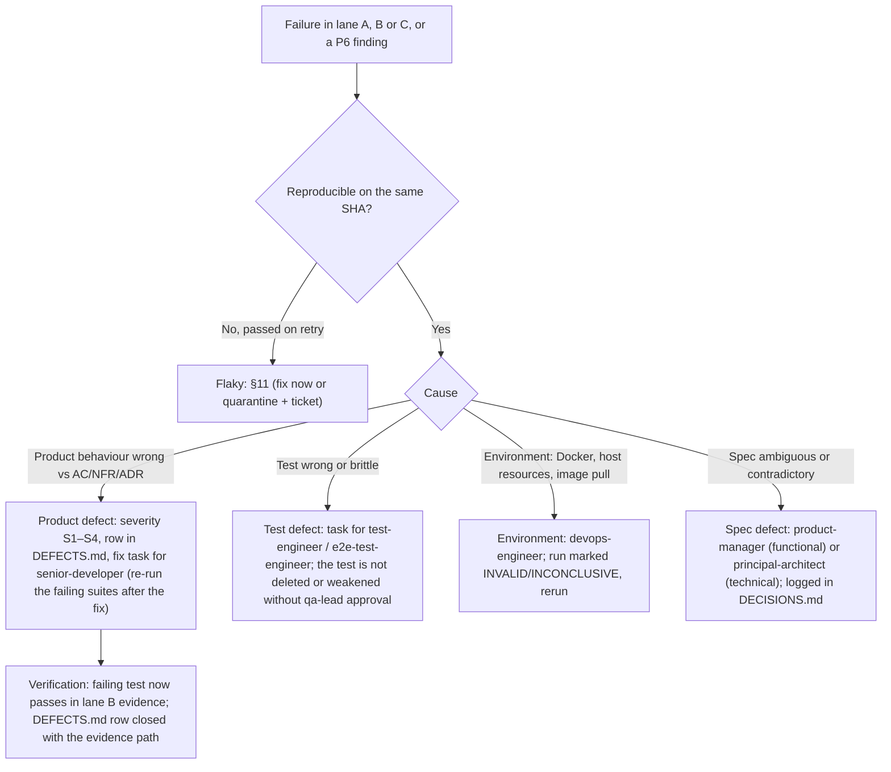

# Test Strategy: Multi-Carrier Shipping Platform, run scope M0 + M1

| Field | Value |
|---|---|
| Version | 1.1 (P5 Wave 0, W0-ACT-1: §9.1–§9.3 suite-activation protocol) |
| Date | 2026-11-13 |
| Owner | qa-lead |
| Consumers | senior-developer (task DAG and DoD), test-engineer, e2e-test-engineer, test-runner, accessibility-auditor, performance-engineer, security-analyst, devops-engineer, quality-gatekeeper (G3) |
| Inputs | CLAUDE.md §2, §3, §6, §8; `docs/sdlc/BRIEF.md` §9, §11; `docs/01-requirements/NFR.md` v1.3, `PRD.md` §4 and §6, `stories/EPIC-*.md` v1.3; ADR-0023 (amendments A–H), ADR-0024 (+ amendment); `platform.md` §7; `nfr-strategy.md`; `nfr-traceability.md`; `threat-model.md` §10; `risks.md`; `docs/05-quality/security/P3-architecture-security-review.md` §9 and §14; `docs/02-ux/accessibility.md` §10 |
| Companion files | [`tools/quality/required-suites.json`](../../tools/quality/required-suites.json) (required-suite manifest) · [`tests/security-test-cases.md`](tests/security-test-cases.md) (SEC-TC-01..64) · [`tests/e2e-journeys.md`](tests/e2e-journeys.md) (critical journeys) · [`tests/gherkin-test-map.md`](tests/gherkin-test-map.md) (every Must scenario → test ID and suite) · `../03-architecture/nfr-traceability.md` (Test(s) column: every NFR → tests, lane and evidence) |
| Decisions | D-QA-001 … D-QA-014 in `docs/sdlc/DECISIONS.md` |

The purpose of this document is to make gate G3 decidable. It answers five questions for every obligation in the run: **what** is tested, **where** (lane A, B or C), **with which tool**, **against which threshold**, and **which evidence file** proves it. Section 15 is the checklist that quality-gatekeeper verifies.

---

## 1. Quality bar for this run

The quality bar comes from the brief and the PRD. This strategy adds no new targets. It only makes the existing ones testable.

| Source | Obligation | Where it is verified |
|---|---|---|
| PRD O1 | Both exit demos (PRD §6.1, §6.2) green end to end on Mock carrier + fixtures, on Chromium, Firefox and WebKit at 360 px and 1280 px | Journeys J-M0-01..05 and J-M1-01 ([e2e-journeys.md](tests/e2e-journeys.md)), lane B `gate` profile + lane C `release-candidate` |
| PRD O2 | First quote result ≤ 1.5 s; complete ≤ 5 s with partial results | `k6-load` SSE scenarios (NFR-PERF-002/003) |
| PRD O3 | 0 cross-tenant access; 100 % route metadata; RBAC matrix 100 % of route × role | `rls-cross-tenant`, `catalog-c1-c14`, `route-registry`, `rbac-matrix` |
| PRD O4 | 100 % audit completeness; immutability for every DB role | `audit-generator`, `audit-immutability`, `audit-chain` |
| PRD O5 | Coverage ≥ 85 % line / 75 % branch (≥ 95 % pricing, audit, authz, and ledger-equivalent code); 0 serious/critical axe; 0 open Critical/High security | Coverage gates (§8), axe fixture, scanner suites and SEC-TC cases |
| PRD §4.3 guardrails (all = 0) | Captured payment without a booked shipment; duplicate label on retry; personal data on public tracking beyond city level; secrets/PII in logs or audit values | `saga-fault-matrix`, `idempotency`, `api` (public projection allow-list), `redaction`, `log-scan` |
| CLAUDE.md §8 DoD | AC demonstrated by tests; unit tests for new logic, integration for new boundaries; coverage not reduced; RBAC matrix and audit tests per feature; three locales, responsive, a11y | Per-PR: lane A + lane B evidence chosen by changed paths (§4.3); per-story: the story's `AT-` IDs (§6) |
| Brief §11 | Unit, integration, API per route and class, RBAC matrix, audit validation, carrier contract (Mock + fixtures, live opt-in), e2e on 3 engines × mobile/desktop, k6 profiles, ZAP + Semgrep + secrets + dependency scanning + abuse cases, axe + keyboard | §7 suite catalogue |
| NFR.md v1.3 | 91 NFRs: 75 FULL, 10 PARTIAL, 6 DEFERRED | `nfr-traceability.md` Test(s) column (every row has a test, or a deferral reason plus the evidence this run produces) |

Out of scope for this run, and stated so in the G3 report rather than silently dropped: brief §11 journeys that belong to later milestones (staff books on behalf of a customer and refunds/audit export: M2; partner connects a carrier account and books through the API: M3). The refund path that exists in M1 (automatic refund after cancellation, US-216, Should) is tested if the story ships.

---

## 2. Risk-based approach

### 2.1 Product and delivery risk register (QA view)

Scores: impact (I) and likelihood (L) on a 1–5 scale; exposure = I × L. "Tier" sets test depth (§2.2). Architecture risks from `risks.md` are referenced where they drive a test.

| ID | Risk | I | L | Exposure | Tier | Test response (primary suites) |
|---|---|---|---|---|---|---|
| QR-01 | Cross-tenant read or write (RLS gap, IDOR, operator-scope misuse, guest claim race) | 5 | 3 | 15 | T1 | Generated `rls-cross-tenant` per table, `catalog-c1-c14`, generated `abuse` per ID route, `rbac-matrix` cross-tenant cells; zero-skip; hosted `security-integration` on security-critical paths; P6 malicious-user charter |
| QR-02 | Audit trail incomplete, not in-transaction, or tamperable (incl. migrator search_path hijack, SEC-P3-27) | 5 | 3 | 15 | T1 | Generated `audit-generator` per route, fault injection, `audit-immutability` per DB role, `audit-chain` anchors (SEC-TC-17/43/44/61), 95/95 on `packages/audit` |
| QR-03 | Money: captured payment without shipment, duplicate label or charge, wrong captured or refunded amount, CVC outcome ignored (SEC-P3-28) | 5 | 3 | 15 | T1 | `saga-fault-matrix` (step × fault), `idempotency` concurrency, `payments-webhooks`, ledger-equivalent 95/95 (D-QA-003), J-M1-01/J-M1-03 |
| QR-04 | Pricing errors (rounding loss, tax, FX snapshot, margin precedence, snapshot mutation) | 4 | 3 | 12 | T1 | Unit + `pricing-properties` (≥ 1 000 cases each), Stryker ≥ 80 %, 95/95 on `packages/pricing`, integration snapshot immutability |
| QR-05 | Identity and session compromise (refresh reuse, absolute cap, `auth_time` step-up, MFA lockout, pre-hijack, enumeration) | 5 | 3 | 15 | T1 | `identity-session` with fake clock for every boundary, `csrf-cookie`, `rate-limit`, `e2e-security`; 95/95 on `packages/authz` |
| QR-06 | PII or secrets exposure (logs, public tracking, audit values, documents, raw carrier payloads, URLs/Referer) | 5 | 3 | 15 | T1 | `redaction` sentinels, `log-scan` over all container logs after e2e, `api` allow-list projections, PAN scanner, SEC-TC-08/19/28/31/35/52/54 |
| QR-07 | Carrier integration: fixture realism, timeouts, breaker, bulkheads, quota exhaustion, anonymous flood (R-ARCH-02, SEC-P3-02/29) | 4 | 4 | 16 | T1 | `carrier-contract` (Mock + 3 fixture sets), `carrier-resilience`, `k6-abuse` wave profile (SEC-TC-26/40), opt-in `contract-live` (COND-SANDBOX-DEMO) |
| QR-08 | Supply chain and evidence integrity (install scripts, cooldown, lockfile, self-attested local evidence; R-ARCH-16, SEC-P3-04/07/31) | 4 | 3 | 12 | T1 | `ci-policy` negative fixtures (SEC-TC-32/45/48/51/64), `sec-static`, manifest with zero-skip suites, lane C inventory cross-check |
| QR-09 | Performance budgets missed (rate shopping, API p95, booking pipeline, audit overhead) | 3 | 3 | 9 | T2 | `k6-*` profiles on the reference host (§7.10), `query-plan`, N+1 counter, Lighthouse |
| QR-10 | Accessibility or i18n regression (WCAG 2.2 AA, en/es/fr parity, +30 % expansion) | 3 | 4 | 12 | T2 | axe after every navigation, `e2e-a11y`, keyboard-only journeys, `i18n-parity`, `e2e-i18n`, manual sheet (P6) |
| QR-11 | Browser or viewport breakage (WebKit/Firefox at 360 px, 3DS frame, SSE) | 3 | 3 | 9 | T2 | 6 Playwright projects (§7.8), lane C per-browser shards |
| QR-12 | Migration or restore failure (expand/contract, data-changing migration, RLS SQL) | 4 | 2 | 8 | T2 | `migrations` up→down→up, `migration-lint`, `restore-rehearsal` |
| QR-13 | Windows/Linux drift between lane B evidence and Linux CI/production (R-ARCH-17) | 3 | 3 | 9 | T2 | Lane C re-runs integration and e2e on `ubuntu-latest` at wave ends and before G3; inventory cross-check |
| QR-14 | Flaky tests hide defects or erode trust in evidence | 3 | 4 | 12 | T2 | Zero-tolerance flake policy (§11), flake report, quarantine limits |

### 2.2 Test depth by tier

| Tier | Applies to | Depth |
|---|---|---|
| **T1** (exposure ≥ 12 or impact 5) | QR-01..08 and the code paths behind them | Exhaustive or generated coverage from metadata (every route, table, role or step); failure injection; zero-skip suites; 95/95 coverage where the code is a package or pure logic; mutation testing where logic is pure (pricing); hosted re-run on security-critical paths; a P6 exploratory charter |
| **T2** (6–11) | QR-09..14 | Thresholded NFR tests in lane B `wave`/`gate`; e2e on all engines at gate; repository coverage 85/75 |
| **T3** (< 6) | Everything else | Unit tests for new logic, integration for new boundaries, story AT tests; 85/75 via the repository gate |

### 2.3 How the risk view changes the plan

- **Generators first (R-ARCH-11).** RBAC matrix, audit generator, RLS cross-tenant generator, abuse generator and catalog tests are Wave 0 deliverables (T-QA-04, §16). Every later feature then gets T1 coverage for free, and a feature that lacks metadata fails the build.
- **Demo-critical (DC) first.** The e2e journeys are built from the DC story set (PRD §7.1). Non-DC Must stories are verified by their `AT-` tests in the lower layers.
- **Security cases are gates, not reports.** All 64 SEC-TC cases are `@security`, sit in zero-skip suites, and are listed in the manifest as `required_cases`. A missing case fails the evidence check (§9).

---

## 3. Test pyramid per module

Unit = Jest (+ fast-check, React Testing Library). Integration = Jest + Testcontainers (PostgreSQL 18, Valkey 8, RustFS). API = Supertest + OpenAPI response validation. Generated = metadata-driven suites. E2E = Playwright. "●●●" = main weight of the module's tests; "●" = present; "–" = not used. Coverage gates are in §8.

| Module / package | Tier | Unit | Integration | API + generated | E2E | Coverage gate | Notes |
|---|---|---|---|---|---|---|---|
| `packages/pricing` | T1 | ●●● (+ properties) | – | ● (quote API) | ● (breakdown) | **95/95** + Stryker ≥ 80 % | Pure, no I/O (lint) |
| `packages/audit` | T1 | ●●● (canonicalisation, differ, redaction, hashing) | ●●● (chain, anchors, immutability) | ●●● (audit generator) | ● (viewer) | **95/95** | Writer + middleware + registry |
| `packages/authz` | T1 | ●●● (catalogue, policies) | ● | ●●● (RBAC matrix) | ● (UI helper) | **95/95** | Matrix generator lives here |
| Ledger-equivalent money paths (D-QA-003) | T1 | ●●● | ●● | ●● (saga, webhooks) | ● | **95/95** | `apps/api/src/modules/payments/service/**`, `packages/shared/src/money/**`; `apps/api/src/modules/ledger/**` reserved |
| `packages/carriers` (adapters, Mock, resilience wrapper) | T1 | ●● | ● | ●●● (contract suite) | ● | 85/75, 90/80 reported | Contract suite × 4 adapters |
| `packages/shared` (Money, format, validation constants, parity) | T1/T2 | ●●● | – | – | – | 85/75 (money paths 95/95) | Zod/Joi parity fixtures ≥ 50 per schema |
| `packages/config` | T1 | ●●● | – | – | – | 85/75 | Fail-fast, no values in errors |
| `packages/ui` | T2 | ●● (RTL, contrast) | – | – | ●●● (axe, keyboard, states) | 85/75 | Token contrast unit test |
| `apps/api/src/platform` (pipeline, idempotency, rate limit, RLS tx, outbox, health) | T1 | ●● | ●●● | ●●● | – | 85/75, 90/80 reported | Security-critical path (hosted `security-integration`) |
| `identity` | T1 | ●● | ●● | ●●● (`identity-session`, fake clock) | ●● | 85/75, 90/80 reported | Security-critical path |
| `organisations` | T2 | ● | ●● | ●●● | ● | 85/75 | Matrix and abuse cells |
| `quotes` (fan-out, SSE, claim, cache) | T1 | ●● | ●● | ●●● | ●●● | 85/75 | SSE + k6 |
| `pricing` module (config loading, FX snapshot) | T1 | ● | ●● | ● | – | 85/75 | Seed versioning |
| `carriers` module (registry, accounts, raw payloads) | T1 | ● | ●● | ●● | – | 85/75 | Raw payload redaction |
| `shipments` (state machine, transitions) | T1 | ●●● | ●● | ●● | ● | 85/75 | Transition table tests |
| `orders` (basket, checkout, saga) | T1 | ●● | ●●● (saga) | ●●● | ●●● | 85/75, 90/80 reported | Saga fault matrix |
| `payments` (gateway, Stripe fixture, Mock, webhooks) | T1 | ●●● | ●● | ●●● | ●● | 95/95 on `service/**` | CVC rule, livemode rejection |
| `customs` | T2 | ●●● | ● | ●● | ●● | 85/75 | Prohibited items, HS codes |
| `documents` | T1 | ●● | ●●● (RustFS) | ●● | ●● | 85/75 | Hashes, presign TTL, audited download |
| `pickups` | T2 | ●● | ● | ●● | ●● | 85/75 | Date and window rules |
| `tracking` | T2 | ●● | ●●● (polling, mapping) | ●● (public allow-list) | ●● | 85/75 | Forward-only rule |
| `notifications` | T2 | ●● (templates) | ●●● (Mailpit) | ● | ● (via journeys) | 85/75 | Locale fallback, parity |
| `compliance` | T2 | ● | ●● | ● | – | 85/75 | Pack immutability |
| `audit` module (viewer API) | T1 | ● | ● | ●●● | ●● | 85/75 | Filter exactness, VIEW audited |
| `admin-settings` (reference data, flags, sequences) | T2 | ● | ●● | ●● | – | 85/75 | |
| `apps/worker` | T1 | ●● | ●●● (`jobs-resilience`) | – | – | 85/75 | Tenant context from PostgreSQL |
| `apps/web`, `apps/admin` | T2 | ●● (RTL) | – | – | ●●● | 85/75 (unit-covered code) | Lighthouse, bundle budgets |
| `prisma` (migrations, RLS SQL, bootstrap) | T1 | – | ●●● | – | – | n/a (SQL) | Catalog tests C1–C14, linter |
| `tools/ci`, `tools/quality` | T1 | ●●● (fixture tests) | – | – | – | 85/75 | SEC-TC-32/45/48/51/64 |

Rough proportion by test count at G3 (planning estimate, not a gate): unit ≈ 55 %, integration ≈ 15 %, API + generated ≈ 25 % (generated cells dominate), e2e ≈ 5 % of tests but most of the wall-clock time.

---

## 4. Where tests run: lanes and profiles

The lane model is fixed by D-ORCH-001, D-ARCH-010 and D-ARCH-021 (ADR-0023 amendments A–H, ADR-0024 amendment). This section binds every suite to a lane.

### 4.1 Lanes

| Lane | What it is | Runs | Evidence |
|---|---|---|---|
| **A** (hosted PR fast lane) | GitHub-hosted `ubuntu-latest`, every non-draft PR, incremental | `lint`, `typecheck`, `unit` (incl. `pricing-properties`, `carrier-contract`), `route-registry`, `contract-openapi`, `i18n-parity`, `config-guards`, `migration-lint`, `bundle-budget`, `sec-static`, `ci-policy`; `iac` when `infra/**` changed; **`security-integration`** (hosted Testcontainers subset: `rls-cross-tenant`, `rbac-matrix`, `audit-generator`, `audit-immutability`, `csrf-cookie`, `catalog-c1-c14`) when a security-critical path changed | `ci-gate` status on the PR head; diff-coverage gate |
| **B** (local heavy lane) | `npm run quality:heavy -- --profile pr\|wave\|gate`, run by test-runner on the developer host (Windows 11, Docker Desktop, Node 24 via the CLAUDE.md §2 PATH prefix) | Everything that needs Docker: integration, API and generated suites, e2e, k6, Lighthouse, ZAP, Trivy, compose-up, scale test, restore rehearsal, Stryker, valkey-compat | `docs/05-quality/{tests,security,performance}/runs/<UTCstamp>_<sha7>/` (§9) |
| **C** (hosted full lane) | `workflow_dispatch` with profile `wave-end` or `release-candidate`; Linux | Lane A non-incremental with repository coverage thresholds, `integration` job (all Jest B suites), `images` (Trivy, SBOM), `e2e-stack` sharded per browser (Playwright + axe, Lighthouse, k6 smoke reported, log-schema check), `iac` | GitHub run conclusion + `inventory.json` and `coverage-summary.json`, committed for gate runs (§15 item 3) |

### 4.2 Lane B profiles

| Profile | When | Content |
|---|---|---|
| `pr` | Before a PR is marked ready, when its changed paths select lane B suites (§4.3) | Only the suites selected by the path rules, plus the full unit suite with repository thresholds as a pre-flight |
| `wave` | Every wave end on `main` HEAD after the last merge (§13) | Every **active** lane B suite except the gate-only ones; Playwright on Chromium, Firefox and WebKit × mobile and desktop for `@critical` journeys in en, and es/fr on Chromium; k6 ramp/steady/spike + `k6-abuse` + scale test; ZAP; Trivy; Lighthouse |
| `gate` | Before G3 (and G4), on the gate SHA; also used for the R0 `v0.1.0-m0` regression | Everything in `wave` plus `k6-soak`, `stryker`, `restore-rehearsal`, `valkey-compat`, `gitleaks-full`, the full demo matrix (J-M1-01 × 3 carriers × 3 locales × 6 projects), keyboard-only journeys on 3 engines, `flake-report`, `ac-trace` |

### 4.3 Suite selection per change (summary of the manifest)

The authoritative content is `tools/quality/required-suites.json` (`path_rules`). It implements the ADR-0023 amendment C table and adds rows for risk areas the table groups together.

| Changed paths (glob) | Lane B suites required on the `pr` profile |
|---|---|
| `apps/api/**`, `apps/worker/**`, `packages/**` except `packages/ui/**`, `prisma/**` | `integration`, `api`, `rbac-matrix`, `audit-generator`, `audit-immutability`, `rls-cross-tenant`, `catalog-c1-c14`, `abuse`, `csrf-cookie`, `idempotency`, `ssrf`, `identity-session`, `rate-limit`, `redaction`, `secrets-keys` (one Jest run; ≈ 15–25 min) |
| + `apps/api/src/modules/{orders,payments,shipments,pickups}/**`, `packages/carriers/**` | + `saga-fault-matrix`, `payments-webhooks`, `carrier-resilience` |
| + `apps/worker/**`, `apps/api/src/platform/outbox/**`, queue definitions | + `jobs-resilience`, `resilience-deps` |
| + `prisma/migrations/**`, `prisma/bootstrap/**` | + `migrations` (up→down→up, previous-image probe); a `-- @data-changing` migration also needs `restore-rehearsal` |
| + repositories, `prisma/schema.prisma`, list routes | + `query-plan` |
| `apps/web/**`, `apps/admin/**`, `packages/ui/**` | `e2e-chromium` (`@critical`, mobile + desktop, axe + CSP + headers listeners), `log-scan`; `lighthouse` + `headers` when public pre-rendered routes changed; `e2e-i18n` when locale resources changed |
| `**/Dockerfile*`, `compose*.yaml`, `infra/compose/**`, `package-lock.json` | `compose-up`, `image-assertions`, `trivy` |
| `packages/pricing/**`, `packages/audit/**`, `packages/authz/**`, `tests/load/**` or a task tagged `perf` | + `k6-smoke` with NFR-PERF thresholds |
| `docs/**` (except `docs/03-architecture/api/**` and the manifest's `tooling_inputs`) or `.github/**` only | none (lane A; `.github/**` is security-critical per SEC-P3-31 and needs security-analyst review) |

Stories whose Gherkin needs Firefox or WebKit are accepted at the wave end on the `wave` profile, not per PR (ADR-0023 amendment C).

---

## 5. Test types

| Type | Purpose | Tooling (ADR-0024) | Primary suites |
|---|---|---|---|
| Static | Layering, i18n literals, a11y lint, logical CSS, Money arithmetic ban, outbound HTTP ban, raw SQL ban | ESLint 10 (boundaries, import-x, i18next, jsx-a11y), Stylelint, Prettier, Semgrep | `lint`, `sec-static` |
| Unit | Pure logic, components, validators, state machines, helpers | Jest 30 + @swc/jest, fast-check 4, RTL | `unit`, `pricing-properties` |
| Contract (API) | OpenAPI lint, drift, examples, breaking changes, event catalogue | Redocly, drift test, oasdiff, openapi-typescript freshness | `contract-openapi`, `route-registry` |
| Contract (carriers) | Shared adapter behaviour for Mock + DHL/FedEx/UPS | Jest + nock 15 fixtures; live opt-in | `carrier-contract`, `contract-live` |
| Integration | Repositories and services with real PostgreSQL, Valkey and RustFS using the runtime role | Jest + Testcontainers 12 | `integration`, `catalog-c1-c14`, `migrations`, `query-plan`, `jobs-resilience`, `audit-chain`, `audit-immutability`, `secrets-keys` |
| API | Every route × applicable class (success, validation, 401, 403, 404, 409, idempotent replay, rate limit) with response validation | Supertest 7 + Ajv OpenAPI validator | `api`, `identity-session`, `rate-limit`, `csrf-cookie`, `idempotency`, `ssrf`, `payments-webhooks`, `carrier-resilience` |
| Generated | Exhaustive cells from metadata | Generators in `packages/authz`, `packages/audit`, RLS and abuse generators, saga matrix | `rbac-matrix`, `audit-generator`, `rls-cross-tenant`, `abuse`, `saga-fault-matrix` |
| E2E | Critical journeys, UI standard, browser security | Playwright 1.65 + @axe-core/playwright, web-vitals, Mailpit API | `e2e-chromium`, `e2e-firefox`, `e2e-webkit`, `e2e-a11y`, `e2e-i18n`, `e2e-security`, `log-scan` |
| Performance | Budgets, profiles, A/B, abuse loads | k6 (Docker), Lighthouse CI, size-limit | `k6-smoke`, `k6-load`, `k6-soak`, `k6-audit-ab`, `k6-abuse`, `scale-test`, `lighthouse`, `bundle-budget` |
| Security | SAST, secrets, dependencies, licences, images, DAST, abuse | Semgrep, Gitleaks, npm audit + osv-scanner, licence/age script, Trivy, OWASP ZAP baseline | `sec-static`, `trivy`, `zap-baseline`, `gitleaks-full` + SEC-TC suites |
| Resilience | Dependency loss, SIGTERM, crash, restart | Testcontainers stop/start, k6 + docker kill | `resilience-deps`, `jobs-resilience`, `scale-test` |
| Operability | Compose, images, config, IaC, restore | docker compose, hadolint, Trivy config, Terraform validate, Checkov | `compose-up`, `image-assertions`, `config-guards`, `iac`, `restore-rehearsal` |
| Mutation | Test strength of pricing | Stryker 10 | `stryker` |
| Manual / exploratory | WCAG 2.2 AA sheet, AT proxy, charters | accessibility-auditor, qa-lead | P6 artefacts (§14) |

---

## 6. Test IDs and traceability

| ID form | Meaning | Defined in |
|---|---|---|
| `AT-US-NNN-nn` | Acceptance test for scenario `nn` (1-based) of a story's Gherkin block; outline rows add `-<row>` | [gherkin-test-map.md](tests/gherkin-test-map.md) |
| `NT-<CAT>-NNN-<x>` | Test of NFR `NFR-<CAT>-NNN`, part `x` (a, b, c…) | `nfr-traceability.md` Test(s) column |
| `SEC-TC-NN` | Security test case 01–64 | [security-test-cases.md](tests/security-test-cases.md) |
| `J-<area>-NN` | E2E journey (J-M0-*, J-M1-*, J-SEC-*, J-KB-*) | [e2e-journeys.md](tests/e2e-journeys.md) |

**Rules (D-QA-002).**

1. A test carries every ID it verifies in its title, in square brackets: `[AT-US-202-01] [J-M0-03] booking flows API → queue → worker`. Security cases also carry the tag `@security`. Playwright journey tests carry `@critical` when they belong to the PR-level set.
2. `quality:trace` (Wave 0 task T-QA-02) reads every JUnit file of a run, extracts the IDs, and writes `ac-trace.json` into the run directory:
   - **Must-AC coverage** = (G3-counted `AT-` IDs with at least one test, all of whose tests passed) ÷ (G3-counted `AT-` IDs in the map). At G3 the target is **100 %** (1,593 scenarios at map v1.0).
   - **NFR coverage** = NFRs with every listed `NT-` part passing (FULL rows) or with their "this run" evidence present (PARTIAL/DEFERRED rows).
   - **SEC-TC coverage** = 64/64 present and passing, or recorded as "route absent" for the conditional cases (§7.11, D-QA-011).
3. An ID in a test title that is not in the maps fails `quality:trace` (no orphan tests that pretend to cover something).
4. When senior-developer creates tasks, each task lists the `AT-` IDs of its stories in its acceptance section. The DoD item "acceptance criteria demonstrated by tests" is checked against `ac-trace.json` of the task's lane B evidence (story-level, not yet gate-level).
5. `traceability.md` keeps its REQ → Story structure. The Test(s) column there will point to the story's `AT-` ID range once senior-developer's Task(s) column is filled (follow-up FU-02 in the handoff), so the two agents do not edit the same table concurrently.

---

## 7. Suite catalogue and suite-specific rules

### 7.1 Catalogue

"Zero-skip" = the suite must report `skipped = 0` (ADR-0023 amendment G list plus the additions of D-QA-004). Report = file name inside the run directory (§9). All suites below are in the manifest.

| Suite | Level | Lane / profiles | Zero-skip | Main NFR / risk | Report |
|---|---|---|---|---|---|
| `lint` | static | A | – | MAINT-001/002, I18N-001/003/004, A11Y-006, DATA-001 | lane A |
| `typecheck` | static | A | – | MAINT-002 | lane A |
| `unit` | unit | A; B pre-flight | – | QUAL-001, many | lane A / `unit.junit.xml` |
| `pricing-properties` | unit (properties) | A | yes | QUAL-003, DATA-001 | lane A / `pricing-properties.junit.xml` |
| `carrier-contract` | contract | A; C | yes | QUAL-005, RES-001/002 | lane A / `carrier-contract.junit.xml` |
| `route-registry` | build-time | A | yes | AUDIT-004, QUAL-004, SEC-009, SEC-008, PERF-006 | lane A |
| `contract-openapi` | contract | A | yes | MAINT-004, SEC-TC-53/63 | lane A |
| `i18n-parity` | static | A | – | I18N-002 | lane A |
| `config-guards` | unit (CFG) | A | yes | OPS-005, SEC-007, SEC-TC-03/18/24/34/49/51 | lane A |
| `migration-lint` | static | A | yes | AVAIL-003, DATA-004, SEC-TC-33 | lane A |
| `bundle-budget` | build | A | – | WEB-004, WEB-005 (images) | lane A |
| `sec-static` | security | A | yes | SEC-002, SEC-012 | lane A; `security/runs/*/` for local copies |
| `ci-policy` | tooling tests | A | yes | OPS-003, SEC-TC-32/45/48/51/64 | lane A |
| `iac` | IaC | A (`infra/**`), C | – | OPS-004, SEC-007, SCALE-003 | lane A/C |
| `integration` | integration | B pr/wave/gate; C | – | DATA-003, REC, many | `integration.junit.xml` |
| `catalog-c1-c14` | integration | B; A* | yes | TENANT-001, PRIV-003, DATA-001/002, SEC-TC-05 | `catalog-c1-c14.junit.xml` |
| `rls-cross-tenant` | generated | B; A* | yes | TENANT-001, SEC-TC-06/07 | `rls-cross-tenant.junit.xml` |
| `rbac-matrix` | generated | B; A* | yes | TENANT-002, SEC-011, SEC-TC-01 | `rbac-matrix.junit.xml` |
| `audit-generator` | generated | B; A* | yes | AUDIT-001/006, SEC-TC-35 | `audit-generator.junit.xml` |
| `audit-immutability` | integration | B; A* | yes | AUDIT-002, SEC-TC-43/61 | `audit-immutability.junit.xml` |
| `audit-chain` | integration | B pr (audit paths)/wave/gate | yes | AUDIT-003, SEC-TC-16/17/44/57 | `audit-chain.junit.xml` |
| `abuse` | generated + fuzz | B | yes | SEC-011, SEC-009, SEC-TC-15/30/36 | `abuse.junit.xml` |
| `api` | API | B; C | – | QUAL-004, PRIV-004, many | `api.junit.xml` |
| `identity-session` | API (fake clock) | B; A* (identity paths run the CSRF/cookie part) | yes | SEC-003/004, SEC-TC-02/11/13/37/38/46/47/56 | `identity-session.junit.xml` |
| `csrf-cookie` | API | B; A* | yes | SEC-008, SEC-TC-09/58 | `csrf-cookie.junit.xml` |
| `rate-limit` | API | B | yes | SEC-005, SEC-TC-27/46/62 | `rate-limit.junit.xml` |
| `idempotency` | API (concurrency) | B | yes | RES-005, SEC-TC-04/53 | `idempotency.junit.xml` |
| `ssrf` | integration | B | yes | SEC-010, SEC-TC-25/60 | `ssrf.junit.xml` |
| `payments-webhooks` | API + integration | B | yes | SEC-013, SEC-TC-23/37/60 | `payments-webhooks.junit.xml` |
| `saga-fault-matrix` | generated | B | yes (guardrail) | RES-005, PRD §4.3 guardrails, SEC-TC-21 | `saga-fault-matrix.junit.xml` |
| `carrier-resilience` | integration + API | B | yes | RES-003/006/007, PERF-003, SEC-TC-26/41/42/62 | `carrier-resilience.junit.xml` |
| `jobs-resilience` | integration | B | yes | RES-004, SEC-TC-20 | `jobs-resilience.junit.xml` |
| `secrets-keys` | integration | B | yes | SEC-TC-49/50 | `secrets-keys.junit.xml` |
| `redaction` | unit + integration | B (unit part also A) | yes | PRIV-001/002/004, SEC-TC-08/19/31/52 | `redaction.junit.xml` |
| `resilience-deps` | integration | B wave/gate (pr on platform/worker) | yes | AVAIL-002, SEC-TC-10/59 | `resilience-deps.junit.xml` |
| `query-plan` | integration (volume) | B wave/gate (pr on repositories) | – | PERF-006 | `query-plan.junit.xml` |
| `migrations` | integration | B pr (migrations)/wave/gate; C | – | DATA-004, AVAIL-003 | `migrations.junit.xml` |
| `observability` | integration | B | – | OBS-001..003, SCALE-003 | `observability.junit.xml` |
| `compose-up` | operability | B pr (compose)/wave/gate; C | – | OPS-001 | `compose-up.junit.xml`, `compose-up.json` |
| `image-assertions` | operability | B; C | – | OPS-002 | `image-assertions.junit.xml` |
| `trivy` | security | B; C | yes | SEC-002, OPS-002 | `trivy.junit.xml` + `security/runs/*/trivy-*.json` |
| `headers` | E2E (HTTP) | B | yes | SEC-006, WEB-005 | `headers.junit.xml`, `headers.json` |
| `e2e-chromium` / `e2e-firefox` / `e2e-webkit` | E2E | B pr (Chromium only)/wave/gate; C shards | – (journeys gated by §11) | COMPAT-002, QUAL-006, A11Y-002, SEC-006, RES-006 | `e2e-<browser>.junit.xml`, `axe-summary.json`, `csp-violations.json` |
| `e2e-a11y` | E2E | B wave/gate | – | A11Y-002..006, COMPAT-003 | `e2e-a11y.junit.xml` |
| `e2e-i18n` | E2E | B wave/gate (pr on locales) | – | I18N-001/003 | `e2e-i18n.junit.xml` |
| `e2e-security` | E2E | B wave/gate | yes | SEC-013, SEC-TC-09/28/39/54 | `e2e-security.junit.xml` |
| `log-scan` | post-e2e scan | B | yes | OBS-001, PRIV-001, SEC-TC-28/31 | `log-scan.junit.xml` |
| `lighthouse` | web perf | B; C | – | WEB-001..005 | `lighthouse.junit.xml` + `performance/runs/*/lighthouse/` |
| `k6-smoke` | load | B pr; C (reported) | – | PERF smoke | `k6-smoke.junit.xml` + `performance/runs/*/k6-smoke.summary.json` |
| `k6-load` | load | B wave/gate | – | PERF-001..007, RES-003 | `k6-load.junit.xml` + summaries |
| `k6-soak` | load | B gate | – | PERF-007 | `k6-soak.junit.xml` + summary |
| `k6-audit-ab` | load | B wave/gate | – | AUDIT-005 | `k6-audit-ab.junit.xml` + summary |
| `k6-abuse` | load | B wave/gate | yes | RES-007, SEC-TC-12/16/26/40 | `k6-abuse.junit.xml` + summaries |
| `scale-test` | load + resilience | B wave/gate | – | SCALE-001/002, SEC-005 sharing | `scale-test.junit.xml` |
| `zap-baseline` | DAST | B wave/gate | yes | SEC-002, SEC-006 | `zap-baseline.junit.xml` + `security/runs/*/zap-baseline.json` |
| `gitleaks-full` | secrets | B gate; C | yes | SEC-002 | `gitleaks-full.junit.xml` + JSON |
| `stryker` | mutation | B gate; P6 | – | QUAL-003 | `stryker.junit.xml` + `performance/runs/*/stryker-summary.json` |
| `restore-rehearsal` | recovery | B gate (+ data-changing PRs); C rc | – | REC-001..003, DATA-004 | `restore-rehearsal.junit.xml`, `restore-report.json` |
| `valkey-compat` | integration | B gate | – | ADR-0001 / OI-01 | `valkey-compat.junit.xml` |
| `flake-report` | analysis | B gate | – | QUAL-006 | `flake-report.json` |
| `ac-trace` | analysis | B wave/gate | – | §6 | `ac-trace.json` |
| `contract-live`, `e2e-live` | opt-in | `CARRIER_LIVE_SANDBOX=1` / `STRIPE_TEST_LIVE=1` | n/a | COND-SANDBOX-DEMO | `contract-live.junit.xml`, `e2e-live.junit.xml` when run |

Non-Jest tools (k6, Lighthouse, ZAP, Trivy, Gitleaks, Stryker) keep their native JSON and are also converted to JUnit by `quality:heavy` (one testcase per threshold, assertion, rule or finding class), so the manifest and verdict recomputation treat every suite the same way (D-QA-001).

### 7.2 API tests

- Every route has tests for each applicable class: success, validation failure, unauthenticated (401), unauthorised (403), not found (404), conflict (409/412), idempotent replay, rate limit. A class that does not apply needs an `n/a` justification in the route metadata. `route-registry` fails on a missing class (NFR-QUAL-004).
- Every response (2xx and problem+json) is validated against `docs/03-architecture/api/openapi.yaml` by the shared Ajv helper. A response that does not validate fails the test, not just a warning.
- Every 4xx/5xx body is scanned for stack traces, SQL, file paths and secret patterns (NFR-SEC-009).
- `Cache-Control: private, no-store` on every authenticated response is asserted by the helper (SEC-TC-29).
- List routes assert the N+1 bound with the Prisma query counter: equal query count for page sizes 10 and 100, ≤ 12 (NFR-PERF-006).

### 7.3 Generated suites

| Generator | Input | Cells | Pass condition | Fails the build when |
|---|---|---|---|---|
| RBAC matrix (`packages/authz`) | Permission catalogue, role seeds, route metadata | Every route × every role (customer roles, operator roles, guest, unauthenticated) + cross-tenant variant per tenant route + `{orgId}` mismatch (SEC-TC-01) + staff-before-TOTP | Expected allow/deny exactly; 401 for unauthenticated; 404 cross-tenant; DENIED audit entry | A route or role has no cell; count ≠ catalogue × roles |
| Audit generator (`packages/audit`) | Route metadata (audit descriptors) | Every mutating route + every sensitive read/download + every `NONE` route | Exactly one entry with correct actor, entity, action, outcome, same transaction; `NONE` routes write none; fault injection rolls back or fails closed | A route lacks a case |
| RLS cross-tenant | `pg_class` tables with `org_id` + allow-lists | Per table: select/update/delete with B's IDs as A via repository and raw SQL; insert with B's `org_id`; unset context; forced OPERATOR scope | 0 rows visible or affected; insert fails | A tenant table lacks a case |
| Abuse (IDOR / mass assignment) | Route metadata (ID params, writable fields) | Per ID route: other tenant's ID, other user's ID in the same tenant; per write route: protected fields `org_id`, `role`, `status`, prices, `created_by`, `version` | 403/404 + DENIED audit; protected fields rejected or ignored | A route lacks a case |
| Saga fault matrix (ADR-0014) | Saga step list × fault catalogue | Steps: authorise, createShipment, capture, generate documents, schedule pickup, notify. Faults: definitive error, timeout, ambiguous outcome, `CARRIER_BUSY`, worker crash after commit, duplicate delivery, Redis restart. Plus cancel-before-pickup (SEC-TC-21) and partial capture for multi-shipment orders | Final state consistent; compensations (void label, release authorisation, refund) executed exactly once; 0 captured without shipment; 0 second label; Mock call counters exact | A step or fault has no cell |

Generated suites report their cell count in `summary.json`. The manifest's `min_tests` for them is ratcheted to the last count (§9.3), so a generator that silently produces fewer cells fails.

### 7.4 Carrier adapter contract suite

- One Jest suite parameterised over Mock, DHL Express (MyDHL), FedEx REST and UPS REST. HTTP is intercepted with nock fixtures (recorded or synthesised from the documentation; secrets and PII free, Gitleaks clean). The same assertions run for every adapter: operations offered, request mapping, normalisation to canonical codes, error normalisation, timeout per operation, retry rules, customs field mapping, label formats (NFR-QUAL-005, RES-001/002).
- Adapter READMEs record the documentation version and date checked; a docs check fails when a field is missing.
- **Live sandbox (opt-in).** `CARRIER_LIVE_SANDBOX=1 npm run test:contract:live` runs the same suite against the sandboxes when credentials exist (user-scoped environment, never the repository; `carrier-sandbox` environment for the hosted `nightly.yml` job). It is not part of any gate this run. It produces COND-SANDBOX-DEMO evidence (e2e-journeys.md J-M1-01L).
- After any live or OAuth contract run, SEC-TC-50 scans Valkey for plaintext token patterns.

### 7.5 Pricing: properties and mutation

- fast-check, `numRuns ≥ 1000` per property, seed printed on failure and replayable. Properties: determinism; integer minor units everywhere; totals = sum of lines; rounding never creates or loses a minor unit; tax and FX applied in the documented order; margin precedence; later configuration changes never alter a stored snapshot (with the integration test of US-150).
- Stryker 10 on `packages/pricing`, mutation score ≥ 80 % (NFR-QUAL-003), `gate` profile and P6. Surviving mutants above the threshold are still reviewed by test-engineer at P6.

### 7.6 Accessibility

| Layer | What | Where |
|---|---|---|
| Lint | jsx-a11y, hover-only-under-`(hover: hover)` stylelint rule | `lint` (A) |
| Unit | Token contrast for every fg/bg pair in light and dark | `unit` (A) |
| Automated e2e | Shared fixture runs axe (WCAG 2.2 AA tags) after every navigation and state change in every Playwright suite: 0 serious/critical. A route-inventory test fails if a route was never scanned. States (loading, empty, error, partial, permission-denied, offline) are reached through Mock scenarios, network interception and `context.setOffline`. Light and dark in en; critical journeys in es and fr | `e2e-*`, `e2e-a11y` (B) |
| Keyboard | Keyboard-only journeys J-KB-01..09 (no pointer events) on 3 engines desktop; Tab sweep: focus ring ≥ 2 px and ≥ 3:1, not obscured (`elementFromPoint`), skip link, 0 traps | `e2e-a11y`, `e2e-*` (B wave/gate) |
| Target size and reflow | 44 × 44 on coarse pointers at 360/390, 36 px on fine pointers; 320 px / 200 % reflow | `e2e-a11y` |
| Reduced motion | `reducedMotion: 'reduce'` sampling | `e2e-a11y` |
| Manual (P6) | `docs/02-ux/accessibility.md` §10 sheet: every screen row × columns L, K, F, LR, E, T, D, A, R, M, C, plus the screen-specific checks and §11 timing. Result per cell: Pass, Fail (with defect ID) or n/a. Output `docs/05-quality/tests/a11y-manual-audit.md` | accessibility-auditor + qa-lead |
| Screen-reader proxy (P6) | Playwright ARIA snapshots of sign-in, quote and results, booking wizard, checkout, tracking, staff TOTP and audit viewer reviewed for names, roles, live-region text and reading order. Real NVDA/VoiceOver spot checks are performed only if an AT-capable session is available; otherwise they are reported as not performed under NFR-A11Y-001 PARTIAL (D-QA-008) | qa-lead |

Excluded from the axe route inventory (D-QA-009): Swagger UI (`/api/docs`) and the Mailpit and RustFS consoles. They are developer tools that are absent from non-local profiles (SEC-TC-34). The e-mail templates are checked against the sheet's S-E01..E04 row through rendered HTML in Mailpit (lang, plain-text part, 44 px button, underlined links).

### 7.7 Internationalisation

- `lint`: `i18next/no-literal-string` at error level; no concatenated sentences.
- `i18n-parity` (A): en/es/fr keys, placeholders, plural forms; e-mail template sets; user-visible API error messages.
- `e2e-i18n` (B): pseudo-locale (+30 % length, accented) renders every route with no English literal and no overflow, clipping or overlap at 360 px; es and fr at 360 px likewise.
- `unit`: Intl helpers in en/es/fr for USD, INR, GBP, CAD, EUR, viewer time zone, DST boundaries.
- Journeys: J-M1-01 runs in en, es and fr (gate), including the confirmation e-mail in the user's locale (Mailpit).

### 7.8 End-to-end (Playwright)

Full journey definitions, data setup and the `@live-sandbox` variants are in [e2e-journeys.md](tests/e2e-journeys.md). Rules that apply to all of them:

| Project | Engine | Viewport | Notes |
|---|---|---|---|
| `chromium-mobile` | Chromium | 360 × 780, `isMobile`, `hasTouch` | PRD O1 |
| `chromium-desktop` | Chromium | 1280 × 800 | PRD O1 (Edge is covered by Chromium) |
| `firefox-mobile` | Firefox | 360 × 780, `hasTouch` | Playwright has no `isMobile` for Firefox; documented limitation (D-QA-005) |
| `firefox-desktop` | Firefox | 1280 × 800 | |
| `webkit-mobile` | WebKit | 360 × 780, `isMobile`, `hasTouch` | iOS Safari proxy |
| `webkit-desktop` | WebKit | 1280 × 800 | Safari proxy |
| `chromium-390`, `webkit-390` | Chromium, WebKit | Pixel 7 and iPhone 14 descriptors (390 px) | NFR-COMPAT-001/002 390 px class; target-size checks |

- Every test runs with the axe fixture, the `securitypolicyviolation` listener (any violation fails the test), a response-header recorder and a console-error collector (unexpected `console.error` fails the test).
- Retries: `retries: 1` in lanes B and C, only to *detect* flakiness. A test that passes on retry is reported as flaky and handled by §11; it never counts as a clean pass for the flake rate.
- Determinism: Mock carrier and Mock gateway scenarios selected per test; no `waitForTimeout`; web-first assertions; per-test users and organisations from factories; Mailpit polled through its API with a bounded wait.
- Failure artefacts (traces, screenshots, videos) stay in the git-ignored `tests/e2e/output/` and are never committed (ADR-0023 amendment B).

### 7.9 Resilience and observability

- `resilience-deps`: stop/start PostgreSQL and Valkey (readiness ≤ 5 s, recovery ≤ 10 s), SIGTERM during k6 (0 dropped), 100 slow jobs + worker SIGTERM (exactly-once), revoked token rejected through the DB fallback with Valkey down (SEC-TC-10/59).
- `jobs-resilience`: kill -9 mid-job, Valkey restart, DLQ after 5 attempts, re-run idempotency, forged job context (SEC-TC-20).
- `observability`: log JSON schema and correlation echo, `/metrics` route templates = metadata and cardinality ≤ 1,000 series per metric, one trace across API → queue → worker → carrier (in-memory exporter).

### 7.10 Performance (k6) against NFR budgets

**Reference host.** The developer host is the gating host (ADR-0023 amendment E; NFR.md "Reference host"; A-029). Every k6 run writes `host-spec.json` (CPU model, cores, RAM, Docker version, Node version) and the host CPU utilisation series. A run is **INCONCLUSIVE**, not PASS, if k6 `dropped_iterations` > 1 % or host CPU > 85 % for more than 10 % of the run. performance-engineer re-baselines A-029 on the host in Wave 0. Hosted 2-vCPU results (lane C smoke) are reported, never gated.

**Stack under test.** Compose built from release images, 2 API replicas behind the `edge` proxy unless the profile says otherwise, Mock carrier with the NFR.md latency profiles, Mock gateway, seeded volume data where the scenario needs it.

| Scenario (`k6-<scenario>.summary.json`) | Profile(s) | Load | Thresholds (gate) | NFR |
|---|---|---|---|---|
| `smoke` | `pr`, lane C | 10 rps, 1 min, mixed | p95 < 300 ms, errors < 1 % | PERF-001 (smoke) |
| `ramp` | `wave` | 0 → 100 rps over 5 min, mixed non-carrier | p95 < 300, p99 < 800, 5xx ≤ 0.1 % | PERF-001/007 |
| `steady` | `wave`, `gate` | 100 rps × 10 min; **300 rps attempted in P6** (reported with host CPU) | as ramp | PERF-001/007 |
| `spike` | `wave` | 300 rps (3 × gate rate) for 2 min | 5xx ≤ 1 %; p95 back under 300 ms within 2 min | PERF-007 |
| `soak` | `gate` | 100 rps × 60 min | no error drift; RSS growth ≤ 10 % | PERF-007 |
| `sse` | `wave`, `gate` | Rate-shopping SSE ≥ 500 iterations per Mock profile mix (`fast`; `fast`+`hung`; `slow`+`flaky`; all `hung`) + cache repeat | `time_to_first_result` p95 ≤ 1,500 ms; `time_to_done` max ≤ 5.0 s; partial results present when ≥ 1 carrier answered; cache `time_to_done` p95 ≤ 300 ms | PERF-002/003 |
| `booking` | `wave`, `gate` | 5 bookings/s × 10 min, Mock `fast` | ack p95 ≤ 300 ms; PAID → LABEL_READY p95 ≤ 10 s, p99 ≤ 20 s; queue wait p95 ≤ 2 s; 0 stuck in BOOKING | PERF-004 |
| `tracking` | `wave`, `gate` | 50 rps public tracking (limit raised by config) | p95 ≤ 200 ms, p99 ≤ 500 ms | PERF-005 |
| `list` | `wave`, `gate` | Lists on ≥ 100k rows, audit filter on ≥ 1M rows | list p95 ≤ 300 ms; audit filter p95 ≤ 500 ms | PERF-006 |
| `hung-carrier` | `wave`, `gate` | `steady` with one carrier `hung` vs baseline | non-carrier p95 within PERF-001; other carriers' call latency +≤ 10 % | RES-003 |
| `audit-ab` | `wave`, `gate` | Same mix with audit on vs `APP_ENV=benchmark` build | Δp95 ≤ 15 ms; Δp99 ≤ 40 ms | AUDIT-005 |
| `wave` | `wave`, `gate` | 50 guest IPs at the per-IP limit (Mock `latency=3000`) while 20 authenticated orders book | 100 % `BOOKED`; 0 saga steps in DRAFT/EXCEPTION due to `CARRIER_BUSY`; guests get `CARRIER_BUSY` or cache ≤ 5 s | RES-007, SEC-TC-26/40 |
| `recovery-flood` | `wave` | 50 rps wrong recovery codes + baseline mix | other routes p95 within PERF-001 | SEC-TC-12 |
| `anon-mix` | `wave` | Mixed anonymous load incl. failed logins | login-failure p95 within budget; every SYSTEM shard chain verifies afterwards | SEC-TC-16 |
| `scale-1x`, `scale-10x` | `gate` + P6 | 30 rps on 1 api/1 worker; then the maximum sustained rate (target 300) on 2+ replicas, same images | PERF-001 budgets at both; capacity note | SCALE-001 |

### 7.11 Security testing

- **Static and supply chain (lane A, every PR):** Semgrep with the project rules (raw SQL, outbound HTTP, `innerHTML`, country branches, writer import allow-list), Gitleaks on the PR diff, `npm audit --omit=dev --audit-level=high` + osv-scanner, `npm audit signatures`, licence per closure + 18-month rule + 7-day cooldown, lockfile source/integrity, install-flag and workflow policy checks. 0 Critical/High; Gitleaks 0.
- **Images and DAST (lane B `wave`/`gate`, lane C):** Trivy image + config (0 Critical/High), ZAP baseline against the compose stack (0 High; Medium needs a tracked task; the rules file lists every ignored rule with a reason and a decision ID), Gitleaks over the full history (`gate`).
- **Abuse cases:** generated IDOR and mass-assignment suite, fuzzing (fast-check) of bodies, queries and headers, rate-limit keying (XFF, IPv6 /64, path case), SSRF suite, CSRF/Origin, upload-like abuse on document routes (size, type, path traversal in names), share-token and guest-token handling.
- **SEC-TC-01..64:** each case, its suite and the stories it gates are in [security-test-cases.md](tests/security-test-cases.md). Cases that depend on a Should/Could story (SEC-TC-08, part of 22, parts of 28, 30, parts of 37, parts of 53) assert either the behaviour (story shipped) or that the route is absent from the route registry and from OpenAPI (story not shipped). They are never skipped (D-QA-011).
- **P6 assessment:** security-analyst completes the ASVS 4.0.3 L2 per-item checklist (NFR-SEC-001) using these results.

---

## 8. Coverage gates

| Scope | Threshold | Where enforced | Evidence |
|---|---|---|---|
| Changed and new source files of a PR | 85 % line / 75 % branch; **95/95** under the critical paths below | Lane A diff gate | `ci-gate` |
| Whole repository, merged across workspaces (unit + integration + API Jest projects) | **85 % line / 75 % branch** | Lane B `wave`/`gate`, lane C | `coverage-summary.json` (`coverage.line`, `coverage.branch`) |
| `packages/pricing/**`, `packages/audit/**`, `packages/authz/**` | **95 % line / 95 % branch** each | Lanes A (diff), B, C | `coverage-summary.json` `per_package` |
| Ledger: `apps/api/src/modules/ledger/**` | 95/95 | Pre-declared; vacuous until the module exists (ADR-0003: M4) | same |
| Ledger-equivalent money movement in M1 (D-QA-003): `apps/api/src/modules/payments/service/**`, `packages/shared/src/money/**` | **95/95** | Lanes A (diff), B, C | same |
| Risk-elevated (reported, not blocking; D-QA-012): `packages/carriers/**`, `apps/api/src/platform/**`, `apps/api/src/modules/identity/**`, `apps/api/src/modules/orders/**` | 90 % line / 80 % branch target | Reported in the wave summary; a shortfall creates a test-engineer task | wave summary |

Rules:

1. Coverage never decreases on `main`: lane B `wave` compares with the previous wave's `coverage-summary.json`; a drop of more than 0.5 percentage points in any gated scope is a wave-exit failure.
2. Exclusions are limited to: generated code (`packages/shared/src/api/types.gen.ts`, Prisma client output), test files and fixtures, `*.d.ts`, raw SQL migrations (covered by catalog and migration tests), Playwright and k6 scripts, and process bootstrap files of fewer than 30 lines. Adding an exclusion needs a comment in the Jest config naming a D-QA decision.
3. E2E coverage is not counted toward the thresholds.
4. `/* istanbul ignore */` (or the v8 equivalent) is allowed only with a linked task ID, like the `any` rule of NFR-MAINT-002, and the suppression-count script counts it.

---

## 9. Evidence: layout, manifest and verification

### 9.1 Layout (refines ADR-0023 amendment B)

```
docs/05-quality/
  TEST-STRATEGY.md                  this file (qa-lead)
  tests/
    (required-suites.json)          moved to tools/quality/required-suites.json in Wave 0 (T-QA-01, D-QA-001)
    security-test-cases.md          SEC-TC-01..64 adoption (qa-lead)
    e2e-journeys.md                 journeys (qa-lead)
    gherkin-test-map.md             Must scenario → AT ID → suite (generated, qa-lead)
    DEFECTS.md                      defect register (qa-lead; hand-edited, §12)
    QUARANTINE.md                   quarantine register (qa-lead; §11)
    a11y-manual-audit.md            P6 manual sheet results
    VERIFICATION-REPORT.md          P6 report (G3 evidence)
    (schema/heavy-run.schema.json)  moved to tools/quality/summary.schema.json (D-ARCH-082 (1), ADR-0023 am. B note)
    runs/<UTCstamp>_<sha7>/         machine-generated only:
      summary.json · summary.md
      <suite>.junit.xml             one file per suite ID of the manifest
      coverage-summary.json · compose-up.json · axe-summary.json · csp-violations.json · headers.json
      restore-report.json · flake-report.json · ac-trace.json · inventory.json (lane C copy)
  security/runs/<UTCstamp>_<sha7>/  zap-baseline.json, trivy-<image>.json, trivy-config.json, gitleaks-full.json, osv.json, npm-audit.json, semgrep.json, summary.json
  performance/runs/<UTCstamp>_<sha7>/ k6-<scenario>.summary.json, host-spec.json, lighthouse/<route>-<locale>.json, stryker-summary.json, summary.json
```

The file-name allow-list of the run directories = the fixed names above + `<suite>.junit.xml` for every suite ID in the manifest + `k6-<scenario>.summary.json` for the scenarios of §7.10. Size cap 5 MB per run directory (ADR-0023 amendment B).

### 9.2 Required-suite manifest

`tools/quality/required-suites.json` (moved from `tests/` by T-QA-01, D-QA-001) lists, for every suite: lane, runner, report name, `security`/`zero_skip`, `status` (`planned` or `active`), `min_tests`, `required_cases` (SEC-TC IDs that must appear by name and pass), activation trigger, and the NFRs it serves. It also holds the per-profile suite sets, the changed-path rules (§4.3), the security-critical path list (SEC-P3-07 item 5 + SEC-P3-31), `tooling_inputs` (staleness allow-list exclusions; it names the code-owned tooling inputs `tools/quality/required-suites.json` and `tools/quality/summary.schema.json` too, D-ARCH-082 (1)), and `required_cases_pending` (SEC-TC IDs of an active suite that have no test on `main` yet, each with its owner task and latest checkpoint; informational, the verifier reads only `required_cases`; D-QA-014). The `summary.json` schema is `tools/quality/summary.schema.json` (devops-engineer, code-owned).

`quality:check-evidence` (devops-engineer, Wave 0) enforces, from the **base-ref copy** of the manifest and scripts (SEC-P3-31):

1. Verdict recomputed from the attachments: every required suite present, `tests ≥ min_tests` and `> 0`, `failures + errors = 0`; JUnit counts equal `summary.json`.
2. Zero-skip suites have `skipped = 0`.
3. Every `required_cases` ID of a required suite appears in a passing testcase name of that suite.
4. A run that holds a JUnit file for a suite whose `status` is `planned` in the base manifest is rejected: it is not credited as evidence (PR #23 R1-m1). The check fails only when the change needed that run, so the PR that activates a suite passes with its own run uncredited, and from the next PR on the suite is required; a later activation whose run also carries the newly activated suite is rejected as a whole. Activation therefore happens in manifest-only PRs (§9.3).
5. At the `gate` profile, every suite must be `active`, except suites listed under `deferred_at_gate` with a decision ID.
6. Clean tree, no `SKIP_*` variable, ancestry and staleness rules of ADR-0023 amendments B and G.

### 9.3 Manifest maintenance (D-QA-010)

- **Activation (D-ARCH-082 as amended by D-ORCH-030 and D-SEC-PR23-02; supersedes "in the PR that adds its first test").** A suite moves from `planned` to `active` in a **manifest-only PR by qa-lead**, with a security record, after its first tests and its `tools/quality/suite-runners.json` entry are on `main`. Activations are batched at four checkpoints: **W0-ACT-1** (right after PR #23: `unit`, `integration`, `api`, `catalog-c1-c14`, `migrations`, the suites with runners), **Wave-0 exit** (the remaining W0-ACT-1 candidates with their runners — `migration-lint`, `config-guards`, `sec-static`, `ci-policy`, `lint`, `typecheck`, `contract-openapi`, `e2e-chromium`, `e2e-webkit`, `redaction` once PR #20 is merged — plus every T-QA-04 generator and security suite, `route-registry`, `compose-up` and `image-assertions`), the **`v0.1.0-m0` tag** (every suite whose owning task has merged) and **G3** (every suite `active` or in `deferred_at_gate` with a decision ID, rule 5). `e2e-firefox` stays `planned` until COND-E2E-FF. Security suites and generators are therefore active by the end of Wave 0 (T-QA-04).
- **Runner first.** No suite is `active` without a runner entry (`tools/quality/activation.test.ts`, COND-PR23-2).
- **Pending required cases.** A required SEC-TC ID whose test is not on `main` at activation is parked in `required_cases_pending` and moves back into `required_cases` at the first checkpoint after its owning task merges, at the latest at the checkpoint recorded with it (D-QA-014). `required_cases_pending` must be empty (every entry moved back to `required_cases`) when its checkpoint is reached, and G3 fails on any non-empty pending list. Enforcement in `quality:check-evidence --profile gate` is a devops-engineer follow-up; until it lands, qa-lead and the orchestrator's wave-exit checklist verify it by hand.
- **Activation evidence.** The activation PR carries a `npm run quality:heavy -- --profile pr` run on its head (a manifest-only change selects `unit`), never a `wave` or `gate` run; at W0-ACT-1 that run is uncredited (rule 4). Until PR23-SEC-03/04/05 merge, its gate table states that `npm ci --ignore-scripts` and `npm run deps:rebuild` ran immediately before `quality:heavy` and that `.git/info/exclude` holds no entries (D-SEC-PR23-02). Procedure: `docs/05-quality/README.md` "Suite activation".
- **Steady-state evidence rule.** After W0-ACT-1, every PR that touches anything outside `docs/**` (and `.github/**` where the path rules select suites) must commit a fresh `npm run quality:heavy -- --profile pr` run made on an ancestor of its head, with only `docs/**` changes after that run. Run `npm ci --ignore-scripts` then `npm run deps:rebuild` first, and state both in the gate table of the evidence commit. The checker accepts the run at the commit it was made on, not at later heads that changed non-docs paths (PR #28: run 11f1877 was accepted at dbfe4df, not at the pushed head, because `.claude/agent-memory/**` changed afterwards).
- **Ratchet.** At each wave end qa-lead raises every suite's `min_tests` to the test count of that wave's lane B `wave` run (generated suites: to the exact cell count). Lowering a value needs a DECISIONS.md entry explaining the removal (e.g. a story withdrawn).
- **Ownership.** The manifest is a tooling input and a security-critical path (SEC-P3-31): every change needs security-analyst review in the DoD.

---

## 10. Test data and environments

### 10.1 Test data rules

1. **Synthetic only.** All test data is generated by factories or seeds in the repository. The legacy database backup (brief Appendix A) is never used, copied, sampled, profiled into fixtures, or placed in prompts or logs (CLAUDE.md §5, brief §13 rule 9). Its structural profile may inform realistic shapes (field lengths, character sets), never values.
2. **No production data exists** in this run, so masking pipelines are not needed. If carrier sandbox responses are recorded for fixtures, recording passes through the redaction step of US-136/US-137 and Gitleaks before commit; only synthetic names, addresses and tax IDs appear in fixtures.
3. **Factories.** In-house typed factories (`tests/factories`, Wave 0 T-QA-03) for users, organisations, memberships, quotes, shipments, orders, payments, documents. Deterministic with a seed per test; unique e-mail domains per test run (`<run>.test.invalid`) so parallel tests never collide. No new data-generation dependency is needed; adding one follows the CLAUDE.md §9 justification rule.
4. **Sentinel values.** A fixed set of sentinel PII and secret strings (`SENTINEL_NAME_…`, `SENTINEL_TAXID_…`, `SENTINEL_TOKEN_…`, card number `4242…` style Luhn-valid PAN strings used only in negative tests) is injected by the redaction, log-scan and PAN-scanner tests. Their presence anywhere in logs, audit values, notification logs or raw payload objects fails the test.
5. **Secrets in tests.** Keys (JWT ES256, HMAC peppers, vault keys, anchor signing keys) are generated at test start in memory. No credential, key or realistic-looking secret is committed; `.env.example` holds placeholders only. Demo passwords come from `SEED_*` variables.
6. **Volume data.** `query-plan`, `k6 list` and the 1M audit timing use a seeding script that generates ≥ 100,000 rows per list table and ≥ 1,000,000 audit entries synthetically (bulk insert through the migrator role in the test container only, then chain recomputation through the normal writer for the timing run).
7. **Time.** Unit and API tests use the Jest modern fake timers / `@sinonjs/fake-timers` and an injectable clock in services. E2E uses Playwright's `page.clock` for client timers (admin idle timeout) and factory-created server state for server-side ages (expired quote, `auth_time` older than 12 h) through the test-data CLI (T-QA-05), never through an HTTP endpoint.
8. **External systems.** Carriers: Mock carrier with `X-Mock-Scenario` directives (`APP_ENV ∈ {local, test}` only) and nock fixtures. Payments: Mock gateway tokens (`mock_ok`, `mock_decline`, `mock_3ds`, `mock_3ds_fail`, `mock_capture_fail`, `mock_refund_fail`, CVC outcomes) and the Stripe fixture adapter. E-mail: Mailpit. Object storage: RustFS.

### 10.2 Environments

| Environment | Used by | Notes |
|---|---|---|
| In-process (Jest unit) | Lane A, B pre-flight | No network; nock disables real HTTP |
| Testcontainers (PostgreSQL 18, Valkey 8, RustFS) | Integration, API, generated suites | One database per Jest worker via template cloning; runtime role `platform_app`; images pinned by digest and recorded in `summary.json` |
| Compose stack (`docker compose up`) | E2E, k6, ZAP, Lighthouse, compose-up, scale test, restore rehearsal | Built from the PR's images; `APP_ENV=test`; seeded with `db:seed:demo`; ports bound to 127.0.0.1 |
| Compose `--scale api=2 --scale worker=2` | `scale-test`, k6 profiles | Behind the `edge` proxy |
| Hosted Linux (lane C) | Cross-check of integration and e2e | `ubuntu-latest`, 2 vCPU: performance reported only |
| Sandbox (opt-in) | `contract-live`, `e2e-live` | Only with credentials supplied outside the repository (D-003) |

### 10.3 Compatibility matrix

| Dimension | Covered automatically | Not covered this run (M5 or manual) |
|---|---|---|
| Browsers | Chromium (Chrome, Edge), Firefox, WebKit (Safari) current engines | Previous major versions; real Safari/Edge binaries |
| Devices | Emulated iOS Safari (WebKit 360/390), Android Chrome (Chromium 360/390) | Real devices |
| Viewports | 320 (reflow), 360, 390, 768, 1024, 1280, 1536 | — |
| Locales | en, es, fr, pseudo (+30 %) | — |
| Themes | light, dark | High-contrast OS modes (spot-checked in P6 manual sheet only) |
| Input | Pointer, touch emulation, keyboard-only, reduced motion | Real screen readers (D-QA-008) |
| Redis-compatible store | Valkey 8 (primary), Redis OSS (`valkey-compat`, gate) | ElastiCache |
| OS for tests | Windows 11 + Docker Desktop (lane B), Ubuntu (lane C) | — |

---

## 11. Flaky-test policy (zero tolerance)

1. **Definition.** A test is flaky when it fails and then passes on retry, or passes and fails across runs on the same SHA without a code change.
2. **Detection.** Playwright `retries: 1` and Jest single-retry reporting in lanes B and C only detect flakiness; a retried pass is recorded as flaky in `flake-report.json`. Lane A runs without retries.
3. **Response the same day.** qa-lead classifies the flaky test (§12.2). If the cause is not fixed in the same session, the test is quarantined.
4. **Quarantine rules.**
   - Quarantine = tag `@quarantine` plus a row in `tests/QUARANTINE.md` (test, ID, first seen, cause hypothesis, owner, ticket, due wave). Quarantined tests still run, in a non-gating `quarantine` project, so their history continues.
   - **Never quarantined:** tests in zero-skip suites (all security and guardrail suites), the DC journey tests J-M0-01..04 and J-M1-01, and any test that is the only verification of a Must `AT-` ID. These must be fixed before the next merge to `main` in the affected area (stop-the-line for that area).
   - At most 5 quarantined tests at any time across the repository; at 5, new feature merges pause until the count drops.
   - Fix within 1 wave. A quarantine row older than one wave end becomes an S3 defect (S2 if it covers a Must AC) and blocks the wave exit.
5. **Gate.** At G3: 0 quarantined tests that cover a Must AC; flake rate < 1 % over the last 20 e2e runs (NFR-QUAL-006); 0 flaky tests in the gate run itself.
6. **Prevention.** No fixed sleeps; web-first assertions; isolated data per test; deterministic Mock scenarios; seeded RNG; time controlled by fake clocks; Testcontainers reuse only for read-only images; e2e tests never depend on order.

---

## 12. Defects

### 12.1 Severity (CLAUDE.md §11), with product examples

| Severity | Definition | Examples in this product | Required response |
|---|---|---|---|
| **S1** | Data loss, security breach, or outage | Cross-tenant read; audit entry missing or mutable; captured payment without shipment; secret or PII in logs; live endpoint reachable; stack down after `compose up` | Stop the line for the affected area: no merges there until fixed; fix task created immediately (senior-developer); regression test mandatory; security-analyst informed for security S1 |
| **S2** | Major function broken, no reasonable workaround | Demo step fails on one engine or viewport; booking stuck in BOOKING; wrong price total; Must AC failing; axe serious/critical; NFR FULL threshold missed | Fix within the current wave; blocks the wave exit and G3 |
| **S3** | Minor function broken or degraded with a workaround | Wrong error copy in one locale; non-critical UI state missing; Should story AC failing; moderate axe finding | Fix within the next wave; tracked; does not block G3 unless it covers a Must AC (then it is S2) |
| **S4** | Cosmetic | Spacing, alignment, wording polish | Backlog |

### 12.2 Triage flow



- `DEFECTS.md` row: ID (`DEF-NNN`), severity, title, found by (suite/test ID or charter), SHA, story/NFR/SEC-TC affected, owner, status, fixing PR, verifying evidence path.
- Fix cycles follow CLAUDE.md §7: after MAX_FIX_CYCLES (3) failed attempts on the same defect the escalation ladder applies (opus re-dispatch, re-specification, re-scope), each step logged in DECISIONS.md.
- Security findings keep the security scale (CRITICAL…INFO) in security-analyst's reports; for G3 counting, CRITICAL/HIGH map to S1/S2.

---

## 13. Per-wave regression procedure (P5)

At every wave end, after the wave's last merge to `main`:

1. **Run.** qa-lead dispatches test-runner: lane B `npm run quality:heavy -- --profile wave` on `main` HEAD (clean tree). The orchestrator or devops-engineer dispatches lane C `wave-end` on the same SHA when the monthly budget allows (default 3 per month, ADR-0023 amendment G); otherwise the next lane C run covers this wave.
2. **Commit evidence.** senior-developer or devops-engineer commits the run directory (`test(evidence): heavy lane wave <sha7> <verdict>`).
3. **Triage** every failure, flaky result and threshold miss with §12.2 in the same session. Product defects become fix tasks for the next wave (S1/S2: before the next wave starts).
4. **Cross-check.** Lane C `inventory.json` vs the wave's lane B evidence (missing suite, lower counts, local-pass/Linux-fail) → incident in DECISIONS.md and revert of the offending PR (ADR-0023 amendment G item 6).
5. **Update.** Ratchet `min_tests`; flip newly introduced suites to `active`; regenerate `gherkin-test-map.md` if stories changed; update `QUARANTINE.md`, `DEFECTS.md` and the AC-coverage trend.
6. **Wave exit criteria** (qa-lead verdict recorded in `docs/sdlc/STATUS.md`):
   - `wave` profile verdict PASS (recomputed), and lane C green if it ran;
   - no open S1; no S2 introduced in this wave left open;
   - coverage gates met and not decreased (§8 rule 1);
   - no quarantine older than one wave; ≤ 5 quarantined;
   - `ac-trace.json`: every `AT-` ID of the wave's merged stories passing.
7. **R0 release (`v0.1.0-m0`).** The M0 regression runs the `gate` profile restricted to M0 stories and journeys J-M0-01..05; lightweight dossier, no gate (PRD §7).

---

## 14. P6 verification plan

1. **In parallel:** test-engineer (coverage gaps vs §8, missing `AT-` IDs from `ac-trace.json`, surviving Stryker mutants), e2e-test-engineer (journeys on the full matrix, flake history), accessibility-auditor (manual sheet + AT proxy), performance-engineer (k6 `gate` profile + the 300 rps attempt + the capacity note), security-analyst (ASVS L2 checklist, ZAP/Trivy/Gitleaks review, SEC-TC evidence).
2. **Then** test-runner executes the lane B `gate` profile on the candidate SHA, and lane C `release-candidate` runs on the same SHA.
3. **Exploratory charters** (time-boxed 60 min each; notes and defects in `VERIFICATION-REPORT.md`):

| Charter | Persona | Area (risk) | Focus |
|---|---|---|---|
| CH-01 | Malicious customer | Tenancy and IDs (QR-01) | Tamper IDs in URLs, bodies and SSE resumes; swap active organisation mid-flow; replay another user's links; guessable order or tracking numbers |
| CH-02 | Malicious guest | Quote, share and claim (QR-01, QR-07) | Guest token theft and reuse, claim races across tabs, share-link minting, SSE stream abuse, scenario header injection |
| CH-03 | Malicious customer | Checkout and saga (QR-03) | Price or amount tampering, double submit, back/forward during 3DS, cancel mid-saga, stale saved-card checkout (CVC outcome) |
| CH-04 | Malicious insider | Audit (QR-02) | Viewer filter abuse, very large ranges, export-like scraping, attempts to infer redacted values, chain status after tampering in a disposable stack |
| CH-05 | Confused first-time user | Wizard and customs (QR-10) | Wrong units, ambiguous HS codes, prohibited items, back navigation, locale switch mid-wizard, expired quote recovery, unverified e-mail at checkout |
| CH-06 | Impatient mobile user | Results and checkout at 360 px (QR-11) | Rapid re-submits, refresh during streaming, offline toggling, slow network, rotation, 3DS on mobile WebKit |
| CH-07 | Confused staff member | Admin sign-in and TOTP (QR-05) | Lost authenticator, recovery codes, wrong codes and lockout, idle timeout warnings, multiple tabs |
| CH-08 | Assistive-technology user | Critical journeys (QR-10) | Keyboard and screen-reader proxy across sign-in, quote, wizard, checkout, tracking |

4. **Confirm** every Must AC (1,593 `AT-` IDs at map v1.0) has a passing automated test in the gate evidence.
5. **Write** `docs/05-quality/tests/VERIFICATION-REPORT.md`: results per suite and lane, coverage vs targets, AC coverage %, NFR verification status per row (FULL verified / PARTIAL evidence / DEFERRED evidence), SEC-TC 64/64, open defects by severity, exploratory findings, and the qa-lead recommendation for G3 (never PASS with an open S1/S2 or a failing Must AC). quality-gatekeeper decides.

---

## 15. G3 evidence checklist

quality-gatekeeper verifies each item against files in the repository at the gate SHA (`<G3>` below). "Run dir" = `docs/05-quality/tests/runs/<stamp>_<sha7>/` of the `gate` profile run whose `git_sha` = `<G3>`.

| # | Item | Pass condition | Evidence to open |
|---|---|---|---|
| 1 | Gate SHA identified | One SHA on `main`; `git status` clean for the evidence run (`git_dirty: false`) | `VERIFICATION-REPORT.md` header; run dir `summary.json` |
| 2 | Lane B `gate` verdict | Recomputed verdict PASS (`quality:check-evidence --profile gate --sha <G3>` exits 0, run from `main`); every manifest suite `active` or listed under `deferred_at_gate` with a decision ID | Run dir `summary.json`, all `<suite>.junit.xml`; manifest at `<G3>` |
| 3 | Lane C `release-candidate` | Run concluded `success` on `<G3>`; its `inventory.json` and `coverage-summary.json` committed (run dir with `profile: lane-c-release-candidate`), inventory consistent with item 2 | GitHub run URL in the report; committed lane C files |
| 4 | Lane A on `<G3>` | `ci-gate` green for the last PR merged into `<G3>`; `security-integration` green for every security-critical PR of the run | PR checks listed in the report |
| 5 | Zero-skip suites | Every zero-skip suite present with `skipped = 0` | Run dir JUnit files |
| 6 | SEC-TC-01..64 | 64/64 present by name and passing, or (conditional cases) the route-absent assertion passing with the reason recorded | `ac-trace.json` `sec_tc` section; `security-test-cases.md` |
| 7 | Must AC | `ac-trace.json` Must-AC coverage = 100 % of G3-counted IDs in `gherkin-test-map.md` | `ac-trace.json`, map at `<G3>` |
| 8 | Exit demos | J-M0-01..05 and J-M1-01 (× DHL_EXPRESS, FEDEX, UPS × en/es/fr) green on 6 projects in the gate run; 0 flaky in that run | `e2e-chromium/firefox/webkit.junit.xml` |
| 9 | Coverage | Repository ≥ 85/75; `packages/pricing`, `packages/audit`, `packages/authz`, ledger-equivalent paths ≥ 95/95 | `coverage-summary.json` |
| 10 | Mutation and properties | Stryker ≥ 80 % on `packages/pricing`; properties ≥ 1,000 runs each | `performance/runs/*/stryker-summary.json`; `pricing-properties.junit.xml` (lane C copy) |
| 11 | Performance budgets | All gated k6 thresholds PASS on the reference host (not INCONCLUSIVE); 300 rps attempt and capacity note reported | `performance/runs/*/k6-*.summary.json`, `host-spec.json` |
| 12 | Web performance | LCP ≤ 2.5 s, TBT ≤ 200 ms, CLS ≤ 0.1, Performance ≥ 90, SEO ≥ 95 on every public route × locale; bundle budgets met | `performance/runs/*/lighthouse/`; lane C `bundle-budget` |
| 13 | Accessibility | 0 serious/critical axe across the route inventory × states × themes; keyboard journeys green on 3 engines; manual sheet complete with 0 failed criteria (or each failure an open S2 defect, which blocks) | `axe-summary.json`, `e2e-a11y.junit.xml`, `a11y-manual-audit.md` |
| 14 | Security scanners | Semgrep, Trivy, npm audit/osv, ZAP: 0 Critical/High; Gitleaks full history 0 | `security/runs/*/` |
| 15 | Security assessment | security-analyst P6 report: no open Critical/High; ASVS L2 checklist complete | `docs/05-quality/security/` P6 file |
| 16 | NFR status | Every NFR row of `nfr-traceability.md` has its tests passing (FULL) or its "this run" evidence present (PARTIAL/DEFERRED); the report lists the rows | `VERIFICATION-REPORT.md` NFR table |
| 17 | Flakiness | Flake rate < 1 % over the last 20 e2e runs; 0 quarantined tests covering a Must AC | `flake-report.json`, `QUARANTINE.md` |
| 18 | Defects | 0 open S1, 0 open S2 | `DEFECTS.md` |
| 19 | Guardrails | Saga matrix, idempotency, public projection allow-list, redaction and log-scan suites green (PRD §4.3) | Corresponding JUnit files |
| 20 | Operability | compose all-healthy ≤ 180 s; images hardened and within size budgets; restore rehearsal exit 0 | `compose-up.json`, `image-assertions.junit.xml`, `restore-report.json` |
| 21 | Exploratory | CH-01..08 executed; findings triaged | `VERIFICATION-REPORT.md` |
| 22 | Conditions carried | SEC-COND-01..07 evidence (SEC-TC-17/26/37/38/40/41/42/43/44/61/62) green; COND-SANDBOX-DEMO recorded as a post-release condition | Report "Conditions" section |

---

## 16. QA tasks requested in the P4 plan

senior-developer places these in the task DAG (IDs are qa-lead's; the plan may renumber). Implementers are test-engineer, e2e-test-engineer, devops-engineer and performance-engineer under qa-lead's review.

| ID | Task | Wave | Depends on |
|---|---|---|---|
| T-QA-01 | Move the manifest to `tools/quality/required-suites.json`; extend `quality:heavy` to write one JUnit per suite and convert k6/Lighthouse/ZAP/Trivy/Gitleaks/Stryker results to JUnit; implement manifest rules §9.2 in `quality:check-evidence` (with SEC-TC-48/64 fixtures) | W0 | ADR-0023 scripts (devops-engineer) |
| T-QA-02 | `quality:trace` (ID extraction, `ac-trace.json`) and `tools/quality/gen-gherkin-map.mjs` | W0 | T-QA-01 |
| T-QA-03 | Jest harness: projects (`unit`, `integration`, `api`, generated), Testcontainers template DB per worker, factories, fake-clock helpers, OpenAPI validator helper, leakage scanner, sentinel set, Mock scenario helper, query counter | W0 | SPK-01, SPK-03 |
| T-QA-04 | Generators: RBAC matrix, audit generator, RLS cross-tenant, abuse (IDOR/mass assignment), catalog tests C1–C14; all `active` | W0 | US-065..067, US-074, US-086 |
| T-QA-05 | Playwright harness: 8 projects, axe fixture, CSP/header/console listeners, route inventory, state helpers, keyboard-only mode, Mailpit client, PAN scanner, log collector, test-data CLI for server-side states | W0–W1 | US-003, US-108, US-110 |
| T-QA-06 | k6 harness: scenarios and profiles of §7.10, `handleSummary` → JSON + JUnit, `host-spec.json`, volume seeder | W0–W1 | US-003 |
| T-QA-07 | Saga fault matrix generator and Mock fault catalogue | With US-202..206 | T-QA-03 |
| T-QA-08 | `quality:flake-report` over stored runs | W1 | T-QA-01 |
| T-QA-09 | Lighthouse CI config (routes × locales) and ZAP baseline config + rules file with reasons | W1 | US-112, US-043 |
| T-QA-10 | Carrier contract suite skeleton parameterised over adapters, fixture hygiene check, live opt-in switch | W0 (Mock), M1 waves (DHL/FedEx/UPS) | US-121, US-125 |

---

## 17. Open items and risks for this strategy

| ID | Item | Owner | Default applied |
|---|---|---|---|
| OI-QA-01 | Browser-side payment in fixture mode: without a Stripe key the Payment Element cannot load, so the default e2e lane pays through the Mock gateway's hosted-field test double (`mock_3ds` challenge) while the Stripe fixture adapter is verified at API level. Needs frontend confirmation that the Mock hosted-field component exists for `APP_ENV ∈ {local, test}` | principal-architect / frontend-developer | D-QA-006 |
| OI-QA-02 | Real screen-reader checks are not possible on an agent-only host | qa-lead | D-QA-008 (ARIA snapshot proxy; PARTIAL stays) |
| OI-QA-03 | `traceability.md` REQ rows' Test(s) column not yet filled, to avoid concurrent edits with senior-developer's Task(s) column | qa-lead after the plan lands | Story → `AT-` map is authoritative meanwhile |
| OI-QA-04 | ADR-0023 amendment G now names the suite `catalog-c1-c14` (corrected 2026-11-12); `platform.md` §7.2 item 2 still says `catalog-c1-c12` | principal-architect (wording) | D-QA-004 |
| OI-QA-05 | The 300 rps target may exceed the developer host; then NFR-PERF-001/007 and SCALE-001 stay PARTIAL with the maximum sustained rate recorded | performance-engineer | NFR.md rule |
